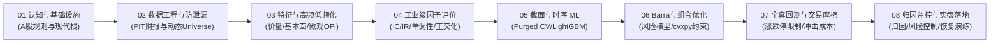

# 量化研究手册 (Quantitative Research Handbook)

<p align="center">
  <strong>现代 A 股量化投研与工程实战体系</strong><br>
  从数据工程、因子挖掘、机器学习到指增实盘闭环
</p>

<p align="center">
  
  
  
  
  
  
</p>

---

## 📌 项目概览

《量化研究手册》是一套面向中国 A 股市场的专业量化投研与工业级工程实现教程。全套教程涵盖 **8 大核心模块、31 讲深度专题**，配备完整的交互式 VitePress 网页文档，以及 **31 个开箱即用的独立 Python 实战脚本与全套离线单元测试**。

本项目面向具备 Python 编程基础、渴望系统建立**买方/私募机构级量化投资与全流程工程闭环**的研究员与开发者，彻底打通“数据清洗 $\rightarrow$ PIT 治理 $\rightarrow$ 特征工程 $\rightarrow$ 因子评估 $\rightarrow$ 机器学习 $\rightarrow$ 风险模型 $\rightarrow$ 组合优化 $\rightarrow$ 全真撮合 $\rightarrow$ 归因监控”的完整链路。

> [!IMPORTANT]
> **教学与实盘边界声明**：本项目所有示例均配备自包含的合成教学数据与契约测试，旨在验证工程架构逻辑与数学算法正确性。测试通过不代表真实交易收益证明，合成数据亦不代表真实市场行情。实盘接入前需另行对接合规行情柜台、交易接口与历史数据源。

---

## 🌟 核心特色与设计原则



1. **立足 A 股微观制度与实盘约束**
   - 深入建模 A 股特有的 **T+1 机制**、**涨跌停板（±10% / ±20% / ±30%）限制与不可成交逻辑**、**停牌与退市处理**、**红利送转与除权除息四时点账本**，以及印花税与市场冲击成本，拒绝脱离实盘的“玩具回测”。
2. **严密的 Point-in-Time (PIT) 数据治理架构**
   - 严格区分信息的**生效时间（`effective_date`）**与**策略可见时刻（`available_at`）**，支持财务报告多次更正历史回溯，从数据根源彻底消除前瞻偏差（Lookahead Bias）与幸存者偏差（Survivorship Bias）。
3. **拥抱现代高性能量化工程栈**
   - 全面采用 **Polars**（向量化表达式与高速并行）与 **DuckDB**（极速嵌入式分析）替代传统低效的 Pandas 单线程计算，支持千万级高频与截面数据秒级聚合。
4. **买方级量化机器学习与凸优化组合构建**
   - 严格落实 **Purged / Embargo K-Fold** 时序交叉验证；基于 `RankReturnCalibrator` 校准收益预测；构建 Barra 多因子结构化风险模型；使用 `cvxpy` 实施年化跟踪误差（TE）硬上限与换手冲击惩罚的凸优化求解。
5. **100% 离线自包含可复现验证**
   - 31 讲全部具备独立可执行源码及合成测试夹具（`fixtures.py`、`common.py`），无需购买商业数据即可一键执行全套自动化回归测试（`npm run test:examples`）。

---

## 🗺️ 课程全景体系与实战源码映射

本课程包含 8 大模块、31 讲，每讲均配套独立 Python 源码与契约验证：

| 模块 | 讲次 | 核心专题（教程链接） | 配套 Python 运行入口 | 依赖 Extra | 核心验证重点 |
| :--- | :---: | :--- | :--- | :---: | :--- |
| **M1 工程与认知** | 01 | [A 股量化生态与盈利模式全景](./module_01/01_ashare_quant_landscape.md) | `examples.lecture_01_comprehensive_cost_engine` | 基础 | 收益来源、对冲基差与成本敏感性测算 |
| | 02 | [量化回测的“四大死因”与防范心法](./module_01/02_backtest_pitfalls.md) | `examples.lecture_02_backtest_sanitizer` | 基础 | 前瞻偏差、幸存者偏差与 DSR 试验离散 |
| | 03 | [告别缓慢传统栈：Polars + DuckDB](./module_01/03_modern_quant_stack.md) | `examples.lecture_03_benchmark_massive` | 基础 | 百万行级基准测速与结果一致性校验 |
| | 04 | [A 股多源数据接入与本地落库实战](./module_01/04_data_acquisition_pipeline.md) | `examples.lecture_04_industrial_data_pipeline` | `data` (可选) | 增量数据湖、原子替换写盘与接口防御 |
| **M2 数据工程与 PIT** | 05 | [行情数据复权与动态股票池构建](./module_02/05_universe_filtering.md) | `examples.lecture_05_dynamic_universe_builder` | 基础 | 后复权计算、上市天数过滤与动态股票池 |
| | 06 | [Point-in-Time 财报无泄漏对齐](./module_02/06_pit_financials.md) | `examples.lecture_06_pit_financial_engine` | 基础 | 财报披露时刻、修订版本选择与防未来对齐 |
| | 07 | [行业分类演变与概念标签维护](./module_02/07_industry_classification.md) | `examples.lecture_07_industry_engine` | 基础 | 行业分类版本变更、未知类别与概念事件 |
| | 08 | [【实战】手写 A 股 PIT 检索引擎](./module_02/08_pit_engine_practice.md) | `examples.lecture_08_pit_engine_practice` | 基础 | 15:00 收盘截面查询与多表 PIT 综合装配 |
| **M3 特征与因子挖掘** | 09 | [经典量价因子体系与 Polars 加速](./module_03/09_price_volume_factors.md) | `examples.lecture_09_price_volume_factors` | 基础 | 复权量价特征、窗口滚动与表达式向量化 |
| | 10 | [基本面与分析师预期因子挖掘](./module_03/10_fundamental_factors.md) | `examples.lecture_10_fundamental_factors` | 基础 | 杜邦拆解、单季同比与 TTM 财务指标构建 |
| | 11 | [高频数据低频化特征工程（微观 OFI）](./module_03/11_high_freq_to_low_freq.md) | `examples.lecture_11_high_freq_to_low_freq` | 基础 | 订单失衡 OFI 三分支计算与日度截面聚合 |
| | 12 | [因子预处理工业级四步法](./module_03/12_factor_preprocessing_pipeline.md) | `examples.lecture_12_factor_preprocessing_pipeline` | 基础 | 去极值、标准化、缺失填充与 WLS 加权中性化 |
| | 13 | [因子正交化与共线性消除](./module_03/13_factor_orthogonalization.md) | `examples.lecture_13_factor_orthogonalization` | 基础 | 施密特/对称正交化、满秩截面与共线报错 |
| **M4 因子评估与验证** | 14 | [因子预测力核心指标（IC/Rank IC/ICIR）](./module_04/14_factor_ic_metrics.md) | `examples.lecture_14_factor_ic_metrics` | 基础 | 截面秩相关、时间序列 t 检验与 HAC 调整 |
| | 15 | [分层回测与单调性检验](./module_04/15_quantile_and_monotonicity.md) | `examples.lecture_15_quantile_and_monotonicity` | 基础 | 分位数多空对冲、单调性得分与最大回撤 |
| | 16 | [因子换手率与衰减曲线（Alpha Decay）](./module_04/16_turnover_and_alpha_decay.md) | `examples.lecture_16_turnover_and_alpha_decay` | 基础 | 因子自相关、边际 IC 半衰期与调仓情景估算 |
| | 17 | [【实战避坑】假因子的“打脸”排查案例](./module_04/17_fake_alpha_forensics.md) | `examples.lecture_17_fake_alpha_forensics` | 基础 | 市值暴露寄生、涨跌停伪胜率与未成交现金 |
| **M5 金融机器学习** | 18 | [金融时序交叉验证（CV）正确切法](./module_05/18_financial_cv_purging_embargo.md) | `examples.lecture_18_financial_cv_purging_embargo` | 基础 | Purged & Embargo 时序切分、双侧防泄漏 |
| | 19 | [表格级梯度提升树（LightGBM）实战](./module_05/19_lightgbm_catboost_ranking.md) | `examples.lecture_19_lightgbm_catboost_ranking` | `ml` | 标签成熟边界控制与 LambdaRank 截面排序 |
| | 20 | [特征重要性与可解释性（SHAP）](./module_05/20_shap_interpretability.md) | `examples.lecture_20_shap_interpretability` | `ml` | TreeSHAP 特征贡献度分解与加和自洽校验 |
| | 21 | [时序深度学习模型简析与边界](./module_05/21_deep_learning_boundaries.md) | `examples.lecture_21_deep_learning_boundaries` | `deep` | CNN/GRU 3D 时序张量训练与过拟合边界 |
| | 22 | [【实战】截面打分到全自动选股流水线](./module_05/22_ml_stock_selection_pipeline.md) | `examples.lecture_22_ml_stock_selection_pipeline` | `ml` | 样本外预测、收益校准器与目标权重生成 |
| **M6 风险模型与优化** | 23 | [Barra 结构化风险模型数学解构](./module_06/23_barra_risk_model_architecture.md) | `examples.lecture_23_barra_risk_model_architecture` | 基础 | WLS 因子收益估计、EWMA 协方差与特异风险收缩 |
| | 24 | [凸优化求解器（cvxpy）实战](./module_06/24_cvxpy_portfolio_optimization.md) | `examples.lecture_24_cvxpy_portfolio_optimization` | `optimization` | 行业/风格中性约束与年化跟踪误差（TE）二次约束 |
| | 25 | [换手率约束与交易成本惩罚项引入](./module_06/25_turnover_constraints_and_costs.md) | `examples.lecture_25_turnover_constraints_and_costs` | `optimization` | AUM/ADV 非线性冲击成本、换手软硬约束求解 |
| | 26 | [风险平价（Risk Parity）与 HRP](./module_06/26_risk_parity_and_hrp.md) | `examples.lecture_26_risk_parity_and_hrp` | 基础 | 等风险贡献（ERC）、分层聚类风险平价（HRP） |
| **M7 全真回测与执行** | 27 | [A 股回测引擎：向量化 vs 事件驱动](./module_07/27_vectorized_vs_event_driven_backtest.md) | `examples.lecture_27_vectorized_vs_event_driven_backtest` | 基础 | 次日开盘撮合、现金/应收/股份复式对账 |
| | 28 | [真实交易摩擦全真模拟](./module_07/28_transaction_friction_and_market_impact.md) | `examples.lecture_28_transaction_friction_and_market_impact` | 基础 | 佣金、过户费、印花税梯级计算与单边容量模型 |
| | 29 | [A 股特殊撮合规则代码级实现](./module_07/29_matching_rules_limits_suspensions.md) | `examples.lecture_29_matching_rules_limits_suspensions` | 基础 | 一字板限制、流动性占比、分红送转四时点演化 |
| **M8 绩效归因与监控** | 30 | [业绩归因实战：Beta 还是纯 Alpha？](./module_08/30_performance_attribution_brinson_barra.md) | `examples.lecture_30_performance_attribution_brinson_barra` | 基础 | 单期 Brinson 资产配置与 Barra 因子收益闭合归因 |
| | 31 | [实盘运行监控与风控预警看板](./module_08/31_live_monitoring_risk_dashboard.md) | `examples.lecture_31_live_monitoring_risk_dashboard` | 基础 | 相对净值跟踪、PSI 特征漂移、三级熔断滞回 |

---

## 🚀 快速上手指南

### 1. 前置环境要求
- **Python**：`>= 3.11, < 3.14`
- **Node.js**：`>= 18`
- **包管理器推荐**：[uv](https://docs.astral.sh/uv/)（现代极速 Python 包管理工具）与 `npm`

### 2. 本地启动 VitePress 交互式文档站点
```bash
# 1. 安装前端文档依赖
npm ci

# 2. 启动本地开发服务 (支持热更新，默认访问 http://localhost:5173)
npm run dev

# 3. 构建静态站点产物
npm run build

# 4. 本地预览构建产物
npm run preview
```

### 3. 配置 Python 运行环境并执行示例
本项目推荐使用 `uv` 进行可复现的环境锁管理（依赖已完全锁定于 `uv.lock`）。

```bash
# 基础依赖同步 (涵盖 25 个核心讲次)
uv sync --locked

# 全量依赖同步 (包含机器学习、深度学习与凸优化求解器)
uv sync --locked --extra ml --extra deep --extra optimization
```

运行单个实战示例模块（**必须在项目根目录下以 `-m` 模块模式运行**）：

```bash
# 运行基础示例（如第 8 讲：手写 A 股 PIT 检索引擎）
uv run --locked python -m examples.lecture_08_pit_engine_practice

# 运行机器学习选股流水线（第 22 讲，需 --extra ml）
uv run --locked --extra ml python -m examples.lecture_22_ml_stock_selection_pipeline

# 运行组合换手约束与凸优化（第 25 讲，需 --extra optimization）
uv run --locked --extra optimization python -m examples.lecture_25_turnover_constraints_and_costs

# 运行全真事件驱动回测引擎（第 27 讲）
uv run --locked python -m examples.lecture_27_vectorized_vs_event_driven_backtest

# 运行实盘监控看板与熔断预警（第 31 讲）
uv run --locked python -m examples.lecture_31_live_monitoring_risk_dashboard
```

> [!NOTE]
> **真实数据下载（可选）**：如需联网下载真实历史样本数据并写入本地数据湖 `data_lake/`，可使用 `--extra data`：
> ```bash
> uv sync --locked --extra data
> uv run --locked --extra data python -m examples.lecture_04_industrial_data_pipeline --fetch
> ```

### 4. 运行全量自动化测试套件
项目配备了完整的契约与数学逻辑单元测试，所有测试均使用内建合成数据，无需联网：

```bash
# 执行全套回归测试
npm run test:examples

# 或直接调用 uv 执行 unittest：
uv run --locked --extra ml --extra deep --extra optimization python -m unittest discover -s tests -v
```

测试套件分类说明：
- `tests/test_tutorial.py`：覆盖模块 01–02（数据湖原子写盘、前瞻偏差诊断、PIT 历史多版本检索与动态 Universe）。
- `tests/test_factor_modules.py`：覆盖模块 03–04（量价微观 OFI、WLS 加权正交、共线性拦截、IC/IR 统计、单调性与未成交现金排查）。
- `tests/test_ml_risk_modules.py`：覆盖模块 05–06（Purged CV 时间隔离、SHAP 贡献加和、Barra 风险模型、TE 约束凸优化求解）。
- `tests/test_execution_monitoring.py`：覆盖模块 07–08（复式记账守恒、开盘不可成交限制、红利送转四时点演化、Brinson 归因闭合与风控滞回熔断）。

---

## 📐 核心数据契约规范 (Point-in-Time Schema)

在模块 02（第 4–8 讲）中，项目定义了标准的工业级共享数据契约。后续所有特征挖掘、模型训练及回测撮合均严格遵照此契约执行：

### 1. 时间与时区标准
- **日期字段**：统一采用 `pl.Date`。
- **高频与事件时间戳**：必须统一采用 **Asia/Shanghai 本地无时区 `pl.Datetime`**。外部带时区时间必须先转换为上海时间再剔除时区，严禁直接丢弃 UTC 时区标识。
- **数值与状态**：价格、成交量为非负浮点或整型，状态一律采用布尔值 `Boolean`。

### 2. 七大核心表结构定义

| 表名 | 必需字段 (Primary Fields) | 字段语义与数据治理约束 |
| :--- | :--- | :--- |
| **交易日历** (`trading_calendar`) | `trade_date` | 经核验的交易所开市日，覆盖所有测试样本的上市与交易生命周期。 |
| **股票档案** (`stock_universe`) | `symbol, list_date, delist_date` | 必须包含历史退市股票（防幸存者偏差）；退市日为排除边界，未退市填 Date 空值。 |
| **行情表** (`daily_quote`) | `symbol, trade_date, open, high, low, close, close_hfq, volume, turnover` | OHLC 为原始未复权价；`close_hfq` 单独保存；成交量为股、成交额为元；唯一键 `(symbol, trade_date)`。 |
| **状态事件** (`status_event`) | `symbol, effective_date, available_at, is_st, is_delisting` | 包含历史 ST/退市整理期标记。追加式写入，支持历史追溯更正。 |
| **财报版本** (`financial_pit`) | `symbol, report_period, available_at, roe, net_profit_yoy` | 保留原始首次披露与后续历次更正版本；禁止同一次查询发生跨版本污染。 |
| **行业事件** (`industry_event`) | `symbol, taxonomy, industry_name, effective_date, available_at` | 记录行业分类变更历史；未映射股票单列为 `ind_未知`，严禁归入“综合”或随意填充。 |
| **基准快照** (`index_weight`) | `symbol, asof_date, weight, available_at` | 完整批次记录；`weight` 范围为 $[0, 1]$；观测时间不能倒填为编制日期。 |

### 3. 关键字段语义与业务约束
- **`effective_date` vs `available_at`**：
  - `effective_date` 为状态在现实中实际生效的业务日期。
  - `available_at` 为该信息经由上游数据源处理后、量化系统**真正可知并可下单**的客观物理时间。二者决不可混同。
- **上市交易天数规则**：
  - 上市交易天数按交易所开市日逐日计数，包含停牌期间，绝对不等于已下载行情记录行数。日历缺失立即报错。
- **动态池候选资格 (`in_universe`)**：
  - 仅表示该标的在此截面具备选股候选资格，不代表持仓被剔除后可以立即按最新价变现。
- **收盘截面 15:00 假设**：
  - PIT 引擎模拟盘后选股，假定 15:00 日线行情已形成。实际生产环境应计入数据入库延迟，所生成的信号最早于次日开盘时段执行。

---

## 🛡️ 各阶段实现边界与工程规范

### 1. 模块 01–02：数据工程与 PIT 检索引擎
- **版本选择规则**：财报查询时先按指定时刻过滤 `available_at <= query_time`，再取每个报告期当前可见的最新更正版本。更新历史年报不会导致当前季度财务指标退回旧期。
- **行情文件存储**：按 `(symbol, trade_date)` 保证主键唯一，写盘前严格检查有限值与 $Low \le Open, Close \le High$ 关系；年度 Parquet 文件采用临时文件原子替换（Atomic Rename），避免写入中断损坏数据。

### 2. 模块 03–04：特征工程与因子评估排查
- **收益率口径**：计算跨日收益必须使用后复权价格 `close_hfq`。财务同比增速不应冒充超预期 SUE 指标。
- **高频微观结构**：第 11 讲 OFI 严格采用本地无时区时间戳，不支持跨交易日平滑衔接；定时快照（Snapshot）不等于逐笔委托事件（Tick by Tick）。
- **正交化与中性化**：第 12 讲使用 NumPy 求解加权最小二乘（WLS），验证残差与约束向量的加权正交；第 13 讲正交化前对常数列与共线输入显式报错，杜绝虚假独立因子。
- **评估隔离**：第 14–15 讲标签必须由调用方按实际信号产生与成交时点对齐；第 17 讲排查伪 Alpha 时，未成交委托必须保留为现金，杜绝“一字涨停虚构暴利”。

### 3. 模块 05–06：金融机器学习与组合优化
- **时间隔离**：训练集与测试集必须施加 Purged 与 Embargo 机制；严禁使用未来信息拟合数据预处理变换器（如 Scaler/Imputer）。
- **收益校准**：树模型的排序输出（LambdaRank 分数）不能直接作为预期收益率输入给优化器，必须通过 `RankReturnCalibrator` 拟合成熟历史样本外的持有期超额收益。
- **Barra 与优化求解**：
  - 风险模型接收 $(T, N, K)$ 历史期初暴露面板与独立的当前期初暴露。
  - 优化器使用 `Clarabel` 凸优化求解器处理年化跟踪误差（TE）二次硬约束，求解后自动校验对偶残差与可行性。
- **进程隔离注意事项**：
  > [!WARNING]
  > 在已训练 LightGBM 的同一 Python 进程中执行 PyTorch 深度学习模型可能引发底层 OpenMP / 卷积线程池阻塞。第 21 讲与深度模型测试建议在独立进程中调用。

### 4. 模块 07–08：回测撮合、交易摩擦与归因监控
- **撮合纪律**：次日开盘撮合严禁读取当日最高价、最低价或收盘价。成交数量受当日成交量占比上限（ADV Limit）硬约束，未成交订单继续保留于持仓或资金中，当日成交股份严格受 T+1 锁定。
- **红利送转四时点演化**：股权登记日收盘锁定权益，除权除息日确认应收红利与锁定送股，红利发放日与送股上市日分别释放可用资金与可用股份，实现账本幂等。
- **归因闭合与风控滞回**：第 30 讲归因显式纳入现金留存与交易手续费，确保组合收益与归因分项严格等式闭合；第 31 讲风控监控实行滞回熔断机制，触发三级最高预警后禁止新开买单，且必须经显式条件复位并记录审批引用。

---

## 📂 项目目录结构

```text
quant-handbook/
├── .vitepress/              # VitePress 站点配置、Mermaid 插件与课程目录定义
│   ├── config.mts           # 站点全局配置与导航
│   └── curriculum.ts        # 8 大模块 31 讲大纲数据源
├── examples/                # 31 讲独立 Python 源码与公共工具库
│   ├── common.py            # 数据契约核验与通用断言
│   ├── fixtures.py          # 离线合成数据集生成器
│   ├── factor_utils.py      # 因子计算与加权中性化工具
│   ├── ml_utils.py          # 机器学习验证与收益校准工具
│   ├── portfolio_utils.py   # 组合优化与风险归因工具
│   ├── lecture_01_*.py      # 第 1 讲配套可运行示例
│   └── ...                  # 第 2 ~ 31 讲对应示例源码
├── module_01/ ~ module_08/  # 31 讲详细教程 Markdown 正文
├── tests/                   # 自动化回归测试套件 (100% 离线通过)
│   ├── test_tutorial.py             # 模块 01–02 单元测试
│   ├── test_factor_modules.py       # 模块 03–04 单元测试
│   ├── test_ml_risk_modules.py      # 模块 05–06 单元测试
│   └── test_execution_monitoring.py # 模块 07–08 单元测试
├── index.md                 # 网站主页
├── learning_path.md         # 学习路径、入门自测与逐章掌握标准
├── resources.md             # 公开权威书目、大学课程与官方规则导读
├── syllabus.md              # 完整课程体系全景大纲
├── package.json             # 前端与全局测试脚本定义
├── pyproject.toml           # Python 项目依赖与 Extras 配置
└── uv.lock                  # 依赖精确锁定文件
```

---

## 📚 延伸指南与参考资料

### 站内核心文档指南
- [学习路径与逐章掌握标准](./learning_path.md)：提供量化六大基础入门自测题、三条并行学习线以及逐讲交付证据核验清单。
- [公开资源与权威书目导读](./resources.md)：收录 MIT 18.06（线性代数）、Boyd 凸优化、上交所最新交易规则、AKShare 接口规范等核验清单。
- [课程全景体系大纲](./syllabus.md)：31 讲完整知识图谱、各讲设计思路与进阶目标。

### 官方文档与开源生态
- **现代工程栈**：[Polars 官方文档](https://docs.pola.rs/) · [DuckDB 官方文档](https://duckdb.org/) · [uv 包管理器](https://docs.astral.sh/uv/)
- **优化与建模**：[CVXPY 凸优化库](https://www.cvxpy.org/) · [LightGBM 文档](https://lightgbm.readthedocs.io/) · [SHAP 可解释性](https://shap.readthedocs.io/)
- **市场制度与基准**：[上交所交易规则](https://www.sse.com.cn/) · [中证指数计算与维护细则](https://www.csindex.com.cn/) · [AKShare 开源财经数据](https://akshare.akfamily.xyz/)

---

<p align="center">
  量化研究求真务实 · 严谨敬畏市场 · 构建稳健复利
</p>
