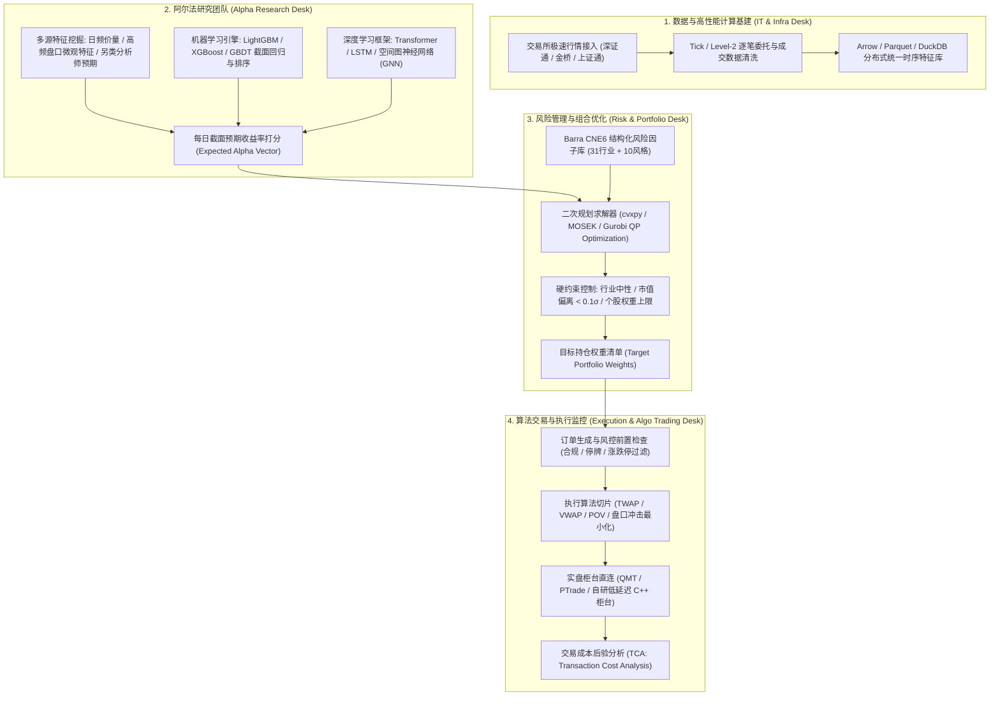
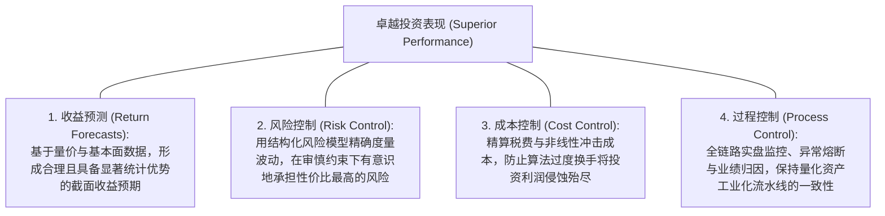
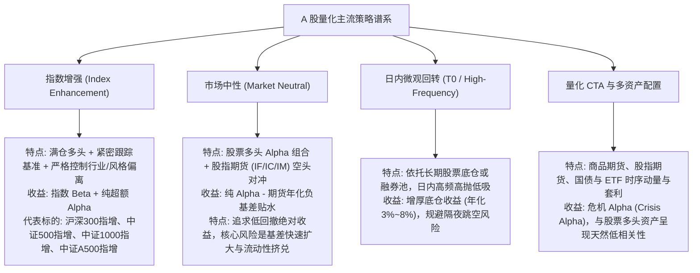

# 第 1 讲：A 股量化生态与盈利模式全景

> **本讲核心目标**：  
> 彻底破除“量化就是写技术指标自动买卖”的散户误区。系统掌握买方量化的底层收益拆解公式、主动管理基本法则（FLAM）、机构四大核心策略的运作闭环、买方私募典型组织架构与交易账户体系；深入推导 A 股特有的微观交易制度与期货负基差贴水对净超额的侵蚀；并系统梳理全球经典文献与成熟开源工具链。

---

## 1. 量化在 A 股赚什么钱？底层收益拆解与数学法则

在成熟的买方与对冲基金投资体系中，资产的收益并非来自神秘的“预测水晶球”，而是来自对**系统性风险因子的合理定价补偿**与**微观市场非理性定价偏差的系统性捕捉**。

### 1.1 资产收益的四重结构拆解

根据套利定价理论（APT）与 MSCI Barra 结构化风险框架，任意量化投资组合在交易日 $t$ 的总收益 $R_{p,t}$ 都可以精确展开为如下四重结构：

$$R_{p,t} = \underbrace{\beta_m R_{m,t}}_{\text{Market Beta}} + \underbrace{\sum_{k=1}^K X_{p,k,t} f_{k,t}}_{\text{Style \& Industry Premiums}} + \underbrace{\alpha_{p,t}}_{\text{Pure Alpha}} - \underbrace{\text{Cost}_{p,t}}_{\text{Friction \& Slippage}}$$

```
买方量化组合收益四重拆解体系
├── 1. Market Beta (市场基准收益)
│     ├── 沪深300 / 中证500 / 中证1000 / 中证A500 等宽基指数的系统性 beta
│     └── 特点：被动承受全市场系统性牛熊波动，不体现投资经理的主动投研阿尔法
├── 2. Style & Industry Premiums (风格与行业风险溢价 - 伪 Alpha 集中区)
│     ├── 行业配置暴露：超配电子/医药/计算机板块带来的行业 Beta 驱动
│     ├── 市值风格暴露：长期暴露在小微盘股 (Micro-cap) 上的流动性补偿溢价
│     └── 传统基本面风格：价值 (Value)、动量 (Momentum)、盈利质量 (Quality)、低估值 (BP)
├── 3. Pure Alpha (特异质纯超额收益 - 买方量化核心壁垒)
│     ├── 经过行业完全中性化、市值严格中性化剔除后的纯截面选股能力
│     └── 来源：非线性高阶量价微观特征、深度特征交叉、另类分析师行为预期、高频订单流失衡
└── 4. Execution Friction (交易与持有摩擦 - 吞噬收益的现实黑洞)
      ├── 显性摩擦：证券交易印花税（卖方 0.05%）、券商佣金、证券过户费
      ├── 隐性摩擦：买卖盘口买卖价差（Bid-Ask Spread）、流动性冲击滑点（Square-root Market Impact）
      └── 衍生品对冲成本：股指期货负基差（贴水 / Basis Discount）年化展期损耗
```

### 1.2 主动管理基本法则（The Fundamental Law of Active Management）

买方量化的超额收益能够做到多高？收益预测能力如何转化为最终的组合表现？Richard Grinold 与 Ronald Kahn 在其量化投资圣经 *Active Portfolio Management (1999)* 中提出了著名的**主动管理基本法则（FLAM）**：

$$\text{IR} \approx \text{IC} \times \sqrt{N} \times \text{TC}$$

其中：
- **$\text{IR}$ (Information Ratio，信息比率)**：衡量投资组合相对基准的主动风险调整后超额收益，$\text{IR} = \frac{\text{Annualized Alpha}}{\text{Tracking Error}}$。在 A 股买方机构中，扣除费用后 $\text{IR} > 1.5$ 属于优秀，$\text{IR} > 2.5$ 属于顶尖。
- **$\text{IC}$ (Information Coefficient，信息系数)**：预测打分与未来真实截面收益率的秩相关系数（Rank IC）。在股票日频与周频预测中，单个优秀有效因子的 Rank IC 通常仅在 **$0.03 \sim 0.06$** 之间。量化交易绝非靠百分之百胜率，而是靠“微弱优势在海量重复博弈中的统计积累”。
- **$N$ (Breadth，投资广度)**：投资经理一年内所做出的**互相独立的有效投资决策次数**。
  - 若在**沪深 300** 范围内选股（300 只股票），即使每周换仓一次（一年约 50 次），广度上限约为 $300 \times 50 = 15,000$。
  - 若在**中证 1000** 范围内选股（1000 只股票），周频广度即跃升至 $1000 \times 50 = 50,000$。
  - 这从数学底层解释了：**为什么国内量化私募的主战场会从中证 500 持续下沉到中证 1000 和中证 2000——股票池的广度 $N$ 越大，容纳的独立博弈机会越多，组合能够实现的 $\text{IR}$ 上限就越高！**
- **$\text{TC}$ (Transfer Coefficient，约束转化系数)**：衡量预测信号在转化为真实投资组合时受到的约束损耗（取值区间 $[0, 1]$）。
  - 在完全无摩擦、允许自由借券做空的理想市场中，$\text{TC} \approx 1.0$。
  - 在 A 股市场，由于**做空受限（单边多头限制）**、**个股涨跌停导致无法成交**、**严格的行业与个股权重上限**，$\text{TC}$ 通常会骤降至 **$0.3 \sim 0.6$**。这意味着超过一半的原始预测信号在组合构建环节被现实约束消耗掉了。

### 1.3 警惕“微盘股陷阱”与伪 Alpha 的破灭

2021 年至 2023 年，国内部分量化产品展示出高达 3.5 以上的虚高夏普比率（Sharpe Ratio）。然而事后拆解证实，其超额收益的 80% 以上并非来自真正的选股 Alpha，而是**重度暴露在全市场市值最小的 400 只微盘股上**。

- **微盘风格溢价的本质**：这是承担了极高流动性挤兑风险所获得的流动性风险溢价（Liquidity Risk Premium），一旦全市场遭遇宏观流动性紧缩或监管政策转向，微盘股流动性会瞬间冻结。
- **2024 年初流动性踩踏复盘**：2024 年 1 月至 2 月，当微盘股遭遇流动性挤兑时，由于连续无量跌停无法平仓，大量重仓微盘股的量化产品在短短两周内净值大幅下撤 30%~50%，数年积累的“虚假超额”瞬间化为乌有。
- **机构级铁律**：真正的机构量化研究，第一步必须建立**严格的风格与行业中性化基准**。凡是未经过市值与行业中性化检验的超额收益，一律视为“伪 Alpha”。

---

## 2. 买方量化机构内部运作架构与账户体系

要完整掌握量化交易，必须理解百亿级量化买方机构（如九坤、幻方、灵均、明汯等）在现实中是如何分工与协作的。



### 2.1 买方量化四要素：BARRA 卓越表现四棱锥（Performance Pyramid）
根据 **BARRA US-E3 风险手册第 1 章** 与 **华泰证券多因子系列之一**，卓越的量化投资表现（Superior Performance）绝非仅仅是单一的收益率数字，而是稳固构建在底面四大不可或缺的支柱之上：



### 2.2 四大职能团队的权责边界
1. **IT 与基建团队（Quant Infra）**：负责行情源接收、底层低延迟 C++ 接入网关、GPU 异构算力集群调度以及分布式时序数据库管理。
2. **阿尔法研究团队（Alpha Research）**：核心考核指标是信号的**纯 IC、IC_IR、单调性与换手衰减半衰期**。阿尔法研究员不负责直接决定买卖多少股，只输出全市场股票的截面预期收益率打分。
3. **风险管理与组合优化团队（Portfolio Management & Risk）**：负责使用 Barra 结构化风险模型和二次规划求解器，在控制行业偏离、市值偏离、跟踪误差（TE）与换手率的前提下，求解出最优的目标持仓权重。
4. **算法执行团队（Execution Trading）**：负责将理论目标持仓以最小的市场冲击成本（Slippage & Market Impact）在连续交易时段内完成换仓。

### 2.3 机构交易账户结构与衍生品工具
- **普通证券账户 vs 信用账户（两融）**：普通量化指增产品使用托管在券商的普通证券账户；涉及融券做空或融券 T0 策略时需要使用信用账户。
- **DMA 业务（Direct Market Access）**：过去私募通过券商自营交易柜台直连（通常带有 2~4 倍杠杆及收益互换 TRS 结构）开展市场中性策略。2024 年监管新规后，DMA 业务杠杆受到严格压降，促使策略向平层中性或公募指增转移。
- **雪球期权（Snowball Options）与基差的联动**：券商发行的挂钩中证 500 / 中证 1000 的自动敲入敲出结构（雪球期权），其对冲端是在股指期货（IC/IM）上进行高抛低吸的动态 Delta 对冲。当市场急跌触发大面积“敲入点位”时，券商对冲盘需要迅速平掉多头空仓，从而引发期指急剧贴水放大，对市场中性策略产生巨大的基差损耗冲击。

---

## 3. A 股四大主流机构量化策略运作机制



### 3.1 指数增强策略（Index Enhancement）——国内百亿私募基石

指数增强策略是目前国内量化买方资产管理规模（AUM）最大、资金承载力最高的绝对主力品种。

#### 核心运作原则：
1. **高仓位配置**：股票资产仓位长年维持在 95%~100%，不进行主观大势择时。
2. **基准对齐与跟踪误差约束（Tracking Error, TE）**：
   - 策略紧密跟踪宽基指数（如沪深 300、中证 500、中证 1000）。
   - 设定严格的行业偏离度约束（如任意申万一级行业权重相对基准偏离不超过 $\pm 1.5\%$）。
   - 设定严格的市值暴露约束（如组合平均对数流通市值相对基准的偏离不超过 $0.1$ 个标准差）。
3. **超额收益评价双核心指标**：
   - **跟踪误差（Tracking Error, TE）**：衡量相对基准偏离的波动率：
     $$\text{TE} = \sqrt{\frac{252}{T-1} \sum_{t=1}^T (R_{p,t} - R_{b,t} - \overline{\alpha})^2}$$
   - **信息比率（Information Ratio, IR）**：衡量每承担一单位主动跟踪风险所获得的超额收益：
     $$\text{IR} = \frac{\overline{\alpha}_{annual}}{\text{TE}}$$

#### 宽基指数指增挖掘难度与容量全景：
| 标的指数 | 指数代码 | 成分股市值中位数 | 散户交易占比 | 定价偏离度 | 典型年化超额区间 | 策略资金容量 |
| :--- | :--- | :--- | :--- | :--- | :--- | :--- |
| **沪深 300** | 000300.SH | 约 1,200 亿元 | 极低（险资/公募/外资为主） | 极低（定价极其充分） | 5% ~ 10% | 极大 (>1,500 亿) |
| **中证 500** | 000905.SH | 约 220 亿元 | 中等 | 中等 | 8% ~ 14% | 大 (约 600 亿) |
| **中证 1000** | 000852.SH | 约 95 亿元 | 较高（换手活跃） | 较高 | 12% ~ 22% | 适中 (约 200~300 亿) |
| **中证 2000** | 932000.CSI | 约 35 亿元 | 极高 | 很高（高换手博弈） | 18% ~ 30% | 较小 (约 50~100 亿) |
| **中证 A500** | 000510.CSI | 约 350 亿元 | 中等 | 适中（行业均衡配置） | 8% ~ 15% | 快速扩容中 |

---

### 3.2 市场中性对冲策略（Market Neutral）与对冲成本之殇

市场中性策略旨在剥离全市场 Beta，不论上证指数涨到 5000 点还是跌到 2000 点，只赚取多头股票相对空头基准的超额差额。

#### 策略数学原理：
- 资金规模：$V$
- **多头组合（Long Leg）**：买入价值 $V$ 的量化选股组合，收益率为 $R_{long} = R_{index} + \alpha$。
- **空头组合（Short Leg）**：在中金所卖空对应名义市值的股指期货合约（如中证 1000 期货 IM，中证 500 期货 IC），空头收益率为 $-R_{futures}$。
- **策略理论组合收益**：
  $$R_{neutral} = R_{long} - R_{futures} = (R_{index} + \alpha) - (R_{index} - \text{Basis Discount}) = \alpha - \text{Basis Discount}$$

#### A 股致命痛点：期货常年负基差贴水（Basis Discount）
在境外成熟市场，借券做空机制完善，股指期货通常处于轻微升水（Contango）或微幅贴水。而在 A 股：
1. **做空机制严重不对称**：个股融券券源稀缺且利息高昂（年化 6%~10%），绝大部分机构（量化私募、公募专户、券商自营）必须集中涌入中金所开空单对冲。
2. **极端抛压导致期货价格常年大幅低于现货指数价格（$F_t < S_t$）**。
3. **贴水对冲成本测算**：
   - 设某日中证 1000 现货指数为 $S = 6000$ 点，季月期货合约价格为 $F = 5880$ 点，剩余到期日为 90 天。
   - 年化贴水率计算公式：
     $$\text{Annualized Basis} = \frac{S - F}{S} \times \frac{365}{\text{Days to Expiration}} = \frac{6000 - 5880}{6000} \times \frac{365}{90} \approx 8.11\%$$
   - **这表明：空头端在持有到期日将必然承受 8.11% 的被动期现收敛损耗！**
   - **残酷现实**：如果你的选股引擎一年只有 8% 的毛 Alpha，在扣除 7%~8% 的贴水损耗与交易摩擦后，中性策略的净收益将完全归零。

---

### 3.3 日内微观回转交易（T0 策略）

由于 A 股实行 T+1 制度（当日买入股票当日不可卖出），高频交易者无法像美股市场那样进行无限次日内往返撮合。国内量化界演化出了两种独特的 T0 模式：

1. **底仓 T0（Inventory T0）**：
   - 前提：指增或长线账户长期持有 10,000 股某股票。
   - 操作：日内基于微观盘口订单流不平衡（Order Flow Imbalance, OFI），在早盘快速冲高时卖出 3,000 股昨仓；在午后恐慌跳水时以更低价格接回 3,000 股新仓。
   - 结果：收盘时股票总持仓仍为 10,000 股，但账面锁定了日内高抛低吸的无隔夜风险现金收益。
2. **融券 T0（Margin T0）**：
   - 借入券商的专项融券配额池，早盘卖空，尾盘买入现货还券。

---

## 4. A 股特有交易制度与量化实盘“物理红线”

在编写任何 A 股实盘与回测代码前，必须将以下制度规则作为不可逾越的物理定律编码到系统中：

```mermaid
timeline
    title A 股交易日全天竞价时间轴与申报规则
    09:15 - 09:20 : 开盘集合竞价 (允许申报，允许撤单，假单欺诈集中区)
    09:20 - 09:25 : 开盘集合竞价 (允许申报，严禁撤单，真实撮合出开盘价)
    09:25 - 09:30 : 开盘静默期 (接收报单，不撮合)
    09:30 - 11:30 : 上午连续竞价 (价格优先 / 时间优先 / 2%价格笼子限制)
    13:00 - 14:57 : 下午连续竞价 (价格优先 / 时间优先 / 2%价格笼子限制)
    14:57 - 15:00 : 收盘集合竞价 (严禁撤单，最终撮合产生收盘价)
```

### 4.1 申报价格笼子机制（Price Limit Bands）
A 股主板与双创板在连续竞价期间均实施“申报价格笼子”限制：
- **买入申报**：申报价格不得高于买入基准价格的 $102\%$ 或基准价格加 0.10 元（以较高者为准）。
- **卖出申报**：申报价格不得低于卖出基准价格的 $98\%$ 或基准价格减 0.10 元（以较低者为准）。
- **对量化算法的影响**：算法交易程序严禁直接以远高于市价的价格市价扫盘，超出笼子范围的报单将被交易所主机判定为**废单**！

### 4.2 涨跌停板与流动性完全冻结
- **主板股票**：前一日收盘价的 $\pm 10\%$（ST 股票为 $\pm 5\%$）。
- **双创板（创业板/科创板）**：$\pm 20\%$。
- **北交所**：$\pm 30\%$。
- **量化回测物理定律**：
  - **封死涨停板**（买一挂单巨量封单但无卖单成交）：**严禁撮合任何买入订单！**
  - **封死跌停板**（卖一挂单巨量封单无买盘承接）：**严禁撮合任何卖出订单，持仓强制被动顺延至下一交易日！**

### 4.3 市场冲击成本与平方根定律（Square-Root Law）
学术界与业界（Bouchaud 2004, Almgren 2005）公认的市场冲击成本遵循经典的平方根定律：

$$I(Q) = Y \cdot \sigma \cdot \sqrt{\frac{Q}{V}}$$

其中 $Q$ 为算法拆单委托量，$V$ 为该股票全天平均成交量，$\sigma$ 为日波动率，$Y$ 为市场常数。该定律表明：**资金规模越大、换手率越高，冲击成本将以订单占比的平方根急剧上升，从而对大资金策略的容量设定了硬性天花板。**

### 4.4 真实交易摩擦全成本参数矩阵
| 费用科目 | 计费基准 | 适用方 | 现行费率标准 | 备注 |
| :--- | :--- | :--- | :--- | :--- |
| **证券交易印花税** | 成交金额 | 仅卖方收取 | **0.05% (5 bps)** | 2023年8月28日起由 0.1% 减半征收 |
| **券商交易佣金** | 成交金额 | 买卖双边收取 | **0.01% ~ 0.02% (1~2 bps)** | 机构量化大客户通常可协商至万1左右 |
| **证券过户费** | 成交金额 | 买卖双边收取 | **0.001% (0.1 bps)** | 中国结算标准费率 |
| **买卖盘口买卖价差** | 成交金额 | 买卖双边收取 | **0.02% ~ 0.05% (2~5 bps)** | 取决于股票流动性与盘口厚度 |
| **流动性冲击滑点** | 成交金额 | 买卖双边收取 | **0.02% ~ 0.08% (2~8 bps)** | 与单笔订单占成交量比例正相关 |
| **股指期货贴水损耗** | 期货名义本金 | 空头持有方 | **年化 5% ~ 10%** | 中性策略空头端必须承担的展期损耗 |

---

## 5. 成熟开源工具生态与里程碑文献导读

量化投资是一门高度工程化与科学化的交叉学科，切忌闭门造车重复发明轮子。以下是全球与国内业界公认的顶尖开源项目与必读经典论文。

### 5.1 生产级量化开源项目推荐

| 项目名称 | 开源组织 / 作者 | 适用环节 | 核心特色与架构定位 |
| :--- | :--- | :--- | :--- |
| **Qlib** | 微软亚洲研究院 (MSRA) | AI 量化全流程 | 专为 AI 投资设计的端到端平台，内置 Alpha158 因子库、LightGBM/Transformer 模型与滚动回测评估。 |
| **Backtrader** | Daniel Rodriguez | 事件驱动回测 | 纯 Python 事件驱动回测框架，支持多资产混搭、灵活的订单生命周期管理与图表可视化。 |
| **cvxpy** | Stanford 凸优化团队 | 组合优化求解 | 业界事实标准的凸优化建模库，支持二次规划（QP）、锥规划（SOCP），无缝对接 OSQP、SCS、Gurobi、MOSEK 求解器。 |
| **Alphalens-reloaded** | Quantopian / Stefan Jansen 维护 | 因子特征检验 | 标准化因子性能分析库，快速输出信息系数（IC）、IC 衰减半衰期、分层收益分位数与换手率 Tearsheet。 |
| **Pyfolio-reloaded** | Quantopian / Stefan Jansen 维护 | 业绩与风险归因 | 全球机构最常用的组合业绩分析工具，提供夏普比率、最大回撤、Calmar 比率、贝塔暴露与贝叶斯风险分析。 |
| **DuckDB + Polars** | DuckDB Labs / Ritchie Vink | 高性能数据处理 | 现代列式内存计算与嵌入式 OLAP 引擎，单机数十秒高效处理数亿行 A 股逐笔行情，性能彻底超越传统 Pandas。 |
| **AKShare / BaoStock** | 开源社区 | 免费公开行情获取 | 覆盖 A 股历史日线、财务报表、指数成分股与宏观指标的开箱即用开源数据接口库。 |

### 5.2 里程碑经典学术文献（量化买方必读清单）

1. **主动投资管理圣经**：  
   Grinold, R. C., & Kahn, R. N. (1999). *Active Portfolio Management: A Quantitative Approach for Producing Superior Returns and Controlling Risk*. McGraw-Hill.  
   *核心贡献*：正式提出主动管理基本法则（FLAM: $\text{IR} = \text{IC} \times \sqrt{N}$），奠定了现代多因子与超额收益分解的理论基石。
2. **多因子定价理论发轫**：  
   Fama, E. F., & French, K. R. (1993). *Common risk factors in the returns on stocks and bonds*. Journal of Financial Economics.  
   *核心贡献*：提出经典的 Fama-French 三因子模型（Market, SMB, HML），开创了资产定价中从单一 CAPM 走向系统性风险因子的先河。
3. **动量因子的确立**：  
   Carhart, M. M. (1997). *On persistence in mutual fund performance*. The Journal of Finance.  
   *核心贡献*：在三因子模型中正式加入动量因子（UMD/Momentum），构建了影响学术界与工业界数十年的 Carhart 四因子模型。
4. **市场微观结构与冲击成本**：  
   Bouchaud, J. P., Gefen, Y., Potters, M., & Wyart, M. (2004). *Fluctuations and response in financial markets: the subtle nature of ‘random’ price changes*. Quantitative Finance.  
   Almgren, R., Thum, C., Hauptmann, E., & Li, H. (2005). *Direct estimation of equity market impact*. Risk.  
   *核心贡献*：从物理学统计力学与海量实盘订单流出发，确立了市场冲击成本遵循订单规模平方根规律（Square-Root Law）。
5. **金融机器学习方法论**：  
   López de Prado, M. (2018). *Advances in Financial Machine Learning*. John Wiley & Sons.  
   *核心贡献*：系统揭露了量化金融中伪回测的七大陷阱，提出了三重障碍法（Triple Barrier Method）、去重标签法与组合交叉验证（PurgedGroupTimeSeriesSplit）。

---

## 6. 动手实操：全真交易摩擦、FLAM 理论测算与净 Alpha 敏感性仿真器

下面的 Python 代码严格遵循机构级买方规范，同时封装了**主动管理基本法则（FLAM）理论超额测算**、**单次全真换仓摩擦精细分解**以及**期货贴水多维侵蚀敏感性分析**。

在项目根目录运行 `python3 -m tutorial.examples.lecture_01_comprehensive_cost_engine` 或直接执行脚本。依赖安装、共享模块和数据契约见[项目说明](../README.md)。

<<< @/examples/lecture_01_comprehensive_cost_engine.py

### 运行输出深度解析与机构实盘启示：
```
===========================================================================
0. 主动管理基本法则 (FLAM) 理论超额测算 (以中证1000周频调仓为例)
===========================================================================
  rank_ic                      : 0.0450
  universe_size                : 1000
  annual_decisions             : 50000
  transfer_coefficient_tc      : 0.4500
  active_risk_te               : 0.0800
  theoretical_ir               : 4.5280
  theoretical_gross_alpha      : 0.3622
```
1. **理论与现实的巨大鸿沟**：
   - 假定研发人员挖掘出一个截面 Rank IC 为 **0.045** 的优秀多因子特征，在中证 1000（1,000 只标的）周频调仓（年决策广度 $N = 50,000$ 次）下，若约束转化系数 $\text{TC} = 0.45$、主动跟踪误差 $\text{TE} = 8\%$，理论上的毛超额（Gross Alpha）可达惊人的 **36.22%**（理论 IR 达 4.53）。
2. **交易换手摩擦的巨大杀伤力**：
   - 单次完整换仓（卖出老仓买入新仓）的直接摩擦成本为 **16.2 bps（万分之 16.2）**。
   - 当单边年化换手率为 **35 倍**（在 A 股日级调仓中属于中等频率）时，一年的直接交易摩擦将高达 **$35 \times 0.00162 = 5.67\%$**！
   - 理论超额从 36.22% 被砍至 **30.55%**。
3. **市场中性策略的生死线**：
   - 如果将相同 Alpha 引擎用中证 1000 期指（IM）对冲做成绝对收益中性策略，扣除 7.5% 的年化负基差贴水后，净收益进一步下降到 **23.05%**。
   - 在毛超额较低（例如 12%）的成熟宽基（如沪深 300）中，如果年化换手达到 40 倍，交易摩擦与基差将吞噬掉 **54% 到 81%** 的总收益！
   - **核心启示**：顶尖量化研发的真正壁垒，绝非仅仅追求极高的瞬时单点 IC，而是**在保持有效 IC 的同时，寻找信息衰减半衰期更长、低换手率、低冲击滑点的高容量信号**！

---

## 7. 本讲小结与课后实战作业

### 核心知识图谱梳理：
1. **收益本质**：$\text{总收益} = \text{Beta} + \text{风格/行业溢价} + \text{纯特异质 Alpha} - \text{摩擦损耗}$。严禁将微盘股市值暴露等同于 Alpha。
2. **基本法则**：主动管理基本法则 $\text{IR} \approx \text{IC} \times \sqrt{N} \times \text{TC}$ 揭示了投资广度 $N$ 与转化系数 $\text{TC}$ 对最终超额的决定性作用。
3. **策略双子星**：指数增强是指增跑赢基准的 Beta+Alpha 游戏；市场中性是用股指期货剥离 Beta 换取绝对收益，但必须时刻警惕负基差贴水的无情侵蚀。
4. **物理红线**：深刻理解 A 股 T+1、申报价格笼子与涨跌停机制，是编写真实有效实盘与回测策略的根本物理前提。

### 课后动手实训：
> **实操任务**：  
> 1. 打开并运行 `lecture_01_comprehensive_cost_engine.py` 脚本。
> 2. 将 `transfer_coefficient`（约束转化系数）从 0.45 分别调整为 0.25（极度严格的行业权重偏离限制与停牌流动性冻结）和 0.65（较为宽松的换手与权重约束），观察理论超额与理论 IR 的变化。
> 3. 将单边滑点参数从“万分之 4”调整为极端流动性枯竭下的“千分之 1.5”，观察并记录此时策略净 Alpha 发生转折为负数的临界年化换手率是多少？
