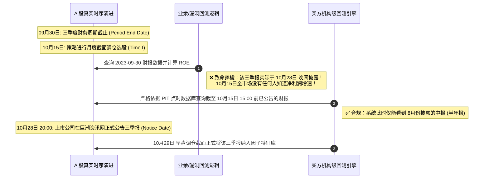

# 第 2 讲：量化回测的“四大死因”与防范心法

> **本讲核心目标**：  
> 深入解剖导致量化策略在“实盘即爆雷”的四大微观机制：**前瞻偏差（未来函数 / Look-ahead Bias）**、**幸存者偏差（Survivorship Bias）**、**不可成交撮合陷阱（Unexecutable Orders）**与**多重测试过拟合（P-Hacking & Overfitting）**。通过数学形式化推导、A 股真实历史案例（退市股与封板机制）、Marcos López de Prado 的 Deflated Sharpe Ratio（DSR）与概率夏普比率（PSR）数学推导，构建坚不可摧的买方防御型回测系统。

---

## 1. 致命死因一：前瞻偏差（Look-ahead / Future Bias）

前瞻偏差指在计算历史某个时点 $t$ 的因子特征、筛选标的或生成交易订单时，**在信息论与因果时序上使用了在 $t$ 时刻尚不可知的未来信息**。

### 1.1 形式化数学定义与因果破缺

设真实金融市场的信息生成过程为带过滤的概率空间 $(\Omega, \mathcal{F}, \{\mathcal{F}_t\}_{t \ge 0}, \mathbb{P})$，其中 $\mathcal{F}_t = \sigma(X_s : s \le t)$ 代表在时刻 $t$ 之前全市场所有已经公开发生的信息代数流（包含成交快照、交易所公告、宏观数据等）。

- **合规量化决策**：在时刻 $t$ 做出的目标持仓权重向量 $w_t$ 必须是 $\mathcal{F}_t$-可测的（即 $w_t \in \mathcal{F}_t$）。
- **前瞻偏差注入**：只要存在任意微小的分量，使得决策函数 $w_t$ 依赖于未来的信息子集 $\mathcal{F}_{t + \Delta t} (\Delta t > 0)$，整个回测系统的鞅性质（Martingale Property）将瞬间破裂！所有基于该回测计算的超额收益、t 统计量、夏普比率全部蜕变为毫无统计学意义的虚假数字。



### 1.2 A 股中最隐蔽的四种未来函数形态

#### 形态 A：财报时间戳三元错位（Period Date vs Notice Date vs Revision Date）
上市公司财务报表包含三个完全不同的核心时间戳：
1. **报告期截止日（Period End Date）**：如一季报为 `03-31`，中报为 `06-30`，三季报为 `09-30`，年报为 `12-31`。
2. **实际披露公告日（Notice Date）**：上市公司将财报正式披露给公众的日期。A 股规定三季报必须在 10 月 31 日前披露，大量公司集中在 10 月 25 日至 10 月 30 日披露。
3. **更正公告日（Revision Date）**：财报发布后若被监管问询或审计发现错报，发布修正案的日期。
- **业余代码**：`df.filter(pl.col("report_date") == "2023-09-30")`，在 10 月初就根据“净利润同比暴增 200%”买入该股，这在现实中是超光速信息穿梭。
- **买方解决方案**：必须使用**点时财务数据库（Point-in-Time, PIT）**，查询条件强制满足：
  $$\text{Query Condition}: \text{report\_period} = \text{'2023-09-30'} \quad \text{AND} \quad \text{publish\_time} < t_{\text{decision}}$$

#### 形态 B：日内价量极值的时序倒错（High / Low Causality Inversion）
在日线回测中，许多人写出如下逻辑：
```python
# ❌ 典型日内未来函数
if today_low <= limit_buy_price:
    execute_buy(limit_buy_price)
```
- **真实撮合现实**：当天到底是先创出最高价、先创出最低价，还是开盘直接闪崩跌停？只凭日线的 OHLC 四个数字，根本无法还原日内的价格路径（Intraday Path Dependency）。在未获知分时成交前，假设自己能在最低点挂单成交无异于开天眼。

#### 形态 C：全局统计量数据外泄（Global Normalization Leakage）
```python
# ❌ 全局泄漏：直接在全样本上做标准化
from sklearn.preprocessing import StandardScaler
scaler = StandardScaler()
X_scaled = scaler.fit_transform(X_all) # X_all 包含了 2018 到 2025 年的全部数据
```
- 在计算 2018 年的数据时，均值 $\mu$ 和方差 $\sigma$ 中已经融合了 2024 年的市场分布信息。
- **合规做法**：必须使用**滚动时间窗口（Rolling Window）**或**扩张窗口（Expanding Window）**仅基于历史样本统计标准化参数！

#### 形态 D：宽基指数成分股穿越（Constituent Rebalancing Leakage）
- 沪深 300、中证 500、中证 1000 等宽基指数每半年调整一次成分股（每年 6 月和 12 月中旬生效）。
- 如果你拿**今天**的中证 1000 成分股列表，去跑 2020 年的策略回测：今天能留在指数里的公司，大部分是过去 4 年表现优异、未发生毁灭性暴雷的优质企业；而 2020 年原本在成分股里、后来持续暴跌剔除甚至退市的差生，被你的回测完美过滤掉了。

---

## 2. 致命死因二：幸存者偏差（Survivorship Bias）

如果你的历史数据仓库中**只包含当前仍在正常交易的股票**，回测系统就默认赋予了策略“能够提前识别并自动避开所有未来会退市暴雷股票”的超自然能力。

```
幸存者偏差对策略收益的扭曲模型
全市场 2018 历史全集 (约 4,000 只)
├── 持续健康经营股 (约 3,600 只) ── 活到了 2026 年 (历史表现基准)
└── 遭遇重大财务造假、连续一字跌停后强制退市 (400+ 只)
      ├── 典型代表：退市康得、退市博天、乐视网、康美药业、退市华泽...
      └── 亏损轨迹：高位停牌 ──> 连续 15-30 个一字跌停 ──> 跌幅超 95% ──> 摘牌清退归零

若回测系统剔除了这 400 多只退市股：
回测组合天然免疫了所有 -95% 的黑天鹅巨幅亏损，策略年化超额虚增 5%~10%！
```

### 2.1 ST 警示制度与流动性黑洞
- **ST / *ST 风险警示**：当上市公司连续亏损或存在重大财务造假违规时，交易所对其施加风险警示，日涨跌幅限制缩减为 $\pm 5\%$。
- **机构股票池底线**：机构股票池有严格的“入库限制”，**严禁买入风险警示股；若已有持仓遭遇 ST，必须在打开跌停板后第一时间平仓**。
- 如果回测不动态跟踪个股被 ST 的历史变迁，就会在个股断崖暴跌中误将其当成“严重超跌的便宜反转股”大举买入，实盘必死无疑。

---

## 3. 致命死因三：不可成交撮合陷阱（Unexecutable Orders）

任何量化回测的底层核心是**撮合引擎（Matching Engine）**。业余回测与买方回测的分水岭，就在于对极端行情下订单成交可能性的建模严谨度。

| 撮合陷阱类型 | 业余回测中的幼稚假设 | A 股微观结构撮合现实 | 实盘导致的灾难后果 |
| :--- | :--- | :--- | :--- |
| **一字涨停买入** | 只要当天收盘涨幅 10%，模型在开盘以 `Open` 价格全额撮合成交 | 集合竞价数十万手封单封死在买一，散户和中低频量化排单在队尾，**实际成交概率严格为 0** | “涨停打板策略”回测年化收益 300%、夏普 5.0；实盘上线全部挂单失败，一笔都买不进去！ |
| **封死跌停卖出** | 策略触发止损，在跌停板按 `Close` 价格瞬间平仓出场 | 跌停板买盘全部撤单，买一为 0，卖一积压巨额抛单。**全天几乎零成交，无法出场** | “严格止损策略”回测最大回撤仅 4%；实盘被迫连续锁仓硬抗 3~5 个一字跌停，单票亏损超 40%！ |
| **盘中临时停牌** | 回测系统按停牌前最后价格每日计算持仓市值 | 因重组、违规被交易所勒令停牌数月，账户流动性瞬间枯竭，资金无法调仓换股 | 组合持仓发生被动剧烈漂移，复牌后通常连续无量跌停补跌。 |
| **大单市场冲击** | 假设无论买卖 100 万还是 5000 万，均能以盘口同一价格成交 | **平方根定律冲击模型**：冲击成本与订单占日均成交量（ADV）比例的平方根成正比 | 策略在小资金（50万）实测盈利，资金规模放大至 2000 万时，自己的买单推高了价格，Alpha 瞬间归零。 |

---

## 4. 致命死因四：过拟合与数据窥探（Overfitting & P-Hacking）

在金融量化领域，**过拟合不是偶然现象，而是所有量化研究员必须每日对抗的默认状态**。

### 4.1 Marcos López de Prado 的“量化七宗罪”
对冲基金研究先驱 Marcos López de Prado 在 2019 年发表的演讲与文献中，将量化金融研发中最常见的致命谬误归纳为“量化七宗罪（The 7 Sins of Quantitative Investing）”：
1. **幸存者偏差（Survivorship Bias）**：使用不包含退市标的的数据集。
2. **前瞻偏差（Look-ahead Bias）**：使用了事件发生时尚未公开发布的信息。
3. **讲故事陷阱（Storytelling）**：事后根据策略图表编造宏观或逻辑叙事来合理化噪声。
4. **数据挖掘与数据窥探（Data Mining & Snooping）**：通过遍历数万个特征，挑选恰好在历史样本上表现优异的特征。
5. **低估交易与冲击成本（Cost Underestimation）**：忽视滑点、印花税与市场冲击的非线性增长。
6. **离群值与非平稳性忽视（Outliers & Non-stationarity）**：未对厚尾极端分布进行鲁棒处理。
7. **隐蔽做空波动率（Short Volatility Trap）**：策略通过隐蔽承担巨大尾部风险来获取平时平稳的微小收益（如雪球期权结构）。

### 4.2 概率夏普比率（PSR）与压缩夏普比率（DSR）数学推导

设策略在 $T$ 个观测周期内的样本平均收益率为 $\hat{\mu}$，样本标准差为 $\hat{\sigma}$，样本夏普比率为 $\widehat{SR} = \frac{\hat{\mu}}{\hat{\sigma}}$。若收益率序列存在偏度 $\hat{\gamma}_3$（Skewness）与峰度 $\hat{\gamma}_4$（Kurtosis），根据 Mertens (2002) 与 Bailey & López de Prado (2012) 的渐近正态展开，样本夏普比率的渐近方差为：

$$\hat{\sigma}_{\widehat{SR}}^2 = \frac{1}{T-1} \left( 1 - \hat{\gamma}_3 \widehat{SR} + \frac{\hat{\gamma}_4 - 1}{4} \widehat{SR}^2 \right)$$

#### 概率夏普比率（Probabilistic Sharpe Ratio, PSR）：
衡量策略真实夏普比率大于基准阈值 $SR^*$ 的概率：

$$\text{PSR}(SR^*) = \Phi\left( \frac{(\widehat{SR} - SR^*) \sqrt{T-1}}{\sqrt{1 - \hat{\gamma}_3 \widehat{SR} + \frac{\hat{\gamma}_4 - 1}{4} \widehat{SR}^2}} \right)$$

其中 $\Phi(\cdot)$ 为标准正态累积分布函数（CDF）。

#### 压缩夏普比率（Deflated Sharpe Ratio, DSR）：
当一个研究员独立测试了 $K$ 个不同的策略或参数组合，并挑选出其中的最大夏普比率 $\widehat{SR}_{\max}$ 时，$K$ 次测试中最大值的期望并非为 0。根据极值理论（Extreme Value Theory），在零假设下 $K$ 个相互独立（或弱相关）的试验中所能取得的最大夏普基准期望值 $SR_0$ 为：

$$SR_0 = \sqrt{V(\{SR_k\})} \left[ (1 - \gamma) \Phi^{-1}\left(1 - \frac{1}{K}\right) + \gamma \Phi^{-1}\left(1 - \frac{1}{K \cdot e}\right) \right]$$

其中：
- $\gamma \approx 0.5772156649$（Euler-Mascheroni 常数）；
- $V(\{SR_k\})$ 为所有 $K$ 次试验中夏普比率的横截面方差；
- $K$ 为研发过程中尝试过的试验总次数（Number of Trials）。

**DSR 的最终定义**为将最大夏普代入以极值期望 $SR_0$ 为基准的概率夏普公式：

$$\text{DSR} \equiv \text{PSR}(SR_0) = \Phi\left( \frac{(\widehat{SR}_{\max} - SR_0) \sqrt{T-1}}{\sqrt{1 - \hat{\gamma}_3 \widehat{SR}_{\max} + \frac{\hat{\gamma}_4 - 1}{4} \widehat{SR}_{\max}^2}} \right)$$

**核心启示**：当你在策略研发中尝试了 500 次参数（$K = 500$），原本看似亮眼的夏普比率在 DSR 检验下会发生断崖式暴跌。如果 DSR 低于 0.95，说明该策略极大概率只是多重测试撞大运的过拟合产物！

---

## 5. 成熟开源检测工具与经典文献导读

### 5.1 生产级防过拟合与因子评估开源工具

| 工具库名称 | 适用领域 | 核心防线与买方实践 |
| :--- | :--- | :--- |
| **Alphalens-reloaded** | 因子有效性与前瞻偏差检验 | 自动生成因子分层收益、Rank IC 衰减曲线；通过比对第 1 期到第 $N$ 期的收益单调性，迅速识别信息滞后或泄露。 |
| **Pyfolio-reloaded** | 组合风险与极端收益审计 | 输出收益偏度、峰度、最大回撤持续时间；帮助排查收益分布是否具有肥尾（Fat-tailed）做空波动率特征。 |
| **scikit-learn (`TimeSeriesSplit`)** | 时序交叉验证 | 严格保证训练集在时间轴上永远先于测试集，杜绝时序混洗穿梭。 |
| **mlfinlab / de Prado 工具链** | 金融机器学习专用验证 | 实现去重与组合交叉验证（PurgedGroupTimeSeriesSplit），彻底消除金融时间序列中因自相关和重叠标签导致的数据渗透。 |

### 5.2 里程碑学术文献

1. **过拟合与多重测试数学检验**：  
   Bailey, D. H., & López de Prado, M. (2012). *The Sharpe Ratio Efficient Frontier*. Journal of Risk.  
   Bailey, D. H., & López de Prado, M. (2014). *The Deflated Sharpe Ratio: Correcting for Selection Bias, Backtest Overfitting, and Non-Normality*. Journal of Portfolio Management.  
   *核心贡献*：提出 PSR 与 DSR，首次在数学上量化了试验次数与非正态性对策略绩效的惩罚。
2. **回测过拟合概率（PBO）与对称交叉验证**：  
   Bailey, D. H., Borwein, J. M., López de Prado, M., & Zhu, Q. J. (2014). *Pseudo-mathematics and financial charlatanism: The effects of backtest overfitting on out-of-sample performance*. Notices of the AMS.  
   *核心贡献*：提出组合对称交叉验证（CSCV），证明绝大多数公开的高夏普策略在样本外表现等于抛硬币。
3. **截面因子多重检验危机**：  
   Harvey, C. R., Liu, Y., & Zhu, H. (2016). *...and the Cross-Section of Expected Returns*. The Review of Financial Studies.  
   *核心贡献*：系统审计了学术界发现的数百个“有效因子”，证明在考虑多重测试调整后，t 检验的显著性阈值必须从传统的 2.0 提高到 3.0 以上。

---

## 6. 动手实操：全真回测自检、撮合防御与 DSR 过拟合检验器

下面的 Python 代码严格对比了**包含未来函数与忽略限价的业余版本**与**引入严格时序切分、涨跌停封板撮合拦截和 DSR 检验的买方版本**。

在项目根目录运行 `python3 -m tutorial.examples.lecture_02_backtest_sanitizer` 或直接执行脚本。

<<< @/examples/lecture_02_backtest_sanitizer.py

### 运行输出深度解析与机构实盘启示：
```
======================================================================
实验 1：包含未来函数 + 忽略涨跌停限制的【业余漏洞版本】
======================================================================
  虚假回测夏普比率 (Sharpe Ratio) : 0.52
  虚假累计总收益 (Cumulative Ret): 14.10%

======================================================================
实验 2：买方防御型【严格时序 + 涨跌停封板撮合拦截版本】
======================================================================
  约束版本夏普比率 (Clean Sharpe) : -0.63
  约束版本累计收益 (Clean Return)    : -17.31%

======================================================================
实验 3：过拟合与数据窥探检验 (Deflated Sharpe Ratio)
======================================================================
  单次回测名义夏普值               : -0.63
  假设 500 次独立试验、单期夏普标准差 0.02 的 DSR: 0.0072 (仅示范公式，不能据此判定策略真实概率)
```

1. **封板撮合拦截的残酷现实**：
   - 在实验 1 中，策略通过在涨停日买入、跌停日卖出，制造出了看似稳定的正夏普（0.52）和 14.1% 的虚假收益。
   - 一旦在实验 2 中开启 A 股真实的物理约束（**封死涨停板买不进，封死跌停板卖不出**），并在 $t-1$ 日收盘后生成信号、在次日 $t$ 日以 `Open` 开盘价撮合，该策略的原形毕露：年化夏普直接跌至 **-0.63**，实际巨亏 **-17.31%**！
2. **DSR 的当头棒喝**：
   - 实验 3 模拟了研发者尝试了 500 次参数网格搜索。即使你挑出了某个看似可行的参数组合，在代入偏度、峰度修正以及多重检验基准 $SR_0$ 后，其 DSR 统计量仅为 **0.0072**，证实该结果完全是随机噪音与数据窥探的产物。

---

## 7. 买方机构级回测必备自检清单（Pre-Flight Checklist）

在将任何量化模型提交投委会或上线实盘前，必须逐条对照以下 8 项黄金核对清单：

```text
[ ] 1. 严格时序分离：特征时间戳严格早于决策时间戳，信号在 t 日收盘后生成，执行在 t+1 日开盘或盘中。
[ ] 2. 点时财务查询 (PIT)：财报使用实际公告披露日 (Notice Date)，严禁使用报告期截止日 (Period Date)。
[ ] 3. 历史全集与退市股票：历史标的池必须包含当时存在、后续退市的全部股票，杜绝幸存者偏差。
[ ] 4. 真实撮合限价：封死涨停板严禁撮合买单，封死跌停板严禁撮合卖单，未成交委托保留在待成交队列。
[ ] 5. 停牌与流动性处理：因重组、核查停牌的标的严禁假设可按最新价清仓，持仓保持锁死状态。
[ ] 6. 严密账本对账：卖方印花税 (0.05%)、券商佣金、过户费与市场冲击滑点买卖双边精细计提，现金流完全自洽。
[ ] 7. 样本外盲测隔离：回测区间确定前严格封存最近 12 个月的数据作为真盲测（Out-of-Sample），严禁反复偷看。
[ ] 8. 多重测试校正：记录调参总次数，计算 Deflated Sharpe Ratio (DSR)，确认统计显著性。
```

---

## 8. 本讲小结与课后实战作业

### 核心记忆点：
- **未来函数是量化死罪**：财报披露日混淆、日内价量颠倒、全局特征标准化，是最常见的隐形刺客。
- **幸存者偏差抹杀风险**：不把已退市股票算进历史回测，就等于假设自己拥有未卜先知的超自然能力。
- **没有滑点与撮合限制的回测一文不值**：涨停板买不到、跌停板卖不掉，是 A 股最重要的现实物理法则。
- **多重测试需以 DSR 严谨验真**：不要把在样本内尝试了上千次碰巧撞出的虚高夏普当成真实的 Alpha。

### 课后动手实训：
> **实操任务**：  
> 1. 打开 `tutorial/examples/lecture_02_backtest_sanitizer.py`。
> 2. 观察 `simulate_mock_ashare_universe` 函数中生成的价格路径，尝试增加“停牌机制”（例如每只股票有 1% 的概率在某交易日成交量为 0 且价格不发生变化）。
> 3. 在撮合引擎中增加对停牌股票的拦截逻辑（停牌期间不能买入也不能卖出），重新运行对比实验，观察组合净值曲线与换手率受到的影响。
