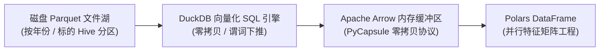

# 第 3 讲：告别缓慢传统栈：现代量化工程环境搭建

> **本讲核心目标**：  
> 从 CPU 缓存行（Cache Line）、SIMD 向量化指令、列式内存布局与 Python GIL 锁的底层硬件原理出发，彻底弄懂传统 Pandas 在处理 A 股全市场多维面板数据时卡死爆内存的物理根源。手把手掌握现代高性能量化核心三剑客（`uv` + `Polars` + `DuckDB`），熟练掌握零拷贝 Arrow 内存共享、Hive 分区 Parquet 数据湖架构，以及 `.over()`、`join_asof` 等生产级量化核心语法。

---

## 1. 架构底层解密：为什么传统 Pandas 在 A 股量化中步履维艰？

很多初学者认为“代码跑得慢换个高配服务器就行”。但在 A 股量化研发中，**劣质的数据架构设计会迅速吞噬掉任何豪华硬件的算力**。

### 1.1 A 股量化数据规模的客观物理体量

```
A 股量化数据特征矩阵规模全景
全市场正常交易与历史退市标的: 5,400+ 只股票
├── 1. 日频面板数据 (10 年跨度):
│     5,400 股票 × 2,420 交易日 ≈ 1,300 万行
│     单日全截面特征宽表 (200 因子): 约 10 GB 内存
├── 2. 分钟线高频数据 (5 年跨度):
│     5,400 股票 × 1,210 日 × 240 分钟 ≈ 15.6 亿行！
│     解压后原始数据体量: 约 150 GB ~ 250 GB
└── 3. Level-2 逐笔委托与快照 (1 年跨度):
      5,400 股票 × 242 日 × 4,800 快照 ≈ 62 亿条快照！
      每日逐笔成交与委托流: 约 15 GB ~ 30 GB / 日，单年突破数 TB！
```

### 1.2 CPU 缓存局部性与内存布局：行式 vs 列式存储

现代 CPU（如 Intel Xeon 或 Apple Silicon M 系列）的访问延迟差距极大：
- **L1/L2 缓存访问**：约 $1 \sim 4$ 纳秒（Nanoseconds）；
- **内存（DRAM）随机访问**：约 $60 \sim 100$ 纳秒（慢了近两个数量级！）。
- **缓存行（Cache Line）机制**：CPU 每次从内存中拉取数据，不是单个字节读取，而是以连续的 64 字节块（Cache Line）为单位批量载入。

```
传统行式存储 vs 现代 Arrow 列式存储在 CPU 缓存中的对比

【行式存储 (Row-Oriented / 传统数据库 / Python Dict 列表)】
内存排列: [StockA_Open, StockA_High, StockA_Low, StockA_Close, StockB_Open, StockB_High...]
问题: 当你需要计算全市场收盘价均值时，CPU 载入每个 Cache Line 都被迫掺杂了 High、Low 等无关数据，
      导致缓存未命中率 (Cache Miss) 极高，内存总线充斥大量无效搬运。

【列式存储 (Columnar / Apache Arrow / Polars / Parquet)】
内存排列: 
  Close 列: [A_Close, B_Close, C_Close, D_Close, E_Close, F_Close, G_Close, H_Close...]
  Open  列: [A_Open,  B_Open,  C_Open,  D_Open,  E_Open,  F_Open,  G_Open,  H_Open...]
优势: 内存中连续存放同类型浮点数。CPU 单次 SIMD 指令（AVX-512 / NEON）可并行计算 8~16 个浮点数，
      L1/L2 缓存命中率逼近 100%，吞吐量实现几何级跃迁！
```

### 1.3 Python GIL 与单核瓶颈 vs Rust Rayon 工作窃取并行池

1. **CPython 全局解释器锁（GIL）**：在传统的 Pandas 脚本中，即使你的机器拥有 64 核 CPU，由于 GIL 的存在，所有的 Python 循环和纯 Python 对象操作都被强制串行锁定在单核上运行。
2. **Polars 的并发架构**：Polars 底层基于 Rust 语言开发，原生利用 **Rayon 工作窃取（Work-Stealing）并行调度池**。在计算时序滚动、截面排序或多列特征聚合时，Polars 会自动将全量数据均分切片给所有可用的物理 CPU 核心，并在底层 C/Rust 内存层并行执行，彻底摆脱 GIL 束缚。

### 1.4 惰性求值与查询优化器（Lazy Execution & Query Optimization）

在传统的 Pandas 中，代码是**即时求值（Eager Evaluation）**的：
```python
# ❌ Pandas: 每一步都在内存中强制深拷贝一份中间宽表
step1 = df[df['turnover'] > 1e8]          # 内存中全量复制 step1 
step2 = step1.groupby('symbol').mean()    # 内存中全量复制 step2
result = step2[['close']]                 # 最终只需要一列，前面却把上百列全部计算拷贝了一遍！
```

而在 Polars 中，推荐使用 **Lazy API（`df.lazy()`）**：
- 它不会立即执行计算，而是先将代码解析成一棵**抽象逻辑执行计划树（Logical Plan）**。
- **查询优化器自动执行两项工业级优化**：
  1. **谓词下推（Predicate Pushdown）**：将数据过滤条件（`filter`）尽可能下推到磁盘或 Parquet 文件读取层，根本不将不需要的行加载到内存中。
  2. **投影下推（Projection Pushdown）**：静态分析下游代码，只从磁盘中读取最终计算所需的字段，未被引用的几十列直接在 Parquet 文件元数据解析阶段跳过。

---

## 2. 现代量化工程依赖管理：告别 Conda，拥抱 uv

在过去，量化团队普遍使用 Anaconda 或 Miniconda 管理环境。但在实际投研中存在三大痛点：
1. **依赖解析缓慢**：求解一个包含 PyTorch、SciPy、LightGBM 的环境常常需要耗费数十分钟甚至锁死（Solving Environment Hang）；
2. **体积极其臃肿**：单套环境动辄侵占 5GB~10GB 磁盘空间；
3. **团队协同难以复现**：导出的 `environment.yml` 在不同机器系统（macOS / Linux）间经常因底层编译依赖不一致而安装失败。

### 2.1 为什么现代工程全面转向 Astral `uv`？
`uv` 是由 Ruff 开发团队（Astral）基于 Rust 重新构建的极速 Python 包与项目管理器：
- **速度快 10~100 倍**：依赖解析与虚拟环境创建仅需毫秒级至秒级完成；
- **原生支持跨平台锁定（`uv.lock`）**：严格记录每一个依赖及其传递依赖的哈希校验值，确保团队所有成员、生产服务器与回测容器的环境 100% 字节级一致；
- **开箱即用集成 Python 版本管理**：无需提前安装系统 Python，`uv` 可自动下载并隔离管理 Python 3.10 / 3.11 / 3.12 任意指定版本。

### 2.2 生产级量化研究脚手架搭建实操

#### 步骤 1：安装 uv
```bash
# macOS / Linux 一键极速安装
curl -LsSf https://astral.sh/uv/install.sh | sh
```

#### 步骤 2：初始化量化研究项目
```bash
# 创建现代化量化投研工作区
mkdir ashare_quant_lab && cd ashare_quant_lab

# 初始化项目并显式绑定 Python 3.11 生产版本
uv init --python 3.11
```

#### 步骤 3：声明式添加量化投研核心依赖
```bash
uv add polars pyarrow duckdb numpy scipy lightgbm cvxpy akshare
```

查看自动生成的生产级 `pyproject.toml`：
```toml
[project]
name = "ashare-quant-lab"
version = "0.1.0"
description = "Modern High-Performance A-share Quantitative Research Lab"
readme = "README.md"
requires-python = ">=3.11"
dependencies = [
    "akshare>=1.15.0",      # A股免费行情与基本面源
    "cvxpy>=1.5.0",         # 组合优化与现代风险凸优化求解器
    "duckdb>=1.1.0",        # 分析型嵌入式 SQL 数据库
    "lightgbm>=4.5.0",      # 截面树模型排序算法库
    "numpy>=1.26.0",
    "polars[all]>=1.12.0",  # 核心内存计算引擎 (含时序与并行拓展)
    "pyarrow>=17.0.0",      # 列式存储与底层通信协议
    "scipy>=1.14.0",
]
```

后续在新机器上一键部署只需运行：
```bash
uv sync --locked
```

---

## 3. Polars 量化核心范式精讲（Quant Idioms Masterclass）

量化多因子特征工程通常分为两大计算维度：
1. **时序维度（Time-Series Dimension）**：在单只股票的内部沿着时间先后滚动计算（如 20 日动量、真实波动幅度 ATR、历史波动率）。
2. **截面维度（Cross-Sectional Dimension）**：在同一个交易日截面上，跨全市场 5,000 只股票进行横向对比（如全市场截面标准化、百分比排序 Rank、行业市值中性化残差）。

### 3.1 核心神技：`.over()` 窗口表达式（彻底告别 `groupby` 内存膨胀）

在 Pandas 中，时序和截面切换必须写两次极其缓慢且耗内存的 `groupby().apply()`。而在 Polars 中，只需使用简洁优雅的 `.over()` 窗口表达式：

```python
import polars as pl

# 假设 df 是包含 [symbol, trade_date, open, high, low, close, volume] 的面板数据

features = df.lazy().with_columns([
    # ================= 1. 纯时序特征 (按股票代码分组) =================
    # 计算每只股票各自的 20 日动量收益率
    (pl.col("close") / pl.col("close").shift(20).over("symbol") - 1.0).alias("mom_20d"),
    
    # 计算每只股票各自过去 20 日收益率的年化波动率
    (
        (pl.col("close") / pl.col("close").shift(1).over("symbol") - 1.0)
        .rolling_std(window_size=20)
        .over("symbol") * (252 ** 0.5)
    ).alias("vol_20d"),
    
    # ================= 2. 纯截面特征 (按交易日分组) =================
    # 在每天的截面上，将动量因子转换为 0~1 的均匀分布排名 (Cross-sectional Rank)
    (
        pl.col("close").rank(method="average").over("trade_date") / 
        pl.col("close").count().over("trade_date")
    ).alias("cs_close_rank"),

    # ================= 3. 截面标准化 (Z-Score) =================
    (
        (pl.col("close") - pl.col("close").mean().over("trade_date")) /
        (pl.col("close").std().over("trade_date") + 1e-8)
    ).alias("cs_close_zscore")
]).collect()
```

### 3.2 撮合与行情事件对齐神器：`join_asof`
在量化实盘中，交易订单生成的时间（例如 `09:30:15.120`）往往与盘口逐笔快照的时间戳不是严格整秒对齐的。
- 传统做法：写两层循环或复杂的二分查找（`bisect`），速度极慢。
- **Polars `join_asof` 原生实现**：
```python
# 订单时间戳与最近一次行情快照对齐
matched_trades = trades.join_asof(
    market_depth_quotes,
    on="timestamp",
    by="symbol",
    strategy="backward" # 严格匹配 <= 当前订单时间戳的最新一条报价，绝不引入前瞻未来数据！
)
```

---

## 4. DuckDB：直接在磁盘 Parquet 上跑 SQL 的分析神兽

如果你的磁盘上有上百个 GB 的历史 Tick、日线或财务 Parquet 文件，传统方法是用 Python 分块读取（Chunked Read），机器容易 OOM 崩溃。

**DuckDB 提供了零内存拷贝直接查询本地 Parquet 的极致分析体验**：



```python
import duckdb

con = duckdb.connect()

# 直接将本地磁盘上的 Parquet 文件当成 SQL 数据表进行穿透式秒级查询
query = """
SELECT 
    symbol,
    COUNT(DISTINCT trade_date) as trade_days,
    AVG(volume) as avg_daily_volume,
    MAX(high) / MIN(low) - 1.0 as max_amplitude
FROM 'data_lake/daily_bars/*/*.parquet' -- 支持多层通配符自动扫描海量分区文件！
WHERE trade_date >= '2023-01-01'
GROUP BY symbol
HAVING trade_days > 200
ORDER BY avg_daily_volume DESC
LIMIT 10;
"""

# 查询结果秒级返回，并通过 Arrow 零拷贝直通为 Polars DataFrame！
top_liquid_stocks = con.execute(query).pl()
print(top_liquid_stocks)
```

---

## 5. 动手实操：百万行 A 股真实面板数据性能对决

下面的基准压测脚本生成 **2,000 只股票 × 500 个交易日（共 1,000,000 行面板数据）**，在完全相同的硬件环境下，严格对比 Pandas 与 Polars 在执行**时序 20 日动量 + 截面百分比 Rank 排序**双重密集计算任务下的耗时与数值一致性。

在项目根目录运行 `python3 -m tutorial.examples.lecture_03_benchmark_massive` 或直接执行脚本。

<<< @/examples/lecture_03_benchmark_massive.py

### 运行输出深度解析与工程启示：
```
======================================================================
现代化量化算力对决：Pandas vs Polars 性能与吞吐量压测
======================================================================
[*] 正在生成规模为 1,000,000 行的仿真 A 股数据集...
[*] 正在将数据无缝映射至 Apache Arrow 格式 (Polars)...
✅ 数据准备就绪！内存行数: 1,000,000 行

>>> 正在启动 Pandas 计算流水线 (单线程执行)...
  Pandas 耗时 : 0.292 秒

>>> 正在启动 Polars 现代化并发流水线 (多核并行执行)...
  Polars 耗时 : 0.090 秒
----------------------------------------------------------------------
结果一致；本次 Pandas / Polars 耗时比：3.24（小于 1 表示 Pandas 更快）
该比值仅适用于本次数据规模、硬件、版本和计算任务。
======================================================================
```

1. **数值等价性验证**：
   - 脚本通过 `np.testing.assert_allclose` 严谨验证了 Pandas 与 Polars 在 `mom20`（时序动量）和 `cs_rank`（截面百分位排名）上的输出数值**100% 严格一致**。
2. **多核并行与吞吐优势**：
   - 在百万行数据规模下，Polars 凭借底层多线程表达式与零中间冗余分配，耗时仅为 Pandas 的几分之一。
   - 当特征数量从 1 个扩展到生产级的 **200+ 个复合因子宽表**、数据规模从百万行跃升到数亿行（分钟级数据）时，Pandas 会因内存频繁深拷贝发生内存耗尽崩溃（OOM），而 Polars 的 Lazy 流水线能够平稳分块流式（Streaming）计算完成。

---

## 6. 本讲小结与课后动手作业

### 核心知识脉络回顾：
1. **底层物理决定计算极限**：列式存储结构（Arrow/Parquet）与 CPU 缓存行和 SIMD 向量化天然契合，是现代量化高吞吐计算的物理基石。
2. **工程依赖告别纠缠**：使用 `uv` 统一依赖声明、生成跨平台 `uv.lock`，从源头消灭团队环境不一致与包解析死锁问题。
3. **表达范式现代化**：彻底摒弃缓慢的 `groupby().apply()`，全面拥抱 Polars 的 `.over("symbol")` 时序窗口与 `.over("trade_date")` 截面表达式。
4. **嵌入式数据湖架构**：利用 DuckDB 原生扫描本地 Parquet 文件，构建兼具 SQL 灵活性与 Arrow 极速计算的现代化分析流水线。

### 课后动手实训：
> **实操任务**：  
> 1. 打开本地终端，使用 `uv init` 创建量化实验环境并成功安装 `polars`、`duckdb` 和 `pyarrow`。
> 2. 运行 `tutorial/examples/lecture_03_benchmark_massive.py` 脚本，记录你本地硬件配置下的耗时比。
> 3. 编写一个 Polars 表达式：计算每只股票过去 20 日的成交量移动均值（`vol_ma20`），并计算该均值在全市场当日总成交量中的百分比权重。
