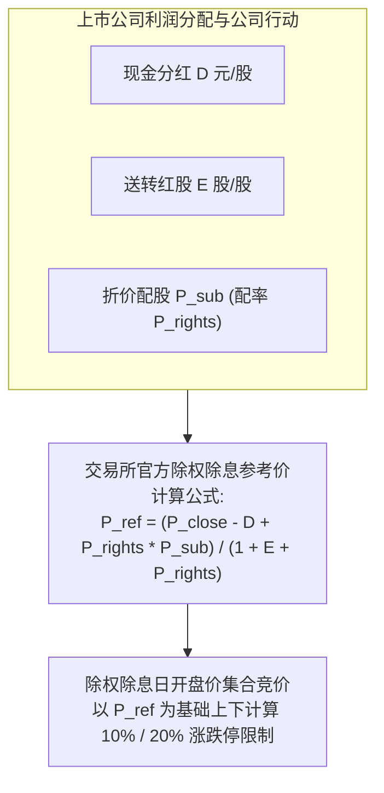
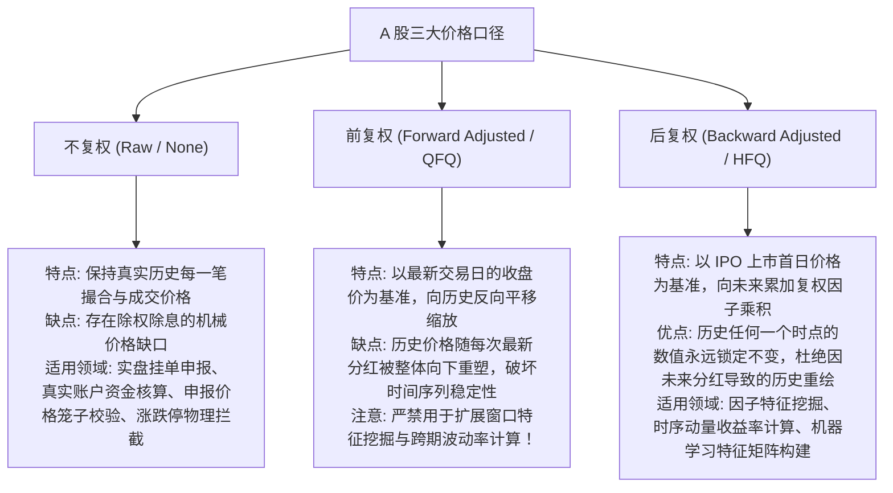

# 第 4 讲：A 股多源数据接入与本地落库实战

> **本讲核心目标**：  
> 从交易所底层除权除息与公司行动（Corporate Actions）的数学公式出发，彻底弄懂原始价、前复权（QFQ）与后复权（HFQ）在因子挖掘与实盘撮合中的边界；全面对比 A 股成熟开源数据源（AKShare、BaoStock、PyTDX、TuShare）与机构商业数据源；构建具备原子写入、增量合并、严格数据契约与 PIT（Point-in-Time）快照的本地 Parquet 数据湖。

---

## 1. 核心数学原理：A 股除权除息与复权机制大起底

在 A 股市场，上市公司经常发生**现金分红（派息）**、**送红股（送股）**、**资本公积金转增股本（转增）**以及**配股**。此类公司行动会导致股票在除权除息日（Ex-Dividend Date）开盘时，股价发生非交易性的机械式下挫。

如果回测系统不做正确的复权处理，你的量化指标就会将分红除权误判为“股价断崖式暴跌 50%”，从而触发严重的错误清仓或错误超跌买入信号！

### 1.1 交易所除权除息参考价（Ex-Dividend Reference Price）数学公式

设某股票在股权登记日（$t-1$ 日）的收盘价为 $P_{\text{close}}$：
- 每股派发现金红利税前为 $D$（元）；
- 每股送红股数为 $E_{\text{bonus}}$（股）；
- 每股公积金转增股本数为 $E_{\text{transfer}}$（股），合计送转股比例 $E = E_{\text{bonus}} + E_{\text{transfer}}$；
- 每股配股数为 $P_{\text{rights}}$（股），配股价为 $P_{\text{sub}}$（元）。

交易所官方撮合系统在除权除息首日（$t$ 日）早盘计算的基准参考价 $P_{\text{ref}}$ 严格遵循以下无套利均衡公式：

$$P_{\text{ref}} = \frac{P_{\text{close}} - D + P_{\text{rights}} \times P_{\text{sub}}}{1 + E + P_{\text{rights}}}$$



---

### 1.2 三大复权类型的本质差异与买方选型准则



#### 买方机构的“双轨制”法则：
1. **收益率与量价特征计算**：**必须使用后复权（HFQ）序列**。只有后复权价格序列才能真实还原投资者长期持有股票的复利收益率（Total Return）。
2. **撮合交易、资金对账与风控检查**：**必须使用原始未复权（Raw）价格**。交易所的委托撮合、账户可用资金划扣、价格申报笼子和涨跌停封板判断，只认当时真实的原始交易价格。

---

## 2. A 股成熟数据源生态全景（开源 vs 商业）

量化研发的基础是高质量、低噪声、时序自洽的行情与基本面数据。买方机构与个人研究者可根据自身算力与预算进行选型：

| 数据平台 | 开源/商业 | 核心特点与覆盖维度 | 适用场景与工程定位 |
| :--- | :--- | :--- | :--- |
| **AKShare** | 免费开源 (GitHub) | 全网最全面的金融开源爬虫库，覆盖 A 股、ETF、商品期货、外盘、宏观与另类情绪数据。 | 适合个人量化学习、高校学术研究、另类宏观与中低频特征原型探索。 |
| **BaoStock** | 免费开源 (证券网) | 纯 Python 客户端，免登录、免积分；提供极高质量的日线、5分钟线及历史 PIT 财务报表。 | 适合搭建本地历史高频与日线回测数据湖，时序极为稳定。 |
| **PyTDX** | 免费开源 (通达信协议) | 直接通过 Socket 逆向对接券商或通达信 L1 行情主站服务器，支持极速获取当日 Tick 逐笔与分时数据。 | 适合轻量级实时行情监控、盘中 Tick 接收与本地盘口仿真。 |
| **TuShare Pro** | 社区/积分制 | 国内资深量化社区，接口规整、字段丰富；提供标准化股票列表、成分股变迁与丰富基本面报表。 | 适合中小私募与个人研究员搭建中频基本面与多因子特征库。 |
| **RQData / JoinQuant** | 商业机构授权 | 专业买方级清洗，提供严格的点时（PIT）财报、ST 变迁、指数成分股逐日权重与衍生指标。 | 适合中小量化私募用于实盘投研基建，数据质量高，维护成本低。 |
| **Wind / Choice / iFinD** | 头部金融终端 | 机构金融数据事实标准，宏观、研报、非标资产与公司行动全覆盖。 | 头部买方机构风控、宏观分析与研究员通用终端。 |

---

## 3. 动态股票池（Universe）构建规则与过滤漏斗

在任何量化策略中，**绝不能使用一个固定的全市场股票代码列表从头跑到尾**。如果使用今天的 5,000 只股票跑 2018 年的历史，就犯了严重的幸存者偏差与成分股穿越错误。

必须在历史每一个交易日截面 $t$，严格执行动态过滤漏斗：

```
动态股票池过滤漏斗 (Daily Investable Universe Funnel)
全市场历史存在的所有标的 (含正常上市、已退市公司)
  │
  ├── [过滤 1] 剔除上市未满 N 日的次新股 (通常过滤上市 <= 60 或 120 个交易日)
  │     └── 物理机理：次新股上市初期存在非理性的筹码博弈，换手率极端异常，且缺乏历史财务数据支持。
  │
  ├── [过滤 2] 剔除当日被实施风险警示的 ST / *ST 股票
  │     └── 物理机理：机构风控库的强制禁入规则；规避连续跌停与财务暴雷黑天鹅。
  │
  ├── [过滤 3] 剔除当日全天停牌或成交量为零的个股 (Volume == 0)
  │     └── 物理机理：当日完全没有流动性，无法成交，防止虚假记账。
  │
  ├── [过滤 4] 剔除昨日收盘触及退市整理期的股票
  │     └── 物理机理：已进入交易所强制终止上市退市流程，流动性趋向枯竭。
  │
  └── 最终输出：当日真正具备可交易性与统计稳健性的【有效股票池 (Valid Universe)】
```

---

## 4. 本地数据湖架构设计与原子写入契约

为了保障量化投研的高吞吐与绝对可靠，建议采用以 **Apache Arrow + Parquet** 为核心的本地数据湖存储架构：

```text
data_lake/
├── metadata/
│   ├── trade_calendar.parquet      # 交易日历：trade_date (覆盖所有历史交易日)
│   └── stock_basic.parquet         # 上市档案：symbol, display_name, list_date, delist_date
├── daily_bars/
│   ├── year=2021.parquet           # 年度分区：原始 OHLCV、close_hfq、turnover (带交易所后缀)
│   ├── year=2022.parquet
│   ├── year=2023.parquet
│   └── year=2024.parquet
└── index_constituents/
    └── 000852/                     # 指数代码目录 (如中证1000)
        ├── 20230615T160000-xxxx.parquet  # 每次观测留存的不可篡改历史快照
        └── 20231218T160000-xxxx.parquet
```

### 4.1 数据质量保障的四大黄金工程原则：
1. **原子写入（Atomic File Replacement）**：落库时先写入随机临时文件（`.tmp`），校验无误后通过底层操作系统级 `replace` 替换目标文件，彻底杜绝程序异常中断导致 Parquet 文件损坏。
2. **只增不改快照原则（Append-Only Snapshots）**：指数成分股历史变迁极为复杂，每次获取只记录带有精确采集时刻 `available_at` 的独立快照文件，历史快照严禁覆盖！
3. **主键唯一性断言（Unique Primary Key）**：所有行情表强制校验 `(symbol, trade_date)` 唯一性，凡出现重复行立即抛出异常阻断。
4. **OHLC 物理包含性验证**：严格断言 $\text{High} \ge \max(\text{Open}, \text{Close}, \text{Low})$ 且 $\text{Low} \le \min(\text{Open}, \text{Close}, \text{High})$，阻断一切被污染的脏数据。

---

## 5. 动手实操：生产级 A 股数据落库流水线实现

下面的 Python 代码严格遵循机构级买方规范，封装了**网络指数退避重试**、**原始价与后复权分离采集**、**增量合并更新**、**原子写入**以及**全量数据完整性自检**。

在项目根目录运行 `python3 -m tutorial.examples.lecture_04_industrial_data_pipeline` 或直接执行脚本。

<<< @/examples/lecture_04_industrial_data_pipeline.py

### 核心实现要点解读：
1. **网络重试（`fetch_with_retry`）**：
   - 面对外部公开 API 偶尔的网络抖动、限流或超时，采用指数退避（Exponential Backoff）重试策略，确保离线批处理任务的自愈能力。
2. **统一证券代码命名规范**：
   - 严格要求股票代码必须带有交易所大写后缀（如 `600519.SH`, `000001.SZ`, `688981.SH`），杜绝因上海、深圳代码重合引起的串号事故。
3. **严格的单位换算**：
   - A 股传统行情的成交量单位通常为“手（100 股）”，流水线在落库时统一转换为“股（Shares）”，与成交金额（元）和未来高频 Tick 严格保持物理量纲统一。

---

## 6. 本讲小结与模块总结

### 核心知识图谱梳理：
1. **除权除息本质**：掌握交易所参考价计算公式，深刻理解现金分红与送转股对价格序列的机械折损。
2. **价格口径分工**：收益率与因子挖掘用**后复权（HFQ）**，撮合交易、资金结算与风控拦截用**原始未复权（Raw）**。
3. **动态股票池**：用严格的时序漏斗（次新股、ST、停牌、退市）动态生成每日交易掩码，彻底告别静态代码池。
4. **数据工程底座**：用 Apache Arrow + Parquet 搭建本地高效数据湖，遵循原子写入与快照版本留存规范。

至此，**第一模块：认知重塑与现代化量化工程栈** 全部四大核心讲座构建完毕！
- 我们从量化底层的收益四重拆解与制度摩擦出发（第 1 讲）；
- 剖析了回测爆雷的四大死因并推导了 DSR 过拟合检验（第 2 讲）；
- 搭建了高性能的 `uv` + `Polars` + `DuckDB` 列式计算工程栈（第 3 讲）；
- 奠定了可信的 A 股除权除息、复权处理与本地 Parquet 数据湖基建（第 4 讲）。

从下一模块开始，我们将正式进入：**第二模块：A 股市场微观结构与特征工程**，深入挖掘量价微观失衡特征与基本面点时数据！
