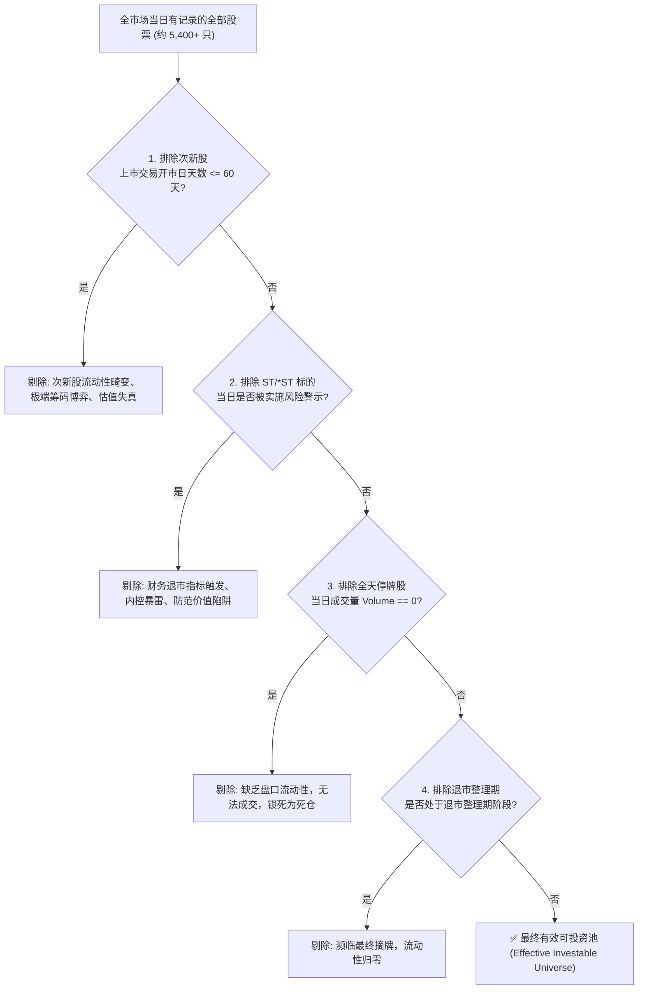

# 第 5 讲：行情数据复权与动态股票池（Universe）构建

> **本讲核心目标**：  
> 彻底打破“使用静态股票池回测历史”的业余做法。深入剖析次新股流动性畸变、A 股退市新规与 ST/*ST 机制对价值因子的毁灭性污染，以及停牌流动性黑洞在实盘中的真实清算逻辑；推导动态交易掩码（Trading Mask）的数学性质；手写一套基于 Polars 的生产级动态股票池引擎，构建并验证日级交易掩码。

---

## 1. 静态股票池的“七宗罪”：为什么你的回测超额是假的？

很多量化初学者在搭建策略时，最常犯的一个隐蔽错误是：**直接从数据库中拉出“当前最新的中证 1000 成分股列表”或“当前全市场正常交易的 5,000+ 只股票代码”，然后用这个固定的代码列表去回测 2018 到 2024 年的历史策略。**

这种“静态股票池”做法在买方机构会被直接判定为**严重回测安全事故**：

```
静态股票池引入的隐蔽偏差模型
2018 年真实市场 (包含 3,600 只股票)
├── 后来成长为行业龙头的公司 (2018 年可能是微盘暴涨股) ─── [被静态池保留]
├── 正常稳健经营的公司 ────────────────────────── [被静态池保留]
└── 后来发生重大财务造假、连续一字跌停并退市的垃圾公司 ── [在静态池中彻底蒸发！]
      ├── 典型代表：康美药业、康得新、乐视网、凯乐科技、退市博天...
      └── 真实历史：在 2018-2023 年间，这些股票曾让无数投资者亏损 95% 以上
```

### 1.1 静态股票池的核心危害

1. **天然过滤退市股与暴雷股（幸存者偏差 / Survivorship Bias）**：今天仍在交易的股票，天生具有“幸存基因”，策略根本没有承受它们在暴跌退市期间的杀伤力。
2. **提前知晓成份股调整（成份股穿越 / Index Selection Leakage）**：中证 500、中证 1000 等宽基指数每半年调整一次成分股（每年 6 月与 12 月中旬）。能被新调入指数的公司，往往在调入前的半年到一年内市值快速扩张、股价大涨；静态池等于让你在 2018 年就提前买入了 2023 年才被选入指数的未来大牛股！
3. **学界重磅实证：控制垃圾股后的规模溢价**：  
   著名量化机构 AQR 创始人 Clifford Asness 等在经典文献 *Size matters, if you control your junk (Journal of Financial Economics, 2018)* 中严谨证明：小市值公司中充斥着大量财务恶化、濒临违约的“垃圾资产（Junk）”。如果不建立动态可投资池剔除这些垃圾资产，所谓的“小市值 Alpha”在经历尾部退市清算后将荡然无存！

---

## 2. A 股动态可投资池的数学模型与过滤漏斗

在严谨的买方量化投研中，时刻 $t$ 的可投资标的全集 $Universe_t$ 必须是根据 $t$ 日历史已知状态**动态求解生成的布尔集合**：

$$Universe_t = \left\{ s \in S_t \;\middle|\; \begin{aligned}
\text{ListedTradingDays}(s, t) > 60 \\
\land\; \neg \text{IsST}_t(s) \\
\land\; \text{DailyVolume}_t(s) > 0 \\
\land\; \neg \text{IsDelistingPeriod}_t(s)
\end{aligned} \right\}$$



---

## 3. 动态过滤四大核心关卡深度剖析

### 3.1 关卡一：上市未满 60 个交易日的次新股过滤
- **微观机制**：新股（IPO）上市初期，受散户打新、机构网下配售锁定等机制影响，换手率极端异常（单日换手率经常高达 30%~60%），买卖盘口以情绪博弈为主。
- **财务失真**：次新股通常缺乏至少 2~3 年可验证的连续 PIT 财报数据，市盈率（PE）与市净率（PB）严重脱离基本面均值。
- **买方标准**：买方量化通常**严格剔除上市交易天数不足 60 个交易日（约 3 个自然月）的次新股**，部分超额注重稳健的机构甚至收紧至 120 个交易日（半年）。

### 3.2 关卡二：ST 与 *ST 风险警示机制与“价值陷阱”
A 股特有的 ST（Special Treatment）制度是量化模型最容易摔跤的泥潭：

```
A 股退市新规与风险警示制度四大类型
├── 1. 财务类退市警示 (*ST):
│     ├── 净利润为负且营业收入低于 3 亿元 (新规标准)
│     └── 期末净资产为负值，或者被出具无法表示意见/否定意见的审计报告
├── 2. 规范类退市警示 (ST/*ST):
│     └── 控股股东巨额资金违规占用、内控失效、严重财务造假
├── 3. 交易类退市警示:
│     └── 连续 20 个交易日收盘价低于 1 元面值 (1元面值退市)
└── 4. 重大违法类退市:
      └── 触及欺诈发行、重大信息披露造假等触犯证券法情形
```

::: warning 致命陷阱：ST 股对价值反转因子的毁灭性污染
ST 股往往在连续一字跌停后，**静态估值指标（如市净率 PB、市盈率 PE）会显得“极其便宜”**，短期技术指标（如 RSI）显示“严重超跌”。  
如果你不动态剔除 ST 股票，机器学习或因子排序模型就会把它们当成“绝佳的低估值高弹性反转标的”疯狂买入，最终换来的是连续 15~30 个一字跌停退市的毁灭性打击！
:::

### 3.3 关卡三：全天停牌股票（Suspension）的清算逻辑
在日线或高频回测中，很多人处理停牌股票时直接用前向填充：`df['close'].ffill()`。
- **回测假象**：模型认为当天持有该股票，价格没有波动，净值稳定；
- **实盘残酷现实**：
  1. 如果模型此时想**卖出**该股票换仓，由于全天停牌无成交，**卖出委托直接沦为废单，持仓被强行锁死成为死仓**；
  2. 如果账户遭遇客户大额赎回，持仓无法变现，将直接引发流动性违约；
  3. A 股历史上多起重大停牌重组案例（如万科 A 停牌半年、乐视网停牌数月），复牌后往往直接遭遇无量跌停补跌。

---

## 4. 交易掩码矩阵（Trading Mask）架构设计

在高性能量化投研架构中，动态股票池通常不以庞大的文本字符串保存，而是抽象为一个**二维布尔稀疏/紧凑矩阵（Trading Mask）**：

$$\mathbf{M} \in \{0, 1\}^{T \times N}$$

其中行代表交易日 $t \in [1, T]$，列代表全市场所有历史出现过的股票 $s \in [1, N]$：
- $M_{t, s} = 1$：表示在第 $t$ 个交易日，股票 $s$ 满足所有过滤条件，允许被模型纳入截面打分、分位数排序与组合二次规划优化；
- $M_{t, s} = 0$：表示该标的不可交易（停牌、ST、次新或已退市），在截面标准化与凸优化前直接掩码置为零或 NaN。

### 指数成分股调整与 10% 缓冲区规则（Buffer Zone Rule）：
中证指数公司在调整中证 300 / 500 / 1000 成分股时，实施经典的**缓冲区规则**以降低换手冲击：
- 老成分股若排名在剔除线以内（例如前 60%）则优先保留；
- 新候选股票必须排名极其靠前（例如前 40%）才会被强制调入。
- **量化启示**：在构建策略自己的动态池时，亦应借鉴缓冲区机制，防止个股在可交易边缘频繁跳动触发无谓换手摩擦。

### 4.2 Barra US-E3 / CNE5 估计样本池六维准入与 18 个月“祖父条款（Grandfathering）”
根据 **BARRA US-E3 风险手册第 7 章** 与 **CNE5 估计池（ESTU）规范**，买方在构建多因子模型估计池时，实施以下 6 项标准严苛筛选，杜绝样本边界的统计伪噪声：
1. **核心指数成分硬准入**：沪深 300 / 中证 800 成分股强制全额入池，不受一般市值与价格限制约束；
2. **PIT 财务数据连续性**：必须具备最新且最近 21 个月以内的完整财报数据，严禁选择需要大量依赖缺省规则插值的样本；
3. **市值规模基石（Top 1,500）**：自动纳入全市场总市值排名前 1,500 名的标的，构成模型估计的核心底座；
4. **最低股价门槛（Minimum Price Rule）**：非核心指数股票必须满足股价高于阈值（如美股 \$5.00，A 股 2.00 元），彻底规避“仙股”因买卖最小跳价单位（Tick Size）引发的离散非线性微观噪声；
5. **行业深度补充规则（Industry Fill-in）**：检查每个细分行业股票数量，确保**每个行业至少拥有 20 只代表性成分股**；不足 20 只的较薄弱行业，从剩余未入池股票中按市值降序递补填齐，但严格排除全市场市值后 10% 的股票；
6. **18 个月祖父容忍法则（Grandfathering Rule）**：
   - **痛点机理**：在第 1,500 名市值门槛边缘徘徊的股票，由于日常价格波动，容易在当期月度“进进出出”。若直接机械剔除，该股票在非估计池因子（NONESTU）上的暴露与特异风险预测会发生剧烈跳变；
   - **工业方案**：Barra 规定，只要股票曾经合规入池，因市值下跌跌出阈值时，**给予长达 18 个月的宽限观察期（18-month Grace Period）**！在此期间只要未跌入全市场后 10% 且未跌破最低股价，依然保留在估计池内，直至 18 个月期满未恢复再正式移出。这一经典法则为行业提供了平滑边界效应的工业标杆。

---

## 5. 动手实操：高性能动态股票池构建引擎实现

下面的参考实现按日期组织查询，并用 Polars 完成当日连接与过滤。重点是时间口径和缺失处理，严格保证零前瞻未来数据。

在项目根目录运行 `PYTHONPATH=tutorial python3 -m examples.lecture_05_dynamic_universe_builder`。依赖安装、共享模块和数据契约见[项目说明](../README.md)。

<<< @/examples/lecture_05_dynamic_universe_builder.py

### 核心实现要点解读：
```
shape: (3, 3)
┌─────────┬────────────────────────┬─────────────┐
│ symbol  ┆ trading_days_since_ipo ┆ in_universe │
│ ---     ┆ ---                    ┆ ---         │
│ str     ┆ i64                    ┆ bool        │
╞═════════╪════════════════════════╪═════════════╡
│ HALT.SZ ┆ 75                     ┆ false       │
│ NEW.SZ  ┆ 5                      ┆ false       │
│ OLD.SH  ┆ 75                     ┆ true        │
└─────────┴────────────────────────┴─────────────┘
```
1. **二分查找精确计算上市开市天数**：
   - 很多系统用自然日计算上市年龄（`trade_date - list_date`），这会导致节假日偏长引起误差。本引擎使用 `bisect_right - bisect_left` 严格对照真实交易所开市日历计算上市天数。
2. **三元状态精确断言**：
   - `OLD.SH` 上市 75 个开市日，非 ST，非停牌，精准判定为 `in_universe = True`；
   - `NEW.SZ` 仅上市 5 天，触发次新股保护，`in_universe = False`；
   - `HALT.SZ` 全天成交量为 0（停牌），即使上市超 60 天也被安全拦截。

---

## 6. 本讲小结与课后动手作业

### 核心知识图谱梳理：
1. **静态池是灾难**：回测中永远不要使用今天已知的成份股去跑历史，否则会引入幸存者偏差与未来穿越；
2. **ST 股会污染价值因子**：ST 股票的高风险折价使其表面估值极其“便宜”，不剔除会诱导因子模型买入即将退市的垃圾资产；
3. **Trading Mask 抽象**：将动态股票池标准化为 $T \times N$ 维布尔掩码，是现代买方量化系统处理时序与截面多因子的基础协议。

### 课后动手实训：
> **实操任务**：  
> 1. 运行上述动态股票池脚本，观察输出的判定结果。
> 2. 尝试修改 `UniverseFilterConfig`，将 `min_listed_days` 从 60 调整为 120，观察次新股的过滤周期如何变化。
> 3. 思考题：在实盘交易中，如果某只个股在昨日是可交易的（已买入），但在今日突然宣布停牌（`Volume == 0`），此时股票池将其标记为 `in_universe = False`，你的交易执行系统应该执行“尝试卖出”还是“锁死持仓并暂停信号”？为什么？
