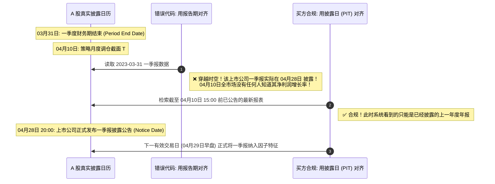
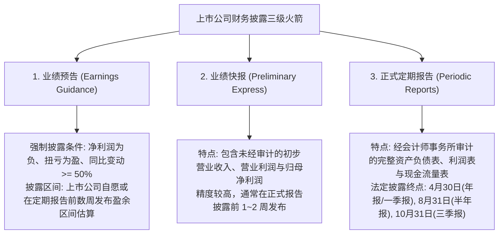

# 第 6 讲：Point-in-Time (PIT) 财报无未来函数对齐

> **本讲核心目标**：  
> 深入解剖基本面多因子量化中最致命的隐形刺客——**财报跨期未来函数（Look-ahead Bias in Financials）**。掌握经典学术文献中盈余公告后漂移（PEAD）与标准化预期外盈利（SUE）的微观机理；彻底厘清“四月大堵车”、业绩预告、业绩快报与正式定期报告的三维时间戳逻辑；掌握具备版本追溯与更正能力的生产级 PIT 财报检索算法。

---

## 1. 为什么不能直接用报告期对齐行情？

在基本面量化（价值选股、成长动量、质量因子 Quality、SUE 盈利意外）研究中，财务指标（如营业收入、净利润、扣非净利润、ROE、ROIC、经营现金流）是构建因子的源头。然而，绝大多数初学者由于没有接触过真实的买方数据工程，在第一步读取数据时就已经全盘皆输。



### 1.1 报告期（Period Date）与公告披露日（Notice Date）的时间差

- **报告期截止日（Period End Date）**：这是会计核算周期的财务截止日（03-31, 06-30, 09-30, 12-31）。它**只代表会计期间，绝不代表该数据在市场上可被公开获取的时间！**
- **实际公告披露日（Notice Date / Available Time）**：上市公司将经过审计或审阅的财务报表正式上传至巨潮资讯网等交易所指定媒体公布的时间。
- **法定披露时间差（Information Delay Window）**：
  - **一季报**：4 月 1 日至 4 月 30 日披露（滞后 1~30 天）；
  - **中报（半年报）**：7 月 1 日至 8 月 31 日披露（滞后 1~62 天）；
  - **三季报**：10 月 1 日至 10 月 31 日披露（滞后 1~31 天）；
  - **年报**：次年 1 月 1 日至 4 月 30 日披露（滞后长达 **1~120 天！**）。

如果你的回测代码写出 `trade_date == report_date` 或直接按报告期季度切片，你实际上赋予了策略**“提前一个月到四个月预知全市场所有上市公司财务底细”的超自然能力**，实盘必然直接暴毙！

---

## 2. 学术经典：PEAD 盈余公告后漂移与 SUE 盈利意外

财报披露为什么具有巨大的 Alpha 捕捉价值？会计学与金融实证领域的经典文献给出了深刻解答：

1. **会计信息含量的发轫**：  
   Ball, R., & Brown, P. (1968). *An Empirical Evaluation of Accounting Income Numbers*. Journal of Accounting Research.  
   *核心贡献*：首次用实证统计方法证明，未被市场预期到的净利润变动在财报披露前后具有极强的价格反应，奠定了基本面量化投资的学术基石。
2. **盈余公告后漂移（Post-Earnings-Announcement Drift, PEAD）**：  
   Bernard, V. L., & Thomas, J. K. (1989, 1990). *Post-Earnings-Announcement Drift: Delayed Price Response or Risk Premium?* Journal of Accounting Research.  
   *核心发现*：市场在财报公布当天并不能立刻消化全部的盈利超预期信息，受投资者注意力限制与认知偏差影响，超预期股票在公布后的 30~60 个交易日内会发生持续的**单向价格漂移（Drift）**。
3. **标准化预期外盈利（SUE）数学模型**：  
   Livnat, J., & Mendenhall, R. R. (2006). *Comparing the Post-Earnings-Announcement Drift for Surprises Calculated from Analyst Forecasts and Time Series Models*. Journal of Accounting Research.  
   $$\text{SUE}_{i,t} = \frac{E_{i,t} - \mathbb{E}[E_{i,t}]}{\sigma(E_i - \mathbb{E}[E_i])}$$
   其中 $E_{i,t}$ 为当期公布的真实净利润，$\mathbb{E}[E_{i,t}]$ 为分析师一致预期或时序模型预测的净利润，分母为历史预测误差的标准差。**若回测未严格使用 PIT 数据，PEAD 与 SUE 策略的超额收益将被虚增 3~5 倍！**

---

## 3. A 股独特的“四月大堵车”与三元业绩披露架构

在 A 股，上市公司业绩信息并非仅有四本定期报告，而是由三层阶梯状架构组成：



### 3.1 致命的“四月大堵车（The April Nightmare）”
在每年的 4 月份，A 股会出现全世界独一无二的财务信息披露高峰：
- **同日双报**：上市公司在 4 月 28 日同一天披露《2023 年年度报告》与《2024 年第一季度报告》；
- **追溯更正公告（Revision Notice）**：公司可能在发布年报后被交易所发函问询，于 5 月份发布《年报会计差错更正公告》，下修利润 40%。
- **买方铁律**：在 5 月份发布更正公告前，历史回测**只能使用当时错报的原始数据**；绝不能在 2023 年就使用 2024 年才更正的“完美无瑕数据”！

---

## 4. 生产级 PIT 数据模型设计契约

在高性能量化投研架构中，PIT 财报必须采用**只增不改（Append-Only）**的事件流设计，统一使用 **Asia/Shanghai 本地无时区时间戳**：

```text
pit_financials_schema:
├── symbol           : 股票代码 (如 600519.SH)
├── report_period    : 财务报告期截止日 (如 2023-12-31, 2024-03-31)
├── available_at     : 外部可获取的实际披露时间戳 (如 2024-04-26 20:00:00)
├── roe              : 净资产收益率
├── net_profit       : 归母净利润
├── net_profit_yoy   : 归母净利润同比增速
└── is_revised       : 是否为更正后版本
```

### 4.1 PIT 核心检索三定律：
1. **时间绝对截断**：对于任意交易日 $t$ 的收盘截面（通常为当日 15:00），系统只能看到 `available_at <= cutoff` 的财务记录。当晚 20:00 公告的财报绝不可见！
2. **版本独立选择**：对于每个 `(symbol, report_period)`，选择在查询时刻可见的**最新更正版本**；
3. **最新报告期对齐**：在各报告期有效版本中，选择最新截止的报告期作为当前基本面指标（例如一季报发布后自动取代旧年报，但旧年报的更正版本依然完整归档保留）。

---

## 5. 动手实操：具备版本更正能力的 PIT 财报引擎实现

下面的 Python 代码严格遵循机构级买方规范，封装了**时序严格截断**、**同日双报解构**、**历史版本更正隔离**与**自动化零泄漏断言**。

在项目根目录运行 `PYTHONPATH=tutorial python3 -m examples.lecture_06_pit_financial_engine`。依赖安装、共享模块和数据契约见[项目说明](../README.md)。

<<< @/examples/lecture_06_pit_financial_engine.py

### 核心运行输出与实盘对齐验证：
```
shape: (3, 4)
┌────────────┬───────────────┬─────────────────────┬──────┐
│ trade_date ┆ report_period ┆ available_at        ┆ roe  │
│ ---        ┆ ---           ┆ ---                 ┆ ---  │
│ date       ┆ date          ┆ datetime[μs]        ┆ f64  │
╞════════════╪═══════════════╪═════════════════════╪══════╡
│ 2023-03-31 ┆ null          ┆ null                ┆ null │
│ 2023-04-26 ┆ 2022-12-31    ┆ 2023-03-31 20:00:00 ┆ 0.3  │
│ 2023-04-27 ┆ 2023-03-31    ┆ 2023-04-26 20:00:00 ┆ 0.09 │
└────────────┴───────────────┴─────────────────────┴──────┘
```

1. **3 月 31 日 15:00 收盘截面**：年报虽在 3 月 31 日当晚 20:00 发布，但盘后收盘时全市场尚不可知，引擎正确返回 `null`，严禁提前抢跑！
2. **4 月 26 日 15:00 收盘截面**：系统只能读取到 2022 年报（ROE 为 0.3），当晚才发布的一季报不可见；
3. **4 月 27 日 15:00 收盘截面**：一季报在 4 月 26 日晚公布后，4 月 27 日收盘时系统已无缝更新至 2023 一季报（ROE 为 0.09），且旧年报后来的更正不会破坏最新报告期。

---

## 6. 本讲小结与课后动手作业

### 核心知识图谱梳理：
1. **时间戳分离**：永远铭记报告期（Period Date）与公告披露日（Notice Date）的巨大时间差；
2. **PEAD 真实超额**：盈余公告后漂移（PEAD）与 SUE 策略的有效性必须建立在坚固的 PIT 数据底座之上；
3. **只增不改架构**：使用 Append-Only 模式保存每一次更正版本，以 `available_at` 为物理约束截断查询。

### 课后动手实训：
> **实操任务**：  
> 1. 打开 `tutorial/examples/lecture_06_pit_financial_engine.py`。
> 2. 模拟向数据集中追加一条更正公告：在 2023-05-10 发布对 2022 年报的会计更正（将 ROE 从 0.3 下修至 0.15）。
> 3. 运行引擎分别查询 2023-04-20 与 2023-05-15 的截面，确认在更正发布前后的历史取值完全符合因果律。
