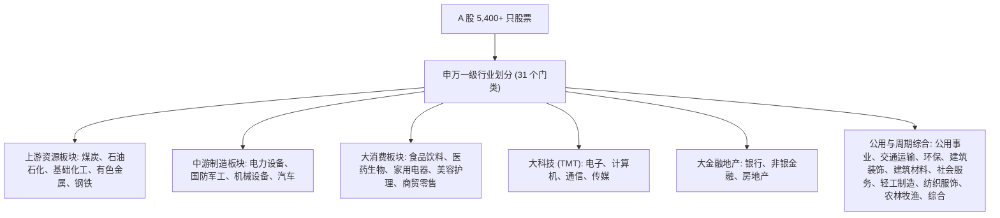

# 第 7 讲：行业分类演变与概念标签维护

> **本讲核心目标**：  
> 深刻理解行业风险暴露对超额收益的系统性扭曲；彻底厘清申万（SW）与中信（CITIC）两大主流行业分类标准，攻克“2021 申万大改版”带来的历史跨期定义错位；从数学底层推导多元回归中的**虚拟变量陷阱（Dummy Variable Trap）**与 Barra 加权受约束回归求解；手写一套基于 Polars 的生产级 Point-in-Time 行业映射与 One-Hot 哑变量矩阵生成引擎。

---

## 1. 为什么行业中性化是 A 股量化的立身之本？

在 A 股市场，**行业效应解释了股票截面收益波动的绝大部分**。在许多年份，选对行业板块比在行业内精挑细选个股更为关键。

很多缺乏买方训练的研究员跑出一个“年化收益 45%、夏普 3.2 的动量策略”，复盘持仓时却发现：
- 2020 年策略全仓超配“食品饮料（白酒板块）”；
- 2021 年策略全仓超配“电力设备（新能源与光伏板块）”；
- 2023 年策略全仓超配“通信与计算机（AI 算力板块）”。

```
收益本质深度拷问
表面现象：模型选股能力惊人，每年都能踩中翻倍大牛股
背后真相：模型根本没有“选股 Alpha”，它只是在单边下注赌某些行业的板块 Beta 暴涨！
致命后果：一旦板块风口退潮（如 2021 年后的白酒、2022 年后的光伏），组合将遭遇 40%~60% 的单边剧烈崩塌！
```

### 1.1 Barra 结构化风险模型中的行业因子分解

在 MSCI Barra 中国股票风险模型（CNE5 / CNE6）中，任意股票 $i$ 在时刻 $t$ 的超额收益可严谨分解为：

$$R_{i,t} = \underbrace{\sum_{j=1}^J I_{i,j,t} \cdot f_{j,t}}_{\text{行业因子贡献 (Industry Factor Return)}} + \underbrace{\sum_{k=1}^K X_{i,k,t} \cdot g_{k,t}}_{\text{风格因子贡献 (Style Factor Return)}} + \underbrace{u_{i,t}}_{\text{特异质选股超额 (Idiosyncratic Alpha)}}$$

其中：
- $I_{i,j,t} \in \{0, 1\}$ 为股票 $i$ 在时刻 $t$ 是否属于行业 $j$ 的**行业哑变量（Industry Dummy）**；
- $f_{j,t}$ 为第 $j$ 个行业在 $t$ 日的纯行业收益率；
- $u_{i,t}$ 才是剔除掉全市场 Beta、行业暴露与风格暴露后，真正由量化选股能力创造的**纯特异质收益（Pure Alpha）**！

---

## 2. A 股两大主流行业体系全景对照

| 体系名称 | 编制机构 | 一级行业数 | 二级行业数 | 机构核心应用场景 |
| :--- | :--- | :--- | :--- | :--- |
| **申万行业分类 (SW)** | 申万宏源研究所 | **31 个**（2021 版） | 134 个 | **公募基金指增基准、百亿量化私募事实标准** |
| **中信行业分类 (CITIC)** | 中信证券研究部 | **30 个** | 100+ 个 | 券商自营、部分独立量化对冲基金 |



---

## 3. 历史大地震：“2021 申万行业大改版”与跨期宏观未来函数

2021 年 7 月，申万正式发布了第四代行业分类标准（2021 版），对全市场行业树进行了重大重组：
1. **新增一级行业**：新增“**美容护理**”（从原轻工制造和基础化工中拆分爱美客、珀莱雅等医美化妆品公司）；
2. **拆分重组**：将原“化工”大类正式拆解为“**石油石化**”与“**基础化工**”；
3. **撤并调整**：原“电气设备”更名为“**电力设备**”，重组锂电池、光伏与电网产业链。

```
跨期回测致命陷阱
错误做法：直接拿今天导出的【申万2021版最新行业名单】，简单粗暴地套用到 2015 年的历史行情上。
隐蔽穿梭：在 2015 年，全市场根本不存在“美容护理”这个行业，该板块的龙头公司当时在市场上被归类为传统化工或轻工。
严重后果：如果你在 2015 年的历史数据上做行业中性化，你的模型等于提前使用了 6 年后才出台的新产业认知，构成了隐蔽的宏观前瞻未来函数！
```

### 3.1 跨期行业状态事件表设计
```text
industry_events_schema:
├── symbol           : 股票代码 (如 000001.SZ)
├── taxonomy         : 分类体系版本 (如 SW2014, SW2021)
├── industry_name    : 行业标准名称 (如 银行)
├── effective_date   : 行业分类正式生效日期
└── available_at     : 该事件在系统中可见的物理时间戳
```

通过追加式事件记录，任何时刻的行业查询必须满足：
$$\text{effective\_date} \le t_{\text{decision}} \quad \text{AND} \quad \text{available\_at} \le t_{\text{decision}}$$

---

## 4. 虚拟变量陷阱（Dummy Variable Trap）与受约束回归数学推导

在对多因子进行行业中性化时，初学者最容易犯的统计学错误是直接写出如下回归方程：

$$Y_i = \beta_0 + \sum_{j=1}^{31} \beta_j I_{i,j} + \epsilon_i$$

### 4.1 虚拟变量陷阱（完美共线性）
- 由于每只股票必定且仅属于 31 个行业中的某一个，因此对于任意股票 $i$，恒有：
  $$\sum_{j=1}^{31} I_{i,j} = 1$$
- 这意味着全 1 的截距项向量 $\mathbf{1}$ 与 31 个行业哑变量之和完全相等！设计矩阵 $\mathbf{X}$ 出现**严格线性相关（秩亏损 / Rank Deficient）**，矩阵 $\mathbf{X}^T \mathbf{X}$ 不可逆，回归系数无唯一解。

### 4.2 两种经典买方数学解决方案

#### 方案 A：剔除一个基准行业（$J-1$ 哑变量法）
- 强制令某个行业（如“综合”）的系数为 0，只放入 30 个行业哑变量。此时截距项 $\beta_0$ 代表被剔除行业的平均收益，其余系数代表相对基准行业的超额。

#### 方案 B：Barra 市值加权受约束回归（Restricted WLS - 工业界首选）
在 Barra 风险模型中，既保留全 31 个行业哑变量，又保留全市场截距项（Market Beta），同时施加如下约束条件：**全市场 31 个行业的因子收益率在市值加权后之和严格为零**！

$$\min_{\{f_j\}} \sum_{i=1}^N w_i \left( R_i - \sum_{j=1}^J I_{i,j} f_j \right)^2 \quad \text{s.t.} \quad \sum_{j=1}^J W_j f_j = 0$$

其中 $w_i$ 为个股根号市值权重，$W_j = \sum_{i \in \text{Industry}_j} w_i$ 为行业总市值权重。  
通过拉格朗日乘子法求解，保证了解的唯一性，同时赋予了行业因子收益率最完美的物理意义：**各行业相对全市场市值加权基准的主动溢价**！

---

## 5. 动手实操：带版本的行业映射与 One-Hot 哑变量矩阵引擎

下面的 Python 代码使用 **Polars** 实现了全市场股票到申万一级行业的高性能映射，并一键构造出用于后续多因子中性化回归的标准哑变量矩阵（Dummy Matrix）。

在项目根目录运行 `PYTHONPATH=tutorial python3 -m examples.lecture_07_industry_engine`。依赖安装、共享模块和数据契约见[项目说明](../README.md)。

<<< @/examples/lecture_07_industry_engine.py

### 核心实现要点解读：
1. **显式未知类别（`ind_未知`）**：
   - 当历史数据中某股票因停牌或信息缺失未能匹配行业时，严禁将其胡乱归入“综合”行业，而是生成独立的 `ind_未知` 列，行和严格保持为 1。
2. **零内存冗余的 Polars 表达式展开**：
   - 传统 Pandas 的 `pd.get_dummies` 会产生大量的单核浅拷贝。本实现利用 Polars 声明式表达式，一次性并行构造 31 维布尔列并强转为 `UInt8`，极大降低特征工程内存开销。

---

## 6. 本讲小结与课后动手作业

### 核心知识图谱梳理：
1. **行业效应不可忽视**：未经行业中性化的量化选股，超额收益极易蜕化为单一行业的单边风险赌注；
2. **申万 31 行业标准**：认准 2021 版标准架构，理解轻工、化工拆分背后的产业逻辑，坚决防范跨期历史错配；
3. **哑变量矩阵的数学约束**：每个截面上行业列（含显式未知列）的行和严格等于 1，通过受约束回归彻底消除虚拟变量陷阱。

### 课后动手实训：
> **实操任务**：  
> 1. 打开 `tutorial/examples/lecture_07_industry_engine.py`。
> 2. 编写一个测试函数，验证生成的哑变量矩阵在每一行上的数值求和是否严格等于 1（`assert (matrix.select(pl.all().sum_horizontal()) == 1).all()`）。
> 3. 思考题：如果一个量化多因子策略只在“医药生物”单个行业内部选股（行业内增强），此时还需要做申万一级行业的哑变量中性化吗？为什么？
