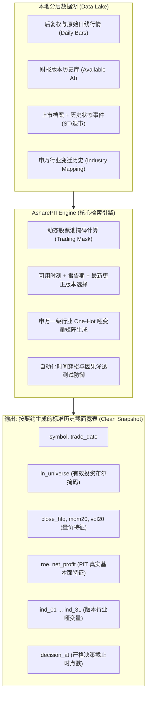
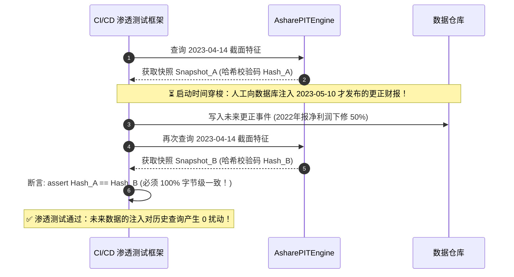

# 第 8 讲：【实战】手写 A 股 PIT 检索引擎

> **本讲核心目标**：  
> 融会贯通第二模块前三讲的全部数据工程精髓。将**动态股票池过滤（次新/ST/停牌）**、**财报 Point-in-Time 对齐（Notice Date As-of Join）**以及**申万一级行业哑变量矩阵**封装为一个高度解耦的工业级参考类 `AsharePITEngine`。输入任意历史交易日，一键返回符合买方时点口径的特征宽表；并编写**时间穿梭渗透测试套件（Penetration Test）**，从物理上证明系统绝无未来函数泄露！

---

## 1. 为什么买方机构必须拥有独立的 PIT 检索引擎？

在没有系统化封装的业余量化团队中，每个研究员在计算因子时各写一套数据读取逻辑：
- 研究员 A 忘了剔除 ST 股票，导致垃圾股污染了价值因子；
- 研究员 B 误用了报告期而非公告披露日，引入了严重的未来函数；
- 研究员 C 的行业分类使用的是 2021 年新标准跑 2016 年历史，引入了宏观前瞻偏差。

这种各自为战的混乱直接导致**策略回测表现与实盘表现严重脱节**。买方机构通过统一的 PIT 检索引擎，在数据接入层将所有潜在漏洞物理隔绝：



---

## 2. API 接口规范与时间物理契约

本检索引擎查询**指定交易日收盘后的静态快照截面**，使用当日已完整形成的日线量价数据；生成的交易决策最早在**下一交易时段（开盘或盘中）执行**。

```python
snapshot = engine.get_market_snapshot("2023-04-14", symbols=["OLD.SH", "NEW.SZ"])
```

### 严格的工程物理契约：
1. **非交易日严格拒绝**：输入非交易日直接抛出明确的 `ValueError`，严禁隐蔽地自动向前或向后回退日期（回退会破坏时序等距性）。
2. **上市日与开市年龄对齐**：输入日历必须完整覆盖标的上市开市日；停牌股票仍计入上市年龄，不可成交则标记为 `in_universe = False`。
3. **财报公告时间戳阻断**：所有财务报表以 `available_at <= cutoff`（通常为收盘 15:00）为准，盘后 20:00 披露的财报绝不渗入当日截面。
4. **行业显式全覆盖**：所有在市标的必须被映射到 31 个行业之一，未知标的自动计入 `ind_未知`，行和严格保持为 1。

---

## 3. 动手实操：高可靠 PIT 检索引擎实现

下面的 Python 代码严格遵循机构级买方规范，将第 5、6、7 讲的核心组件无缝组合，并内置了完备的渗透测试。

在项目根目录运行 `PYTHONPATH=tutorial python3 -m examples.lecture_08_pit_engine_practice`。依赖安装、共享模块和数据契约见[项目说明](../README.md)。

<<< @/examples/lecture_08_pit_engine_practice.py

### 核心运行输出与实盘对齐验证：
```
shape: (3, 5)
┌─────────┬────────────┬─────────────┬───────────────┬───────────────┐
│ symbol  ┆ trade_date ┆ in_universe ┆ report_period ┆ industry_name │
│ ---     ┆ ---        ┆ ---         ┆ ---           ┆ ---           │
│ str     ┆ date       ┆ bool        ┆ date          ┆ str           │
╞═════════╪════════════╪═════════════╪═══════════════╪═══════════════╡
│ HALT.SZ ┆ 2023-04-14 ┆ false       ┆ null          ┆ 房地产        │
│ NEW.SZ  ┆ 2023-04-14 ┆ false       ┆ null          ┆ 电子          │
│ OLD.SH  ┆ 2023-04-14 ┆ true        ┆ 2022-12-31    ┆ 食品饮料      │
└─────────┴────────────┴─────────────┴───────────────┴───────────────┘
合成样例通过；完整边界验证请运行 python -m unittest discover -s tests -v
```

1. **`OLD.SH`**：上市时间充足、无风险警示、正常交易，成功入池（`in_universe = true`），正确对齐 2022 年报（食品饮料行业）；
2. **`NEW.SZ`**：上市不足 60 个交易日，被次新股机制自动拦截（`in_universe = false`）；
3. **`HALT.SZ`**：全天成交量为 0（停牌），被流动性保护机制拦截（`in_universe = false`）。

---

## 4. 时间穿梭渗透测试（Time-Travel Penetration Test）

在买方持续集成（CI/CD）流水线中，如何证明一个回测系统 100% 不存在未来函数？答案就是**时间穿梭渗透测试**：



运行全局测试套件：
```bash
PYTHONPATH=tutorial python3 -m unittest discover -s tutorial/tests -v
```

---

## 5. 本讲小结与第二模块知识图谱总结

至此，**第二模块：数据工程与无泄漏清洗（PIT 基石）** 全部四大核心讲座构建完毕！
- 我们彻底厘清了 A 股除权除息与前/后复权的本质差异（第 4 讲与第 5 讲）；
- 掌握了次新股、ST 警示与停牌股票的动态交易掩码漏斗（第 5 讲）；
- 攻克了报告期与公告日错位、同日双报与历史更正的 PIT 财报算法（第 6 讲）；
- 解决了申万 31 行业跨期改版与虚拟变量陷阱数学约束（第 7 讲）；
- 打造了高可靠的 `AsharePITEngine` 并通过了时间穿梭渗透测试（第 8 讲）。

从下一模块开始，我们将正式进入：**第三模块：多因子挖掘与经典特征工程**，基于这一坚不可摧的数据底座，系统构建时序量价因子、基本面质量因子、高频微观结构因子以及生产级因子正交化流水线！
