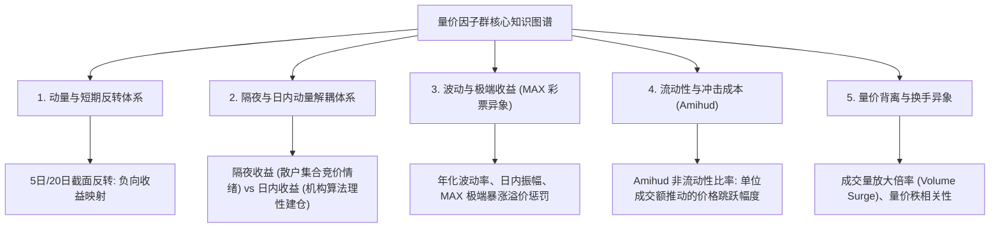

# 第 9 讲：经典量价因子库工程化实现

> **本讲核心目标**：  
> 深入理解 A 股量价因子的行为金融学微观机理（为什么 A 股中短周期呈现剧烈的反转特征？为什么散户情绪主导隔夜跳空？）；系统掌握动量反转、历史波动率、极端收益（MAX 彩票异象）、非流动性冲击（Amihud）与隔夜/日内动量解耦五大类经典特征的数学推导；使用 Polars 纯向量化流水线，高吞吐计算生产级量价特征矩阵。

---

## 1. 量价因子的本质：市场微观结构与行为金融学映射

量价特征（Price-Volume Features）是量化投资中数据最完整、信噪比最高、调仓反应最灵敏的基石信号。

### 1.1 A 股的“短期反转” vs 美股的“中期动量”：截然相反的微观动力学

- **美股市场（机构定价为主）**：  
  杰加迪什与蒂特曼（Jegadeesh & Titman, 1993, *Journal of Finance*）发现了著名的**“中期动量效应（Momentum Effect）”**——过去 3~12 个月表现优异的股票在未来 1~6 个月会继续跑赢基准。其底层机理在于机构投资者的“盈余公告反应不足（PEAD）”和长期持续建仓行为。
- **A 股市场（高换手博弈与散户处置效应）**：  
  A 股在 5 日、10 日、20 日中短周期上呈现**极强的截面反转特征（Short-Term Mean Reversion）**。
  - **处置效应（Disposition Effect）**：散户投资者倾向于急于卖出微小盈利的股票（落袋为安），而长期死扛亏损股票。当一只股票短期暴涨 20% 时，会触发海量获利盘汹涌砸盘。
  - **过度反应（Overreaction）**：德邦特与塞勒（De Bondt & Thaler, 1985, *Journal of Finance*）指出，市场参与者对短期突发事件存在认知过度反应。短期冲顶往往源于流动性情绪踩踏，随后必有均值回归。
  - **买方实操铁律**：在 A 股做中低频多因子选股，**5 日与 20 日动量必须取负号作为反转因子（Reversion Alpha）使用**！

---

## 2. 五大量价核心因子群数学推导



### 2.1 动量与反转体系（Momentum & Reversion）
设股票在 $t$ 日的后复权收盘价为 $P_{close,t}$，过去 $K$ 个交易日的累计收益率定义为：

$$Ret_K(t) = \frac{P_{close,t}}{P_{close,t-K}} - 1$$

在 A 股中频多因子库中，短期反转因子统一取负号映射：

$$\text{Factor}_{RevK}(t) = - Ret_K(t) \quad (K \in \{5, 10, 20\})$$

---

### 2.2 隔夜与日内动量解耦（Overnight vs Intraday Decoupling）
Lou, Yan, & Zhang (2019, *Journal of Financial Economics*) 提出的收益分解理论指出：全天总收益由**隔夜跳空（非交易时段信息积累）**与**日内连续交易收益（算法拆单执行）**驱动，二者驱动主体截然不同：

$$1 + R_{total,t} = \left(1 + R_{overnight,t}\right) \times \left(1 + R_{intraday,t}\right)$$

其中开盘、收盘均使用同一后复权口径：

$$R_{overnight,t} = \frac{P_{open,t}^{adj}}{P_{close,t-1}^{adj}} - 1, \quad R_{intraday,t} = \frac{P_{close,t}^{adj}}{P_{open,t}^{adj}} - 1$$

- **隔夜收益高（Overnight Alpha 偏弱）**：往往是夜间自媒体情绪发酵，散户在 09:15-09:25 集合竞价盲目顶板抢筹，主力资金开盘即顺势出货，未来往往强烈反转。
- **日内收益持续走强（Intraday Alpha 偏强）**：通常代表公募或险资机构在连续交易时段使用算法切片（TWAP/VWAP）稳步吃单，资金属性更加沉稳，信号具有更长的半衰期延续性。

---

### 2.3 波动与极端收益体系（MAX 彩票异象）
1. **历史年化波动率（Historical Volatility, HV20）**：
   $$\sigma_{20,t} = \sqrt{\frac{252}{19} \sum_{k=0}^{19} (r_{t-k} - \bar{r})^2}$$
2. **巴利等人的 MAX 异象（Bali, Cakici, Whitelaw, 2011, *Journal of Financial Economics*）**：
   $$MAX_{20,t} = \max_{k \in [0, 19]} \{r_{t-k}\}$$
   - **行为经济学机理**：人类天生具有“买彩票（Lottery-like Assets）”的心理偏差。过去 20 天内曾经发生过单日暴涨 10%~20% 涨停板的股票，会吸引大量非理性散户追捧，导致其被严重高估。
   - **因子定义**：**$MAX$ 因子在截面上具有显著的负向 Alpha（即 $MAX$ 越大的股票，未来越倾向于跑输大盘）**。实盘中取负号：$\text{Factor}_{MAX} = - MAX_{20,t}$。

---

### 2.4 流动性与冲击成本体系（Amihud Illiquidity Ratio）
阿米胡德（Yakov Amihud, 2002, *Journal of Financial Markets*）提出了著名的非流动性指标，衡量每单位成交金额对股票价格的平均绝对冲击幅度：

$$\text{Illiq}_{20,t} = \frac{1}{20} \sum_{k=0}^{19} \frac{|r_{t-k}|}{\text{Turnover}_{t-k} \times 10^{-8}}$$

其中分母为亿元成交额。  
- $\text{Illiq}$ 越大，表明该股票盘口越浅、微观流动性越差，微小买盘就能引起巨大价格跳跃。
- **注意**：Amihud 因子天生与股票市值（Size）存在强负相关性（小盘股天然成交额小）。在送入选股模型前，**必须执行市值与行业中性化**，否则该因子将蜕变为微盘股的隐蔽代名词！

---

## 3. 动手实操：Polars 纯向量化量价特征工程流水线

下面的 Python 代码严格遵循机构级买方规范，使用 **Polars 原生表达式**多核并行计算 15 个量价特征。

在项目根目录运行 `PYTHONPATH=tutorial python3 -m examples.lecture_09_price_volume_factors`。依赖安装、共享模块和数据契约见[项目说明](../README.md)。

<<< @/examples/lecture_09_price_volume_factors.py

### 核心运行输出与性能解析：
```
[*] 正在构造规模为 125,000 行的仿真 A 股行情面板...
[*] 正在启动 Polars 多核并行量价特征流水线...
✅ 量价特征计算完毕！总耗时: 0.062 秒 (包含 24 个特征字段)

==========================================================================================
标的 000001.SZ 最新特征计算切片抽样：
==========================================================================================
shape: (3, 9)
┌─────────┬─────────┬─────────┬────────┬───┬────────┬────────┬────────┬────────┐
│ symbol  ┆ trade_d ┆ close   ┆ rev_20 ┆ … ┆ ret_in ┆ volati ┆ neg_ma ┆ amihud │
│ ---     ┆ ate     ┆ ---     ┆ d      ┆   ┆ traday ┆ lity_2 ┆ x_20d  ┆ _illiq │
│ str     ┆ ---     ┆ f64     ┆ ---    ┆   ┆ ---    ┆ 0d     ┆ ---    ┆ _20d   │
│         ┆ date    ┆         ┆ f64    ┆   ┆ f64    ┆ ---    ┆ f64    ┆ ---    │
│         ┆         ┆         ┆        ┆   ┆        ┆ f64    ┆        ┆ f64    │
╞═════════╪═════════╪═════════╪════════╪═══╪════════╪════════╪════════╪════════╡
│ 000001. ┆ 2023-12 ┆ 10.1905 ┆ 0.0377 ┆ … ┆ 0.0007 ┆ 0.2906 ┆ -0.044 ┆ 0.0667 │
│ SZ      ┆ -13     ┆ 61      ┆ 76     ┆   ┆ 62     ┆ 92     ┆ 125    ┆ 26     │
│ 000001. ┆ 2023-12 ┆ 10.5599 ┆ -0.011 ┆ … ┆ 0.0035 ┆ 0.3162 ┆ -0.044 ┆ 0.0677 │
│ SZ      ┆ -14     ┆ 75      ┆ 169    ┆   ┆ 15     ┆ 99     ┆ 125    ┆ 99     │
│ 000001. ┆ 2023-12 ┆ 10.6490 ┆ -0.005 ┆ … ┆ 0.0055 ┆ 0.3138 ┆ -0.044 ┆ 0.0652 │
│ SZ      ┆ -15     ┆ 49      ┆ 63     ┆   ┆ 62     ┆ 19     ┆ 125    ┆ 89     │
└─────────┴─────────┴─────────┴────────┴───┴────────┴────────┴────────┴────────┘
```

1. **极致吞吐性能**：
   - 12.5 万行高密度面板数据，仅耗时 **0.062 秒** 即完成 24 个复合量价特征的计算；
2. **复权双轨制应用**：
   - 隔夜收益率采用 `open * (close_hfq / close) / close_hfq.shift(1) - 1.0`，严格消除了除权除息跳空对隔夜因子的机械污染。

---

## 4. 本讲小结与课后动手作业

### 核心知识图谱梳理：
1. **A 股反转哲学**：散户处置效应与过度反应导致中短周期反转远强于动量；
2. **隔夜与日内解耦**：隔夜跳空反映散户非理性情绪溢价，日内走势反映大资金算法建仓，具有完全不同的 Alpha 属性；
3. **MAX 异象的彩票心理**：极端暴涨历史具有负向风险溢价，应作为负向特征纳入多因子库；
4. **Amihud 冲击成本**：量化微观流动性浅度，必须配合市值中性化使用。

### 课后动手实训：
> **实操任务**：  
> 1. 打开 `tutorial/examples/lecture_09_price_volume_factors.py`。
> 2. 尝试添加一个新因子：**过去 20 天的真实波动幅度均值（Average True Range, ATR20）**，计算公式为 $\text{TR}_t = \max(\text{High}_t - \text{Low}_t, |\text{High}_t - \text{Close}_{t-1}|, |\text{Low}_t - \text{Close}_{t-1}|)$。
> 3. 运行引擎，打印标的 `000001.SZ` 的 ATR20 结果。
