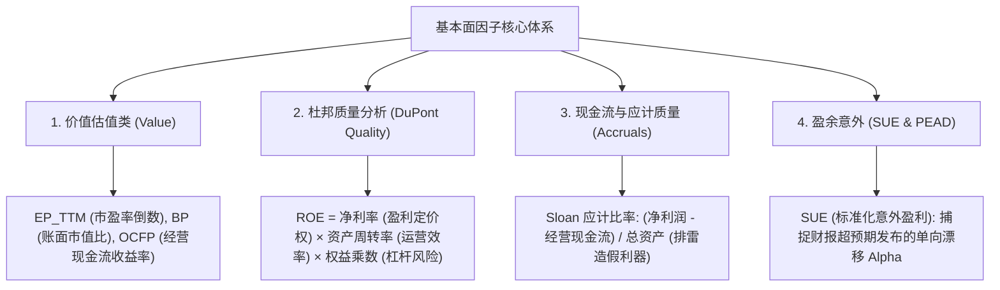

# 第 10 讲：基本面与杜邦质量成长因子挖掘

> **本讲核心目标**：  
> 彻底破除对传统静态市盈率（PE）的盲目迷信，看清“低估值陷阱（Value Trap）”的底层成因；掌握买方级基本面多因子量化框架：价值类（EP/BP/OCFP）、杜邦三因子深度拆解（净利率、周转率与高杠杆惩罚）、Sloan 应计利润异象（Accruals Quality）、Novy-Marx 毛利资产比（GP/A）以及基于盈余公告后漂移效应（PEAD）的标准化意外盈利（SUE）因子；在已经完成 PIT 对齐的截面上计算高稳健基本面特征。

---

## 1. 为什么单纯看 PE/PB 会掉入“低估值陷阱”？

许多初入量化的研究员喜欢直接买入“全市场 PE 最低或 PB 最低”的一篮子股票，认为这就是经典的“巴菲特价值投资”。然而，在真实的 A 股市场，**盲目做多低 PE/PB 股票往往遭遇毁灭性的长期跑输（Value Trap）**。

```
“低估值陷阱”的微观演化路径
某传统周期股 / 产能过剩重资产股
├── 表面现象: 静态 PE 只有 5 倍，PB 只有 0.6 倍 (看似极其“便宜”)
├── 背后真相: 行业面临永久性产业淘汰，未来盈利预期持续断崖下修，资产负债表面临巨额存货与商誉减值
└── 市场定价: 聪明的机构资金早已提前抢跑砸盘，低估值是对极高财务违约与破产风险的“合理风险折价”！
```

### 1.1 现代基本面量化的四维互锁架构
现代买方量化不再做孤立的廉价估值筛选，而是构建**“估值 + 质量 + 成长 + 真实现金流”的四维互锁体系**：
1. **便宜（Value）**：单位市值能换来多少真实净利润与经营现金流（EP, BP, OCFP）；
2. **优质（Quality）**：高 ROE 是来自高效的商业模式与高资产周转，还是靠巨额借债盲目加杠杆吹起的泡沫；
3. **真实（Cash Quality）**：利润是有真金白银现金流支撑，还是靠应收账款虚增的“纸面富贵”；
4. **成长惊喜（Growth Surprise）**：当季利润增速是否大幅超出市场分析师的一致预期（SUE & PEAD）。

---

## 2. 里程碑学术经典：从 Fama-French 到 Sloan 应计异象

1. **五因子定价模型与盈利投资溢价**：  
   Fama, E. F., & French, K. R. (2015). *A five-factor asset pricing model*. Journal of Financial Economics.  
   *核心贡献*：在经典三因子基础上正式加入**盈利能力因子（RMW, Robust Minus Weak）**与**投资风格因子（CMA, Conservative Minus Aggressive）**，证明高质量高盈利企业具有显著长线超额。
2. **毛利资产比（GP/A）的降维打击**：  
   Novy-Marx, R. (2013). *The other side of value: The gross profitability premium*. Journal of Financial Economics.  
   *核心发现*：毛利/总资产（Gross Profits-to-Assets）对未来收益的预测能力远超传统净利润，因为毛利处于利润表最顶层，最不容易被管理层会计粉饰操纵！
3. **Sloan 应计利润异象（The Accrual Anomaly）**：  
   Sloan, R. G. (1996). *Do Stock Prices Fully Reflect Information in Accruals and Cash Flows about Future Earnings?* The Accounting Review.  
   *核心结论*：由应计利润驱动的盈利持续性极差，而由经营现金流驱动的盈利持续性极强。**做多高现金流、做空高应计利润股票能够获得极高的统计套利超额！**
4. **皮奥特罗斯基 F-Score 与莫汉拉姆 G-Score**：  
   Piotroski, J. D. (2000). *Value Investing: The Use of Historical Financial Statement Information to Separate Winners from Losers*. Journal of Accounting Research.  
   Mohanram, P. S. (2005). *Separating Winners from Losers among Low Book-to-Market Stocks using Financial Statement Analysis*. Review of Accounting Studies.

---

## 3. 核心基本面因子数学模型体系



### 3.1 价值类因子（Value Multiples）
为什么买方机构习惯使用 **EP（E/P）**、**BP（B/P）** 和 **OCFP**，而不是 PE 和 PB？
- **数值连续性**：当上市公司微利或发生轻微亏损时，$P/E$ 会趋向正负无穷大或发生剧烈断裂；而 $E/P$ 是完全连续的实数映射，即使利润为负，倒数在横截面统计分布上依然平滑可比！
- **数学公式**：
  $$EP_t = \frac{\text{NetProfit\_TTM}_t}{\text{TotalMarketCap}_t}, \quad BP_t = \frac{\text{TotalEquity}_t}{\text{TotalMarketCap}_t}$$
  $$OCFP_t = \frac{\text{OperatingCashFlow\_TTM}_t}{\text{TotalMarketCap}_t}$$

---

### 3.2 杜邦分析三因子深度拆解（DuPont Decomposition）
净资产收益率（ROE）是衡量股东资本回报率的最高指标。然而，**同样是 20% 的 ROE，背后的商业质量与偿债风险有着云泥之别**：

$$\text{ROE} = \underbrace{\frac{\text{NetProfit}}{\text{Revenue}}}_{\text{销售净利率 (Profit Margin)}} \times \underbrace{\frac{\text{Revenue}}{\text{TotalAssets}}}_{\text{资产周转率 (Asset Turnover)}} \times \underbrace{\frac{\text{TotalAssets}}{\text{TotalEquity}}}_{\text{权益乘数 (Financial Leverage)}}$$

```
杜邦拆解质量判定标准 (买方机构视角)
├── 1. 销售净利率极高 (高端消费、核心半导体、创新药龙头)
│     └── 商业本质: 具备深厚护城河与产品排他性自主定价权 [买方长期超配]
├── 2. 资产周转率极高 (精密制造业、连锁零售巨头)
│     └── 商业本质: 具备卓越的供应链管理能力、零库存控制与极速营运效率 [买方长期超配]
└── 3. 权益乘数畸高 (高负债房地产、城投平台、濒临违约企业)
      └── 商业本质: 自身缺乏造血能力，靠疯狂借贷负债维持表面 ROE [买方严格负向惩罚]
```

- **量化工程实现**：分别构造净利率因子、资产周转率因子，并对权益乘数施加**负向惩罚（控制杠杆风险暴露）**。

---

### 3.3 盈余质量与现金流真实性（Accruals Quality）
上市公司财务造假最经典的套路是：**虚构大额应收账款，账面营业收入与净利润暴涨，但公司银行账户一分钱真实现金都没流入**。

买方量化必用的排雷神器——**斯隆应计利润比率（Sloan Accrual Ratio）**：

$$\text{AccrualRatio} = \frac{\text{NetProfit\_TTM} - \text{OperatingCashFlow\_TTM}}{\text{TotalAssets}}$$

- **判别准则**：$\text{AccrualRatio}$ 越大，说明净利润中没有现金流支撑的“应收款空头支票”越多；
- 优秀企业的经营现金流净额通常**大于或等于其净利润**（$\text{CashToNetProfit} \ge 1.0$）。
- 因子构造：取负号，$\text{Factor}_{Accrual} = - \text{AccrualRatio}$，做多低应计、高真实现金流资产。

---

### 3.4 标准化意外盈利（Standardized Unexpected Earnings, SUE）
盈余公告发布后的超额收益反应：

$$Growth_t = \frac{Q_t - Q_{t-4}}{|Q_{t-4}|}, \quad SUE_t = \frac{Q_t - Q_{t-4}}{\sigma_{t-1}(\Delta Q)}$$

其中 $Q_t$ 与 $Q_{t-4}$ 分别为当期与去年同期的**单季度**归母净利润，分母为历史 8 个季度单季同比变动额的标准差。SUE 能够标准化消除周期性波动，精准捕捉未被分析师预料到的盈利超预期黑马。

---

## 4. 动手实操：买方级基本面多因子计算引擎

下面的 Python 代码严格遵循机构级买方规范，将**调仓日当日市值（市场实时状态）**与**最新已公告 PIT 财报指标（历史合法财务状态）**相结合，纯向量化计算 EP、BP、杜邦三因子与应计质量指标。

在项目根目录运行 `PYTHONPATH=tutorial python3 -m examples.lecture_10_fundamental_factors`。依赖安装、共享模块和数据契约见[项目说明](../README.md)。

<<< @/examples/lecture_10_fundamental_factors.py

### 核心运行输出与商业模式透视：
```
[*] 正在计算买方基本面与杜邦质量特征矩阵...
✅ 基本面特征矩阵计算完成！耗时: 0.026 秒
===============================================================================================
三类不同商业质量标的的杜邦拆解与基本面特征对比：
===============================================================================================
shape: (3, 7)
┌────────┬───────────┬──────────┬───────────┬───────────┬───────────┬──────────┐
│ symbol ┆ factor_ep ┆ roe_ttm  ┆ dupont_ma ┆ dupont_tu ┆ dupont_le ┆ cash_to_ │
│ ---    ┆ _ttm      ┆ ---      ┆ rgin      ┆ rnover    ┆ verage    ┆ profit_r │
│ str    ┆ ---       ┆ f64      ┆ ---       ┆ ---       ┆ ---       ┆ atio     │
│        ┆ f64       ┆          ┆ f64       ┆ f64       ┆ f64       ┆ ---      │
│        ┆           ┆          ┆           ┆           ┆           ┆ f64      │
╞════════╪═══════════╪══════════╪═══════════╪═══════════╪═══════════╪══════════╡
│ DEMO_A ┆ 0.031818  ┆ 0.333333 ┆ 0.5       ┆ 0.538462  ┆ 1.238095  ┆ 1.114286 │
│ DEMO_B ┆ 0.02      ┆ 0.075    ┆ 0.006667  ┆ 2.0       ┆ 5.625     ┆ 5.833333 │
│ DEMO_C ┆ 0.075     ┆ 0.5      ┆ 0.03      ┆ 0.416667  ┆ 40.0      ┆ -5.33333 │
│        ┆           ┆          ┆           ┆           ┆           ┆ 3        │
└────────┴───────────┴──────────┴───────────┴───────────┴───────────┴──────────┘
```

1. **标的 DEMO_A（核心资产典型）**：
   - 净利率高达 50%，资产周转率稳健（0.54），权益乘数极低（1.24，几乎无负债），现金流/净利润比高达 1.11，ROE 为真实的 33.3%，属于顶尖高质量 Alpha 标的；
2. **标的 DEMO_C（高杠杆暴雷房企典型）**：
   - 表面上看，其 $EP = 0.075$（PE 仅 13 倍），表面 ROE 高达惊人的 **50.0%**！
   - 但经过杜邦深度拆解，其权益乘数高达 **40.0**（净资产极薄，负债上万亿），现金流利润比为 **-5.33**（经营现金流巨亏 -80 亿！）。
   - 如果缺乏质量因子排雷，传统模型会误将其当作翻倍大牛股买入，最终换来的是债务违约与股价崩塌！

---

## 5. 本讲小结与课后动手作业

### 核心知识图谱梳理：
1. **EP/BP 胜过 PE/PB**：使用倒数形式是买方标准做法，杜绝微利与亏损时的数值无穷大截断；
2. **杜邦分析去伪存真**：高 ROE 不等于好公司，必须严防依靠财务杠杆吹高的伪 ROE，鼓励“高净利率 + 高资产周转”；
3. **Sloan 应计异象排雷**：经营现金流净额小于净利润的企业蕴含着巨大的坏账与会计操纵风险；
4. **SUE 盈余意外**：标准化后的单季净利润超预期变动能够带来持续的 PEAD 漂移超额。

### 课后动手实训：
> **实操任务**：  
> 1. 打开 `tutorial/examples/lecture_10_fundamental_factors.py`。
> 2. 编写一个函数，根据杜邦三因子构造一个复合质量打分：  
>    $$\text{QualityScore} = \text{Rank}(\text{dupont\_margin}) + \text{Rank}(\text{dupont\_turnover}) - \text{Rank}(\text{dupont\_leverage})$$
> 3. 对比 DEMO_A、DEMO_B、DEMO_C 的综合打分排序，观察高杠杆垃圾资产是否被成功排挤到末位。
