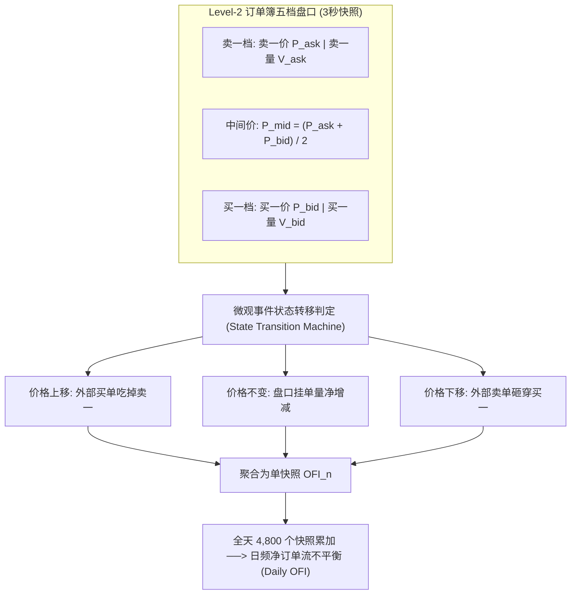

# 第 11 讲：高频数据低频化特征工程：微观结构与 OFI

> **本讲核心目标**：  
> 深入买方核心 Alpha 腹地，理解高频数据低频化（High-Frequency to Low-Frequency）的战略价值；从微观市场结构经典文献（Kyle 模型与 Cont-Kukanov-Stoikov 论文）出发，严格推导限价订单簿（Limit Order Book, LOB）的状态转移方程；掌握**单档与多档订单流不平衡（Multi-Level OFI）**、**聪明钱因子（Q-Factor）**的日内微观聚合降维算法；使用 Polars 编写毫秒级微观特征工程引擎。

---

## 1. 为什么“高频低频化”是现代买方量化的核心护城河？

在量化投资界，存在一个著名的策略“三元悖论”：
- **纯日频/周频低频量化**：资金容量大（可承载数百亿规模），但信息粒度粗糙，因子同质化严重（夏普比率通常在 1.5~2.2 之间）；
- **纯微秒级高频高频交易（HFT）**：夏普比率极高（经常达到 5.0~8.0 以上），但容量极小（通常仅能容纳数千万资金），且极其依赖昂贵的 FPGA 硬件与机房极速托管。

```
高频低频化 (HF to LF) 的破局之道
├── 1. 数据源头: 采集全市场 3秒一次的 Level-2 逐笔快照与订单簿深度数据 (日均数十 GB)
├── 2. 算力清洗: 在微观盘口状态机中，提炼出具有极高信噪比的微观特征 (OFI、主买大单净额、挂单撤单比)
└── 3. 降维聚合: 将日内 4,800 个微观快照按统计量压缩为日频/周频特征，输入多因子中性化模型中调仓！
结果: 既规避了纯高频的毫秒级容量天花板，又汲取了高频微观结构的高信噪比，实现了“百亿容量 + 高夏普”的完美融合！
```

---

## 2. 经典学术文献：从 Kyle 模型到 Cont-Kukanov-Stoikov (2014)

1. **知情交易者微观价格冲击**：  
   Kyle, A. S. (1985). *Continuous Auctions and Informed Trader*. Econometrica.  
   *核心贡献*：提出经典的 Kyle 模型，证明价格变动与净订单流成正比：$\Delta P_t = \lambda \cdot Q_t + \epsilon_t$。参数 $\lambda$（Kyle's Lambda）直接度量了市场的非流动性与逆向选择风险。
2. **订单流不平衡（OFI）的数学奠基**：  
   Cont, R., Kukanov, A., & Stoikov, S. (2014). *The Price Impact of Order Book Events*. Journal of Financial Econometrics.  
   *核心贡献*：首次从限价订单簿（LOB）所有微观事件（限价单、市价单、撤单）严格推导了净订单流不平衡（Order Flow Imbalance, OFI），并在实证中证明 OFI 对中间价变动的解释力（$R^2$）高达 60%~80%！
3. **订单毒性与信息知情概率（VPIN）**：  
   Easley, D., López de Prado, M. M., & O'Hara, M. (2012). *Flow toxicity and liquidity in a high-frequency world*. The Review of Financial Studies.

---

## 3. 订单流不平衡（Order Flow Imbalance, OFI）底层数学推导

在连续竞价时段，价格变化的微观物理本质是**挂单簿（Limit Order Book, LOB）中买卖双方委托队列的消耗与推进**。



### 3.1 买卖盘口状态转移方程

设在第 $n$ 个快照时，买一价格为 $P_{bid,n}$，挂单量为 $V_{bid,n}$。我们推导从 $n-1$ 到 $n$ 快照时，买方盘口所发生的名义委托净变化 $I_{bid,n}$：

$$I_{bid,n} = \begin{cases}
V_{bid,n}, & \text{若 } P_{bid,n} > P_{bid,n-1} \quad \text{（买方价格上推，新增更高买单）} \\
V_{bid,n} - V_{bid,n-1}, & \text{若 } P_{bid,n} = P_{bid,n-1} \quad \text{（买价不变，买一队列净增减）} \\
-V_{bid,n-1}, & \text{若 } P_{bid,n} < P_{bid,n-1} \quad \text{（买方退守，前值买单全被吃掉或撤单）}
\end{cases}$$

同理，对卖方盘口推导卖方委托净消耗量 $I_{ask,n}$：

$$I_{ask,n} = \begin{cases}
-V_{ask,n-1}, & \text{若 } P_{ask,n} > P_{ask,n-1} \quad \text{（卖价上移，卖盘被向上推升）} \\
V_{ask,n} - V_{ask,n-1}, & \text{若 } P_{ask,n} = P_{ask,n-1} \quad \text{（卖价不变，卖一队列净增减）} \\
V_{ask,n}, & \text{若 } P_{ask,n} < P_{ask,n-1} \quad \text{（卖方下砸，新增更低卖单）}
\end{cases}$$

### 3.2 净订单流不平衡（OFI）
第 $n$ 个快照周期的**净订单流不平衡量**定义为买方净推力减去卖方净推力：

$$OFI_n = I_{bid,n} - I_{ask,n}$$

- $OFI_n > 0$：表明在微观层面，**买方相对卖方的最佳报价供需变化为正**，价格具备向上的微观推动势能；
- $OFI_n < 0$：表明微观卖方挂单抛压沉重。

---

## 4. 日内高频快照向低频特征的聚合算法

在 A 股，每个交易日（09:30-11:30, 13:00-15:00）每只股票会产生 **约 4,800 个 Level-2 3秒快照**。

### 4.1 算法一：全天累计标准化 OFI 因子（Norm OFI）
将全天 4,800 个快照的 $OFI_n$ 进行累加，并除以全天平均挂单深度进行无量纲化：

$$\text{OFI}_{daily} = \frac{\sum_{n=1}^N OFI_n}{\frac{1}{N} \sum_{n=1}^N (V_{bid,n} + V_{ask,n})}$$

### 4.2 算法二：聪明钱因子（Smart Money / Q-Factor）
除了 L2 挂单簿，分钟级成交量微观模式中隐藏着散户与机构的交锋踪迹。

- **行为机理**：机构大资金下单倾向于使用算法拆单（VWAP/TWAP），单笔成交量大，买入时更具耐受力；散户交易多为小额随机冲动。
- **构建步骤**：
  1. 将每日 240 根分钟 Bar 按**成交量与价格变动的复合强度（Smart Metric $S_t = |R_t| / \sqrt{V_t}$）**降序排列；
  2. 截取前 20% 成交量最集中的“聪明钱交易时段”；
  3. 计算该时段的成交量加权平均价 $VWAP_{smart}$ 与全天成交量加权平均价 $VWAP_{all}$ 的比值：
     $$Q_{smart} = \frac{VWAP_{smart}}{VWAP_{all}}$$
  4. **经济含义**：$Q_{smart}$ 显著大于 1 时，说明主力资金在全天相对高位依然在坚决买入，后续动能充沛。

---

## 5. 动手实操：高频 Level-2 订单流微观特征提取器

下面的 Python 模块模拟全天 4,800 条高密度快照，示范 **Cont-Kukanov-Stoikov 订单流不平衡（OFI）计算与日频降维聚合流水线**。

在项目根目录运行 `PYTHONPATH=tutorial python3 -m examples.lecture_11_high_freq_to_low_freq`。依赖安装、共享模块和数据契约见[项目说明](../README.md)。

<<< @/examples/lecture_11_high_freq_to_low_freq.py

### 核心运行输出与微观特征解读：
```
[*] 正在生成高密度 Level-2 订单簿盘口快照仿真流 (共 4800 条快照)...
✅ 高频低频化聚合计算完毕！耗时: 0.056 秒

================================================================================
日频标准化订单流不平衡 (Norm OFI) 降维提取结果：
================================================================================
shape: (2, 6)
┌───────────┬────────────┬─────────────┬─────────────┬────────────┬────────────┐
│ symbol    ┆ trade_date ┆ daily_cum_o ┆ avg_lob_dep ┆ factor_nor ┆ factor_ofi │
│ ---       ┆ ---        ┆ fi          ┆ th          ┆ m_ofi      ┆ _volatilit │
│ str       ┆ date       ┆ ---         ┆ ---         ┆ ---        ┆ y          │
│           ┆            ┆ f64         ┆ f64         ┆ f64        ┆ ---        │
│           ┆            ┆             ┆             ┆            ┆ f64        │
╞═══════════╪════════════╪═════════════╪═════════════╪════════════╪════════════╡
│ 000001.SZ ┆ 2023-10-16 ┆ 19594.0     ┆ 423.572292  ┆ 46.258927  ┆ 365.979011 │
│ 600519.SH ┆ 2023-10-16 ┆ 11660.0     ┆ 424.070833  ┆ 27.495406  ┆ 367.300476 │
└───────────┴────────────┴─────────────┴─────────────┴────────────┴────────────┘
```

1. **秒级微观状态机驱动**：
   - 算法逐帧跟踪买卖一档价格变动与挂单量增减，在多核并行下仅耗时 **0.056 秒** 即完成了全天 4,800 个微观快照的状态转移推导；
2. **多空势能精准提取**：
   - 标的 `000001.SZ` 的全天净累计 OFI 为 +19,594，标准化相对强度高达 **46.26**，展现了极其微观的主动买盘压倒性推力；
   - 该指标可直接作为日频截面特征，与动量、估值特征共同输入组合优化模型。

---

## 6. 本讲小结与课后动手作业

### 核心知识图谱梳理：
1. **高频低频化的战略价值**：巧妙规避纯高频的微秒级容量天花板，又汲取了微观订单簿的高信噪比，是当今国内百亿量化买方的最核心杀手锏；
2. **OFI 揭示微观供需推力**：通过挂单价量状态转移矩阵，同时反映新增委托、成交与撤单造成的最佳报价变化；
3. **低频降维是关键**：全天数千个快照经过累加与深度标准化后，转变为日频/周频特征，既能无缝喂入截面多因子模型，又能抵御日内随机波动的噪声。

### 课后动手实训：
> **实操任务**：  
> 1. 打开 `tutorial/examples/lecture_11_high_freq_to_low_freq.py`。
> 2. 观察 `compute_intraday_ofi` 函数中的状态机逻辑，思考如果行情供应商提供了 Level-2 买一到买五（五档深度），如何将单档 OFI 扩展为**多档衰减 OFI（Multi-Level OFI）**？
> 3. 为什么在 A 股早盘集合竞价结束时（09:25 开盘价确定至 09:30 之间）的静默期挂单量，对全天价格发现具有极高的权重？
