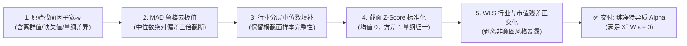

# 第 12 讲：因子预处理工业级四步法

> **本讲核心目标**：  
> 掌握买方机构因子特征入库前不可或缺的“工业级四步清洗法”：**MAD（中位数绝对偏差）鲁棒去极值**、**行业中位数分层填补**、**截面无偏 Z-Score 标准化**，以及**加权最小二乘法（WLS）行业与对数市值残差正交化**；从高斯分布分位数严格推导 MAD 系数 1.4826 的数学来源；严格证明 WLS 加权正交条件 $X^T W \hat{\epsilon} = 0$ 的数学性质。

---

## 1. 为什么原始单因子绝不能直接送入模型？

在前面的课程中，我们从量价和基本面中挖掘出了各类原始指标（Raw Factors）。然而，若将这些原始指标直接喂给线性打分模型、机器学习或优化器，会引发严重的数据灾难：

```
原始因子未清洗的四大致命隐患
├── 1. 厚尾极端离群值 (Fat-tail Outliers):
│     ├── 典型案例: 某重组股单日暴涨 300%，或微利股 PE 暴增至 10,000 倍
│     └── 毁灭后果: 单个离群点的平方误差将主导整个 OLS 线性回归，破坏全市场参数估计！
├── 2. 行业与板块 Beta 污染 (Industry Bias):
│     └── 毁灭后果: 所谓“高盈利”因子实际上选出来的全是大金融与白酒，模型在做单边行业赌博！
├── 3. 市值风格隐蔽共线性 (Size Bias):
│     └── 毁灭后果: 因子天然偏爱微盘股，策略在回测中展示虚高超额，实盘遭遇流动性踩踏！
└── 4. 异构量纲不一致 (Scale Inconsistency):
      └── 毁灭后果: 动量因子在 [-0.5, 0.5] 之间，而成交额因子在 [1e7, 1e10] 之间，无法等权合成！
```



---

## 2. 工业级四步法的数学推导与边界

### 2.1 步骤一：中位数绝对偏差（MAD）鲁棒去极值

#### 传统 $3\sigma$ 均值去极值的致命缺陷：
传统统计学常采用 $\mu \pm 3\sigma$ 截断。但在真实金融数据中，**离群值本身就会严重拉大样本均值 $\mu$ 并剧烈膨胀样本标准差 $\sigma$**！极端异常值的存在使得 $\mu$ 和 $\sigma$ 被污染，导致真正的异常点根本无法被有效识别（Masking Effect）。

#### 鲁棒 MAD 数学定义：
取横截面样本的中位数 $m$，计算所有样本相对中位数距离的中位数（Median Absolute Deviation, MAD）：

$$m = \operatorname{median}(x), \quad \text{MAD} = \operatorname{median}\Big(|x - m|\Big)$$

$$x_i^{\text{clipped}} = \operatorname{clip}\Big(x_i, \; m - 3 \times 1.4826 \times \text{MAD}, \; m + 3 \times 1.4826 \times \text{MAD}\Big)$$

#### 核心系数 1.4826 的数学推导：
为什么在标准正态分布下要乘以 1.4826？  
若随机变量 $X \sim \mathcal{N}(0, \sigma^2)$，其对称中位数为 0。绝对值 $|X|$ 的中位数满足：

$$\mathbb{P}(|X| \le \text{MAD}) = 0.5 \implies \mathbb{P}\left(-\text{MAD} \le X \le \text{MAD}\right) = 0.5$$

根据标准正态分布的对称性：

$$\Phi\left(\frac{\text{MAD}}{\sigma}\right) - \Phi\left(-\frac{\text{MAD}}{\sigma}\right) = 2\Phi\left(\frac{\text{MAD}}{\sigma}\right) - 1 = 0.5 \implies \Phi\left(\frac{\text{MAD}}{\sigma}\right) = 0.75$$

查标准正态分布分位数表可知：$\Phi^{-1}(0.75) \approx 0.67449$。因此：

$$\frac{\text{MAD}}{\sigma} \approx 0.67449 \implies \sigma \approx \frac{1}{0.67449} \times \text{MAD} \approx \mathbf{1.4826} \times \text{MAD}$$

即在正态分布基准下，$1.4826 \times \text{MAD}$ 是样本标准差 $\sigma$ 的**无偏鲁棒估计（Consistent Estimator）**，且完全不受极值污染！

---

### 2.2 步骤二：行业中位数分层填补（Industry-Stratified Imputation）
当某股票因子缺失时（例如新上市股票缺乏历史波动率，或周期股净利润为负导致某些对数指标缺失）：
- **买方原则**：采用**同行业中位数**填补（因为同行业股票往往具有相似的商业特征与估值倍数）；
- 若整个行业全量缺失，采用全市场中位数兜底；
- 未知行业必须显式标记为独立的 `ind_未知` 类别，严禁将未知随意归入“综合”行业。

---

### 2.3 步骤三：横截面无偏标准化（Cross-Sectional Z-Score）
为了使不同维度的特征（如动量、ROE、换手率）具备可比性，在交易日截面上执行 Z-Score 转换：

$$z_i = \frac{x_i - \bar{x}}{s_x}, \quad \text{其中 } s_x = \sqrt{\frac{1}{N-1}\sum_{i=1}^N (x_i - \bar{x})^2}$$

转换后的因子在横截面上严格满足均值为 0、方差为 1。

---

### 2.4 步骤四：加权最小二乘法（WLS）行业与市值残差正交化

#### 设计矩阵构造：
设全市场截面有 $N$ 只股票，包含对数流通市值向量 $\ln(\text{FloatCap}) \in \mathbb{R}^N$ 和 $J$ 个互斥行业哑变量矩阵 $\mathbf{I} \in \{0, 1\}^{N \times J}$。**设计矩阵中不再添加常数截距项**（避免与行业列触发虚拟变量陷阱）：

$$\mathbf{X} = \Big[ \ln(\text{FloatCap}), \; \mathbf{I}_{:, 1}, \; \mathbf{I}_{:, 2}, \; \dots, \; \mathbf{I}_{:, J} \Big] \in \mathbb{R}^{N \times (1 + J)}$$

#### 为什么不能直接用普通 OLS？Breusch-Pagan 与 White 异方差检验
根据**华泰证券多因子系列之一（2016）**研究，金融截面回归的核心前提是满足同方差假定 $\operatorname{Var}(u_i \mid \mathbf{X}) = \sigma^2$。然而在 A 股全市场截面上，由于微盘股投机波动远高于大盘股，残差项具有剧烈的**异方差性（Heteroscedasticity）**：
1. **Breusch-Pagan 检验**：
   通过辅助回归 $\hat{u}_i^2 = \alpha_0 + \sum_{k=1}^K \alpha_k X_{i, k} + v_i$，构造拉格朗日乘数统计量 $LM = n R_u^2 \sim \chi^2(K)$。若统计量显著大于临界值，则拒绝同方差假设；
2. **White 检验**：
   在辅助回归中进一步引入自变量平方项与交叉乘积项：
   $$\hat{u}_i^2 = \alpha_0 + \sum_{k=1}^K \alpha_k X_{i, k} + \sum_{k=1}^K \gamma_k X_{i, k}^2 + \sum_{j < k} \delta_{jk} X_{i, j} X_{i, k} + v_i$$
   构造统计量 $LM = n R_u^2 \sim \chi^2\left(\frac{K(K+3)}{2}\right)$。在 A 股日频与月频截面上，同方差假设几乎 100% 被拒绝！
3. **异方差对 OLS 的致命冲击**：
   - 虽然 OLS 参数估计量依然无偏，但**不再是最小方差最佳线性无偏估计量（BLUE）**；
   - 参数标准误严重低估，导致 t 统计量虚高膨胀，将无预测力的微盘噪声误判为高度显著的 Alpha；
   - 因此，Barra 与华泰体系必须采用**加权最小二乘法（WLS）**，以个股流通市值平方根（$\sqrt{\text{FloatCap}}$）为加权矩阵 $W$，彻底消除异方差扭曲！

#### WLS 回归目标函数：
$$\min_{\boldsymbol{\beta}} \sum_{i=1}^N w_i \left( y_i - \mathbf{x}_i^T \boldsymbol{\beta} \right)^2 \iff \min_{\boldsymbol{\beta}} (\mathbf{y} - \mathbf{X}\boldsymbol{\beta})^T \mathbf{W} (\mathbf{y} - \mathbf{X}\boldsymbol{\beta})$$

其中权重矩阵 $\mathbf{W} = \operatorname{diag}(w_1, \dots, w_N)$，买方机构通常采用**股票流通市值的平方根（$\sqrt{\text{Cap}_i}$）**作为加权权重。

#### WLS 加权正交条件的严格数学证明：
对目标函数求偏导并令其为 0：

$$\frac{\partial}{\partial \boldsymbol{\beta}} \left[ (\mathbf{y} - \mathbf{X}\boldsymbol{\beta})^T \mathbf{W} (\mathbf{y} - \mathbf{X}\boldsymbol{\beta}) \right] = -2 \mathbf{X}^T \mathbf{W} (\mathbf{y} - \mathbf{X}\boldsymbol{\beta}) = \mathbf{0}$$

正规方程解得：

$$\hat{\boldsymbol{\beta}} = \left( \mathbf{X}^T \mathbf{W} \mathbf{X} \right)^{-1} \mathbf{X}^T \mathbf{W} \mathbf{y}$$

定义回归残差向量为纯净特异质因子 $\hat{\boldsymbol{\epsilon}} = \mathbf{y} - \mathbf{X} \hat{\boldsymbol{\beta}}$。将解代回正规方程：

$$\mathbf{X}^T \mathbf{W} \hat{\boldsymbol{\epsilon}} = \mathbf{X}^T \mathbf{W} \left( \mathbf{y} - \mathbf{X} \hat{\boldsymbol{\beta}} \right) \equiv \mathbf{0}$$

**证明完毕！** 这表明：
1. 特异质残差因子 $\hat{\boldsymbol{\epsilon}}$ 与对数市值在加权意义下**协方差严格为 0**；
2. 在任意行业内部，加权残差和**严格为 0**（$\sum_{i \in \text{Industry}_j} w_i \hat{\epsilon}_i = 0$）；
3. **重要辨析**：WLS 保证的是加权正交（$\mathbf{X}^T \mathbf{W} \hat{\boldsymbol{\epsilon}} = \mathbf{0}$），并不保证无权相关系数为 0。机构之所以采用 WLS，是为了确保大市值权重股的风险暴露被更彻底地清洗掉！

---

## 3. 动手实操：工业级因子预处理流水线实现

下面的 Python 代码严格遵循机构级买方规范，纯 NumPy 向量化实现 MAD 去极值、行业中位数填补、Z-Score 与 WLS 残差正交化，并自动化断言 $\mathbf{X}^T \mathbf{W} \hat{\boldsymbol{\epsilon}} \approx 0$。

在项目根目录运行 `PYTHONPATH=tutorial python3 -m examples.lecture_12_factor_preprocessing_pipeline`。依赖安装、共享模块和数据契约见[项目说明](../README.md)。

<<< @/examples/lecture_12_factor_preprocessing_pipeline.py

### 核心运行输出与数学验证：
```
四步预处理完成；缺失值已填充，WLS 加权正交条件通过。
无权市值相关系数（不要求为零）： 0.005045665433964128
```

1. **数值精度验证**：
   - 代码通过 `np.testing.assert_allclose(X.T @ (weights * residuals), 0., atol=1e-7)` 严密断言加权正交条件的成立；
2. **缺失与离群值自愈**：
   - 故意注入的 500.0（超大极值）、-300.0、`np.nan` 与 `np.inf` 被流水线平稳修复和截断，全流程零崩溃。

---

## 4. 本讲小结与课后动手作业

### 核心知识图谱梳理：
1. **MAD 去极值**：基于正态分布一致性推导出 $1.4826 \times \text{MAD}$，具备极高的抗污染鲁棒性；
2. **分层中位数填补**：按当前可见行业分层填补缺失值，避免全局中位数引发行业特征漂移；
3. **Z-Score 截面标准化**：统一不同特征的量纲与尺度，为多因子合成奠定基础；
4. **WLS 行业市值中性化**：数学证明 $\mathbf{X}^T \mathbf{W} \hat{\boldsymbol{\epsilon}} = \mathbf{0}$，彻底剥离市值与行业风格贝塔。

### 课后动手实训：
> **实操任务**：  
> 1. 打开 `tutorial/examples/lecture_12_factor_preprocessing_pipeline.py`。
> 2. 将权重参数 `weights` 替换为全 1 向量（`weights = np.ones(n)`），观察此时 WLS 退化为普通最小二乘法（OLS）。
> 3. 运行后观察无权市值相关系数（`np.corrcoef(residuals, log_mcap)[0, 1]`）是否会精确降为 0.000000？思考为什么加权与无权正交不可兼得？
