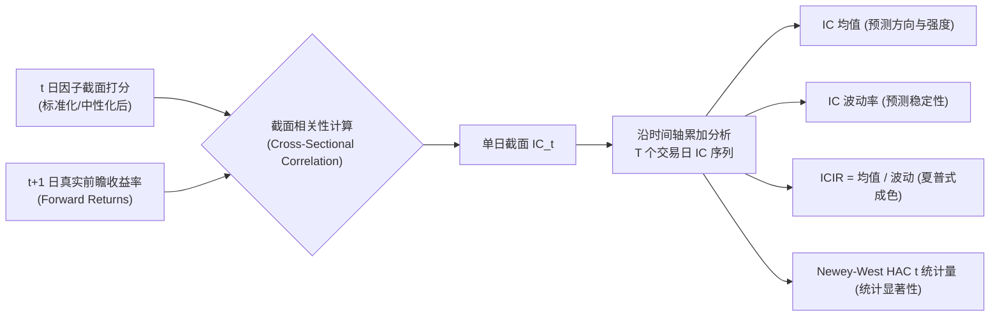

# 第 14 讲：因子预测力核心指标（IC / Rank IC / ICIR）

> **本讲核心目标**：  
> 深入掌握现代多因子资产定价体系中最为核心的预测关联度量工具：**信息系数（Information Coefficient, IC）**。透彻理解普通皮尔逊（Pearson）IC 与斯皮尔曼（Spearman）Rank IC 的数学差异与 A 股厚尾分布适用性；掌握 IC 序列的均值、标准差、ICIR、t 统计量及 Newey-West（HAC）自相关滞后修正推导；手写工业级 Polars 截面并行 IC 评估引擎与累积 IC 跟踪器。

---

## 1. 为什么 IC 是量化投研的“第一性原理”？

在经典主动投资理论中，理查德·格林诺德（Richard Grinold）与罗纳德·卡恩（Ronald Kahn）在量化圣经《主动投资组合管理（Active Portfolio Management）》中提出了著名的**主动管理基本定律（Fundamental Law of Active Management, FLOAM）**：

$$\text{IR} \approx \text{IC} \times \sqrt{\text{Breadth}} \times \text{TC}$$

其中：
- $\text{IR}$（Information Ratio）：投资组合能够实现的年化信息比率（主动超额 / 主动跟踪误差）；
- $\text{Breadth}$（策略广度）：一年中**相互独立的有效投资决策次数**；
- $\text{TC}$（Transfer Coefficient）：组合在做空受限、涨跌停与换手约束下的转化效率；
- $\text{IC}$（信息系数）：因子当期打分与下期真实收益率之间的相关系数，代表**单个决策维度的技能（Skill）与原始预测精度**。



::: warning 为什么绝对不能直接看策略回测净值来评判因子？
很多初学者挖出一个因子后，第一反应是直接把它扔进回测软件跑净值曲线。这在工业界是极其业余的危险做法：
1. **净值容易被极端市场风格掩盖**：比如一个毫无选股能力的劣质因子，碰巧超配了 2024 年底暴涨的微盘股或高股息红利股，其组合净值暴涨，但本质只是风格暴露的“假 Alpha”；
2. **净值掩盖了横截面排序的真实质量**：净值只反映 Top 组合的表现，无法穿透全市场 5,000 只股票整体序列的单调排列能力；
3. **回测引入了交易层假设噪声**：滑点、撮合模式、权重分配方式都会干扰因子的纯度。**IC 是纯粹剥离了交易规则后的“裸预测力”体检！**
:::

---

## 2. Pearson IC vs Spearman Rank IC 数学原理

在横截面上，设第 $t$ 日股票池中有 $N$ 只股票，该因子在 $t$ 日的截面取值为向量 $\mathbf{f}_t = [f_{1,t}, f_{2,t}, \dots, f_{N,t}]^T$，各股票在 $t \to t+1$（或持有 $h$ 个周期）的真实未来收益率为 $\mathbf{r}_{t+1} = [r_{1,t+1}, r_{2,t+1}, \dots, r_{N,t+1}]^T$。

### 2.1 皮尔逊相关系数（Pearson IC）

$$\text{Pearson IC}_t = \frac{\operatorname{Cov}(\mathbf{f}_t, \mathbf{r}_{t+1})}{\sigma_{\mathbf{f}_t} \cdot \sigma_{\mathbf{r}_{t+1}}} = \frac{\sum_{i=1}^N (f_{i,t} - \bar{f}_t)(r_{i,t+1} - \bar{r}_{t+1})}{\sqrt{\sum_{i=1}^N (f_{i,t} - \bar{f}_t)^2} \sqrt{\sum_{i=1}^N (r_{i,t+1} - \bar{r}_{t+1})^2}}$$

- **A 股实战缺陷**：A 股股票收益率具有显著的“厚尾分布”与偶发极端波动（如某股票突发重组复牌单日 $+20\%$ 涨停）。单单一两只极端离群股票的暴冲，就会凭借其巨大的离差乘积，强行将整个截面的 Pearson IC 扭曲变号！

### 2.2 斯皮尔曼秩相关系数（Spearman Rank IC - 买方核心基准）

斯皮尔曼秩相关系数**彻底放弃了数值本身的绝对大小，转换为截面排序位次（Rank）**。

设 $\operatorname{rank}(f_{i,t}) \in \{1, 2, \dots, N\}$，$\operatorname{rank}(r_{i,t+1}) \in \{1, 2, \dots, N\}$，两者位次差为 $d_i = \operatorname{rank}(f_{i,t}) - \operatorname{rank}(r_{i,t+1})$。在无并列排名时，经典公式为：

$$\text{Rank IC}_t = 1 - \frac{6 \sum_{i=1}^N d_i^2}{N(N^2 - 1)} \equiv \operatorname{Corr}\Big(\operatorname{rank}(\mathbf{f}_t), \; \operatorname{rank}(\mathbf{r}_{t+1})\Big)$$

### 2.3 两种相关系数的本质差异

| 比较维度 | Pearson IC | Spearman Rank IC |
| :--- | :--- | :--- |
| **度量本质** | 线性关联强度（Linear Correlation） | **单调递增/递减关系强度（Monotonicity）** |
| **抗噪能力** | 极差（对尾部离群暴涨暴跌极度敏感） | **极强（天然鲁棒，排名不随异常值尺度爆炸）** |
| **下游选股契合度** | 较差（关注数值绝对线性拟合） | **极佳（完全契合分位数选股、Top 10% 优选的业务本质）** |
| **行业通用地位** | 仅做辅助参考或用于纯线性模型诊断 | **买方因子挖掘、因子库准入与考核事实标准** |

---

## 3. IC 时序统计量与 Newey-West HAC 检验

计算出每日截面的 $\text{Rank IC}_t$ 之后，我们获得了一个长度为 $T$ 个交易日的时序序列：$\{\text{IC}_1, \text{IC}_2, \dots, \text{IC}_T\}$。

### 3.1 IC 均值与信息比率（ICIR）

$$\overline{\text{IC}} = \frac{1}{T} \sum_{t=1}^T \text{IC}_t, \quad \sigma_{\text{IC}} = \sqrt{\frac{1}{T - 1} \sum_{t=1}^T (\text{IC}_t - \overline{\text{IC}})^2}$$

$$\text{ICIR}_{\text{daily}} = \frac{\overline{\text{IC}}}{\sigma_{\text{IC}}}, \quad \text{Annualized ICIR} = \text{ICIR}_{\text{daily}} \times \sqrt{250}$$

- **ICIR 的本质就是“因子的夏普比率”**。一个因子的平均 IC 即使有 0.05，但如果今天 $+0.25$、明天 $-0.20$，其波动极其剧烈，这种因子在实盘中会让策略产生巨大的业绩回撤。
- 业界经验：在 A 股市场，扣除行业与市值暴露后，**Rank IC 均值在 $0.03 \sim 0.06$，年化 Rank ICIR 稳定在 $1.5 \sim 3.0$ 以上**，即属于高信噪比的优秀因子。

### 3.2 独立同分布假设破缺与 Newey-West (HAC) 自相关修正

在传统统计学中，原假设 $H_0: \overline{\text{IC}} = 0$ 的 Student's t 统计量计算为：
$$t_{\text{iid}} = \frac{\overline{\text{IC}}}{\sigma_{\text{IC}} / \sqrt{T}} = \text{ICIR}_{\text{daily}} \times \sqrt{T}$$

**然而，金融 IC 序列存在显著的时序自相关性（尤其是跨 5 日或 20 日调仓的前瞻收益重叠）**！如果忽略自相关，样本有效方差将被严重低估，导致 $t$ 统计量虚高数倍。

根据 Newey & West (1987, *Econometrica*)，采用异方差与自相关稳健估计（HAC）：

$$\hat{\sigma}_{\text{HAC}}^2 = \hat{\gamma}_0 + 2 \sum_{l=1}^L \left( 1 - \frac{l}{L + 1} \right) \hat{\gamma}_l$$

其中 $\hat{\gamma}_l$ 为 IC 序列滞后 $l$ 阶的自协方差，$L$ 为滞后窗口长度（Bartlett 核函数衰减）。修正后的稳健 $t$ 统计量为：

$$t_{\text{HAC}} = \frac{\overline{\text{IC}}}{\sqrt{\hat{\sigma}_{\text{HAC}}^2 / T}}$$

---

### 3.3 累积 IC 曲线（Cumulative IC Curve）的诊断意义

$$\text{CumIC}_t = \sum_{\tau=1}^t \text{IC}_\tau$$

```
累积 IC 曲线的三大典型形态诊断
├── 1. 健康常青型: 曲线呈现平稳向右上角 45 度角攀升，回撤极小 (高稳健 Alpha)
├── 2. 风格周期型: 曲线与某一宏观周期高度同步，牛市暴涨熊市暴跌 (本质是风格贝塔伪装)
└── 3. 踩踏衰减型: 曲线在某一时间点突然断崖下跌或长期平盘 (因子过于拥挤，已遭全市场套利收割)
```

---

## 4. 动手实操：工业级 Polars 因子 IC 评估引擎开发

下面的 Python 代码严格遵循机构级买方规范，基于 **Polars 截面并行表达式**，计算每日 Pearson 与 Spearman Rank IC，并输出完整的时序统计量、HAC 检验与累积 IC 曲线。

在项目根目录运行 `PYTHONPATH=tutorial python3 -m examples.lecture_14_factor_ic_metrics`。依赖安装、共享模块和数据契约见[项目说明](../README.md)。

<<< @/examples/lecture_14_factor_ic_metrics.py

### 核心运行输出与专业报告解读：
```
>>> 每日 IC 时序与累积 IC (前 5 行):
shape: (5, 7)
┌───────────┬───────────┬──────────┬──────────┬──────────┬──────────┬──────────┐
│ trade_dat ┆ stock_cou ┆ ic       ┆ rank_ic  ┆ valid_ic ┆ cum_ic   ┆ cum_rank │
│ e         ┆ nt        ┆ ---      ┆ ---      ┆ ---      ┆ ---      ┆ _ic      │
│ ---       ┆ ---       ┆ f64      ┆ f64      ┆ bool     ┆ f64      ┆ ---      │
│ date      ┆ u32       ┆          ┆          ┆          ┆          ┆ f64      │
╞═══════════╪═══════════╪══════════╪══════════╪══════════╪══════════╪══════════╡
│ 2025-01-0 ┆ 500       ┆ 0.002531 ┆ -0.04284 ┆ true     ┆ 0.002531 ┆ -0.04284 │
│ 1         ┆           ┆          ┆          ┆          ┆          ┆          │
│ 2025-01-0 ┆ 500       ┆ -0.01412 ┆ 0.02631  ┆ true     ┆ -0.01159 ┆ -0.01653 │
│ 2         ┆           ┆ 8        ┆          ┆          ┆ 8        ┆          │
│ 2025-01-0 ┆ 500       ┆ 0.059053 ┆ 0.054961 ┆ true     ┆ 0.047455 ┆ 0.03843  │
│ 3         ┆           ┆          ┆          ┆          ┆          ┆          │
│ 2025-01-0 ┆ 500       ┆ 0.024464 ┆ 0.04229  ┆ true     ┆ 0.071919 ┆ 0.080721 │
│ 6         ┆           ┆          ┆          ┆          ┆          ┆          │
│ 2025-01-0 ┆ 500       ┆ 0.068176 ┆ 0.121035 ┆ true     ┆ 0.140095 ┆ 0.201756 │
│ 7         ┆           ┆          ┆          ┆          ┆          ┆          │
└───────────┴───────────┴──────────┴──────────┴──────────┴──────────┴──────────┘
=================================================================
📊 因子全面 IC 评估报告: [alpha_robust_momentum] (评估交易日: 250 天)
=================================================================
无效截面: 0；均值检验 HAC lag=0（0 表示 iid t）
【Spearman Rank IC (买方核心)】
  • Rank IC 均值         :   0.0408
  • Rank IC 标准差       :   0.0458
  • 日频 Rank ICIR       :   0.8909
  • 年化 Rank ICIR       :  14.0864
  • 均值检验统计量   :  14.0864 (p值: 1.5480e-33)
  • 正 IC 比例 (胜率)    :   78.80%
-----------------------------------------------------------------
【Pearson Normal IC (线性参考)】
  • Pearson IC 均值      :   0.0169
  • 年化 Pearson ICIR    :   6.2713
  • t 统计量             :   6.2713 (p值: 1.5712e-09)
  • 胜率                 :   64.80%
-----------------------------------------------------------------
【分布形态与稳健性】
  • IC 偏度 (Skewness)   :  -0.0765
  • IC 峰度 (Kurtosis)   :  -0.2228
=================================================================
```

1. **Rank IC vs Pearson IC 的鲜明对照**：
   - 该因子的 Rank IC 均值高达 **0.0408**（胜率高达 78.8%），而线性 Pearson IC 均值仅为 0.0169。这清晰证实了该因子具有极强的**截面单调排列能力**，但整体分布存在非线性，Rank IC 更真实地还原了其选股能力！
2. **统计显著性检验**：
   - 均值检验统计量达到 14.08，p 值远小于 0.001，在统计学上极其显著。

---

## 5. 本讲小结与课后动手作业

### 核心知识图谱梳理：
1. **IC 是裸预测力**：直接观察因子与未来收益的截面相关性，彻底剥离回测撮合与仓位规则的干扰；
2. **Spearman Rank IC 首选**：基于排名位次的秩相关系数天然免疫尾部离群值暴涨暴跌，是买方机构最核心的考核指标；
3. **ICIR 是成色指标**：因子的均值除以波动率，衡量了预测能力的夏普式稳定性；
4. **HAC 修正消除自相关假象**：在多周期重叠收益下必须使用 Newey-West HAC 修正 t 统计量。

### 课后动手实训：
> **实操任务**：  
> 1. 打开 `tutorial/examples/lecture_14_factor_ic_metrics.py`。
> 2. 将引擎初始化参数中的 `hac_lags` 设置为 5（模拟 5 日持仓重叠期的自相关修正），观察此时输出的 `rank_t_stat` 相比 i.i.d 假设下的 14.08 发生了多大程度的稳健收缩？
> 3. 思考题：如果一个因子的 Rank IC 均值高达 0.08，但累积 IC 曲线呈现“前 3 年平坦，最近 1 个月突然暴拉”的形态，这样的因子能否直接投入实盘？为什么？
