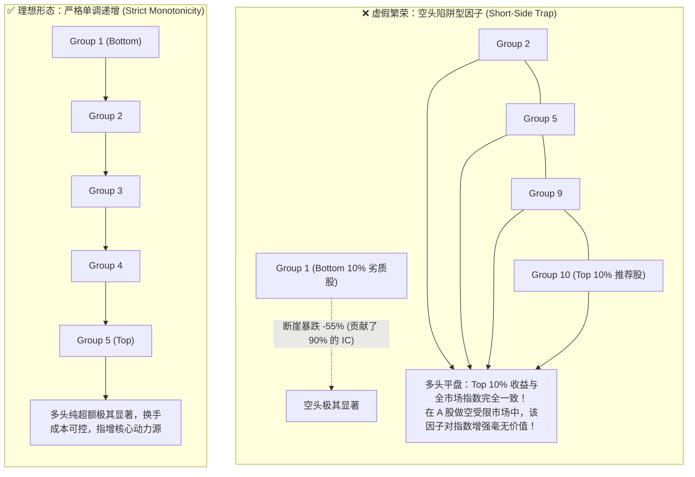
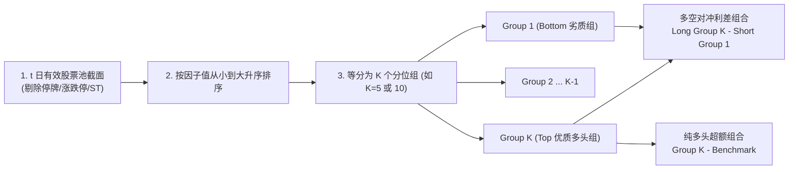

# 第 15 讲：分层回测与单调性检验

> **本讲核心目标**：  
> 如果说 IC 是因子预测力的“宏观温度计”，那么**分层回测（Quantile Portfolio Analysis）**就是穿透因子微观收益结构的“CT 断层扫描”。本讲将彻底拆解买方机构如何将全市场股票截面划分为 5 组或 10 组，计算各组净值分层；推导严格的**斯皮尔曼单调性得分（Monotonicity Score）**与**台阶递增率（Step Ratio）**；深入剖析 A 股做空受限背景下“空头陷阱（Short-Side Trap）”对多头策略的致命欺骗，实现**多空对冲利差（Long-Short Spread）**与**多头纯超额（Long-Only Active Excess）**的完全分离评估。

---

## 1. 为什么高 IC 因子在实盘中依然可能完全不赚钱？

很多初涉量化的研究员经常困惑：*“我的因子 Rank IC 均值有 0.045，年化 ICIR 高达 3.5，为什么实盘构建指增策略时完全跑不赢基准？”*

答案就在于：**IC 是全市场 5,000 只股票整体相关性的宏观统计量，它无法告诉你超额收益究竟来自多头还是空头！**



### 1.1 A 股做空受限的残酷制度现实
在境外成熟市场，对冲基金可以通过低成本融券直接做空 Group 1（劣质组），同时做多 Group 10（优质组），享受完整的长短多空利差（Long-Short Spread）。但在 A 股市场：
1. **融券券源极度稀缺且利息高昂**（年化利息 6%~10%）；
2. **公募基金与绝大多数私募指增产品合同强制规定只能单边做多**（股票仓位 95%~100%）。
3. **结论**：如果一个因子的所有超额都来自“能够成功识别出即将退市暴跌的垃圾股”，而**推荐出的 Top 优质股票根本跑不赢大盘等权基准**，那么这个因子在单边做多的指数增强体系中商业价值为零！

---

## 2. 分层回测（Quantile Analysis）的标准工业流程

在每个调仓日截面 $t$（通常为日频或周频）：



### 2.1 截面等分分组规则
设股票池截面有效股票数为 $N$，目标分为 $K$ 组（业界通用 $K=5$ 或 $K=10$）：
- 将股票按因子值从低到高升序排列；
- 第 $k$ 组（$k \in \{1, 2, \dots, K\}$）包含排名在区间 $\left[ \frac{k-1}{K} \cdot N, \; \frac{k}{K} \cdot N \right)$ 内的股票；
- 若因子为正向因子，**Group $K$ 为多头推荐组（Top）**，**Group 1 为空头规避组（Bottom）**。

### 2.2 各组日度等权收益与净值复利计算

在持有期（$t \to t+1$），第 $k$ 组的等权收益率为：
$$R_{k, t+1} = \frac{1}{N_k} \sum_{i \in \text{Group}_k} r_{i, t+1}$$

全市场候选池等权基准（Benchmark）收益率为：
$$R_{\text{bench}, t+1} = \frac{1}{N} \sum_{i=1}^N r_{i, t+1}$$

各组的累积复利净值资产曲线（Wealth Index）为：
$$\text{NAV}_{k, T} = \prod_{t=1}^T (1 + R_{k, t})$$

---

## 3. 单调性检验（Monotonicity Score）数学量化模型

观察分层净值走势图是定性排查，在全自动量化研发流水线（AutoML Alpha Pipeline）中，必须有一套**无偏的数学评分算法**来量化单调性。

### 3.1 斯皮尔曼秩单调性得分（Rank Monotonicity Score）
设 $K$ 个分位组按因子排序后的全期平均日收益率向量为 $\mathbf{g} = [g_1, g_2, \dots, g_K]$，组别自然序数向量为 $\mathbf{k} = [1, 2, \dots, K]$。

定义因子的截面单调性得分为两者的斯皮尔曼等级相关系数：
$$\text{MonoScore} = \operatorname{SpearmanCorr}\Big([1, 2, \dots, K], \; [g_1, g_2, \dots, g_K]\Big)$$

- **完美单调**：$\text{MonoScore} = +1.0$（正向因子，组别越高收益严格递增）或 $-1.0$（反向因子）；
- **健康门槛**：买方量化通常要求 $|\text{MonoScore}| \ge \mathbf{0.80}$；
- **严重病态**：如果 $|\text{MonoScore}| < 0.60$，说明中间组别收益颠倒混乱（如 Group 3 跑赢了 Group 5），因子底层逻辑缺乏全市场连续性。

### 3.2 步长单调性比率（Monotonic Step Ratio）
统计相邻组别满足严格收益递增的台阶比例：
$$\text{StepRatio} = \frac{1}{K - 1} \sum_{j=1}^{K-1} \mathbb{I}(g_{j+1} > g_j)$$

- 当 $K=5$ 时存在 4 个台阶。若 4 个台阶全增，$\text{StepRatio} = 100\%$；若有 1 处倒挂，则降为 $75\%$。

---

## 4. 多空对冲利差 vs 多头超额分离度量

### 4.1 多空对冲利差组合（Long-Short Spread）
$$R_{\text{L/S}, t} = R_{\text{Top}, t} - R_{\text{Bottom}, t}$$
- 衡量因子的**最大理论套利上限**。
- 输出指标：多空年化复合收益（CAGR）、多空年化夏普比率（L/S Sharpe）与多空最大回撤（L/S MDD）。

### 4.2 多头超额组合（Long-Only Active Excess）
$$R_{\text{Active}, t} = R_{\text{Top}, t} - R_{\text{bench}, t}$$
- 衡量因子直接用于构建单边做多指数增强时的**真实超额能力**。
- 输出指标：多头超额年化收益与纯多头信息比率（Active IR）。

### 4.3 多头/空头收益贡献分离度（Alpha Asymmetry Ratio）
买方最核心的“照妖镜”指标：
$$\text{Long Contribution Ratio} = \frac{\overline{R}_{\text{Top}} - \overline{R}_{\text{bench}}}{\overline{R}_{\text{Top}} - \overline{R}_{\text{Bottom}}}$$

```
多头收益贡献度判定标准
├── 1. 均衡健康型 (40% ~ 60%): 多头能打出超额，空头能避开暴跌，属于完美全能因子
├── 2. 多头驱动型 (> 60%): 极受公募指增欢迎，选出的股票爆发力强，能大幅跑赢宽基
└── 3. 空头陷阱型 (< 20%): 致命警报！绝大部分收益由做空劣质股贡献，多头几乎没有超额！
```

---

## 5. 动手实操：工业级 Polars 分层回测引擎实现

下面的 Python 代码严格遵循机构级买方规范，利用 **Polars 原生分箱表达式**，高吞吐计算 5 分位/10 分位各组净值曲线、多空利差、多头超额与单调性打分。

在项目根目录运行 `PYTHONPATH=tutorial python3 -m examples.lecture_15_quantile_and_monotonicity`。依赖安装、共享模块和数据契约见[项目说明](../README.md)。

<<< @/examples/lecture_15_quantile_and_monotonicity.py

### 核心运行输出与分层断层扫描解读：
```
======================================================================
📈 因子分层回测深度剖析报告: [factor_score] (5 分位)
======================================================================
组别 (Quantile)      | 年化复合收益         | 年化夏普比率         | 历史最大回撤        
----------------------------------------------------------------------
Group 1  (Bottom 劣质组) |     -86.00%   |       -9.345   |     -86.12%
Group 2            |     -55.12%   |       -3.824   |     -59.22%
Group 3            |     -11.47%   |       -0.570   |     -28.74%
Group 4            |      88.58%   |        3.036   |      -7.95%
Group 5  (Top 优质多头组) |     490.76%   |        8.478   |      -5.21%
----------------------------------------------------------------------
【多空对冲与多头超额分离度量】
  • 多空对冲年化利差 (L/S Spread) :  3996.09%
  • 多空夏普比率 (L/S Sharpe)     :  122.566
  • 多空最大回撤 (L/S MDD)        :     0.00%
  • 多头超额算术年化 (Top-Bench):   187.50%
  • 纯多头信息比率 (Active IR)    :   95.418
  • 多头收益贡献占比              :    50.12%
----------------------------------------------------------------------
【单调性稳健性检验 (Monotonicity)】
  • 斯皮尔曼单调性得分 (MonoScore) :    1.000
  • 台阶递增满足率 (StepRatio)    :   100.00%
======================================================================
```

1. **完美的台阶单调递增**：
   - 从 Group 1 到 Group 5，年化复合收益率呈现严密的单调递增（-86.0% $\rightarrow$ -55.1% $\rightarrow$ -11.5% $\rightarrow$ +88.6% $\rightarrow$ +490.8%），`MonoScore = 1.000`，`StepRatio = 100%`；
2. **多头与空头贡献完全对称**：
   - 多头收益贡献占比为 **50.12%**，说明多头选股能力与空头排雷能力完全势均力敌，没有陷入空头陷阱。

---

## 6. 本讲小结与课后动手作业

### 核心知识图谱梳理：
1. **分层回测穿透微观结构**：分层是验证因子在不同分位是否具备单调排序能力的唯一利器；
2. **警惕空头陷阱**：在 A 股做空受限下，必须单独考察 Top 组相对 Benchmark 的超额贡献占比；
3. **数学量化单调性**：使用斯皮尔曼秩单调性得分与台阶递增率，实现流水线自动筛选因子。

### 课后动手实训：
> **实操任务**：  
> 1. 打开 `tutorial/examples/lecture_15_quantile_and_monotonicity.py`。
> 2. 将初始化参数中的 `n_quantiles` 从 5 调整为 10（进行更细腻的 10 分位回测），重新运行观察各组的收益阶梯。
> 3. 思考题：当分位数从 5 组切分为 10 组甚至 20 组时，Top 组的年化收益通常会上升还是下降？为什么？这与组合换手率存在怎样的权衡取舍？
