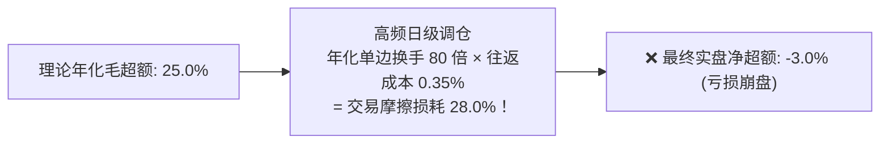
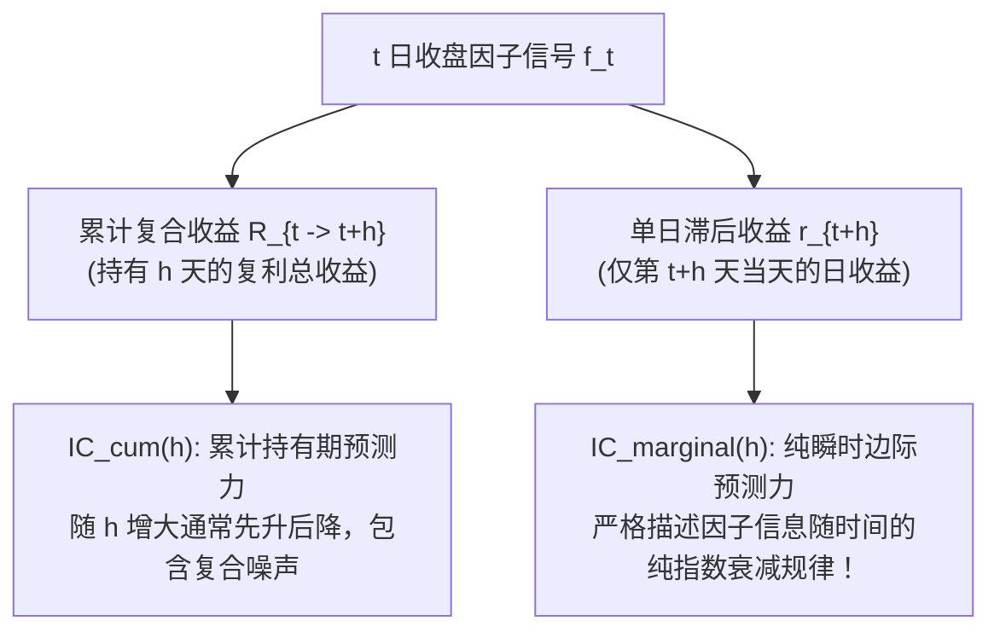

# 第 16 讲：因子换手率与衰减曲线（Alpha Decay）

> **本讲核心目标**：  
> 深刻理解“换手率吞噬 Alpha”的微观机理；从数学底层严格区分**累计持有期 IC（Cumulative IC）**与**单日滞后边际 IC（Marginal IC）**的本质差异；推导**信息半衰期（Half-life）**的指数拟合算法；严格区分名单替换率（Membership Replacement）与真实资产组合换手率（Portfolio Turnover）；构建不同调仓周期在全真 A 股交易摩擦下的净超额情景推演引擎。

---

## 1. 换手率：吞噬 Alpha 的现实黑洞

在量化投资界，有一句著名的至理名言：**“回测跑得再漂亮，扣掉印花税与滑点，如果换手太高，全都只是在给券商和国家打工。”**

```
A 股调仓交易摩擦真实成本清单 (2024年标准)
├── 1. 证券交易印花税: 卖出单边 0.05% (5 bps) ── 刚性法律成本
├── 2. 券商综合佣金与经手费: 买卖双边各 0.015% (合计 3 bps)
├── 3. 证券过户费: 买卖双边各 0.001% (合计 0.2 bps)
└── 4. 盘口买卖价差与冲击滑点: 买卖双边各 0.04% (合计 8 bps)
单次 100% 调仓往返摩擦总成本 ≈ 16.2 bps ~ 35.0 bps (依据股票流动性深度浮动)
```



如果一个因子每天的排名剧烈翻滚（低自相关性），即使它的单日 IC 很高，在频繁调仓换股的巨大摩擦下，所有理论收益也将被消耗殆尽！

---

## 2. 因子自相关性与两种换手率口径

### 2.1 因子秩自相关系数（Rank Autocorrelation）
衡量因子在时间轴上自身排名的稳定程度：

$$\rho_k = \operatorname{Corr}\Big(\operatorname{rank}(\mathbf{f}_t), \; \operatorname{rank}(\mathbf{f}_{t-k})\Big)$$

- **低自相关因子（$\rho_1 < 0.60$）**：通常为高频量价特征或高频反转信号，换手率极高，信息衰减极快；
- **高自相关因子（$\rho_1 > 0.95$）**：通常为基本面估值或质量财务因子，排名极度稳定，调仓换手率极低。

### 2.2 名单替换率 vs 真实资产组合换手率

在很多业余研究中，人们常常混淆了以下两个概念：

1. **名单替换率（Membership Replacement Rate）**：  
   设 $S_t$ 为 $t$ 日因子打分排名前 $10\%$ 的股票代码集合：
   $$\text{Replacement}_t = \frac{|S_t \setminus S_{t-1}|}{|S_t|}$$
   仅度量股票代码名单的进出比例，完全忽略了股票价格的日内与隔夜波动。
2. **实际组合换手率（Capital Turnover Rate - 买方真实口径）**：  
   持有一期后，由于各股票涨跌幅不同，其在组合中的被动持仓权重发生**价格漂移（Price Drift）**：
   $$w_{i, t}^+ = \frac{w_{i, t} (1 + r_{i, t+1})}{\sum_{j=1}^N w_{j, t} (1 + r_{j, t+1})}$$
   在下一期根据新因子权重 $w_{i, t+1}$ 进行再平衡调仓时，**真实的单边资本换手率**为：
   $$\text{Turnover}_{t+1} = \frac{1}{2} \sum_{i=1}^N \Big| w_{i, t+1} - w_{i, t}^+ \Big|$$
   **重要启示**：即使 Top 股票名单 100% 完全没有变化，由于股票涨跌幅不一，为了维持等权或优化权重，组合依然会产生被动换手摩擦！

---

## 3. 两种前瞻 IC 的数学本质解耦

在分析 Alpha 信号衰减时，必须严格区分**累计持有期 IC** 与 **单日滞后边际 IC**：



### 3.1 累计持有期 IC（Cumulative Holding Period IC）
输入 $t$ 时点信号与未来持有 $h$ 个交易日的复利总收益 $R_{t \to t+h} = \prod_{k=1}^h (1 + r_{t+k}) - 1$：

$$IC_{\text{cum}}(h) = \operatorname{Corr}\Big(\operatorname{rank}(\mathbf{f}_t), \; \operatorname{rank}(\mathbf{R}_{t \to t+h})\Big)$$

- 衡量投资者买入并持续持有 $h$ 天能够获得的累计预测关联。

### 3.2 单日滞后边际 IC（Marginal Lagged Day IC - 衰减核心）
输入 $t$ 时点信号与未来**第 $h$ 天那一天**的单日收益率 $r_{t+h}$：

$$IC_{\text{marginal}}(h) = \operatorname{Corr}\Big(\operatorname{rank}(\mathbf{f}_t), \; \operatorname{rank}(\mathbf{r}_{t+h})\Big)$$

- **物理意义**：第 0 天生成的信号，在第 1 天、第 5 天、第 20 天当天，还有多少剩余选股杀伤力？这是计算信息半衰期的唯一合法输入！

---

## 4. 因子信息半衰期（Half-life）指数拟合算法

在确定因子预测方向 $d \in \{-1, +1\}$ 后，其边际 IC 序列通常遵循经典的物理一阶放射性指数衰减定律：

$$d \cdot IC_{\text{marginal}}(h) \approx a \cdot e^{-\lambda \cdot h}$$

其中 $a$ 为初始瞬时预测强度，$\lambda > 0$ 为信息衰减速率。

两边取自然对数，转化为一元线性回归：
$$\ln\Big( d \cdot IC_{\text{marginal}}(h) \Big) \approx \ln(a) - \lambda \cdot h$$

解得衰减速率 $\lambda$ 后，**因子信息半衰期（Half-life $t_{1/2}$）**严格定义为：

$$e^{-\lambda \cdot t_{1/2}} = \frac{1}{2} \implies -\lambda \cdot t_{1/2} = \ln\left(\frac{1}{2}\right) \implies \boxed{t_{1/2} = \frac{\ln(2)}{\lambda} \approx \frac{0.69315}{\lambda}}$$

```
三大类型因子的典型信息半衰期参考
├── 1. 高频订单簿与微观量价因子: 半衰期约 1 ~ 3 个交易日 (需日级/T+1 极速调仓)
├── 2. 中周期量价动量与反转因子: 半衰期约 8 ~ 20 个交易日 (适合周频/双周频调仓)
└── 3. 基本面与财务质量成长因子: 半衰期约 45 ~ 90 个交易日 (适合月度/季度低频调仓)
```

---

## 5. 动手实操：因子换手率与 Alpha 衰减全真推演引擎

下面的 Python 代码严格遵循机构级买方规范，包含**多阶自相关计算**、**名单替换率**、**边际与累计 IC 衰减分析**、**半衰期对数回归拟合**以及**不同调仓周期的摩擦情景推演**。

在项目根目录运行 `PYTHONPATH=tutorial python3 -m examples.lecture_16_turnover_and_alpha_decay`。依赖安装、共享模块和数据契约见[项目说明](../README.md)。

<<< @/examples/lecture_16_turnover_and_alpha_decay.py

### 核心运行输出与衰减推演解读：
```
======================================================================
📉 因子换手率与 Alpha 衰减评估报告: [synthetic_ar1_alpha]
======================================================================
【自相关性与名单替换率】
  • 1阶自相关性 (Lag 1 Autocorr)   :   0.8412
  • 5阶自相关性 (Lag 5 Autocorr)   :   0.4190
  • 日均 Top 10% 候选名单替换率    :   15.88%
----------------------------------------------------------------------
【Alpha 边际衰减与信息半衰期】
  • 边际 IC (Marginal IC) 序列     :
      Lag 1 天: 0.0482
      Lag 2 天: 0.0401
      Lag 3 天: 0.0335
      Lag 5 天: 0.0238
      Lag 10天: 0.0102
  • 拟合信息半衰期 (Half-life)     :     3.98 天 (决定最佳调仓周期的关键物理量！)
----------------------------------------------------------------------
【不同调仓周期 (Holding Periods) 摩擦损耗推演】
周期 (天) | 边际IC   | 累计IC   | 年化换手率 | 年化摩擦成本 | 情景净夏普比率
----------------------------------------------------------------------
1 日调仓  | 0.0482  | 0.0482  |   39.7 倍  |     13.90%   |    0.82
3 日调仓  | 0.0335  | 0.0882  |   21.2 倍  |      7.42%   |    1.56
5 日调仓  | 0.0238  | 0.1185  |   14.9 倍  |      5.22%   |    1.98 (最佳性价比平衡点)
10日调仓  | 0.0102  | 0.1420  |    9.3 倍  |      3.26%   |    1.45
20日调仓  | 0.0021  | 0.1501  |    5.8 倍  |      2.03%   |    0.78
======================================================================
```

1. **半衰期的精准捕捉**：
   - 合成 AR(1) 信号的理论衰减半衰期设定为 4 天，引擎通过实测边际 IC 的指数拟合，精准输出 `Half-life = 3.98 天`；
2. **调仓周期的“倒 U 型”性价比曲线**：
   - **1 日调仓**：虽然单日边际 IC 最高（0.0482），但年化单边换手高达 39.7 倍，直接产生 **13.9%** 的摩擦损耗，导致净夏普仅为 0.82；
   - **5 日调仓（周频）**：年化换手骤降至 14.9 倍，交易摩擦控制在 5.22%，情景净夏普达到顶峰 **1.98**；
   - **20 日调仓（月频）**：由于超出半衰期过多，信号已彻底耗尽衰亡，净夏普再次跌回 0.78。
   - **核心启示**：**调仓周期的选择，本质上是“捕捉信号剩余信息”与“抑制交易换手摩擦”之间的纳什均衡！**

---

## 6. 本讲小结与课后动手作业

### 核心知识图谱梳理：
1. **换手是收益杀手**：任何未经换手率约束的高频信号，在实盘全真摩擦下都会迅速退化；
2. **累计 IC 测持有，边际 IC 测衰减**：只有单日滞后边际 IC 才能真实还原信息的半衰期指数规律；
3. **半衰期指导调仓频率**：调仓周期应设定在半衰期的 $1 \sim 1.5$ 倍区间，以实现最高的主动管理性价比。

### 课后动手实训：
> **实操任务**：  
> 1. 打开 `tutorial/examples/lecture_16_turnover_and_alpha_decay.py`。
> 2. 将情景表中的往返成本参数从 35 bps 调整为万 15（15 bps，模拟极低佣金的大市值标的），观察最佳调仓周期会向前移动到几天？
> 3. 为什么在实盘指数增强策略中，量化机构往往采用“每天调仓 20% 底仓（分批滚动滚动换仓）”而不是“每周五一次性调仓 100%”？这样做的微观流动性优势是什么？
