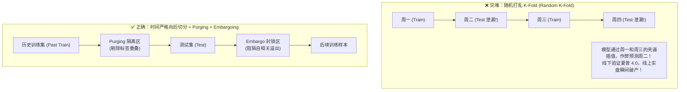
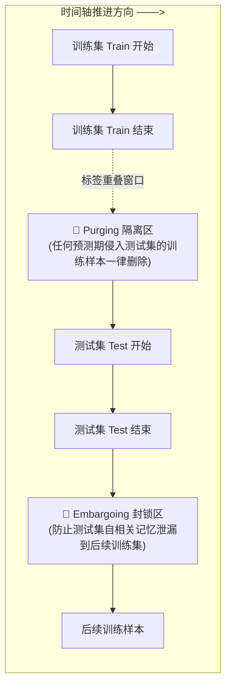

# 第 18 讲：金融时序交叉验证（CV）的正确切法

> **本讲核心目标**：  
> 深刻理解在计算机视觉（CV）或自然语言处理（NLP）中行之有效的标准 K 折交叉验证（Random K-Fold），在金融时序数据上是一场**毁灭性的时序泄漏灾难**；掌握独立同分布（I.I.D.）假设崩塌与重叠标签（Overlapping Labels）渗透机制；推导量化金融先驱马科斯·洛佩斯·德普拉多（Marcos López de Prado）提出的**样本清洗（Purging）**与**缓冲区封锁（Embargoing）**数学原理；手写工业级**组合式清洗交叉验证器（Combinatorial Purged Cross-Validation, CPCV）**。

---

## 1. 为什么普通 K-Fold 在量化金融中是致命毒药？

许多机器学习工程师转入量化后，习惯性调用 `sklearn.model_selection.KFold(shuffle=True)` 进行超参数调优，随即在 Jupyter Notebook 中跑出测试集准确率 $85\%$、夏普比率高达 $4.0$ 的“惊人模型”。但在实盘上线的第一天，模型便开始持续亏损。

### 1.1 独立同分布（I.I.D.）假设的彻底崩塌

标准机器学习交叉验证的核心数学前提是：**样本之间是独立同分布（Independent and Identically Distributed, I.I.D.）的**。而在金融市场中，这一假设被残酷撕碎：

```
金融样本非独立同分布的两大破坏机制
├── 1. 标签时间重叠导致直接窥视未来 (Information Leakage via Overlapping Labels):
│     ├── 业务现实: 若预测目标是未来 5 日收益率 R_{t -> t+5}，t 日的标签覆盖 [t+1, t+5]
│     └── 泄漏真相: 随机打乱将 t 与 t+2 割裂在训练集和测试集，训练集提前看到了测试集未来 3 天的行情！
└── 2. 时序与截面自相关性 (Serial & Cross-Sectional Correlation):
      ├── 业务现实: 宏观情绪、波动率聚集 (GARCH 效应) 使得周一的状态直接延续到周三
      └── 泄漏真相: 把周一和周三作为训练集、周二作为测试集，模型本质是在做“时序插值 (Interpolation)”，
          而不是真实的“时序外推预测 (Forecasting)”！
```



---

## 2. Purging（样本清洗）与 Embargoing（封锁缓冲）数学原理

为了根除标签重叠造成的信息泄漏，量化先驱 Marcos López de Prado 在经典著作《Advances in Financial Machine Learning (2018)》中正式确立了两大核心操作原则：



### 2.1 样本清洗（Purging）：消除标签前向重叠
设样本 $i$ 的特征生成日期为 $t_i$，其预测标签的最终清算结算日期为 $e_i$。在数学上，该样本的信息暴露时间区间为闭区间 $[t_i, e_i]$。

对于任意测试集样本集合 $\text{Test}$，定义测试集在时间轴上的**全局信息覆盖闭包**为：
$$\Omega_{\text{Test}} = \bigcup_{j \in \text{Test}} [t_j, e_j]$$

**Purging 清洗准则**：任何训练集样本 $i$，若其信息区间与测试集信息闭包存在交集，该训练样本必须被**物理剔除**：
$$\text{Train}_{\text{purged}} = \left\{ i \in \text{Train} \;\middle|\; [t_i, e_i] \cap \Omega_{\text{Test}} = \emptyset \right\}$$

- 在多因子选股中，由于我们预测的是未来 5 日（$e_i = t_i + 5$）或 20 日（$e_i = t_i + 20$）的超额收益，测试集开始前必须至少向前清洗剔除掉 $h$ 个交易日的训练样本！

### 2.2 缓冲区封锁（Embargoing）：阻隔自相关后向溢出
当测试集位于中间（如在交叉验证中训练集包含测试集前后的时间段），由于自回归（AR）过程与波动率记忆，测试集末尾的市场状态会持续影响紧随其后的市场。

**Embargoing 封锁准则**：在测试集最晚标签结算点之后，追加设定长度为 $E$ 个交易日的保护缓冲区（Embargo Window）：
$$\Omega_{\text{Embargo}} = \left[ \max_{j \in \text{Test}} e_j, \;\; \max_{j \in \text{Test}} e_j + E \right]$$
任何落入该缓冲区内的后续训练样本一律作废，彻底阻断自相关记忆泄漏！

---

## 3. 组合式清洗交叉验证（CPCV）：告别单一路径狭隘

很多研究员使用朴素的 `TimeSeriesSplit`（前向滚动向后切分），但它存在两大硬伤：
1. **历史测试路径唯一（Single Backtest Path）**：最终只生成一条从头到尾的测试轨迹，无法评估策略在不同历史情景下的泛化方差；
2. **早期数据利用极度不足**：前几个折的训练集样本过小，模型能力受限。

### 3.1 CPCV（Combinatorial Purged Cross-Validation）机制
CPCV 将历史时间序列划分为 $N$ 个时间块（Blocks）。如果设定每个测试集由 $k$ 个时间块组成，那么可以产生：

$$C_N^k = \binom{N}{k} = \frac{N!}{k!(N - k)!}$$

组不重复的训练/测试组合。每一组都严格执行 **Purging** 与 **Embargoing**。

- 例如，取 $N = 6, k = 2$，将产生 $\binom{6}{2} = 15$ 种不重复的切分方案；
- 每次测试覆盖全样本的 $\frac{2}{6} = 33.3\%$，理论上可构造：
  $$\varphi = \binom{N}{k} \times \frac{k}{N} = 15 \times \frac{2}{6} = 5 \text{ 条完整覆盖历史全周期的回测路径！}$$
- **核心价值**：能够评估策略对不同历史市场情景的敏感性，为计算**回测过拟合概率（PBO）**提供了扎实的数据基础。

---

## 4. 动手实操：买方级 Purged Group 时序切分器实现

在横截面量化模型中，同一交易日内全市场 5,000 只股票是一起联合决策的。因此，**切分必须以“日期（Date Group）”为原子单位，绝不能将同一天的股票割裂到不同的折中！**

在项目根目录运行 `PYTHONPATH=tutorial python3 -m examples.lecture_18_financial_cv_purging_embargo`。依赖安装、共享模块和数据契约见[项目说明](../README.md)。

<<< @/examples/lecture_18_financial_cv_purging_embargo.py

### 核心运行输出与切分边界解读：
```
前向折 1: 训练 2023-01-02～2023-09-13，测试 2023-09-21～2024-06-10
前向折 2: 训练 2023-01-02～2024-06-03，测试 2024-06-11～2025-02-26
前向折 3: 训练 2023-01-02～2025-02-19，测试 2025-02-27～2025-11-14
CPCV 生成 15 组有标签清洗的研究切分；不等同于独立样本或实盘前向路径。
```

1. **Purging 隔离区清晰可见**：
   - 在折 1 中，训练集截至 `2023-09-13`，而测试集从 `2023-09-21` 才正式开始。中间留出了整整 6 个交易日的物理隔离区，确保持有期为 5 天的标签在测试集开始前已完全结算！
2. **CPCV 组合全覆盖**：
   - 算法自动生成 15 组经过标签清洗的研究切分，为模型在不同宏观牛熊环境下的压力测试提供了最严密的数据边界。

---

## 5. 本讲小结与课后动手作业

### 核心知识图谱梳理：
1. **金融 I.I.D. 崩塌**：普通随机 K-Fold 在金融时序上会因为标签重叠和自相关性导致虚假高分；
2. **Purging 消除未来标签入侵**：严格剔除所有预测区间侵入测试集的训练样本；
3. **Embargoing 封锁自相关记忆**：在测试集后置结算点增设缓冲区，防止微观状态后向溢出；
4. **CPCV 组合交叉验证**：生成多条非重叠历史路径，为策略鲁棒性压力测试提供数学工具。

### 课后动手实训：
> **实操任务**：  
> 1. 打开 `tutorial/examples/lecture_18_financial_cv_purging_embargo.py`。
> 2. 将标签前瞻持有期 `forward_horizon` 从 5 天增加为 20 天（模拟月度调仓模型），观察此时折 1 中训练集结束日与测试集开始日之间的 Purging 隔离区宽度发生了怎样的相应扩张？
> 3. 思考题：在滚动训练（Walk-Forward Validation）中，如果将模型训练频率从“每月滚动一次”提高为“每周滚动一次”，计算算力消耗与特征更新时效之间存在怎样的权衡？
