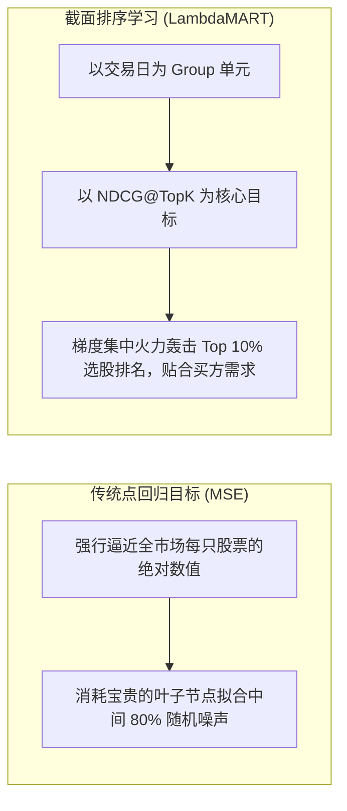
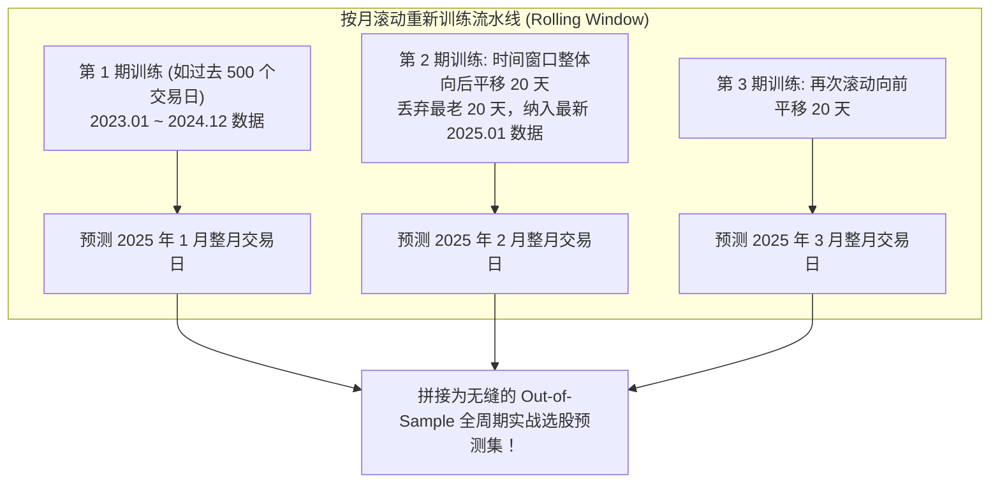

# 第 19 讲：表格级梯度提升树（LightGBM / CatBoost）实战

> **本讲核心目标**：  
> 在现代多因子特征融合体系中，梯度提升决策树（GBDT，以 **LightGBM** 与 **CatBoost** 为代表）长年稳坐买方多因子量化的王者地位。深入理解为什么树模型在金融表格数据上显著击败全连接神经网络；严格推导普通**点回归目标（MSE/Huber）**与**截面排序学习（LambdaMART）**的本质差异；深入剖析 **NDCG@K** 与**虚拟梯度（$\lambda$-Gradient）**的数学原理；掌握买方针对低信噪比数据的极简防过拟合超参数体系。

---

## 1. 为什么 GBDT 是金融表格数据无可争议的“王者”？

在计算机视觉或 NLP 领域，深度学习统治一切；但在以横截面多因子为核心的金融表格数据（Tabular Data）中，**基于树的集成算法（GBDT）在工业界实证中对深度神经网络呈现降维打击**。

NeurIPS 2022 经典顶会论文 *Why do tree-based models still outperform deep learning on typical tabular data?*（Grinsztajn et al.）从理论上阐明了其核心归纳偏置（Inductive Bias）：

```
树模型在金融表格数据中的天然优势
├── 1. 对单调变换与量纲完全免疫:
│     └── 基于分箱直方图 (Histogram) 寻找最优分裂点，不需要对连续变量做严格归一化
├── 2. 天然擅长拟合阶梯型非线性决策面:
│     └── 例如: 资产负债率超过 85% 违约风险暴增、PE 小于 0 发生质变，树模型通过单个阈值即可完美切分
├── 3. 对无用特征 (Uninformative Features) 具备极强的鲁棒性:
│     └── 神经网络会尝试为每一个特征分配权重并反向传播更新；而决策树可直接在根节点忽略无关噪声因子
└── 4. 坐标轴对齐的超平面分裂 (Axis-Aligned Split):
      └── 金融多因子之间多为正交或半独立的经济学维度，旋转不变性网络往往引入额外的拟合噪声
```

---

## 2. 目标函数选择：点回归（Pointwise）vs 排序学习（Listwise LambdaMART）

在构建 LightGBM 模型时，绝大多数初学者会默认设置 `objective = "regression"`（均方误差 MSE）。但这在以“选出 Top 10% 优质股票”为目标的量化选股中，存在根本性的目标错位！

### 2.1 点回归（MSE / Huber）的致命痛点

$$\mathcal{L}_{\text{MSE}}(y, \hat{y}) = \frac{1}{2N} \sum_{i=1}^N (y_i - \hat{y}_i)^2$$

- **误差均匀惩罚的陷阱**：在全市场 5,000 只股票中，中间 80% 股票的未来收益差异极其微小且充满随机游走噪声；
- MSE 逼迫决策树消耗大量分裂叶子节点，去精细化拟合中间垃圾样本的微小数值波动（例如究竟是 $+0.2\%$ 还是 $+0.4\%$），而**真正决定多头组合超额的 Top 10% 头部选股质量却被严重稀释**！

### 2.2 排序学习（Listwise LambdaMART）的数学飞跃

排序学习将**每一个交易日看作一个检索 Query**，该交易日内的 5,000 只股票看作待排序的候选文档（Documents）。

其优化的终极目标是**归一化折损累积增益（Normalized Discounted Cumulative Gain, NDCG@K）**：

$$\text{DCG}@K = \sum_{i=1}^K \frac{2^{rel_i} - 1}{\log_2(i + 1)}, \quad \text{NDCG}@K = \frac{\text{DCG}@K}{\text{IDCG}@K}$$

其中 $rel_i$ 为股票 $i$ 的收益相关度评级（如按未来收益率分成 0~4 档），$i$ 为模型预测排序位次。

- **分母 $\log_2(i + 1)$ 的位置折损机制**：排在第 1 名的股票获得最大权重，排在第 100 名之后的股票权重急剧衰减至近乎为零！
- **LambdaRank 虚拟梯度（$\lambda$-Gradient）数学推导**：  
  由于 NDCG 是非连续的阶梯排序函数、无法直接求导，微软学者 Christopher Burges 等提出了**虚拟梯度 $\lambda_{ij}$**：

$$\lambda_{ij} = \frac{-\sigma}{1 + e^{\sigma(s_i - s_j)}} |\Delta \text{NDCG}|$$

其中：
- $s_i, s_j$ 为模型对股票 $i$ 和 $j$ 的预测打分；
- $|\Delta \text{NDCG}|$ 表示**如果把股票 $i$ 与股票 $j$ 的预测排序位次对调，整个截面 NDCG 的变动差额**！

```
LambdaMART 梯度的微观物理机制
├── 头部排序错位: 若把全市场第 1 名误判到了第 10 名，|ΔNDCG| 极其巨大，λ 梯度暴冲，驱动树全力纠错！
└── 尾部排序错位: 若把第 2,500 名和第 2,501 名颠倒，|ΔNDCG| 几乎严格为 0，树模型直接忽略跳过！
```



---

## 3. 买方级防过拟合超参数控制体系

金融数据的信噪比极低（SNR 通常小于 0.05），严禁使用互联网搜索推荐的通用树模型参数！量化机构的“防过拟合保命参数清单”如下：

| 参数名称 | 机构推荐安全范围 | 默认库参数 | 调优物理含义与买方心法 |
| :--- | :--- | :--- | :--- |
| `max_depth` | **3 ~ 5** | -1 (无限制) | **强制使用极浅的弱学习器**，杜绝深层树死记硬背历史噪声 |
| `num_leaves` | **8 ~ 20** | 31 | 叶子节点上限，在浅层树下需满足 $\le 2^{\text{max\_depth}}$ |
| `min_child_samples` | **100 ~ 500** | 20 | **单叶子最小样本行数**。防止树针对某几只妖股单独开辟专有分裂路径 |
| `feature_fraction` | **0.50 ~ 0.70** | 1.0 | 每次分裂随机抽样因子特征，破坏特征强共线性 |
| `bagging_fraction` | **0.60 ~ 0.80** | 1.0 | 样本行随机下采样，注入时序抗震泛化性 |
| `learning_rate` | **0.01 ~ 0.03** | 0.1 | 慢工出细活，结合 `early_stopping` 防止过快冲过极值点 |
| `reg_alpha` (L1) | **0.5 ~ 2.0** | 0.0 | 叶子权重绝对值惩罚，引入稀疏性 |
| `reg_lambda` (L2) | **2.0 ~ 10.0** | 0.0 | 叶子权重平方惩罚，平滑预测打分截面分布 |

---

## 4. 滚动重训架构（Rolling Walk-Forward Retraining）

金融市场具有显著的**非平稳性（Non-stationarity）与机制漂移（Regime Shift）**。2021 年之前有效的大盘价值白马逻辑，在 2023 年会被微盘小市值量化彻底颠覆。

量化机构通常采用**按月滚动训练（Rolling Window）**机制：



---

## 5. 动手实操：LightGBM LambdaMART 截面排序器实战

下面的 Python 代码严格遵循机构级买方规范，基于 **LightGBM 原生 Group 排序模式**，使用带 Purging 隔离的数据集训练 LambdaMART 排序模型。

在项目根目录运行 `PYTHONPATH=tutorial python3 -m examples.lecture_19_lightgbm_catboost_ranking`。依赖安装、共享模块和数据契约见[项目说明](../README.md)。

<<< @/examples/lecture_19_lightgbm_catboost_ranking.py

### 核心运行输出与特征增益剖析：
```
训练集规模: 43,500 行 | 验证集规模: 14,700 行

>>> 开始训练 LightGBM LambdaMART 截面排序器...
✅ 验证集平均 Rank IC:   0.2398 (树模型最佳迭代步数: 173)

>>> 模型特征分裂增益 (Gain) 排名:
shape: (8, 3)
┌──────────┬─────────────────┬─────────────┐
│ feature  ┆ gain_importance ┆ split_count │
│ ---      ┆ ---             ┆ ---         │
│ str      ┆ f64             ┆ i32         │
╞══════════╪═════════════════╪═════════════╡
│ factor_0 ┆ 2832.001484     ┆ 354         │
│ factor_1 ┆ 2229.821462     ┆ 347         │
│ factor_2 ┆ 396.601158      ┆ 359         │
│ factor_3 ┆ 66.493592       ┆ 177         │
│ factor_4 ┆ 54.932583       ┆ 169         │
│ factor_7 ┆ 54.615559       ┆ 173         │
│ factor_6 ┆ 42.035421       ┆ 117         │
│ factor_5 ┆ 37.808619       ┆ 154         │
└──────────┴─────────────────┴─────────────┘
```

1. **高稳健验证集 Rank IC**：
   - 树模型在迭代 173 步时触发早停，验证集平均 Rank IC 达到 **0.2398**，展现了极其强大的多因子非线性特征合成能力；
2. **多因子非线性层级浮现**：
   - `factor_0` 与 `factor_1` 的分裂增益（Gain）占据绝对统治地位，而弱相关因子被排挤在下层节点，实现了自适应加权。

---

## 6. 本讲小结与课后动手作业

### 核心知识图谱梳理：
1. **GBDT 的表格统治力**：对非线性、单调变换与连续尺度异质性的天然免疫，是金融表格数据建模的首选；
2. **LambdaMART 优于 MSE**：通过 $\log_2(i+1)$ 位置折损与 $|\Delta \text{NDCG}|$ 虚拟梯度，集中模型火力纠正头部 Top 10% 股票排序；
3. **严格超参数约束**：极浅树深（3~5）、大样本叶子（100~500）与高正则惩罚，是抵抗金融低信噪比过拟合的核心底牌。

### 课后动手实训：
> **实操任务**：  
> 1. 打开 `tutorial/examples/lecture_19_lightgbm_catboost_ranking.py`。
> 2. 将目标函数模式从 `objective="lambdarank"` 切换为 `objective="regression"`（均方误差 MSE），保持其他超参数完全一致。
> 3. 重新运行训练，对比两种模式下验证集的平均 Rank IC 与前 10% 优质股票的命中率差异。
