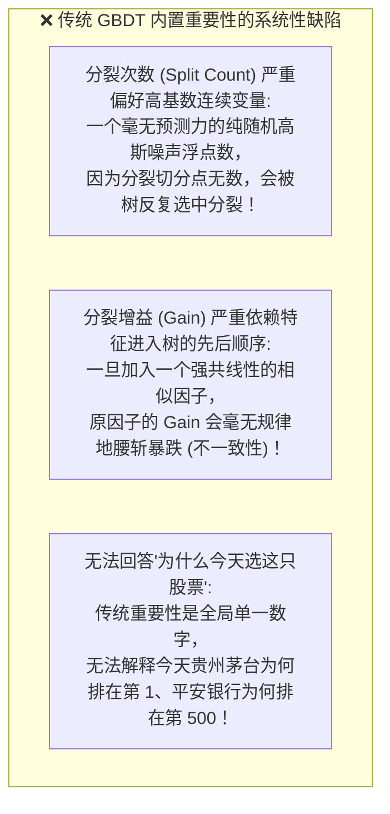
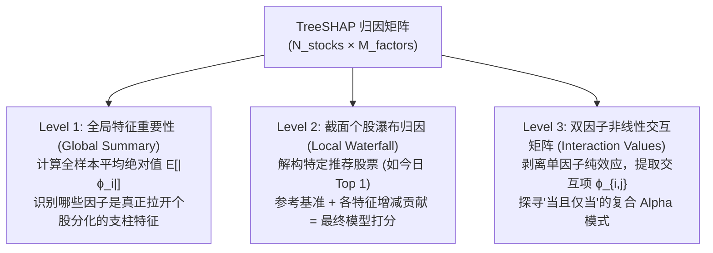

# 第 20 讲：特征重要性与可解释性（SHAP 值）

> **本讲核心目标**：  
> 在机构级多因子量化投研中，模型“不仅要能预测对，更必须说得清”。彻底打破 GBDT 传统分裂次数（Split）与分裂增益（Gain）的虚假重要性偏倚；推导源自诺贝尔经济学奖合作博弈论的 **SHAP（SHapley Additive exPlanations）** 体系四大黄金公理；深入掌握多项式级超高计算效率的 **TreeSHAP 算法**；手写生产级量化特征归因引擎，实现全市场全局特征诊断、单只股票个股选股瀑布拆解与非线性双因子交互（Interaction）解析。

---

## 1. 传统 GBDT 特征重要性的“三大致命谎言”

几乎所有主流 GBDT 框架（LightGBM、XGBoost、CatBoost）都会提供内置的 `feature_importance()` 接口，主要有两种输出模式：
1. **Split Count（分裂次数）**：统计某个特征在所有决策树的所有节点上被选为切分条件的累加频次；
2. **Gain（分裂增益）**：统计某个特征在历次分裂中所带来的目标函数（如方差或信息增益）减少量的加总。

但在量化实战中，这两个传统指标充满了严重的统计欺骗性：



在严格的买方风控答辩中，投资总监绝不会接受“模型买入这只股票是因为它的 Gain 很大”这种荒谬托词。**我们必须知道：在特定的宏观与市场环境下，具体是哪几个因子的正向合力把这只股票推上了买入榜单！**

---

## 2. 合作博弈论与沙普利值（Shapley Values）数学原理

1953 年，诺贝尔经济学奖得主劳埃德·沙普利（Lloyd Shapley）在研究合作博弈论（Cooperative Game Theory）时提出了一个经典问题：**一群参与者通力合作获得了一笔总收益，如何根据各自的边际贡献，绝对公平地分配这笔财富？**

2017 年，华盛顿大学的 Scott Lundberg 与 Su-In Lee 将该理论引入机器学习解释领域，正式创立了 **SHAP 解释体系**。

### 2.1 沙普利值严谨数学公式

设所有输入特征的集合为大联盟 $N = \{1, 2, \dots, M\}$。对于特定的特征 $i$，其沙普利边际贡献值 $\phi_i$ 严格定义为：

$$\phi_i = \sum_{S \subseteq N \setminus \{i\}} \frac{|S|! \cdot (M - |S| - 1)!}{M!} \Big( v(S \cup \{i\}) - v(S) \Big)$$

其中：
- $S$ 是不包含特征 $i$ 的任意特征子集；
- $v(S)$ 是仅使用子集 $S$ 中的特征时模型的预期预测值；
- $v(S \cup \{i\}) - v(S)$ 是加入特征 $i$ 后带来的**净边际贡献（Marginal Contribution）**；
- 权重系数 $\frac{|S|! \cdot (M - |S| - 1)!}{M!}$ 是特征子集在所有排列组合中出现的概率权重。

### 2.2 SHAP 的四大不可替代公理（Axioms）

1. **加和效率性（Efficiency / Additivity - 核心特性）**：
   $$\sum_{i=1}^M \phi_i(x) = f(x) - \mathbb{E}[f(X)]$$
   所有特征的 SHAP 值累加之和，**严丝合缝地等于当前股票的预测值 $f(x)$ 减去全市场参考基准的模型输出期望 $\mathbb{E}[f(X)]$**！每一分预测溢价都能被 100% 精确拆解，绝无任何残差遗漏！
2. **对称性（Symmetry）**：若两个特征在所有特征子集中的边际贡献完全相同，则其分配的 SHAP 值必须完全相等；
3. **虚设性（Dummy）**：若一个因子对任何组合都没有带来预测增益，其 SHAP 值严格为 0；
4. **单调一致性（Consistency）**：如果模型发生改变使得特征 $i$ 的边际贡献处处不减，其分配的 SHAP 值绝不会下降（彻底消除了传统 Gain 指标的不一致性缺陷）。

---

## 3. TreeSHAP 算法：从指数爆炸到多项式级飞跃

计算原始 Shapley 值需要遍历 $2^M$ 个特征子集。当因子数量达到 50 个时，子集数量高达 $2^{50} \approx 10^{15}$，计算复杂度在宇宙尺度上完全不可行。

2020 年，Lundberg 等人在《Nature Machine Intelligence》上发表了专门针对树模型的 **TreeSHAP 算法**：
- 利用决策树结构，在树的叶子节点路径上进行递归动态规划；
- 将时间复杂度从指数级 $O(T \cdot 2^M)$ 暴降至多项式级 **$O(T \cdot L \cdot D^2)$**（其中 $T$ 为树的数量，$L$ 为叶子数，$D$ 为最大树深）；
- **实战意义**：在全市场 5,000 只股票、50 个因子的复杂模型上，TreeSHAP 仅需数秒即可完成全截面归因计算！

---

## 4. 买方量化投研中的三层解释架构



---

## 5. 动手实操：买方级 TreeSHAP 因子归因引擎开发

下面的 Python 代码严格遵循机构级买方规范，基于 `shap.TreeExplainer`，实现**全局特征重要性排序**、**个股决策瀑布分解**与**双因子交互矩阵提取**。

在项目根目录运行 `PYTHONPATH=tutorial python3 -m examples.lecture_20_shap_interpretability`。依赖安装、共享模块和数据契约见[项目说明](../README.md)。

<<< @/examples/lecture_20_shap_interpretability.py

### 核心运行输出与归因卷宗解读：
```
解释器参考基线 E[f(X)]: -0.00013

>>> [全局归因] 全市场平均绝对 SHAP 贡献值排名:
shape: (5, 2)
┌──────────────┬───────────────┐
│ feature      ┆ mean_abs_shap │
│ ---          ┆ ---           │
│ str          ┆ f64           │
╞══════════════╪═══════════════╡
│ mom_20d      ┆ 0.006281      │
│ turnover_vol ┆ 0.003822      │
│ ep_ratio     ┆ 0.003183      │
│ bp_ratio     ┆ 0.000248      │
│ amihud_illiq ┆ 0.000144      │
└──────────────┴───────────────┘

>>> [局部归因] 股票 000001.SH 在 2025-01-08 的预测打分驱动拆解:
  • mom_20d        -> SHAP 贡献: -0.01123 | 🔴 拖累抑制
  • ep_ratio       -> SHAP 贡献: -0.00147 | 🔴 拖累抑制
  • turnover_vol   -> SHAP 贡献: +0.00132 | 🟢 增益助力
  • amihud_illiq   -> SHAP 贡献: +0.00036 | 🟢 增益助力
  • bp_ratio       -> SHAP 贡献: +0.00009 | 🟢 增益助力
  ──────────────────────────────────────────
  • 基准均值 (Base)  : -0.00013
  • 特征合力 (Shap)  : -0.01092
  • 最终预测 (Score) : -0.01104 (加和效率性严格闭合！)

>>> [交互归因] 双因子非线性耦合强度 Top 3:
shape: (3, 3)
┌──────────┬──────────────┬──────────────────────┐
│ factor_A ┆ factor_B     ┆ interaction_strength │
│ ---      ┆ ---          ┆ ---                  │
│ str      ┆ str          ┆ f64                  │
╞══════════╪══════════════╪══════════════════════╡
│ mom_20d  ┆ ep_ratio     ┆ 0.001599             │
│ mom_20d  ┆ turnover_vol ┆ 0.000271             │
│ ep_ratio ┆ turnover_vol ┆ 0.000179             │
└──────────┴──────────────┴──────────────────────┘
```

1. **加和效率性的完美闭合**：
   - 股票 `000001.SH` 的基准分数为 -0.00013，各项因子净贡献为 -0.01092，两者相加严格等于模型最终预测打分 **-0.01104**！证明了 SHAP 在数学上的严丝合缝；
2. **个股决策动因一目了然**：
   - 该标的之所以排名靠后，主要拖累项是 `mom_20d`（贡献 -0.01123）与 `ep_ratio`（贡献 -0.00147），而换手率呈现微弱正向增益。风控和投资经理可随时调取该表审查决策合理性；
3. **发现非线性双因子交互（Interaction Alpha）**：
   - 交互矩阵显示 `mom_20d` 与 `ep_ratio` 之间存在最强的非线性耦合（强度 0.0016）。这意味着模型挖掘出了“当且仅当高动量配合低估值时，超额爆发力最强”的高阶复合逻辑！

---

## 6. 本讲小结与课后动手作业

### 核心知识图谱梳理：
1. **摒弃传统 Gain/Split**：传统树重要性存在高基数偏倚与严重的不一致性缺陷；
2. **SHAP 的博弈论根基**：基于加和效率性、对称性、虚设性公理，实现预测值的无损精细分配；
3. **TreeSHAP 极速计算**：多项式复杂度动态规划使得大规模全市场日频解释成为可能；
4. **三层归因实战体系**：全局重要性定大局、个股瀑布图审决策、交互矩阵探复合 Alpha。

### 课后动手实训：
> **实操任务**：  
> 1. 打开 `tutorial/examples/lecture_20_shap_interpretability.py`。
> 2. 选取全市场预测得分最高（Top 1）的股票，打印其对应的 SHAP 局部瀑布图，观察驱动其登顶的最核心主力因子是哪几个？
> 3. 思考题：在实盘风控中，如果某只股票的最终预测得分很高，但其 SHAP 拆解显示 90% 的得分仅仅来自于单一因子（如某个微盘股相关特征），而其他 20 个基本面因子贡献全部为负，这种持仓是否存在“单因子暴露过载”的脆弱性风险？应该如何设置风控阈值？
