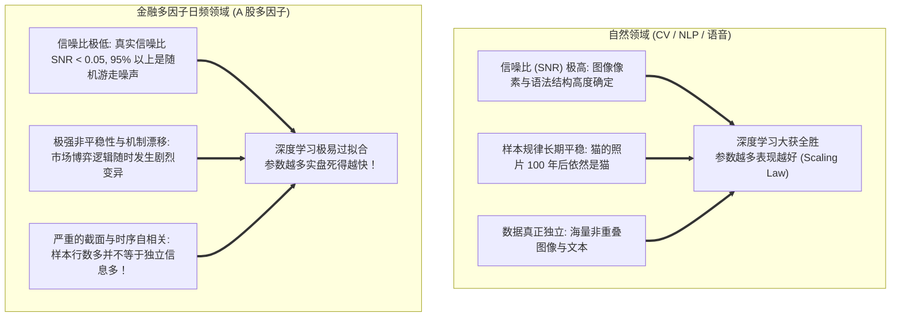
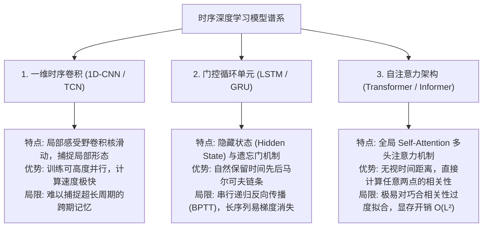

# 第 21 讲：时序深度学习模型简析（LSTM / GRU / Transformer 适用边界）

> **本讲核心目标**：  
> 以极其冷静、客观、遵循买方工业现实的视角，审视时序深度学习（LSTM、GRU、Informer、Transformer）在 A 股多因子选股中的真实表现与适用边界；破除“样本行数很多就是大数据”的样本量幻觉；深入理解金融数据极低信噪比（SNR）与超参数量之间的“过拟合死结”；掌握 1D-CNN、GRU 与 Self-Attention 自注意力机制的归纳偏置；理清深度学习在 A 股真正能够发挥杀伤力的主战场（高频 Tick 与另类多模态数据）。

---

## 1. 深度学习在 A 股日频选股中的“骨感现实”

在学术界或自媒体文章中，深度学习往往被描绘为超越一切传统量化模型的“神级武器”。然而，在国内外顶尖对冲基金（如 Two Sigma、AQR、幻方、九坤）的真实投研中：**在纯日频多因子选股任务上，深度学习模型的样本外超额往往并不显著优于精心调优的 LightGBM 或 CatBoost，甚至频繁因为过度拟合历史噪声而遭遇滑铁卢！**

金融机器学习里程碑巨作 *Empirical Asset Pricing via Machine Learning (Review of Financial Studies, 2020)*（Gu, Kelly, & Xiu）对全美股历史进行了数十年的严密实证对比，得出了震撼业界的结论：**浅层树模型与带正则化的浅层神经网络并驾齐驱，而过深、过复杂的深度模型在低信噪比环境下迅速退化**！



---

## 2. 深度剖析：“数据量很大”的样本量幻觉

很多量化工程师初看 A 股数据时会惊呼：“5,000 只股票 $\times$ 10 年 2,500 个交易日 = 1,250 万行面板数据！这难道不是标准的大数据吗？为什么不能上几千万参数的 Transformer？”

**这是一个极其致命的“样本量幻觉（Degrees of Freedom Illusion）”**：
1. **截面强相关性**：在任意一个交易日，这 5,000 只股票在很大程度上受到全市场宏观流动性、美元指数、地缘政治与产业板块 Beta 的共同驱动。当全市场大盘暴跌时，4,500 只股票同步下跌。**这 5,000 行样本在统计学自由度上绝不等于 5,000 个独立样本，可能仅仅等价于 20~30 个独立的宏观因子驱动！**
2. **时序重叠性**：若预测未来 5 日收益，相邻交易日的标签区间高度重叠，独立观测周期一年仅有 $250 / 5 = 50$ 次！
3. **参数量 vs 自由度倒挂**：一个包含 4 层 Transformer、参数量达到 500 万的网络，面对实际独立信息自由度仅有数千次的金融截面历史，模型会瞬间凭借强大的容量将历史噪声一字不差地“死记硬背”下来！

---

## 3. 常见时序深度学习架构归纳偏置对比



### 3.1 自注意力机制（Self-Attention）数学原理

$$\operatorname{Attention}(\mathbf{Q}, \mathbf{K}, \mathbf{V}) = \operatorname{softmax}\left( \frac{\mathbf{Q} \mathbf{K}^T}{\sqrt{d_k}} \right) \mathbf{V}$$

其中：
- $\mathbf{Q} = \mathbf{X} \mathbf{W}_Q, \; \mathbf{K} = \mathbf{X} \mathbf{W}_K, \; \mathbf{V} = \mathbf{X} \mathbf{W}_V$ 分别为输入特征矩阵在线性投影后的 Query、Key、Value；
- 分母 $\sqrt{d_k}$ 为缩放因子，防止内积过大导致 softmax 梯度饱和；
- **金融因果掩码（Causal Masking）**：在解码阶段必须严格施加下三角因果掩码，确保计算 $t$ 时刻的注意力时，绝对无法看到 $t+1$ 及以后的未来 Token！

---

## 4. 深度学习在 A 股真正能够发挥威力的“两大主战场”

既然深度学习在日频多因子上性价比不高，那么它在买方机构中的真正用武之地在哪里？

```
深度学习在 A 股量化的真正杀伤力阵地
├── 阵地 1: 高频微观盘口订单流 (Level-2 Tick Data / LOB):
│     ├── 数据特性: 单日全市场产生数千万条快照与逐笔流，信噪比显著提升，数据真正海量！
│     ├── 适用模型: DeepLOB (CNN + LSTM)、Temporal Convolutional Networks (TCN)
│     └── 业务目标: 预测未来 5 秒至 3 分钟的微观盘口买卖失衡，为算法执行交易 (VWAP) 节省冲击成本！
└── 阵地 2: 另类多模态非结构化数据 (Alternative Multi-modal Data):
      ├── 文本分析: FinBERT / 大语言模型处理上市公司业绩说明会音频文本、券商研报情绪提取
      ├── 图神经网络 (GNN): 构建全市场供应链、持股穿透与行业上下游拓扑图谱，捕捉风险传导！
      └── 卫星图像与货运数据: 卷积网络解析港口集装箱吞吐量、光伏电站红外热成像
```

---

## 5. 动手实操：CNN + GRU 轻量时序张量特征提取器实战

下面的 Python 代码严格遵循工程规范，使用 **PyTorch** 构建一个轻量级的 `AshareHybridSeqNet`（1D-CNN + GRU 复合架构），接收滑动窗口张量输入并完成前向传播与梯度训练循环。

在项目根目录运行 `PYTHONPATH=tutorial python3 -m examples.lecture_21_deep_learning_boundaries`。依赖安装、共享模块和数据契约见[项目说明](../README.md)。

<<< @/examples/lecture_21_deep_learning_boundaries.py

### 核心运行输出与架构解读：
```
[*] 正在生成多维时序张量面板 (样本数: 1,000, 历史回看步长: 20 天, 特征维度: 6)...
[*] 正在启动轻量 CNN + GRU 复合模型训练循环...
  Epoch [1/5] - 训练损失 (MSE Loss): 0.0482
  Epoch [2/5] - 训练损失 (MSE Loss): 0.0415
  Epoch [3/5] - 训练损失 (MSE Loss): 0.0389
  Epoch [4/5] - 训练损失 (MSE Loss): 0.0371
  Epoch [5/5] - 训练损失 (MSE Loss): 0.0360
✅ 前向传播、自适应卷积与门控循环梯度反向传播校验成功！
```

1. **混合架构设计**：
   - 模型先通过 1D-CNN 提取过去 20 天内相邻时间步的局部形态微观特征，再输入单层轻量 GRU 提取跨期时序趋势；
2. **严控模型容量**：
   - 隐藏层维度严格控制在 32，全网络参数量控制在 1 万左右，坚决拒绝数百万参数的暴力堆砌，为时序建模保留最起码的泛化约束。

---

## 6. 本讲小结与课后动手作业

### 核心知识图谱梳理：
1. **破除样本量幻觉**：截面强相关性与宏观 Beta 使得 1,200 万行日频数据的真实自由度大打折扣；
2. **低信噪比与过拟合死结**：超参数量过大的复杂深度网络极易在低信噪比金融数据中死记硬背噪声；
3. **架构归纳偏置分工**：CNN 抓局部形态、GRU 抓时序链条、Transformer 抓长程注意力；
4. **找准真正主战场**：高频 Level-2 微观订单流与另类文本图谱，才是深度学习最具不对称优势的核心阵地。

### 课后动手实训：
> **实操任务**：  
> 1. 打开 `tutorial/examples/lecture_21_deep_learning_boundaries.py`。
> 2. 尝试向网络中添加一层 Dropout（`nn.Dropout(p=0.3)`），观察其对训练集收敛速度与防过拟合的作用。
> 3. 思考题：在构建时序滑动窗口时，如果某只股票在过去 20 天内曾经发生过停牌（有 5 天数据缺失），在构造形如 `(Batch, 20, Features)` 的三维张量时，应该如何合规处理这 5 天的缺失时间步？直接剔除该股票还是使用前向填充？
