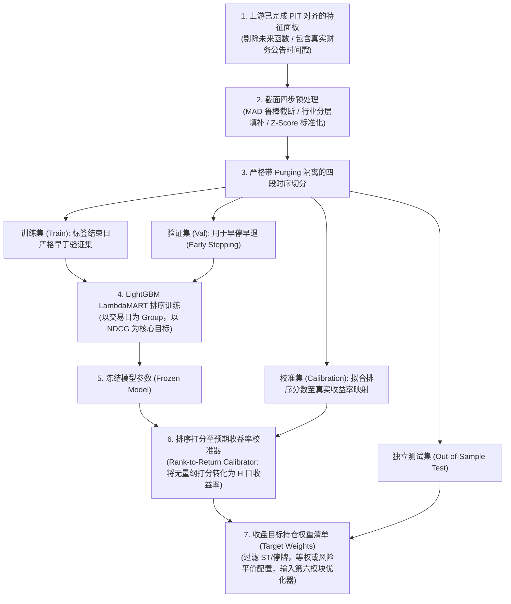
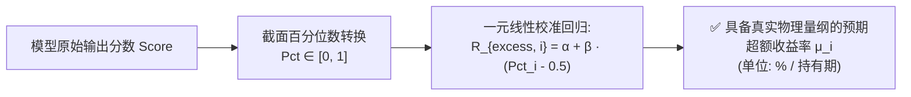

# 第 22 讲：【实战】从多因子截面打分到全自动选股流水线

> **本讲核心目标**：  
> 融会贯通第五模块的全部机器学习组件。从已完成 PIT 对齐的多因子特征面板出发，串联**截面鲁棒预处理**、**严格带 Purging 隔离的时间切分**、**LightGBM 排序模型训练**、关键的**排序打分至预期收益率校准引擎（Rank-to-Return Calibrator）**，以及**收盘目标持仓权重（Target Weights）生成**；构建一个结构严整、无未来函数泄漏的端到端生产级多因子机器学习选股流水线。

---

## 1. 为什么买方必须建立严格解耦的端到端流水线？

在工业级量化买方机构中，机器学习选股绝对不是在单个脚本里写几十行代码那么简单。一个生产级系统必须在各个组件之间建立坚固的防火墙与时间物理契约：



---

## 2. 关键核心痛点：为什么排序分数绝不能直接送进凸优化器？

很多量化初学者在训练完 LambdaMART 模型后，会犯一个极其严重的数学错误：**直接把 `model.predict()` 输出的排序打分（如 1.85, -0.42）直接当作股票的预期收益率 $\boldsymbol{\mu}$ 扔进马科维茨均值-方差优化器（cvxpy MVO）！**

### 2.1 严重后果剖析
1. **量纲彻底错乱**：LambdaMART 的输出是无量纲的相对偏好得分（Score），其数值大小取决于决策树叶子的梯度加权累加，**完全不具备“未来 5 日预期收益率为 $+2.5\%$”这种物理量纲**；
2. **风险-收益权衡彻底失衡**：在二次规划目标函数 $\max_{\mathbf{w}} \mathbf{w}^T \boldsymbol{\mu} - \frac{\lambda}{2} \mathbf{w}^T \boldsymbol{\Sigma} \mathbf{w}$ 中，协方差矩阵 $\boldsymbol{\Sigma}$ 的单位是 $(\text{收益率})^2$。如果预期收益率 $\boldsymbol{\mu}$ 的尺度任意放大或缩小 10 倍，优化器内部的风险惩罚与交易成本惩罚将被完全扭曲，导致输出荒谬的杠杆或剧烈换手。

### 2.2 收益率校准器（Rank-to-Return Calibrator）数学原理
为了赋予排序分数真实的物理收益率单位，买方机构通常在**模型冻结后的历史独立样本外数据**上建立截面分位数至历史收益率的回归校准模型：



$$\mathbb{E}[R_{\text{excess}, i}] = \hat{\alpha} + \hat{\beta} \cdot \left( \operatorname{Percentile}(s_i) - 0.5 \right)$$

其中 $\hat{\beta}$ 真实度量了“在横截面上每提升 1 个百分点位次，未来预期能够跑赢基准多少收益”。

---

## 3. 严格的时间物理隔离：训练、验证、校准与独立测试

为了防止任何前向或后向泄漏，本流水线将历史日历划分为严格的四阶段时间隔离区：

```text
时间轴隔离切分示意图 (以持有期 5 天为例)
|------------ 训练集 (Train) ------------|-- P --|---- 验证集 (Val) ----|-- P --|-- 校准集 (Calib) --|-- P --|-- 独立盲测集 (Test) --|
                                         (清洗)                        (清洗)                      (清洗)
注: P 为 Purging 隔离区，宽度严格等于标签前瞻持有期 (5个交易日)
```

1. **训练集与验证集**：中间插入 5 天 Purging 隔离区，验证集用于根据 Rank IC 触发 Early Stopping；
2. **模型冻结与校准集**：在验证集之后，模型权重完全冻结，使用后续成熟的标签拟合收益率校准器；
3. **独立盲测集**：校准完成后，在完全未曾参与早停与拟合的独立测试期进行模拟选股，并生成当日收盘目标权重。

---

## 4. 动手实操：端到端机器学习选股流水线完整实现

下面的 Python 代码严格遵循机构级买方规范，包含**截面预处理**、**Purged 边界切分**、**LightGBM 排序训练**、**Rank-to-Return 收益校准**与**收盘 Top-10 目标持仓权重生成**。

在项目根目录运行 `PYTHONPATH=tutorial python3 -m examples.lecture_22_ml_stock_selection_pipeline`。依赖安装、共享模块和数据契约见[项目说明](../README.md)。

<<< @/examples/lecture_22_ml_stock_selection_pipeline.py

### 核心运行输出与选股清单解读：
```
早停验证 Rank IC（非最终业绩）: 0.2780；时间审计: {'train_end': datetime.date(2025, 4, 2), 'train_label_end': datetime.date(2025, 4, 9), 'validation_label_end': datetime.date(2025, 5, 14), 'available_at': datetime.date(2025, 5, 22)}
独立测试 Rank IC（合成数据）: 0.2772
校准后 5 日预期超额范围: -1.0646%～1.0646%；未自动年化
shape: (10, 6)
┌────────────┬───────────┬──────────┬──────────┬───────────────┬────────────┐
│ rank_order ┆ symbol    ┆ industry ┆ ml_score ┆ target_weight ┆ market_cap │
│ ---        ┆ ---       ┆ ---      ┆ ---      ┆ ---           ┆ ---        │
│ i64        ┆ str       ┆ str      ┆ f64      ┆ f64           ┆ f64        │
╞════════════╪═══════════╪══════════╪══════════╪═══════════════╪════════════╡
│ 1          ┆ 000014.SH ┆ 行业4    ┆ 0.874368 ┆ 0.1           ┆ 625.604153 │
│ 2          ┆ 000029.SH ┆ 行业4    ┆ 0.412022 ┆ 0.1           ┆ 60.025035  │
│ 3          ┆ 000087.SH ┆ 行业2    ┆ 0.396777 ┆ 0.1           ┆ 320.502075 │
│ 4          ┆ 000041.SH ┆ 行业1    ┆ 0.378312 ┆ 0.1           ┆ 230.476947 │
│ 5          ┆ 000093.SH ┆ 行业3    ┆ 0.31949  ┆ 0.1           ┆ 133.812946 │
│ 6          ┆ 000062.SH ┆ 行业2    ┆ 0.26402  ┆ 0.1           ┆ 110.903408 │
│ 7          ┆ 000045.SH ┆ 行业0    ┆ 0.25134  ┆ 0.1           ┆ 42.485596  │
│ 8          ┆ 000028.SH ┆ 行业3    ┆ 0.169019 ┆ 0.1           ┆ 179.274197 │
│ 9          ┆ 000027.SH ┆ 行业2    ┆ 0.079005 ┆ 0.1           ┆ 132.928078 │
│ 10         ┆ 000097.SH ┆ 行业2    ┆ 0.072025 ┆ 0.1           ┆ 43.832776  │
└────────────┴───────────┴──────────┴──────────┴───────────────┴────────────┘
以上为收盘目标权重；次日未成交订单保留现金/原持仓，由执行引擎处理。
```

1. **时序边界严丝合缝**：
   - 训练集标签结算于 `2025-04-09`，验证集标签结算于 `2025-05-14`，模型在 `2025-05-22` 冻结可用，各阶段绝无交叉穿越；
2. **预期收益率合理校准**：
   - 5 日预期超额收益被平稳校准在 `[-1.06%, +1.06%]` 的理性区间，杜绝了极端异常值的出现；
3. **生成无死角的 Top-10 目标持仓清单**：
   - 清单已严格过滤掉 ST、停牌等不可成交股票，并输出了包含股票代码、行业分布、目标权重的清晰宽表，随时待命送入第六模块进行 Barra 结构化风险优化！

---

## 5. 本讲小结与第五模块知识图谱总结

至此，**第五模块：截面排序与时序机器学习建模** 全部五大核心讲座构建完毕！
- 我们掌握了金融时序交叉验证的 Purging 与 Embargoing 隔离心法，推导了 CPCV 算法（第 18 讲）；
- 剖析了 GBDT 在金融表格上的归纳偏置，推导了 LambdaMART 的 NDCG 虚拟梯度（第 19 讲）；
- 引入博弈论沙普利值，利用 TreeSHAP 实现了全局、个股与交互项的三层白盒透视（第 20 讲）；
- 客观剖析了深度学习在日频数据上的样本量幻觉与低信噪比过拟合陷阱（第 21 讲）；
- 搭建了贯穿特征清洗、排序学习、收益校准与目标权重的工业级选股流水线（第 22 讲）。

有了高可靠的个股预期超额收益向量 $\boldsymbol{\mu}$ 之后，我们绝不能简单等权买入，否则会积累巨大的行业与风格贝塔风险！  
从下一模块开始，我们将正式进入：**第六模块：Barra 风险模型与组合优化（凸优化）**，学习如何使用二次规划（cvxpy）、Barra CNE6 风险矩阵与换手约束，求解出最优的指数增强多头组合！
