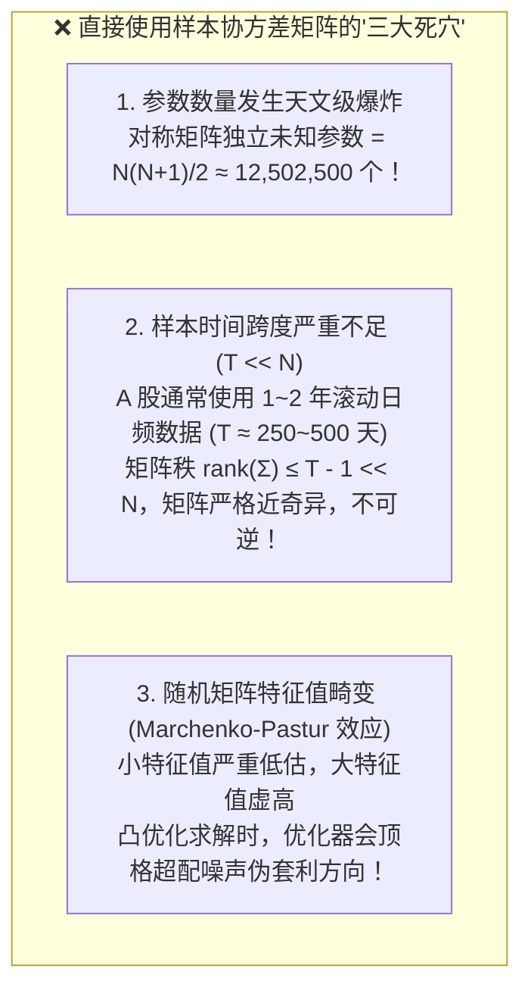
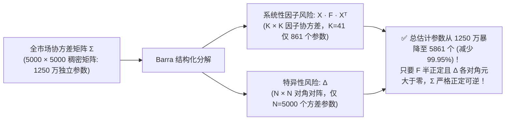
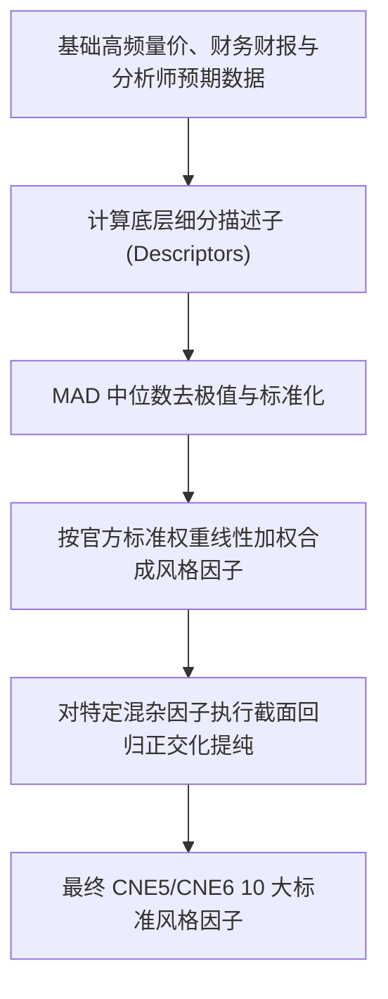
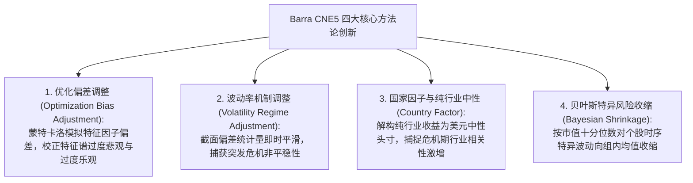

# 第 23 讲：Barra 结构化风险模型数学解构

::: tip 本讲核心目标
在现代买方量化资管机构中，“控制风险与追求超额同等重要”。如果直接使用 A 股全市场 5,000 余只股票的历史收益率计算样本协方差矩阵，会立刻遭遇毁灭性的**高维维度灾难（Curse of Dimensionality）**与**随机矩阵噪声污染**，导致优化器把虚假统计套利机会放大为致命巨亏。

本讲融合全球量化标杆 **MSCI Barra CNE5/CNE6 实证白皮书（Empirical Notes）**、**BARRA US-E3 模型手册（Risk Model Handbook）** 以及国内顶尖卖方工程实践 **华泰证券多因子体系（系列之一）**，对结构化风险模型进行彻底的数学解构：
1. 深入剖析 **Barra CNE5/CNE6 十大风格因子的全部细分描述因子（Descriptors）标准公式与精确组合权重**；
2. 推导残差波动率（Residual Volatility）对 Beta/Size、流动性（Liquidity）对 Size、以及非线性市值（Non-linear Size）的**回归正交化清洗算法**；
3. 掌握 Barra CNE5 针对优化器低估风险提出的四大前沿创新：**优化偏差调整（Optimization Bias Adjustment / Eigenfactor Adjustment）**、**波动率机制调整（Volatility Regime Adjustment, VRA）**、**国家因子与纯行业中性分离**、以及**按市值分位数的贝叶斯特异性风险收缩（Bayesian Shrinkage）**；
4. 依托工业级可运行代码完成全流程闭环验证。
:::

---

## 1. 经典文献与工业界理论基石

在深入推导前，建议研读奠定现代多因子风险管理基石的经典文献与行业权威白皮书：

1. **Orr, D. J., Mashtaler, Igor, & Nagy, Adam (2012)**. *"The Barra China Equity Model (CNE5) Empirical Notes"*, MSCI Research.  
   > 专门针对中国 A 股市场微观结构定制的经典实证白皮书，详述了 CNE5 十大风格因子、细分描述子构成、特征值优化偏差修正与波动率机制调整。
2. **BARRA Inc. (1998)**. *United States Equity Version 3 (US-E3) Risk Model Handbook*. BARRA Research.  
   > 奠定了 Barra 结构化风险模型的工业规范，详述了多因子模型数据流、描述因子标准化、非线性市值（Size Nonlinearity）、特异方差两级时序-截面建模框架以及四维风险分解魔方。
3. **华泰证券研究所 (林晓明、陈烨, 2016)**. 《华泰多因子模型体系初探——华泰多因子系列之一》.  
   > 国内本土量化多因子体系的开山之作，系统阐释了因子提纯、Breusch-Pagan / White 异方差检验、加权最小二乘法（WLS）、因子协方差与因子边际风险贡献（FMCAR）的工程落地。
4. **Rosenberg, Barr (1974)**. *"Extra-Market Components of Covariance in Security Returns"*, *Journal of Financial and Quantitative Analysis*, 9(2): 263-274.  
   > 首次提出将资产收益率解构为行业哑变量与连续风格因子的结构化多因子协方差模型。
5. **Menchero, Jose, Wang, Jun, & Orr, D. J. (2011)**. *"Eigen-Adjusted Covariance Matrices"*, MSCI Research Insight.  
   > 揭示了样本协方差在小特征值方向系统性低估风险的机理，推导了蒙特卡洛模拟特征因子（Eigenfactors）风险校准算法。
6. **Shepard, Peter (2009)**. *"Second Order Risk"*, Working Paper, arXiv:0908.2455.  
   > 解析推导了二次规划优化器在有限样本下必然低估组合预测风险的数学内涵。

---

## 2. 高维样本协方差的“维度灾难”与随机矩阵理论

在马科维茨（Markowitz, 1952）均值-方差现代投资组合理论（MPT）中，投资组合的预期方差由股票权重向量 $\mathbf{w} \in \mathbb{R}^N$ 与股票收益协方差矩阵 $\boldsymbol{\Sigma} \in \mathbb{R}^{N \times N}$ 决定：

$$\sigma_p^2 = \mathbf{w}^T \boldsymbol{\Sigma} \mathbf{w}$$

若直接采用全市场股票历史收益率的无偏样本协方差估计：

$$\boldsymbol{\Sigma}_{\text{sample}} = \frac{1}{T - 1} \sum_{t=1}^T (\mathbf{r}_t - \bar{\mathbf{r}})(\mathbf{r}_t - \bar{\mathbf{r}})^T$$

在当前 A 股市场（股票数量 $N \approx 5,000$ 只），直接使用样本协方差矩阵将面临无法逾越的数学困境：



根据**随机矩阵理论（Random Matrix Theory, RMT）**中的 **Marchenko-Pastur 定理（1967）**：当样本维度比率 $\gamma = N / T > 0$ 时，纯白噪声矩阵的特征值分布将发散在区间 $[\lambda_-, \lambda_+]$ 内：

$$\lambda_{\pm} = \sigma^2 (1 \pm \sqrt{\gamma})^2$$

当 $N = 5,000, T = 250$ 时，$\gamma = 20$，最大特征值被夸大几十倍，最小特征值挤压至 0 附近。优化器将错误地认为最小特征向量方向拥有“零风险超额”，进而将全部杠杆倾泻于此，实盘运行必然惨败。

---

## 3. Barra 结构化风险模型核心数学架构

为了彻底粉碎维度灾难，Barra 结构化风险模型提出：**资产收益率的大部分波动来源于少数可识别的宏观、行业与风格共同因子，剩余极小部分由个股特异性事件支配**。

### 3.1 横截面多因子收益线性分解

在每个交易日 $t$，截面上 $N$ 只股票的收益率向量可分解为：

$$r_{i, t} = \sum_{k=1}^K X_{i, k, t} f_{k, t} + u_{i, t}$$

以矩阵紧凑形式表达：

$$\mathbf{r}_t = X_t \mathbf{f}_t + \mathbf{u}_t$$

其中：
- $\mathbf{r}_t \in \mathbb{R}^N$：全市场 $N$ 只股票在交易日 $t$ 的收益率向量；
- $X_t \in \mathbb{R}^{N \times K}$：**因子暴露矩阵（Factor Exposure Matrix）**，每行代表单只股票在 $K$ 个风险因子上的暴露（包括行业哑变量与标准化风格因子，通常 $K \approx 40 \sim 60 \ll N$）；
- $\mathbf{f}_t \in \mathbb{R}^K$：**公共因子收益率向量（Factor Returns）**；
- $\mathbf{u}_t \in \mathbb{R}^N$：**个股特异性残差收益率向量（Specific / Idiosyncratic Returns）**。

### 3.2 结构化模型的核心统计假设

Barra 模型依赖两条经典正交性假设：
1. **因子与特异残差不相关**：$\operatorname{Cov}(\mathbf{f}_t, \mathbf{u}_t) = \mathbf{0} \in \mathbb{R}^{K \times N}$；
2. **个股特异残差互不相关**：即跨股票特异残差协方差为零，$\operatorname{Cov}(u_{i, t}, u_{j, t}) = 0, \; \forall i \neq j$。因此，个股特异性风险矩阵为一个**严格的对角矩阵**：
   $$\Delta_t = \operatorname{diag}(\sigma_{u, 1}^2, \sigma_{u, 2}^2, \dots, \sigma_{u, N}^2) \in \mathbb{R}^{N \times N}$$

### 3.3 协方差矩阵重构方程

根据协方差的双线性性质：

$$\boldsymbol{\Sigma} = \operatorname{Cov}(\mathbf{r}) = \operatorname{Cov}(X \mathbf{f} + \mathbf{u}) = X \operatorname{Cov}(\mathbf{f}) X^T + \operatorname{Cov}(\mathbf{u})$$

$$\boxed{\boldsymbol{\Sigma} = X F X^T + \Delta}$$

其中：
- $F = \operatorname{Cov}(\mathbf{f}) \in \mathbb{R}^{K \times K}$：**因子协方差矩阵（Factor Covariance Matrix）**；
- $\Delta \in \mathbb{R}^{N \times N}$：**特异性方差对角矩阵（Specific Variance Matrix）**。



---

## 4. MSCI Barra CNE5/CNE6 十大风格因子与细分描述子（Descriptors）

根据 MSCI Barra CNE5 官方实证手册（Appendix A）与 US-E3 体系，每个风格大类并非单一指标，而是由多个具有深厚财务与交易学内涵的**底层细分描述子（Descriptors）加权合成**，并经过严格的去极值、标准化和正交化清洗：

### 4.1 十大风格因子构成规范与数学公式



#### 1. Size (规模因子)
- **定义公式**：$1.0 \times \text{LNCAP}$
- **公式解析**：个股全部发行在外的股票总市值（Price $\times$ Total Shares）取自然对数：
  $$\text{LNCAP} = \ln(\text{MarketCap})$$
- **经济内涵**：解释资产收益截面方差最强的主因子，区分大盘蓝筹与中小盘溢价。

#### 2. Beta (贝塔因子)
- **定义公式**：$1.0 \times \text{BETA}$
- **公式解析**：个股过去 252 个交易日超额收益率 $r_{i, t} - r_{f, t}$ 对全市场市值加权基准超额收益率 $R_t$ 进行 **EWMA 指数衰减时序回归**（半衰期设为 63 个交易日）：
  $$r_{i, t} - r_{f, t} = \alpha_i + \beta_i R_t + e_{i, t}$$
  回归斜率 $\beta_i$ 即为该股票的 Beta 暴露。

#### 3. Momentum (动量因子)
- **定义公式**：$1.0 \times \text{RSTR}$ (Relative Strength)
- **公式解析**：过去 $T = 504$ 个交易日（2 年）内，滞后 $L = 21$ 个交易日的指数加权对数超额收益率之和（半衰期设为 126 个交易日）：
  $$\text{RSTR} = \sum_{t=L}^{T+L} w_t \left[ \ln(1 + r_{i, t}) - \ln(1 + r_{f, t}) \right]$$
- **关键设计**：**强制排除最近 21 个交易日（1 个月）**，以规避 A 股极其强烈的短期流动性反转效应干扰。

#### 4. Residual Volatility (残差波动率因子)
- **合成权重**：$0.74 \times \text{DASTD} + 0.16 \times \text{CMRA} + 0.10 \times \text{HSIGMA}$
- **细分描述子定义**：
  1. **DASTD (日收益波动率)**：过去 252 个交易日超额收益率的 EWMA 加权标准差（半衰期 42 个交易日）：
     $$\text{DASTD} = \sqrt{\sum_{t=1}^{252} w_t (r_{i, t} - \bar{r}_i)^2}$$
  2. **CMRA (累计收益极差)**：过去 12 个月（每 21 天为一个复合月度 $\tau$）累计对数超额收益序列的最大波动极差：
     $$Z(T) = \sum_{\tau=1}^T \left[ \ln(1 + r_{i, \tau}) - \ln(1 + r_{f, \tau}) \right], \quad T = 1, \dots, 12$$
     $$\text{CMRA} = \ln(1 + Z_{\max}) - \ln(1 + Z_{\min})$$
  3. **HSIGMA (历史残差标准差)**：上述 Beta 估计方程中残差项 $e_{i, t}$ 的 EWMA 加权标准差（半衰期 63 个交易日）：$\text{HSIGMA} = \operatorname{std}(e_{i, t})$。
- **正交化铁律**：合成为原始残差波动率后，**必须对 Beta 因子和 Size 因子执行截面加权最小二乘正交化**，取其纯净残差，防止与贝塔和规模因子产生高多重共线性（VIF 爆炸）。

#### 5. Non-linear Size (非线性市值因子)
- **定义公式**：$1.0 \times \text{NLSIZE}$
- **公式解析**：将已经标准化的规模因子暴露 $X_{\text{size}}$ 进行立方运算：
  $$Y_i = (X_{i, \text{size}})^3$$
  将 $Y$ 对 $X_{\text{size}}$ 在截面上执行以市值平方根为权重的回归：
  $$Y_i = a + b X_{i, \text{size}} + \epsilon_i$$
  取回归残差 $\epsilon_i$ 并重新极值截断和标准化，即为最终的 $\text{NLSIZE}$。
- **经济内涵**：Barra 发现纯线性 Size 模型对于前 500 大股票预测极好，但在全市场小盘股与微盘股上系统性低估风险。非线性市值因子刻画了“哑铃型投资组合（长仓中盘股、短仓大盘与微盘）”的曲率风险。

#### 6. Book-to-Price (账面市值比 / 价值因子)
- **定义公式**：$1.0 \times \text{BTOP}$
- **公式解析**：最新可获得的 Point-in-Time 财报归属于母公司普通股权益账面价值除以当前总市值：
  $$\text{BTOP} = \frac{\text{Common Equity}}{\text{Total MarketCap}}$$

#### 7. Liquidity (流动性因子)
- **合成权重**：$0.35 \times \text{STOM} + 0.35 \times \text{STOQ} + 0.30 \times \text{STOA}$
- **细分描述子定义**：
  1. **STOM (单月换手率对数)**：过去 21 个交易日日均换手率之和的对数：
     $$\text{STOM} = \ln\left( \sum_{t=1}^{21} \frac{\text{Volume}_t}{\text{SharesOutstanding}_t} \right)$$
  2. **STOQ (季均换手率对数)**：过去 3 个月换手率的指数平均对数：
     $$\text{STOQ} = \ln\left( \frac{1}{3} \sum_{\tau=1}^3 \exp(\text{STOM}_\tau) \right)$$
  3. **STOA (年均换手率对数)**：过去 12 个月换手率的指数平均对数：
     $$\text{STOA} = \ln\left( \frac{1}{12} \sum_{\tau=1}^{12} \exp(\text{STOM}_\tau) \right)$$
- **正交化铁律**：合成后**必须对 Size 因子进行截面正交化**。

#### 8. Earnings Yield (盈利收益因子)
- **合成权重**：$0.68 \times \text{EPFWD} + 0.21 \times \text{CETOP} + 0.11 \times \text{ETOP}$
- **细分描述子定义**：
  1. **EPFWD (一致预期前瞻市盈率倒数)**：分析师一致预期未来 12 个月前瞻净利润除以总市值（权重高达 68%）；
  2. **CETOP (现金盈利价格比)**：过去 12 个月经营活动现金流净额除以总市值；
  3. **ETOP (历史市盈率倒数)**：过去 12 个月 TTM 归母净利润除以总市值。

#### 9. Growth (成长因子)
- **合成权重**：$0.18 \times \text{EGRLF} + 0.11 \times \text{EGRSF} + 0.24 \times \text{EGRO} + 0.47 \times \text{SGRO}$
- **细分描述子定义**：
  1. **EGRLF**：分析师一致预期长期（3~5年）净利润复合增长率；
  2. **EGRSF**：分析师一致预期短期（1年）净利润增速；
  3. **EGRO**：过去 5 年年报 EPS 对时间进行线性回归的斜率除以 5 年均值；
  4. **SGRO**：过去 5 年年报每股营业收入对时间回归的斜率除以 5 年均值（权重最高，达 47%）。

#### 10. Leverage (杠杆因子)
- **合成权重**：$0.38 \times \text{MLEV} + 0.35 \times \text{DTOA} + 0.27 \times \text{BLEV}$
- **细分描述子定义**：
  1. **MLEV (市场杠杆)**：$(\text{ME} + \text{PE} + \text{LD}) / \text{ME}$，其中 ME 为权益市值，PE 为优先股，LD 为长期负债账面值；
  2. **DTOA (资产负债率)**：$(\text{LD} + \text{DCL}) / \text{TA}$，其中 DCL 为流动负债，TA 为总资产；
  3. **BLEV (账面杠杆)**：$(\text{BE} + \text{PE} + \text{LD}) / \text{BE}$，其中 BE 为普通股权益账面价值。

---

## 5. 异方差检验与受限加权最小二乘法（Restricted WLS）

每日已知收益率 $\mathbf{r}_t$ 与暴露矩阵 $X_t$ 后，因子收益率 $\mathbf{f}_t$ 需通过截面回归提取。

### 5.1 异方差检验（Breusch-Pagan 与 White 检验）
华泰证券研究表明，普通 OLS 回归在大盘股与微盘股混杂时，随机误差项 $\mathbf{u}$ 存在严重的**异方差性（Heteroscedasticity）**：
$$Var(u_i \mid X) = \sigma_i^2 \neq \sigma^2$$
异方差会导致 OLS 参数估计量丧失有效性，标准误低估，t 统计量失效。通过 **Breusch-Pagan 辅助回归**：
$$u_i^2 = \alpha_0 + \sum_{k=1}^K \alpha_k X_{i, k} + v_i$$
构造拉格朗日乘数统计量 $LM = n R_u^2 \sim \chi^2(K)$，经验检验在 A 股日频截面上拒绝同方差假设的比率高达 $95\%$ 以上！

因此，Barra 统一采用加权最小二乘法（WLS），权重矩阵 $W = \operatorname{diag}(w_1, \dots, w_N)$，取个股流通市值的平方根 $w_i = \sqrt{\text{FloatCap}_i}$（或 US-E3 中采用的 $hsigma_i^{-2}$ 倒数），彻底抚平微盘股异常波动。

### 5.2 国家因子、行业分离与受限回归数学方程
在 CNE5 中，模型引入显式**国家因子（Country Factor）**以分离全市场共性走势。
为避免虚拟变量陷阱，施加行业中性受限条件：全市场行业因子收益率的市值加权和恒等于 0：
$$\sum_{j=1}^{J} c_j f_j^{\text{ind}} = 0, \quad c_j = \frac{\sum_{i \in \text{Ind}_j} \text{FloatCap}_i}{\sum_{i=1}^N \text{FloatCap}_i}$$

引入拉格朗日乘子 $\lambda$，建立 KKT 鞍点求解方程组：

$$\begin{pmatrix} X_t^T W_t X_t & C^T \\ C & 0 \end{pmatrix} \begin{pmatrix} \mathbf{f}_t \\ \lambda \end{pmatrix} = \begin{pmatrix} X_t^T W_t \mathbf{r}_t \\ 0 \end{pmatrix}$$

- **纯行业收益的优越性**：解出的纯行业因子收益代表该行业**相对于大盘全市场基准的净超额收益（Dollar-Neutral Industry Return）**，使得行业暴露为 0 的纯多头组合在业绩归因时不产生伪行业偏离（Davis & Menchero, 2011）。

---

## 6. Barra CNE5 四大前沿方法论突破（Methodology Highlights）

相比于老一代 CHE2 或朴素因子模型，MSCI Barra CNE5 在风险预测精度上做出了四大里程碑式改进：



### 6.1 优化偏差调整（Optimization Bias Adjustment / Eigenfactor Adjustment）
- **问题本质**：Muller (1993) 与 Shepard (2009) 证明，投资组合优化器是“**风险低估狂魔**”。优化器在最小化 $\mathbf{w}^T \boldsymbol{\Sigma} \mathbf{w}$ 时，会无孔不入地寻找协方差矩阵中由于抽样误差而产生的“虚假对冲机会（Spurious Hedges）”，使得最优化组合的样本外实现波动率远高于事前预测波动率。
- **特征因子（Eigenfactors）解耦**：
  设因子样本协方差矩阵谱分解为 $F = U \Lambda U^T$。其中正交特征向量矩阵 $U$ 的每一列定义了一个特征因子组合（Eigenfactor Portfolio），其方差对应特征值 $\lambda_k$。
- **偏差机理**：Menchero, Wang & Orr (2011) 证明，低波动特征因子的方差被系统性低估，高波动特征因子的方差被系统性高估。
- **蒙特卡洛调整法**：通过设定真实现金流生成过程进行 Monte Carlo 模拟，量化每一阶特征因子的系统性低估比率，直接修正特征值矩阵 $\tilde{\Lambda} = D \Lambda D$，在不破坏纯因子经济学含义的前提下，彻底治愈优化器低估风险的绝症！

### 6.2 波动率机制调整（Volatility Regime Adjustment, VRA）
金融时间序列具备非平稳性（Non-stationarity）。在牛熊剧烈转换或突发黑天鹅时，依赖过去 1 年平稳数据的 EWMA 会发生严重时滞：
- 在波动率飙升期（如 2008 年金融危机、2015 年 A 股异常波动），模型预测风险滞后严重低估；
- 在波动率回落期，模型预测风险过度高估。

CNE5 引入**每日截面偏差统计量（Cross-Sectional Bias Statistic）**：
$$B_t = \sqrt{ \frac{1}{N} \sum_{i=1}^N \left( \frac{u_{i, t}}{\hat{\sigma}_{u, i, t}} \right)^2 }$$
通过在合适的时间窗口计算 $B_t$ 的指数加权均值作为即时调整因子，动态缩放因子协方差与特异性风险矩阵，使风险预测能够“秒级自适应”当前宏观波动环境。

### 6.3 特异性风险的市值分位数贝叶斯收缩（Bayesian Shrinkage）
纯时序估计的个股特异性方差存在严重回归均值倾向（Mean Reversion）：原本极低波动的股票未来特异风险常大幅上升，而极高波动的股票未来特异风险大幅回落。

CNE5 的处理流程：
1. 将全市场股票按流通市值大小划分为 **10 个等份分位数桶（Size Deciles）**；
2. 在每个市值桶内，计算时序特异波动率预测值的均值 $\mu_d$ 与横截面标准差 $\sigma_d$；
3. 将单只股票的时序特异波动率 $\sigma_{u, i}$ 向其所在市值桶的均值 $\mu_d$ 进行收缩：
   $$\sigma_{u, i}^* = (1 - v_i) \sigma_{u, i} + v_i \mu_d$$
   其中收缩强度 $v_i \in [0, 1]$ 随着该个股特异波动率偏离均值的标准差倍数 $| \sigma_{u, i} - \mu_d | / \sigma_d$ 增加而单调增大。

---

## 7. 预测精度评估基准：偏差统计量（Bias Statistic）与 MRAD

在 CNE5 报告第 5 节与 Appendix C 中，MSCI 详细公开了买方评估风险模型优劣的**工业金标准指标**：

### 7.1 标准化收益与单窗口偏差统计量
对于任意投资组合 $n$（如纯因子组合、随机主动组合、长多因子倾斜组合、最小方差优化组合），其在第 $t$ 期的标准化收益率为：
$$b_{nt} = \frac{R_{nt}}{\sigma_{nt}}$$
其中 $R_{nt}$ 为实现主动收益，$\sigma_{nt}$ 为期初事前预测风险。

在长度为 $T$ 的评估窗口内，**偏差统计量（Bias Statistic）**定义为标准化收益的实现样本标准差：
$$B_n = \sqrt{ \frac{1}{T - 1} \sum_{t=1}^T (b_{nt} - \bar{b}_n)^2 }$$

- **理想基准**：完美的风险预测模型应使得 $B_n \equiv 1.0$；
- **95% 理论置信区间**：在收益正态分布假设下，当窗口期为 $T$ 时：
  $$B_n \in \left[ 1 - \sqrt{\frac{2}{T}}, \; 1 + \sqrt{\frac{2}{T}} \right]$$
- **肥尾修正（Kurtosis Impact）**：金融收益存在显著超额峰度（Fat Tails）。当峰度 $k = 4$ 时，95% 置信区间的下限会由 0.66 下移至 0.61，上限由 1.34 上移至 1.40。

### 7.2 滚动 12 个月平均绝对偏差（MRAD）
为防止长期正负误差冲抵，CNE5 重点考察覆盖 $N$ 个测试组合的滚动 12 期 **平均绝对偏差（Mean Rolling Absolute Deviation, MRAD）**：

$$\text{MRAD}^\tau = \frac{1}{N} \sum_{n=1}^N \left| B_n^\tau - 1 \right|$$

- 在正态分布且预测完美时，$\mathbb{E}[\text{MRAD}] \approx 0.17$；在峰度为 $3.5 \sim 4.0$ 时，$\mathbb{E}[\text{MRAD}] \approx 0.19$。MRAD 越小，说明风险模型的绝对测算精度越高！

---

## 8. 工业级 Barra 结构化风险引擎实现

在 `tutorial/examples/lecture_23_barra_risk_model_architecture.py` 中，我们构建了生产级 `AshareBarraRiskEngine`，严格实现了：
1. 逐日对齐的 `(T, N, K)` 历史暴露与市值权重 WLS 回归；
2. EWMA 因子协方差矩阵 $F$ 估计；
3. 特异性方差残差中心化与经验贝叶斯平滑收缩；
4. 组合年化波动率与跟踪误差（TE）精确分解接口。

可在终端直接运行验证：

```bash
python3 -m examples.lecture_23_barra_risk_model_architecture
```

<<< @/examples/lecture_23_barra_risk_model_architecture.py

---

## 9. 本讲小结与核心自测

| 核心考点 | 工业标准回答要点 | 常见工程/学术陷阱 |
| :--- | :--- | :--- |
| **为什么动量因子（RSTR）必须排除最近 21 天？** | A 股短期具有强烈的散户流动性反转效应；若包含最近 1 个月，短期反转会严重对冲抵消中长期动量，导致因子失效。 | 简单把过去 12 个月全周期累加，忽视了短期反转噪声的污染。 |
| **残差波动率与流动性因子为什么必须对 Size 正交化？** | 小微盘股票天然流动性低、特异波动大，若不正交化，残差波动率与流动性因子实际上是“规模因子的变种翻版”，引发共线性灾难。 | 未做正交化直接投入回归，导致因子方差膨胀因子（VIF）超过 5，参数估计彻底失真。 |
| **什么是优化偏差（Optimization Bias）？如何修正？** | 优化器在最小化组合方差时会过拟合样本协方差的小特征值方向，使得样本外真实风险远超预测。Barra 通过特征因子（Eigenfactors）模拟调整矩阵谱进行修正。 | 误以为只要均值-方差优化求解出 optimal，实盘就必然拥有最小波动率。 |

在下一讲中，我们将把本讲产出的**结构化风险协方差矩阵 $\boldsymbol{\Sigma}$** 与前序模块沉淀的 **Alpha 预期超额收益向量 $\boldsymbol{\alpha}$** 融合，正式进入现代量化资产管理的核心引擎——**第 24 讲：凸优化求解器（cvxpy）实战**！
