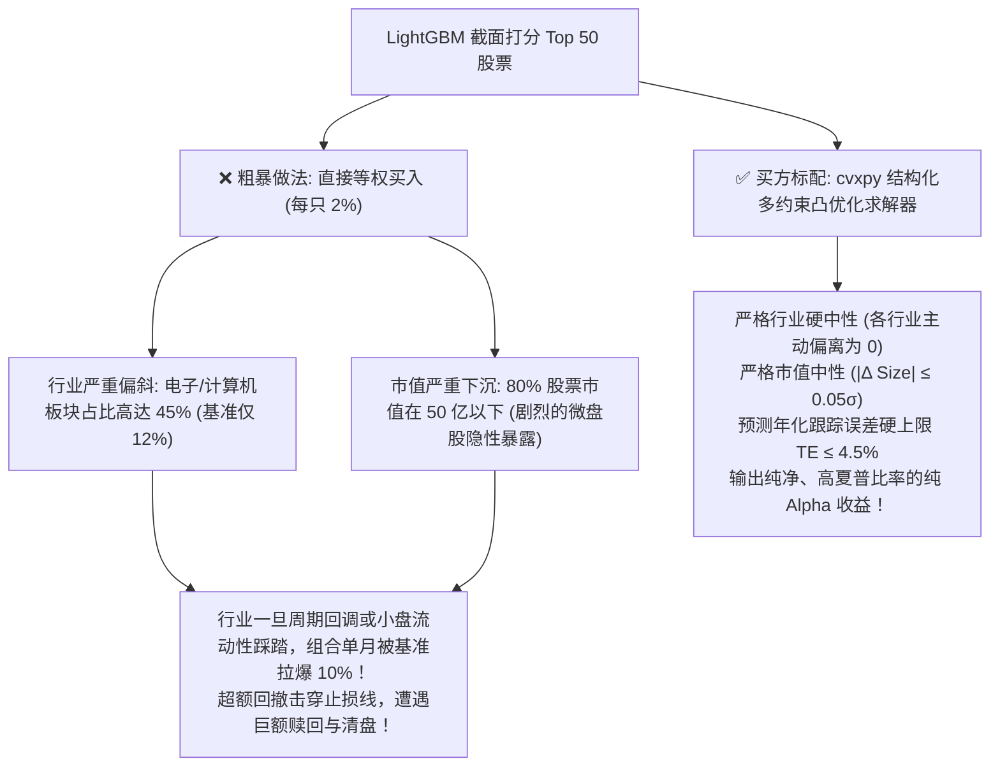
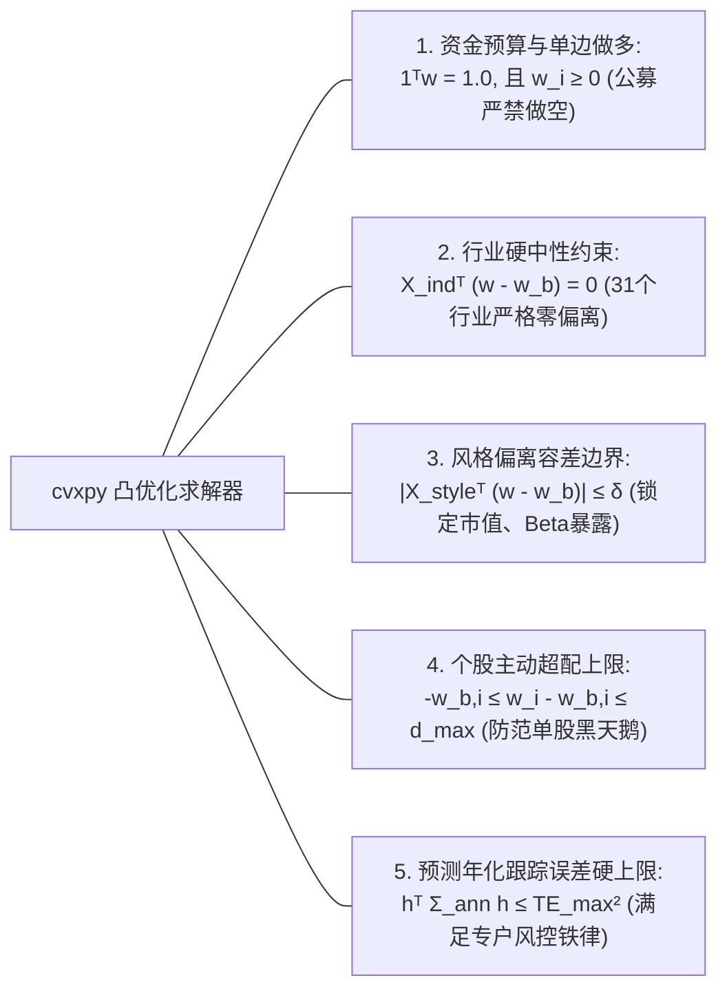

# 第 24 讲：凸优化求解器（cvxpy）实战

::: tip 本讲核心目标
在现代买方量化机构中，“机器学习打分（Alpha）”只是前置原料，**投资组合凸优化（Portfolio Convex Optimization）**才是将预测转化为稳健资管产品的“总装反应炉”。

初级量化研究员往往按预测分数挑选前 50 或 100 只股票等权买入，结果组合无意识暴露了数十个百分点的行业偏斜和小市值下沉风险，一旦市场风格突变便遭毁灭性回撤。本讲融合 **MSCI Barra 组合构建规范** 与 **华泰证券多因子体系优化模型**：系统推导**指数增强（Index Enhancement）**二次规划（QP）与二阶锥规划（SOCP）数学模型；详解利用 Barra 结构化特性在 **cvxpy** 中降维提速至毫秒级的核心算法；严格构建**行业硬中性**、**市值偏离容差**、**个股超配上限**与**预测跟踪误差（TE）硬上限**；并推导**因子边际风险贡献（FMCAR）**对主动风险来源的穿透解析！
:::

---

## 1. 经典文献与工业界理论基石

构建严谨的组合优化系统，离不开数学规划与现代金融工程的经典文献支持：

1. **Markowitz, Harry (1952)**. *"Portfolio Selection"*, *The Journal of Finance*, 7(1): 77-91.  
   > 现代投资组合理论（MPT）奠基之作，首次将投资决策转化为均值-方差二次规划极值问题。
2. **Boyd, Stephen, & Vandenberghe, Lieven (2004)**. *Convex Optimization*. Cambridge University Press.  
   > 全球运筹学与凸优化圣经，系统阐释了凸集、凸函数、对偶理论（KKT 条件）、二次规划（QP）与二阶锥规划（SOCP）的标准范式。
3. **华泰证券研究所 (林晓明、陈烨, 2016)**. 《华泰多因子模型体系初探——华泰多因子系列之一》, 第四部分：优化模型.  
   > 系统推导了国内 A 股指数增强下的二次规划目标函数、哑变量行业中性约束矩阵、个股非负下界约束及因子边际风险贡献（FMCAR）解析体系。
4. **Boyd, S., Busseti, E., He, S., & Kang, J. (2017)**. *"Multi-Period Trading via Convex Optimization"*, *Foundations and Trends in Optimization*, 3(1): 1-76.  
   > 斯坦福大学 Boyd 团队关于凸优化在买方多期量化交易中的前沿综述，详述了交易成本、冲击与跟踪误差的多目标求解。
5. **Lobo, M. S., Vandenberghe, L., Boyd, S., & Lebret, H. (1998)**. *"Applications of second-order cone programming"*, *Linear Algebra and its Applications*, 284(1-3): 193-228.  
   > 证明了二次风险约束可通过 Cholesky 分解严格转化为二阶锥约束（Second-Order Cone, SOC），为内点法高效求解奠定基础。

---

## 2. 为什么“等权选股”在指数增强实盘中是死路一条？

许多量化团队训练出了 Rank IC 高达 $8\%$ 的 LightGBM 预测模型，但当他们按预测得分挑选前 50 只股票直接等权买入时，回测净值往往被基准指数（如中证 500、中证 1000）严重抛离。

根本原因在于：**未加风险控制的主动投资组合，本质上是在用全部净值豪赌行业和风格！**



---

## 3. 指数增强组合优化的严谨数学建模

设全市场可交易股票池（或基准成分股扩展池）共有 $N$ 只股票。

### 3.1 决策变量与主动偏离权重
- $\mathbf{w} \in \mathbb{R}^N$：待求解的**投资组合持仓权重向量**（决策变量）；
- $\mathbf{w}_b \in \mathbb{R}^N$：**基准指数成分权重向量**（如中证 500 成分股权重，满足 $\mathbf{1}^T \mathbf{w}_b = 1, \; w_{b, i} \ge 0$）；
- $\mathbf{h} = \mathbf{w} - \mathbf{w}_b \in \mathbb{R}^N$：**主动偏离权重向量（Active Weights）**。

### 3.2 组合优化的三大经典形式（华泰多因子框架）

在买方实际运作中，二次规划通常有以下三种等价变换形式：
1. **形式一（给定风险预算，最大化收益）**：
   $$\max_{\mathbf{h}} \quad \mathbf{h}^T \boldsymbol{\alpha} \quad \text{s.t.} \quad \mathbf{h}^T \boldsymbol{\Sigma} \mathbf{h} \le \sigma_{\max}^2$$
2. **形式二（给定预期收益目标，最小化风险）**：
   $$\min_{\mathbf{h}} \quad \mathbf{h}^T \boldsymbol{\Sigma} \mathbf{h} \quad \text{s.t.} \quad \mathbf{h}^T \boldsymbol{\alpha} \ge \alpha_{\text{target}}$$
3. **形式三（风险惩罚均值-方差效用最大化，工业界最常用）**：
   $$\max_{\mathbf{w}} \quad U(\mathbf{w}) = \underbrace{\mathbf{h}^T \boldsymbol{\alpha}_H}_{\text{持有期主动预期超额收益}} - \underbrace{\frac{\lambda}{2} \mathbf{h}^T \boldsymbol{\Sigma}_H \mathbf{h}}_{\text{持有期跟踪误差方差惩罚}}$$

其中：
- $\boldsymbol{\alpha}_H \in \mathbb{R}^N$：经第 22 讲样本外校准的持有期 $H$ 日预期主动超额收益率向量；
- $\boldsymbol{\Sigma}_H = \frac{H}{A} \boldsymbol{\Sigma}_{\text{ann}} \in \mathbb{R}^{N \times N}$：将年化 Barra 协方差折算为持有期协方差；
- $\lambda > 0$：**风险厌恶系数（Risk Aversion Parameter）**。

---

## 4. Barra 结构化低维加速（cvxpy 算力优化秘籍）

若在 cvxpy 中直接书写 `cp.quad_form(h, Sigma)`，当 $N = 5,000$ 时，生成一个 $5,000 \times 5,000$ 的稠密二次型需要处理 2,500 万项乘加，导致求解器内存耗尽或耗时数分钟。

利用上一讲推导的 Barra 结构化分解 $\boldsymbol{\Sigma} = X F X^T + \Delta$，主动风险方差可以化简为：

$$\mathbf{h}^T \boldsymbol{\Sigma} \mathbf{h} = \mathbf{h}^T (X F X^T + \Delta) \mathbf{h} = (X^T \mathbf{h})^T F (X^T \mathbf{h}) + \mathbf{h}^T \Delta \mathbf{h}$$

定义**主动因子暴露向量**为 $\mathbf{y} = X^T \mathbf{h} \in \mathbb{R}^K$（维度仅为 $K \approx 40 \sim 60$！），目标函数中的风险项转化为：

$$\mathbf{h}^T \boldsymbol{\Sigma} \mathbf{h} = \mathbf{y}^T F \mathbf{y} + \sum_{i=1}^N \delta_i h_i^2$$

在 cvxpy 中，这一变换不仅将内存消耗降低 99%，而且严格符合 DCP（Disciplined Convex Programming）规范：

```python
# cvxpy 结构化低维算力优化实现
active_factor_exp = cp.matmul(X.T, h)          # (K,) 维线性变换
factor_risk = cp.quad_form(active_factor_exp, F) # 仅 (K, K) 维小矩阵二次型！
specific_risk = cp.sum(cp.multiply(delta, cp.square(h))) # (N,) 向量逐元素相乘！
total_variance = factor_risk + specific_risk
```

---

## 5. A 股实盘约束系统全解

实盘指数增强模型必须施加多维硬性与弹性约束，以满足基金合同与中国证监会监管法规：



### 5.1 资金预算与单边多头约束（Budget & Long-Only）
$$\sum_{i=1}^N w_i = 1, \quad w_i \ge 0, \quad \forall i \in \{1, 2, \dots, N\}$$

在主动权重形式下：
$$\sum_{i=1}^N h_i = 0, \quad h_i \ge -w_{b, i}, \quad \forall i$$
因为无法裸卖空股票（$w_i \ge 0$），个股主动权重的物理下限自然就是其在基准中的权重的负值 $-w_{b, i}$！

### 5.2 行业硬中性约束（Industry Neutrality）
设 $S = X_{\text{ind}} \in \mathbb{R}^{N \times 31}$ 为申万 31 个一级的 One-Hot 行业哑变量矩阵：
$$\sum_{j=1}^N h_j s_{ji} = 0, \quad \forall i \in \{1, \dots, 31\} \iff X_{\text{ind}}^T (\mathbf{w} - \mathbf{w}_b) = \mathbf{0}$$
此约束强制组合在每一个一级行业上的配置比例与基准指数严丝合缝，彻底剔除行业轮动 Beta 波动。

### 5.3 风格因子偏离容忍约束（Style Tolerance）
防止模型为博取收益而隐性向微盘股、高波动股票下沉：
$$|X_{\text{style}}^T (\mathbf{w} - \mathbf{w}_b)| \le \boldsymbol{\delta}_{\text{style}}$$
例如设定对数市值风格主动暴露 $|\Delta \text{Size}| \le 0.05\sigma$，确保组合在市值维度与基准紧密贴合。

### 5.4 个股权重主动偏离上下限（Active Stock Bounds）与“双十原则”
1. 相对基准超配上限：
   $$-w_{b, i} \le h_i \le d_{\max}$$
   实盘中中证 500 指增通常设定 $d_{\max} = 1.0\% \sim 1.5\%$，中证 1000 指增设定 $d_{\max} = 0.5\% \sim 0.8\%$；
2. 绝对持仓上限（公募“双十原则”）：单只股票持仓市值不得超过基金资产净值的 $10\%$（实盘指增通常单股上限设为 $2\% \sim 3\%$ 以极致分散特异风险）。

### 5.5 预测跟踪误差硬上限（Tracking Error Hard Bound）
目标函数中的风险厌恶系数 $\lambda$ 仅提供惩罚权重，无法直接保证跟踪误差低于合同上限。因此必须显式施加二次锥约束：

$$\mathbf{h}^T \boldsymbol{\Sigma}_{\text{ann}} \mathbf{h} \le \text{TE}_{\max}^2$$

---

## 6. 因子边际风险贡献（FMCAR）与主动风险穿透解析

华泰证券多因子报告系统推导了组合优化完成后，如何通过解析求导反向穿透追踪风险来源：

### 6.1 因子对主动风险的边际贡献（FMCAR）公式
组合的总主动方差为：
$$\sigma_P^2 = \mathbf{x}_{PA}^T F \mathbf{x}_{PA} + \mathbf{h}_{PA}^T \Delta \mathbf{h}_{PA}$$
其中 $\mathbf{x}_{PA} = X^T \mathbf{h}_{PA} \in \mathbb{R}^K$ 为组合的主动因子暴露。

对主动因子暴露求偏导数，定义**因子对主动风险的边际贡献（Factor Marginal Contribution to Active Risk, FMCAR）**：

$$\text{FMCAR} = \frac{\partial \sigma_P}{\partial \mathbf{x}_{PA}^T} = \frac{F \mathbf{x}_{PA}}{\sigma_P}$$

### 6.2 主动风险精准加总分解
由矩阵乘法展开，得到因子风险对主动波动率的贡献：
$$\mathbf{x}_{PA}^T \cdot \text{FMCAR} = \frac{\mathbf{x}_{PA}^T F \mathbf{x}_{PA}}{\sigma_P}$$

总主动跟踪误差 $\sigma_P$ 严格分解为系统因子贡献与个股特异贡献两部分：

$$\boxed{\sigma_P = \sum_{k=1}^K x_{PA}(k) \cdot \text{FMCAR}(k) + \frac{\mathbf{h}_{PA}^T \Delta \mathbf{h}_{PA}}{\sigma_P}}$$

- **实战意义**：在完成组合优化后，投资经理可直接打印每个因子的边际贡献 $x_{PA}(k) \cdot \text{FMCAR}(k)$。若发现 Size 因子的风险贡献占比达到 40%，即可迅速警觉市值暴露过载，并在优化器中调紧市值容差参数。

---

## 7. 现代凸优化求解器选型：Clarabel vs OSQP vs MOSEK

| 求解器 (Solver) | 算法架构 | 是否支持 SOCP 跟踪误差硬约束 | 开源/商业许可 | 求解速度与数值精度 | 工业界应用场景 |
| :--- | :--- | :--- | :--- | :--- | :--- |
| **Clarabel** | 原生内点法（Interior Point Method） | ✅ 原生支持 | 开源（Apache 2.0，Rust 内核） | 极高精度，对病态矩阵极稳健，毫秒级收敛 | cvxpy 官方推荐首选现代化开源锥求解器 |
| **OSQP** | 交替方向乘子法（ADMM） | ❌ 仅支持标准线性约束 QP | 开源（Apache 2.0） | 极快（早期迭代），但达到极高精度收敛较慢 | 适用于无二次风险硬约束的大规模高频 QP 优化 |
| **MOSEK** | 工业级对偶原点内点法 | ✅ 原生支持 | 商业闭源（学术免费） | 工业界全球金标准，极速稳定，鲁棒性登峰造极 | 头部百亿量化私募与主权基金生产标配 |
| **SCS** | 分裂圆锥求解器（ADMM） | ✅ 支持 | 开源（MIT） | 适合超大规模问题，但数值精度较低 | 适用于快速原型验证 |

---

## 8. 工业级 cvxpy 指数增强优化器实战

在 `tutorial/examples/lecture_24_cvxpy_portfolio_optimization.py` 中，我们实现了生产级 `AshareIndexEnhancementOptimizer`：
1. 封装了 Barra 结构化协方差降维加速；
2. 完整构建行业硬中性、市值容差、个股主动超配与年化跟踪误差硬上限约束；
3. 输出最优配置权重 $\mathbf{w}^*$，并严格校核每一项 KKT 约束残差。

可在终端直接运行验证：

```bash
python3 -m examples.lecture_24_cvxpy_portfolio_optimization
```

<<< @/examples/lecture_24_cvxpy_portfolio_optimization.py

---

## 9. 本讲小结与核心自测

| 核心考点 | 工业标准回答要点 | 常见工程/学术陷阱 |
| :--- | :--- | :--- |
| **为什么个股主动偏离下限是 $-w_{b, i}$？** | A 股公募与普通私募严禁卖空（$w_i \ge 0$），主动权重 $h_i = w_i - w_{b, i} \ge -w_{b, i}$。 | 随意将下限设为固定的 $-1\%$，导致基准中权重仅 $0.2\%$ 的小盘股被优化出负绝对权重（非法裸卖空）。 |
| **因子边际风险贡献（FMCAR）在组合风控中有何作用？** | 解析计算 $\text{FMCAR} = F x_{PA} / \sigma_P$，能够穿透了解每 1 单位因子暴露增加对主动跟踪误差的边际拉升作用。 | 仅关注单因子暴露大小，忽视了因子之间协方差联动对跟踪误差的放大。 |
| ** Clarabel 求解器相比 OSQP 的本质区别？** | Clarabel 支持二阶锥（SOCP），能够严格处理形如 $\mathbf{h}^T \boldsymbol{\Sigma} \mathbf{h} \le \text{TE}_{\max}^2$ 的二次约束；OSQP 仅支持仿射线性约束。 | 在包含二次不等式约束时强行指定 `solver=cp.OSQP`，导致求解器抛出不支持的锥异常。 |

在下一讲中，我们将进入 **第 25 讲：换手率约束与交易成本惩罚项引入**，将线性佣金税费与非线性市场冲击摩擦直接作为惩罚项编入凸优化目标函数！
