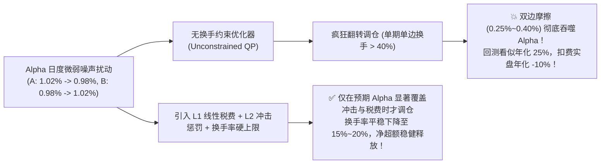
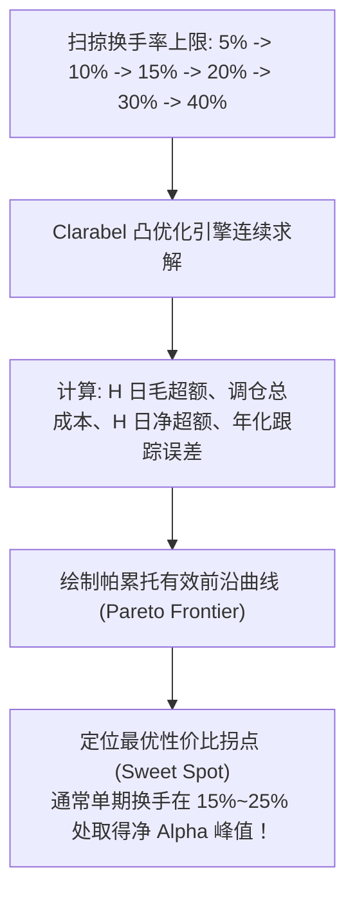

# 第 25 讲：换手率约束与交易成本惩罚项引入

::: tip 本讲核心目标
在现代量化投资组合优化中，经典的均值-方差优化器被学界与业界戏称为“**误差放大器（Error Maximizer）**”：由于机器学习模型的 Alpha 预测值每天都存在细微的统计噪声，一个未经换手率约束与摩擦惩罚的优化器，往往会为了多赚 $0.05\%$ 的微小超额，每天把 $50\%$ 的持仓底仓全盘换掉，最终在 A 股印花税、佣金与滑点冲击的“绞肉机”下巨额失血。

本讲将深入剖析优化器过度换手的病理根源；推导如何将 **L1 线性交易费用** 与 **L2 二次市场冲击模型（Almgren-Chriss 近似）** 直接编入凸优化目标函数；实现**单期换手率半范数硬约束**；并绘制**换手率与扣费净超额收益的帕累托有效前沿（Pareto Frontier）**，建立买方实盘的动态换手决策机制。
:::

---

## 1. 经典文献与工业界理论基石

交易摩擦与组合优化的结合，是量化金融工程中最具实战价值的研究领域之一：

1. **Michaud, Richard O. (1989)**. *"The Markowitz Optimization Enigma: Is 'Optimized' Optimal?"*, *Financial Analysts Journal*, 45(1): 31-42.  
   > 首次从统计学角度证明均值-方差优化器过度青睐估计误差最大（高估均值、低估风险）的资产，揭示了“误差放大器”现象。
2. **Almgren, Robert, & Chriss, Neil (2000)**. *"Optimal execution of portfolio transactions"*, *Journal of Risk*, 3(2): 5-40.  
   > 奠定了最优执行与市场冲击模型（Temporary and Permanent Market Impact）的学术理论基石。
3. **Kyle, Albert S. (1985)**. *"Continuous Auctions and Informed Trader"*, *Econometrica*, 53(6): 1315-1335.  
   > 推导了知情交易者订单流对价格冲击的线性模型（Kyle's Lambda），构成了微观结构冲击成本的理论源头。
4. **Boyd, S., Busseti, E., He, S., & Kang, J. (2017)**. *"Multi-Period Trading via Convex Optimization"*, *Foundations and Trends in Optimization*, 3(1): 1-76.  
   > 斯坦福大学凸优化体系，系统推导了将 L1 线性交易费与 L2 凸冲击函数统一嵌入凸优化规划的标准范式。
5. **Bouchaud, J.-P., Gefen, Y., Potters, M., & Wyart, M. (2004)**. *"Fluctuations and response in financial markets: the subtle nature of 'random' price changes"*, *Quantitative Finance*, 4(2): 176-185.  
   > 证明了真实金融市场中非线性平方根冲击定律的普遍存在性。

---

## 2. 优化器为何会患上“过度换手病”？

金融市场的信噪比（SNR）通常只有 $0.05 \sim 0.15$。在第 $t$ 日，股票 A 的预期超额为 $+1.02\%$，股票 B 为 $+0.98\%$；但到了第 $t+1$ 日，因微弱特征扰动，股票 A 的预测变为 $+0.98\%$，股票 B 变为 $+1.02\%$。

- **无约束优化器的狂热**：优化器把微不足道的 $0.04\%$ 统计噪声视为绝对确定的套利机会，立刻指令全额卖出股票 A，全额买入股票 B！
- **A 股实盘的严酷惩罚**：
  - 卖出股票 A：单向印花税 $0.05\%$ + 卖出佣金与经手费 $\approx 0.02\%$ + 卖出冲击滑点 $\approx 0.10\% = 0.17\%$；
  - 买入股票 B：买入佣金与过户费 $\approx 0.02\%$ + 买入冲击滑点 $\approx 0.10\% = 0.12\%$；
  - **总摩擦损耗**：双边摩擦成本高达 $0.29\%$！这一买一卖不仅没有赚到预期的 $0.04\%$ 差价，反而让组合净资产瞬间缩水 $0.25\%$！



---

## 3. 交易摩擦成本的凸函数化建模（Convex Formulation）

设第 $t$ 日调仓前投资组合的现有真实持仓权重为 $\mathbf{w}_{\text{prev}} \in \mathbb{R}^N$（已经历资产价格被动漂移）。
本次调仓的目标决策变量为 $\mathbf{w} \in \mathbb{R}^N$。
单只股票的调仓权重变动量为：
$$\Delta w_i = w_i - w_{i, \text{prev}}$$

### 3.1 L1 线性交易成本项（印花税 + 券商佣金 + 过户费）

线性交易成本正比于调仓金额。在 A 股市场，印花税仅在卖出侧征收（现行标准 $0.05\%$），佣金与经手过户费双边征收（买卖各约 $0.015\% \sim 0.02\%$）：

$$C_{\text{linear}}(\Delta \mathbf{w}) = \sum_{i=1}^N \left( c_i^{\text{buy}} (\Delta w_i)^+ + c_i^{\text{sell}} (\Delta w_i)^- \right)$$

其中 $(\cdot)^+ = \max(\cdot, 0)$ 为买入部分，$(\cdot)^- = \max(-\cdot, 0)$ 为卖出部分。

在对称费率教学简化下，可表示为 L1 范数形式：
$$C_{\text{linear}}(\Delta \mathbf{w}) = \mathbf{c}^T |\mathbf{w} - \mathbf{w}_{\text{prev}}| = c \cdot \|\mathbf{w} - \mathbf{w}_{\text{prev}}\|_1$$

- **凸性证明**：绝对值函数 $|\cdot|$ 及 L1 范数 $\|\cdot\|_1$ 为严格凸函数，在 cvxpy 中直接通过 `cp.norm1(w - w_prev)` 调用，天然满足 Disciplined Convex Programming (DCP) 规范！

### 3.2 L2 二次市场冲击惩罚项（Almgren-Chriss 暂时冲击模型）

对于管理规模数亿至数十亿元的买方资管产品，大单交易会在订单簿上“打穿挂单深度”，产生显著的市场冲击。

根据 Almgren & Chriss (2000) 最优执行理论，暂时价格冲击与执行速度成正比，因而**总冲击成本金额与交易量的平方成正比**。在单期组合优化中，可等价建模为二次惩罚项：

$$C_{\text{impact}}(\Delta \mathbf{w}) = \frac{1}{2} \sum_{i=1}^N \gamma_i (\Delta w_i)^2 = \frac{1}{2} (\mathbf{w} - \mathbf{w}_{\text{prev}})^T \Gamma (\mathbf{w} - \mathbf{w}_{\text{prev}})$$

其中冲击对角惩罚系数 $\gamma_i$ 严格正比于资金规模 AUM，反比于股票日均成交额 ADV：

$$\gamma_i = k \cdot \sigma_{i, \text{daily}} \frac{\text{AUM}}{\text{ADV}_{i, \text{amount}}}$$

- $\text{AUM}$：基金管理总资产净值（如 10 亿元人民币）；
- $\text{ADV}_{i, \text{amount}}$：该股票在调仓决策前已知的 20 日日均成交金额（如 5,000 万元）；
- $\sigma_{i, \text{daily}}$：个股日收益波动率；
- $k$：由执行算法（TWAP/VWAP）历史交易成交数据校准的经验冲击乘数。
- **经济学内涵**：管理规模越大、股票成交额越清淡、个股波动率越高，冲击系数 $\gamma_i$ 呈几何级数爆炸，优化器将自动约束在该股票上的调仓动作！

---

## 4. 全多目标平衡规划模型与换手率硬约束

统一投资持有期为 $H$ 个交易日。目标函数将持有期主动超额收益、风险惩罚、本次调仓线性税费与二次市场冲击惩罚同时纳入考虑：

$$\max_{\mathbf{w}} \quad \underbrace{\mathbf{h}^T \boldsymbol{\alpha}_H}_{\text{持有期预期超额}} - \underbrace{\frac{\lambda}{2} \mathbf{h}^T \boldsymbol{\Sigma}_H \mathbf{h}}_{\text{持有期风险方差惩罚}} - \underbrace{\mathbf{c}^T |\mathbf{w} - \mathbf{w}_{\text{prev}}|}_{\text{本次调仓线性成本}} - \underbrace{\frac{1}{2} (\mathbf{w} - \mathbf{w}_{\text{prev}})^T \Gamma (\mathbf{w} - \mathbf{w}_{\text{prev}})}_{\text{本次调仓市场冲击成本}}$$

$$\text{s.t.} \quad \begin{cases}
\sum_{i=1}^N w_i = 1, \quad w_i \ge 0 & (\text{预算与单边做多}) \\
X_{\text{ind}}^T (\mathbf{w} - \mathbf{w}_b) = \mathbf{0} & (\text{申万一级行业硬中性}) \\
|X_{\text{style}}^T (\mathbf{w} - \mathbf{w}_b)| \le \boldsymbol{\delta}_{\text{style}} & (\text{风格因子偏离容差}) \\
-w_{b, i} \le w_i - w_{b, i} \le d_{\max} & (\text{个股主动超配上限}) \\
\mathbf{h}^T \boldsymbol{\Sigma}_{\text{ann}} \mathbf{h} \le \text{TE}_{\max}^2 & (\text{年化预测跟踪误差硬上限}) \\
\frac{1}{2} \|\mathbf{w} - \mathbf{w}_{\text{prev}}\|_1 \le \tau_{\max} & (\text{单期单边换手率硬上限})
\end{cases}$$

其中：
$$\text{Turnover}_{\text{single}} = \frac{1}{2} \sum_{i=1}^N |w_i - w_{i, \text{prev}}| = \frac{1}{2} \|\mathbf{w} - \mathbf{w}_{\text{prev}}\|_1$$
因买入总量与卖出总量相等，乘以 $1/2$ 即为工业标准的**单边换手率**。

---

## 5. 换手率与净超额的帕累托前沿（Pareto Frontier）

通过逐步放宽换手率硬上限 $\tau_{\max} \in [5\%, 50\%]$，我们可以绘制出著名的**换手率-净收益帕累托前沿曲线**：



### 5.1 边际效益递减规律
1. **换手率过紧（$\tau_{\max} \le 5\%$）**：优化器被严重束缚，无法将仓位调往高 Alpha 优质股票，毛超额极低；
2. **黄金平衡区间（$\tau_{\max} \approx 15\% \sim 20\%$）**：优化器能够果断卖出 Alpha 衰竭殆尽的股票、重配新发掘的强势股票，且交易摩擦极低，**扣费后净超额达到全局峰值**；
3. **换手率过松（$\tau_{\max} \ge 35\%$）**：优化器开始捕捉高频噪声，冲击成本与税费按二次方加速飙升，净超额出现断崖式暴跌！

---

## 6. 工业级带换手成本的凸优化器实战

在 `tutorial/examples/lecture_25_turnover_constraints_and_costs.py` 中，我们实现了生产级 `AshareTurnoverConstrainedOptimizer`：
1. 完整输入上一期真实持仓 `w_prev`、线性费率向量 $\mathbf{c}$ 与规模冲击对角矩阵 $\Gamma$；
2. 联合求解包含 L1/L2 成本惩罚与单期单边换手率上限 $\tau_{\max}$ 的凸优化问题；
3. 内置 `trace_pareto_frontier()` 扫掠求解器，自动输出换手上限敏感性报告。

可在终端直接运行验证：

```bash
python3 -m examples.lecture_25_turnover_constraints_and_costs
```

<<< @/examples/lecture_25_turnover_constraints_and_costs.py

---

## 7. 机构买方实盘换手率配置参考矩阵

在实际量化资管产品运作中，换手率的设定必须与策略频率和资金容量紧密挂钩：

| 策略类型 | 调仓周期 | 目标单期换手率 | 年化单边换手率 | 典型 AUM 容量 | 交易摩擦核心挑战 |
| :--- | :--- | :--- | :--- | :--- | :--- |
| **基本面多因子 / 价值指增** | 月频（Monthly, 21天） | $10\% \sim 15\%$ | $1.2\times \sim 2.0\times$ | 100 亿 ~ 300 亿元 | 追求极致低冲击，几乎全用 VWAP 算法执行 |
| **量化中频 Alpha / 中证500指增** | 周频（Weekly, 5天） | $15\% \sim 20\%$ | $8\times \sim 12\times$ | 30 亿 ~ 80 亿元 | 兼顾 Alpha 时效性与市场冲击，注重个股流动性过滤 |
| **高频量化截面 / 中证1000/2000指增** | 日频（Daily, 1天） | $15\% \sim 25\%$ | $30\times \sim 60\times$ | 5 亿 ~ 20 亿元 | 冲击成本是生命线，必须配合自研深度学习订单流执行算法 |

---

## 8. 本讲小结与核心自测

| 核心考点 | 工业标准回答要点 | 常见工程/学术陷阱 |
| :--- | :--- | :--- |
| **为什么优化器未经约束会产生极端过度换手？** | 均值-方差优化器本质是“误差放大器”，会将金融数据中的微弱统计噪声误判为确定性超额，从而频繁颠覆持仓。 | 以为模型训练集准确率高就不会过度换手，混淆了预测信噪比与调仓动力的关系。 |
| **如何建模具有真实资金规模特性的市场冲击？** | 引入 Almgren-Chriss 二次冲击惩罚 $\frac{1}{2} \Delta \mathbf{w}^T \Gamma \Delta \mathbf{w}$，其中系数 $\gamma_i \propto \frac{\text{AUM}}{\text{ADV}_i}$。 | 误用固定的万分之几常数滑点，导致回测规模扩大到 50 亿时完全无法察觉流动性冲击崩盘。 |
| **在 cvxpy 中如何表达单边换手率硬约束？** | 使用半范数：`cp.norm1(w - w_prev) <= 2 * max_turnover`。 | 忘记乘以 $1/2$ 导致单边换手率被错误放宽一倍。 |

至此，在**相对基准指数追求超额（Alpha）**的赛道上，我们的结构化风险与凸优化工具箱已经完整闭环。
但在许多全天候资管、FOF 母基金配置、CTA 大宗商品配置或绝对收益场景中，**并没有一个现成可复制的股票基准指数去追踪，我们该如何科学配置资产？**

在下一讲中，我们将进入 **第 26 讲：风险平价（Risk Parity）与层级风险平价（HRP）**，推导如何通过边际风险贡献（MRC）与图聚类无矩阵求逆算法，打造抵御宏观周期的全天候绝对收益基石！
