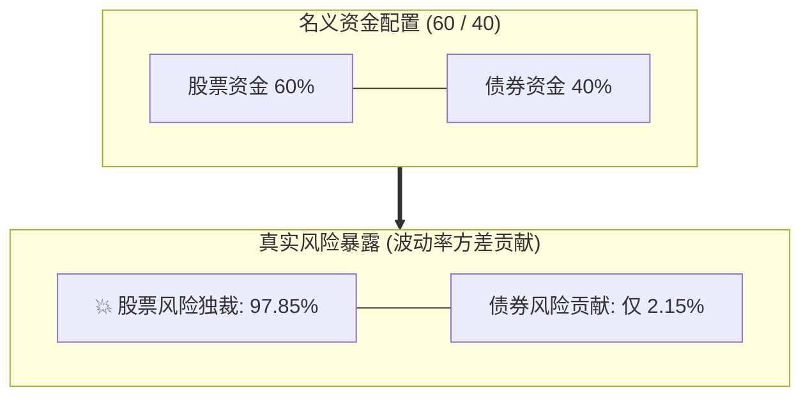
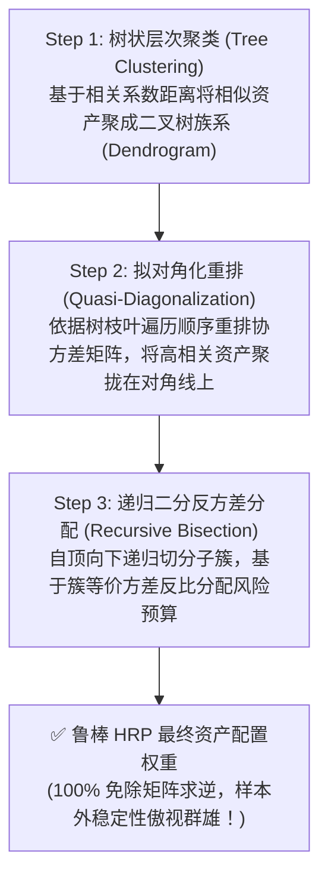

# 第 26 讲：风险平价（Risk Parity）与层级风险平价（HRP）

::: tip 本讲核心目标
并非所有买方量化策略都以跟踪跑赢沪深 300 或中证 1000 等特定指数为目标。在 FOF 母基金配置、CTA 大宗商品多品种配置或**全天候绝对收益（All Weather）**投资中，投资人追求的是“穿越牛熊周期的平稳净值曲线”。

本讲将深入剖析传统市值加权与“股债 60/40”配置中严重的**名义资金平衡 vs 真实风险独裁**陷阱；基于**欧拉齐次函数定理**严密推导**边际风险贡献（MRC）**与等风险贡献平价（ERC）的凸对数障碍求解；掌握由量化先驱 Marcos López de Prado 提出、**彻底摆脱协方差矩阵求逆数值病态难题的层级风险平价（Hierarchical Risk Parity, HRP）算法**。
:::

---

## 1. 经典文献与工业界理论基石

构建全天候大类资产配置与风险平价体系的核心参考文献：

1. **Dalio, Ray (1996)**. *"The All Weather Strategy"*, Bridgewater Associates Research Papers.  
   > 桥水基金创始人瑞·达利欧创立的全天候策略白皮书，首次提出按经济增长与通胀的四象限宏观环境平价分配风险资产。
2. **Qian, Edward (2005)**. *"Risk Parity Portfolios: Efficient Portfolios Through True Diversification"*, PanAgora Asset Management.  
   > 首次正式提出“风险平价（Risk Parity）”术语，推导了边际风险贡献（MRC）与资金权重、资产波动率及相关性的解析关系。
3. **Maillard, S., Roncalli, T., & Teïletche, J. (2010)**. *"The Properties of Equally Weighted Risk Contribution Portfolios"*, *The Journal of Portfolio Management*, 36(4): 60-70.  
   > 严格证明了等风险贡献（ERC）投资组合解的存在性、唯一性，及其在最小方差组合与等权组合之间的优美几何性质。
4. **Spinu, Florin (2013)**. *"An Algorithm for Computing Risk Parity Weights"*, *SSRN Electronic Journal*, 2297383.  
   > 创新性地将非凸的 ERC 方程组转化为严格凸的对数障碍优化问题，使风险平价权重求解实现毫秒级数值收敛。
5. **López de Prado, Marcos (2016)**. *"Building Diversified Portfolios that Outperform Out of Sample"*, *The Journal of Portfolio Management*, 42(4): 59-69.  
   > 提出层级风险平价（HRP），利用图论树状聚类与拟对角化重排彻底颠覆马科维茨矩阵求逆，在多重共线性资产池中展现出无与伦比的样本外稳健性。

---

## 2. 传统资产配置的谎言：名义资金平衡 vs 真实风险独裁

全球最知名的经典多元配置当属“股债 60/40 组合”（$60\%$ 资金配置股票指数，$40\%$ 资金配置国债指数）。

但在现代波动率显微镜下，这其实是一个严重的风险错配：
- 股票年化波动率通常在 $\sigma_{\text{equity}} \approx 18\%$ 左右；
- 国债年化波动率仅有 $\sigma_{\text{bond}} \approx 4\%$ 左右；
- 设股债相关系数 $\rho \approx 0$。

组合的总年化方差为：
$$\sigma_p^2 = w_E^2 \sigma_E^2 + w_B^2 \sigma_B^2 = 0.6^2 \times 0.18^2 + 0.4^2 \times 0.04^2 = 0.011664 + 0.000256 = 0.011920$$

其中**股票方差贡献占比**高达：
$$\frac{0.011664}{0.011920} \approx \mathbf{97.85\%}!$$



名义上四成资金买入了安全债券，实质上**整个组合 $98\%$ 的风险全由股票单独支配**！一旦股票遭遇熊市，债券杯水车薪的收益根本无力回天。

桥水基金全天候策略的核心理念应运而生：**放弃资金等额配置的执念，追求各资产对投资组合总风险的等额贡献（Risk Parity）！**

---

## 3. 经典等风险贡献（ERC）数学原理推导

设资产池中有 $N$ 种资产（如股票指数、国债、黄金、CTA 商品、中性 Alpha），其年化协方差矩阵为 $\boldsymbol{\Sigma} \in \mathbb{R}^{N \times N}$，配置权重向量为 $\mathbf{w} \in \mathbb{R}^N$（满足 $\mathbf{1}^T \mathbf{w} = 1, \; w_i \ge 0$）。

组合总年化波动率为：
$$\sigma_p(\mathbf{w}) = \sqrt{\mathbf{w}^T \boldsymbol{\Sigma} \mathbf{w}}$$

### 3.1 边际风险贡献（Marginal Risk Contribution, MRC）
第 $i$ 种资产权重的微小变动对总组合波动率的偏导数定义为边际风险贡献：

$$\text{MRC}_i = \frac{\partial \sigma_p}{\partial w_i} = \frac{\partial \sqrt{\mathbf{w}^T \boldsymbol{\Sigma} \mathbf{w}}}{\partial w_i} = \frac{(\boldsymbol{\Sigma} \mathbf{w})_i}{\sqrt{\mathbf{w}^T \boldsymbol{\Sigma} \mathbf{w}}} = \frac{(\boldsymbol{\Sigma} \mathbf{w})_i}{\sigma_p}$$

### 3.2 总风险贡献（Total Risk Contribution, TRC）
将第 $i$ 种资产的权重乘以其边际风险贡献，即为该资产向组合注入的**绝对风险贡献值**：

$$\text{TRC}_i = w_i \cdot \text{MRC}_i = \frac{w_i (\boldsymbol{\Sigma} \mathbf{w})_i}{\sigma_p}$$

根据**欧拉齐次函数定理（Euler's Homogeneous Function Theorem）**，由于组合波动率 $\sigma_p(\mathbf{w})$ 是权重向量 $\mathbf{w}$ 的 1 次正齐次函数（即 $\sigma_p(c \mathbf{w}) = c \sigma_p(\mathbf{w})$）：

$$\sum_{i=1}^N \text{TRC}_i = \sum_{i=1}^N w_i \frac{\partial \sigma_p}{\partial w_i} = \frac{\mathbf{w}^T \boldsymbol{\Sigma} \mathbf{w}}{\sigma_p} = \frac{\sigma_p^2}{\sigma_p} = \sigma_p$$

**所有资产的总风险贡献累加之和，严丝合缝、完全等于组合的总波动率！**

### 3.3 等风险平价（ERC）均衡条件
等风险贡献平价要求每一个资产为组合贡献的绝对风险完全一致：

$$\text{TRC}_1 = \text{TRC}_2 = \dots = \text{TRC}_N = \frac{\sigma_p}{N}$$

即对任意两个资产 $i, j$，必须严格满足：
$$w_i (\boldsymbol{\Sigma} \mathbf{w})_i = w_j (\boldsymbol{\Sigma} \mathbf{w})_j, \quad \forall i, j$$

- **直观规律**：低波动资产（如国债）被赋予极高的资金权重，高波动资产（如股票、商品期货）被赋予极低的资金权重，从而实现真正的风险平衡！

### 3.4 Spinu (2013) 对数障碍凸优化高效求解法
直接求解非线性方程组极为困难。Spinu (2013) 证明了 ERC 等价于求解一个无约束凸规划问题：

$$\min_{\mathbf{y}} \quad f(\mathbf{y}) = \frac{1}{2} \mathbf{y}^T \boldsymbol{\Sigma} \mathbf{y} - c \sum_{i=1}^N \ln(y_i)$$

对其求一阶偏导数并令其等于零：
$$\nabla f(\mathbf{y}) = \boldsymbol{\Sigma} \mathbf{y} - c \begin{pmatrix} 1/y_1 \\ \vdots \\ 1/y_N \end{pmatrix} = \mathbf{0} \implies y_i (\boldsymbol{\Sigma} \mathbf{y})_i = c, \quad \forall i$$

求得最优解 $\mathbf{y}^*$ 后，归一化即可得到完美的 ERC 权重：
$$\mathbf{w}^* = \frac{\mathbf{y}^*}{\sum_{j=1}^N y_j^*}$$

---

## 4. 层级风险平价（Hierarchical Risk Parity, HRP）算法

尽管 ERC 解决了风险独裁，但在高维资产池或存在高相关性资产时，协方差矩阵近奇异，任何依赖矩阵乘法逆向求解的方法都会遭遇**数值病态放大（Ill-Conditioned Inversion）**。

2016 年，量化金融先驱 Marcos López de Prado 提出**层级风险平价（HRP）**，将机器学习无监督树聚类与现代投资组合理论深度融合，**彻底摒弃了矩阵求逆**！



### 4.1 第一步：层次树状聚类（Tree Clustering）
1. 将两两资产的相关系数 $\rho_{i, j}$ 映射为严格符合度量空间公理的相关距离（Correlation Distance）：
   $$d_{i, j} = \sqrt{\frac{1}{2}(1 - \rho_{i, j})} \in [0, 1]$$
2. 计算距离向量间的欧氏距离构建仿射相似度：
   $$\tilde{d}_{i, j} = \sqrt{\sum_{k=1}^N (d_{k, i} - d_{k, j})^2}$$
3. 使用 SciPy 的 `linkage` 层次聚类算法构建二叉聚类树（Dendrogram）。

### 4.2 第二步：拟对角化重排（Quasi-Diagonalization）
按照聚类树的叶子节点遍历顺序，重新排列协方差矩阵的行与列。使相似度极高、相关性最强的资产在矩阵对角线上紧挨在一起，将原本杂乱无章的协方差矩阵重塑为清晰的**分块对角矩阵结构**。

### 4.3 第三步：递归二分反方差分配（Recursive Bisection）
从聚类树的根节点开始，递归地将当前资产集合 $V$ 拆分为两个互不相交的子簇 $V_1$ 和 $V_2$：
1. 分别计算两个子簇的等价合成方差：
   对子簇 $V_1$，其内部基于反方差法初始化权重：
   $$\tilde{\mathbf{w}}_1 = \frac{\operatorname{diag}(\boldsymbol{\Sigma}_1)^{-1}}{\operatorname{Tr}(\operatorname{diag}(\boldsymbol{\Sigma}_1)^{-1})}$$
   子簇 $V_1$ 的综合风险方差为：
   $$\tilde{v}_1 = \tilde{\mathbf{w}}_1^T \boldsymbol{\Sigma}_1 \tilde{\mathbf{w}}_1$$
2. 同样计算子簇 $V_2$ 的综合方差 $\tilde{v}_2$；
3. 计算两个子簇间的权重分配比例（方差越小，分配权重越大）：
   $$\alpha_1 = 1 - \frac{\tilde{v}_1}{\tilde{v}_1 + \tilde{v}_2} = \frac{\tilde{v}_2}{\tilde{v}_1 + \tilde{v}_2}, \quad \alpha_2 = 1 - \alpha_1$$
4. 将当前父簇的总权重按 $\alpha_1, \alpha_2$ 递归向下分配，直到叶子节点得到单资产的绝对权重！

---

## 5. 四大经典权重配置方案横向大比拼

| 配置算法 | 依赖输入 | 是否需要矩阵求逆 | 高相关资产表现 | 样本外夏普稳定性 | 核心适用场景 |
| :--- | :--- | :--- | :--- | :--- | :--- |
| **等权（EW / 1/N）** | 仅资产列表 | ❌ 否 | 容易聚集同质风险 | 极稳健基准（常击败 Markowitz） | 零预测信息下的全盲配置 |
| **反方差（IVP）** | 仅单资产方差 | ❌ 否 | 忽视跨资产相关性 | 较好，但可能超配高相关资产群 | 资产两两独立假设下的极简模型 |
| **等风险贡献（ERC）** | 完整协方差矩阵 $\boldsymbol{\Sigma}$ | 需迭代逼近 | 风险等分，但受高维估计误差影响 | 中等偏上 | 全天候宏观大类资产平衡配置 |
| **层级风险平价（HRP）** | 完整协方差矩阵 $\boldsymbol{\Sigma}$ | ❌ **完全免求逆** | **树聚类隔离同质资产，自动分层风控** | **极高（Prado 论文实证超越 Markowitz）** | **CTA 多品种池、多因子策略群与 FOF 绝对收益母基金** |

---

## 6. 工业级 HRP 资产配置引擎实战

在 `tutorial/examples/lecture_26_risk_parity_and_hrp.py` 中，我们实现了生产级 `AshareHierarchicalRiskParity`：
1. 接收历史收益率，自动计算相关系数距离并调用 SciPy 层次聚类；
2. 执行递归二分法确定各个股票或策略的 HRP 权重；
3. 准确计算并验证各项资产的边际风险贡献（MRC）与总风险贡献（TRC）；
4. 提供等权（EW）、反方差（IVP）与 HRP 的风险分解报告。

可在终端直接运行验证：

```bash
python3 -m examples.lecture_26_risk_parity_and_hrp
```

<<< @/examples/lecture_26_risk_parity_and_hrp.py

---

## 7. 第六模块核心交付 Checklist

学完本模块，你已经彻底跨过了量化投资中最深的一道数学护城河——**现代投资组合与风险优化管理**：

- [x] **Barra 结构化风险解构（第 23 讲）**：
  - 破解了 $N \gg T$ 时样本协方差矩阵的维度灾难；
  - 掌握了 $\boldsymbol{\Sigma} = X F X^T + \Delta$ 的低维投影、CNE6 十大风格因子、EWMA 协方差估计与特异性方差贝叶斯收缩。
- [x] **指数增强凸优化求解（第 24 讲）**：
  - 建立了基于 cvxpy / Clarabel 的凸优化生产级参考实现；
  - 实现了 **行业硬中性**、**市值偏离容差** 与 **预测跟踪误差（TE）硬上限约束**。
- [x] **换手率约束与交易成本惩罚（第 25 讲）**：
  - 洞悉了优化器过度换手的病理根源；
  - 融合了 L1 线性税费与 L2 市场冲击成本，绘制了扣费净超额的帕累托前沿曲线。
- [x] **全天候层级风险平价（第 26 讲）**：
  - 推导了边际风险贡献（MRC）与欧拉齐次函数定理；
  - 掌握了免矩阵求逆、基于图聚类的 **HRP 递归二分算法**，为大类资产配置提供了强悍武器。

至此，我们的选股信号已通过凸优化器，被炼制为经受住严密风控约束的**目标股票持仓权重 $\mathbf{w}^*$**。

在接下来的 **第七模块：严苛全真回测与执行摩擦建模** 中，我们将把优化生成的仓位送入最残酷的实盘仿真战场——**事件驱动回测引擎、涨跌停真实撮合限制与滑点冲击精算**！
