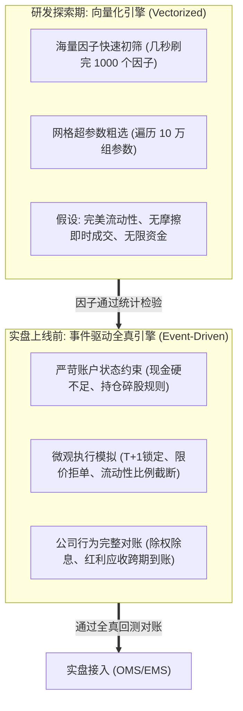
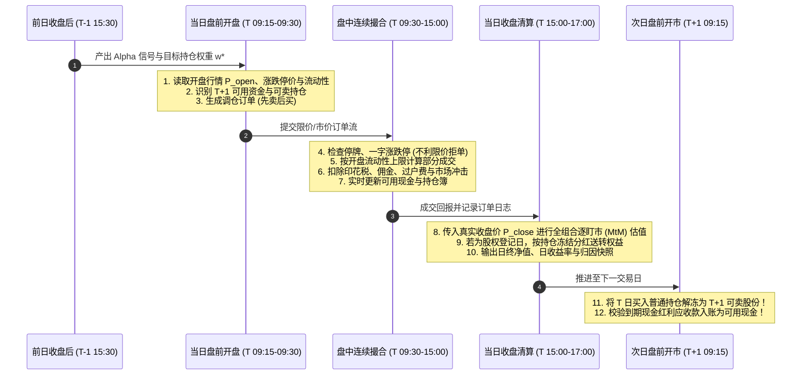

# 第 27 讲：A 股回测引擎架构：向量化 vs 事件驱动

::: tip 本讲核心目标
在量化研究从实验室走向数亿真金白银实盘的过程中，**回测引擎（Backtesting Engine）**是检验策略生死的第一道防线。初级量化研究员常沉迷于在 Jupyter Notebook 中使用 Pandas/NumPy 数组进行点积求和的“向量化回测”，误以为这就是策略未来的真实净值；然而一旦上线实盘，由于无法处理资金不足挂单排队、T+1 仓位锁定、盘中流动性枯竭与分红送转除权等物理限制，策略净值瞬间发生灾难性漂移。

本讲将深入剖析**向量化回测（Vectorized）与事件驱动回测（Event-Driven / DES）**的本质差异；推导符合 A 股微观结构的时间推进状态机；手写工业级**双账本对账系统（现金簿与持仓簿）**；并彻底理顺信号生成、开盘估值、撮合成交、收盘盯市与下一日 T+1 解冻的全链路闭环！
:::

---

## 1. 经典文献与工业界理论基石

构建高保真回测系统所需的经典量化文献与微观结构著作：

1. **López de Prado, Marcos (2018)**. *Advances in Financial Machine Learning*. John Wiley & Sons.  
   > 第 11 章与第 12 章深入剖析了回测三大谎言（过拟合、幸存者偏差、未来函数），奠定了事件驱动仿真（Event-Driven Simulation）与合成压力测试的工业标准。
2. **Harris, Larry (2003)**. *Trading and Exchanges: Market Microstructure for Practitioners*. Oxford University Press.  
   > 市场微观结构权威指南，详尽解析了订单类型、限价簿（LOB）撮合机制、交易时间切片与清算交收流程。
3. **Farmer, J. Doyne, & Foley, Duncan (2009)**. *"The economy needs agent-based modelling"*, *Nature*, 460(7256): 685-686.  
   > 阐释了基于智能体与离散事件模拟（DES）对于捕捉金融市场非线性反馈与流动性冲击的不可替代性。
4. **Cont, Rama (2001)**. *"Empirical properties of asset returns: stylized facts and statistical issues"*, *Quantitative Finance*, 1(2): 223-236.  
   > 总结了高频与日频金融收益率的肥尾、波动率聚集与自相关微观结构实证特征。

---

## 2. 两种回测架构的深度技术对比

在买方研发流水线中，向量化与事件驱动并非非此即彼，而是服务于不同研发阶段的双引擎：



| 评测维度 | 向量化回测（Vectorized Engine） | 事件驱动回测（Event-Driven DES Engine） |
| :--- | :--- | :--- |
| **底层数据结构** | 2D/3D 稠密矩阵（NumPy / Polars 向量化点乘） | 离散事件队列（Time Queue）、订单簿与复式记账账本 |
| **计算时间复杂度** | $O(T \times N)$，GPU/SIMD 并行加速，毫秒级完成数年回测 | $O(\sum \text{Events})$，逐事件推进状态，通常需数秒至数分钟 |
| **资金约束处理** | ❌ 无法动态跟踪现金；目标权重合计为 1 即假设资金无限充裕 | ✅ 严格受制于可用现金余额；现金不足时自动按优先级缩单或拒单 |
| **T+1 与冻结管理** | ❌ 无法区分当期买入与历史可卖底仓 | ✅ 精确跟踪持仓分仓日历，日终买入进入冻结仓，次日开盘解冻 |
| **流动性与挂单排队** | ❌ 假设无论挂单多大均能按收盘价 $100\%$ 成交 | ✅ 设定单笔成交不得超过开盘/全天成交量的 $10\% \sim 20\%$，超额部分部分成交或撤单 |
| **除权除息现金流** | ❌ 粗暴依赖复权价格，掩盖了分红到账日的现金流断流风险 | ✅ 登记日冻结红利、除权日确认应收资产、派息日现金解冻可用 |
| **代表开源项目** | vectorbt, pyfolio, fastquant | Backtrader, Zipline-reloaded, Qlib, NautilusTrader |

---

## 3. A 股单交易日全真离散时间推进状态机

为了杜绝任何隐性未来信息渗透，事件驱动引擎必须建立严格符合沪深交易所结算规则的**时间推进状态机（State Machine）**：



### 关键时点原则：
1. **决策时点严格性**：第 $t$ 日开盘的调仓决策，**只能读取 $t-1$ 日及之前的特征与行情**；执行函数必须强制校验 `signal_date < trade_date`；
2. **开盘估值与收盘估值完全隔离**：开盘撮合只能使用 $P_{\text{open}}$，严禁在开盘撮合逻辑中偷看当天的 $P_{\text{high}}, P_{\text{low}}, P_{\text{close}}$；
3. **先卖后买，资金闭环**：在现金有限的前提下，组合调仓必须遵循“先撮合卖出单释放可用现金，再按可用资金规模搜索并撮合买入单”的铁律。

---

## 4. 现代量化账户恒等式与复式记账法

在生产级回测系统中，任何凭空产生的利润或隐性消失的费用都是灾难。账户在每一个微观时点 $t$ 必须严格满足**资产负债恒等式**：

$$E_t = C_t + D_t^{\text{receivable}} + \sum_{i=1}^N Q_{i, t} P_{i, t}$$

其中：
- $E_t$：投资组合**总资产净值（Equity / NAV）**；
- $C_t$：**当前可用现金余额（Available Cash）**，可立即用于买入新股票；
- $D_t^{\text{receivable}}$：**应收股利/待到账款项（Dividends Receivable）**，已通过股权登记日确认，计入基金总资产净值，但在红利发放日之前**严禁作为买入现金使用**；
- $Q_{i, t}$：第 $i$ 只股票的当前总持仓股数（包含普通可卖股、今日买入冻结股与未上市送转股）；
- $P_{i, t}$：当前盯市价格（开盘估值用 $P_{\text{open}}$，日终估值用 $P_{\text{close}}$）。

### 4.1 买入成交时的复式记账更新
当以价格 $P_{\text{fill}}$ 成功买入 $Q_{\text{fill}}$ 股股票时：
$$\begin{cases}
C_{t+} = C_{t-} - Q_{\text{fill}} P_{\text{fill}} - \text{Fee}_{\text{buy}} - \text{Impact}_{\text{buy}} \\
Q_{i, t+}^{\text{total}} = Q_{i, t-}^{\text{total}} + Q_{\text{fill}} \\
Q_{i, t+}^{\text{sellable}} = Q_{i, t-}^{\text{sellable}} \quad (\text{T+1 锁定，可卖股数绝不增加！})
\end{cases}$$

### 4.2 卖出成交时的复式记账更新
当以价格 $P_{\text{fill}}$ 成功卖出 $Q_{\text{fill}}$ 股股票时：
$$\begin{cases}
C_{t+} = C_{t-} + Q_{\text{fill}} P_{\text{fill}} - \text{Fee}_{\text{sell}} - \text{Impact}_{\text{sell}} \\
Q_{i, t+}^{\text{total}} = Q_{i, t-}^{\text{total}} - Q_{\text{fill}} \\
Q_{i, t+}^{\text{sellable}} = Q_{i, t-}^{\text{sellable}} - Q_{\text{fill}}
\end{cases}$$

---

## 5. 工业级事件驱动引擎实战

在 `tutorial/examples/lecture_27_vectorized_vs_event_driven_backtest.py` 中，我们构建了生产级 `AshareEventDrivenEngine`：
1. 实现了 `PositionLedger`（持仓簿）与 `CashLedger`（现金簿）；
2. 严格按交易日历推进，支持 T+1 动态解冻与零股（Lot Rule）处理；
3. 开盘估值与收盘估值严格物理隔离，原生支持部分成交与资金不足缩量；
4. 逐日输出可对账的资产负债快照序列。

可在终端直接运行验证：

```bash
python3 -m examples.lecture_27_vectorized_vs_event_driven_backtest
```

<<< @/examples/lecture_27_vectorized_vs_event_driven_backtest.py

---

## 6. 成熟开源事件驱动回测框架选型与实盘对比

| 框架名称 | 语言核心 | 架构设计特色 | A 股本土化适配程度 | 生产实盘柜台支持 | 适用机构场景 |
| :--- | :--- | :--- | :--- | :--- | :--- |
| **Backtrader** | Python | 经典松耦合事件驱动，支持多数据流同步与自定义观察器（Analyzers） | 中等（需自行封装 T+1 与印花税） | 支持 Interactive Brokers、Oanda | 中小型私募、量化教学与快速实盘原型 |
| **Zipline-reloaded** | Python / Cython | Quantopian 遗产，分时/日频全真撮合，内置 Pipeline 因子对齐 | 需通过三方库（如 pyfolio）适配 A 股规则 | 弱（偏研究） | 美股基本面多因子量化研究 |
| **Qlib** | Python / C++ | 微软开源，专为 AI/ML 量化设计，支持向量化与事件驱动混合 | 极高（原生支持 A 股日频、复权与 Alpha 评估） | 需自行对接柜台 | 头部中频多因子机器学习量化团队 |
| **NautilusTrader** | Rust / Python | 极致性能的异步多线程 DES，纳秒级时间戳，专为高频设计 | 较低（需自行开发 A 股规则与数据源） | 原生支持主流加密与外盘 FIX 协议 | 高频 HFT、统计套利与低延迟做市商 |

---

## 7. 本讲小结与核心自测

| 核心考点 | 工业标准回答要点 | 常见工程/学术陷阱 |
| :--- | :--- | :--- |
| **向量化回测最大的致命缺陷是什么？** | 无法处理资金依赖、状态依赖与流动性截断，将无法买入或停牌的股票假设为无摩擦成交。 | 拿着没有扣税、没有 T+1 约束的向量化高夏普曲线直接忽悠募资，实盘上线即穿仓。 |
| **T+1 机制在事件驱动引擎中如何严密建模？** | 持仓拆分为 `total_shares` 与 `sellable_shares`；日内买入仅增加总股数，次日日初推进时再将普通持仓转入可卖股数。 | 误把当日买入的股票直接加入可卖数量，在同一天内完成 T+0 违规卖出回转。 |
| **如何防止开盘撮合逻辑产生未来数据泄漏？** | 严格实行开盘接口与收盘接口物理分离，撮合仅接收开盘报价，严禁传入当天的 High、Low、Close。 | 撮合函数直接读取当天 Bar 对象的全天均价或最低价来判断成交，造成严重的未来函数漏洞。 |

在明确了事件驱动引擎的骨架后，回测结果是否真实，决定性地取决于**底层交易摩擦精算**。

在下一讲中，我们将进入 **第 28 讲：真实交易摩擦全真模拟**，深度推导印花税、机构最低佣金与著名的**平方根法则（Square-Root Law）市场冲击模型**！
