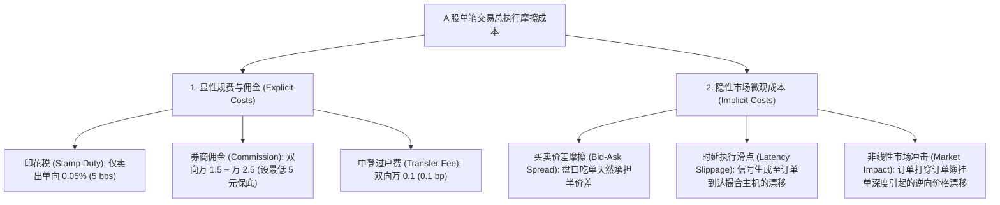
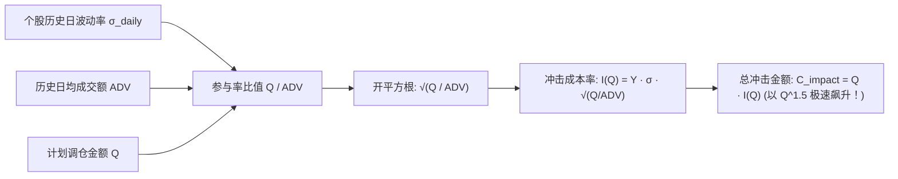
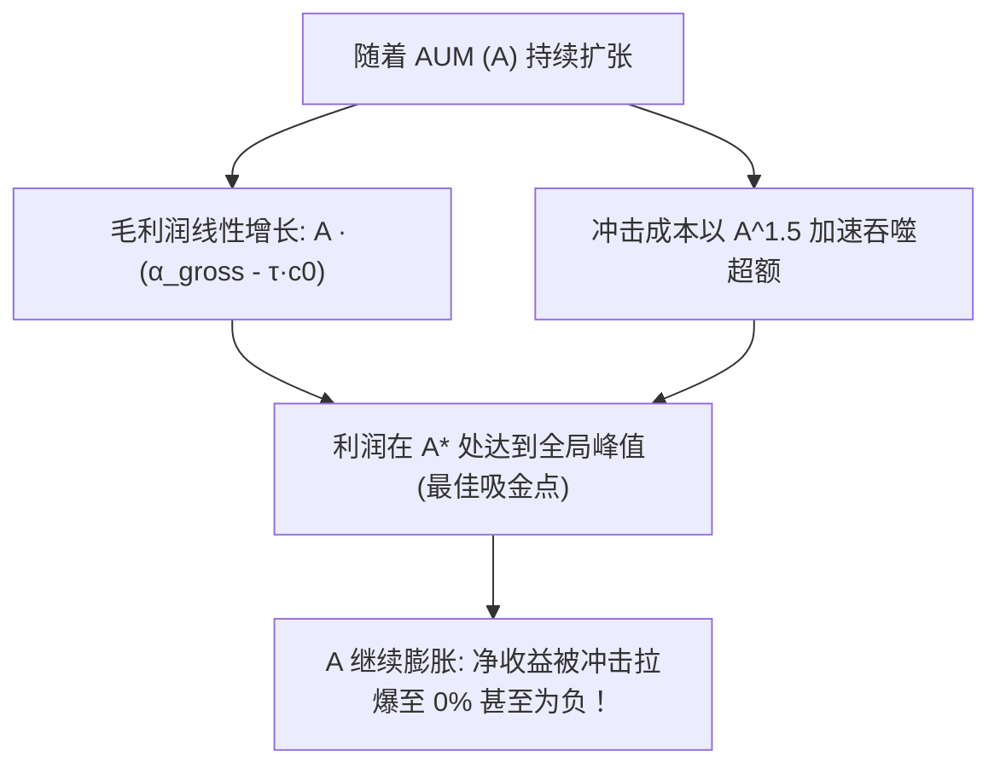

# 第 28 讲：真实交易摩擦全真模拟

::: tip 本讲核心目标
在量化买方机构中有一句名言：“**业余者研究收益，专业者研究风险，顶级专家研究交易成本。**”

很多在实验室中跑出年化 $30\%$ 超额的优秀模型，一经实盘上线，超额收益便迅速被交易摩擦无情抹平，甚至因资金规模扩大引发流动性踩踏而陷入亏损。本讲将系统解构 A 股全套**显性交易成本（印花税、机构佣金、过户费与最低佣金门槛）**与**隐性执行成本（买卖价差与市场冲击）**；严格推导微观结构学界著名的**平方根法则（Square-Root Law）冲击模型**；并以严密的数学微积分推导出**策略最大管理规模（AUM Capacity）与资金利润峰值的闭式解析解**！
:::

---

## 1. 经典文献与工业界理论基石

交易摩擦与最优执行领域的核心经典文献与学术里程碑：

1. **Almgren, R., Thum, C., Hauptmann, E., & Li, H. (2005)**. *"Equity market impact"*, *Risk*, 18(7): 58-62.  
   > 依托 Citigroup 数十万笔真实机构大单，实证检验了不同市场波动率、调仓速度与股票流动性下的非线性冲击模型。
2. **Bouchaud, J.-P., Farmer, J. D., & Lillo, F. (2009)**. *"How markets slowly digest changes in supply and demand"*, *Handbook of Financial Markets: Dynamics and Evolution*. North-Holland.  
   > 全球微观结构权威综述，详尽证明了限价订单簿（LOB）深度的凹性特征是诱发平方根冲击定律的物理根源。
3. **Tóth, B., Lemperiere, Y., Deremble, C., de Lataillade, J., Kockelkoren, J., & Bouchaud, J.-P. (2011)**. *"Anomalous Price Impact and the Emergence of Arbitrage in Worldwide Markets"*, *Physical Review X*, 1(2): 021006.  
   > 跨越美股、欧股、大宗商品和期货市场的大规模实证研究，证明了 $I(Q) \propto \sigma \sqrt{Q/\text{ADV}}$ 平方根法则在跨资产类别中的普遍成立性。
4. **Kissell, Robert (2013)**. *The Science of Algorithmic Trading and Portfolio Management*. Academic Press.  
   > 算法交易与交易成本分析（TCA）工业界权威著作，提供了买卖价差、时延滑点与实施落差（Implementation Shortfall）的度量体系。

---

## 2. A 股真实交易成本体系：显性规费 vs 隐性冲击



### 2.1 逐笔显性成本精算规则

对于单笔成交金额为 $Q$ 元的订单，全套显性费用核算规则如下：

| 成本项目 | 收费方向 | A 股现行标准费率 | 最低收费门槛限制 | 计费基数与实务要点 |
| :--- | :--- | :--- | :--- | :--- |
| **印花税（Stamp Duty）** | **仅卖出侧**征收 | $0.05\%$（万分之五，5 bps） | 无最低门槛 | 国家税收，2023 年 8 月减半征收；公募与私募均无豁免权。 |
| **券商佣金（Commission）** | **买入与卖出双向** | 买方机构大客户约 $0.015\% \sim 0.025\%$ | 零售账户设单笔 5 元保底；机构子母账户通常月结分摊 | 包含证券交易所经手费与证监会监管费。 |
| **证券过户费（Transfer Fee）** | **买入与卖出双向** | $0.001\%$（十万分之一，0.1 bp） | 无最低门槛 | 中国证券登记结算公司（ChinaClear）收取。 |

> [!WARNING] 最低佣金陷阱（Minimum Commission Trap）
> 在量化模型回测中，若未设置最低 5 元佣金门槛：当策略调仓分散在 500 只股票中、单只股票仅调仓 1,000 元时，实际有效佣金率为 $5 / 1000 = 0.50\%$（万分之五十！），比预期费率高出整整 30 倍！这会导致高频小额调仓策略在实盘中发生剧烈亏损。

---

## 3. 平方根法则（Square-Root Law）市场冲击模型

当调仓金额巨大时，隐性市场冲击会迅速超越显性税费，成为吞噬策略利润的最核心杀手。

### 3.1 平方根冲击定律公式推导
根据 Bouchaud et al. (2009) 与 Tóth et al. (2011) 的微观物理推导，大单在连续限价订单簿中推进时，引发的价格瞬时相对冲击率 $I(Q)$ 并不随交易量线性上升，而是呈现出高度一致的**凹函数平方根规律（Sub-linear Square-Root Law）**：

$$I(Q) = Y \cdot \sigma_{\text{daily}} \sqrt{\frac{Q}{\text{ADV}}}$$

其中：
- $Q$：当前订单的计划成交金额（元）；
- $\text{ADV}$：该股票在调仓决策前已知的历史 20 日日均成交金额（元）；
- $\frac{Q}{\text{ADV}}$：订单占日均成交量的比例（Participation Ratio）；
- $\sigma_{\text{daily}}$：个股最近 60 个交易日的日收益率波动率；
- $Y$：无量纲经验比例常数，全球成熟市场经验值约为 $Y \approx 0.5 \sim 0.7$。

### 3.2 冲击成本金额的非线性放大
由于冲击成本金额等于成交额乘以冲击率：

$$C_{\text{impact}}(Q) = Q \cdot I(Q) = Y \cdot \sigma_{\text{daily}} \cdot \frac{Q^{3/2}}{\sqrt{\text{ADV}}}$$

- **幂律放大效应**：若单笔交易金额 $Q$ 扩大 4 倍，冲击成本率 $I(Q)$ 扩大 $\sqrt{4} = 2$ 倍，而**总冲击成本金额 $C_{\text{impact}}$ 将暴增 $4^{3/2} = 8$ 倍！**



---

## 4. AUM 策略容量测算与最优利润峰值解析解

现在，我们将交易摩擦、换手率与管理规模统一在严密的代数方程中，推导量化买方机构最关心的**策略黄金管理容量（Optimal AUM Capacity）**。

### 4.1 符号设定与年化成本推导
设：
- $A$：策略管理资产净值（AUM，元）；
- $\tau$：策略设定的**单边年化换手率**（Annual Single-Sided Turnover）；
- $D = 250$：全年交易日数；
- $N$：投资组合平均持股只数；
- $\overline{\text{ADV}}$：股票池平均日均成交额；
- $\bar{\sigma}$：股票池平均日波动率；
- $s = 0.05\%$：卖方单向印花税；$t = 0.001\%$：双向过户费；$c = 0.015\%$：双向佣金率。

在每个交易日，单只股票在单边的调仓金额为：
$$q = \frac{A \cdot \tau}{D \cdot N}$$

在最低佣金不生效的前提下，全年由交易摩擦产生的总费率占 AUM 的比例为：

$$C_{\text{annual}}(A) = \tau \left[ \underbrace{s + 2t + 2c}_{\text{线性税费率 } c_0} + \underbrace{2 Y \bar{\sigma} \sqrt{\frac{A \tau}{D N \overline{\text{ADV}}}}}_{\text{非线性冲击费率}} \right]$$

### 4.2 扣费净超额与总利润函数
设策略未经摩擦扣除的**毛预期年化超额收益**为 $\alpha_{\text{gross}}$。

策略扣除摩擦后的**净年化超额收益率**为：
$$\alpha_{\text{net}}(A) = \alpha_{\text{gross}} - C_{\text{annual}}(A) = \alpha_{\text{gross}} - \tau c_0 - 2 Y \bar{\sigma} \tau^{3/2} \sqrt{\frac{A}{D N \overline{\text{ADV}}}}$$

整个资管产品每年为投资人创造的**超额利润绝对总金额（Dollar Alpha / Profit）**为：
$$\Pi(A) = A \cdot \alpha_{\text{net}}(A) = A (\alpha_{\text{gross}} - \tau c_0) - \left( 2 Y \bar{\sigma} \tau^{3/2} \sqrt{\frac{1}{D N \overline{\text{ADV}}}} \right) A^{3/2}$$



### 4.3 最佳容量 $A^*$ 的数学解析极值求解
令总利润对规模的一阶导数等于零 $\frac{d\Pi(A)}{dA} = 0$：

$$\frac{d\Pi(A)}{dA} = (\alpha_{\text{gross}} - \tau c_0) - \frac{3}{2} \cdot 2 Y \bar{\sigma} \tau^{3/2} \sqrt{\frac{1}{D N \overline{\text{ADV}}}} \cdot \sqrt{A} = 0$$

$$(\alpha_{\text{gross}} - \tau c_0) = 3 Y \bar{\sigma} \tau^{3/2} \sqrt{\frac{A^*}{D N \overline{\text{ADV}}}}$$

两边平方，即可得到**策略最大化超额利润的黄金容量解析解（Optimal AUM Closed-Form Solution）**：

$$\boxed{A^* = \frac{D \cdot N \cdot \overline{\text{ADV}}}{9 Y^2 \bar{\sigma}^2 \tau^3} \left( \alpha_{\text{gross}} - \tau c_0 \right)^2}$$

### 4.4 工业界核心推论
1. **换手率的三次方反比律（$\tau^3$ Penalty）**：策略容量反比于换手率的三次方！高频策略（$\tau = 40$）的容量通常只有低频基本面策略（$\tau = 2$）的数千分之一！
2. **股票池广度平方根律**：持股只数 $N$ 扩大一倍，或将股票池拓展至流动性更佳的品种（$\overline{\text{ADV}} \uparrow$），策略容量呈线性同比例扩张。
3. **规模停募红线**：若继续扩充规模直至 $\alpha_{\text{net}}(A) = 0$，此时的规模称为策略的“零超额极限容量”，满足 $A_{\text{zero}} = \frac{9}{4} A^* = 2.25 A^*$。当规模超过 $2.25 A^*$ 后，基金买得越多亏得越惨！

---

## 5. 工业级交易摩擦与容量测算引擎实战

在 `tutorial/examples/lecture_28_transaction_friction_and_market_impact.py` 中，我们实现了生产级 `AshareTransactionCostEngine`：
1. 精准实现买卖不对称印花税、中登过户费与机构最低佣金判定；
2. 实现基于日成交额 ADV 与波动率的平方根法则冲击模型；
3. 内置 `evaluate_capacity_curve()` 函数，扫掠不同 AUM 下的冲击、换手、净超额与利润曲线。

可在终端直接运行验证：

```bash
python3 -m examples.lecture_28_transaction_friction_and_market_impact
```

<<< @/examples/lecture_28_transaction_friction_and_market_impact.py

---

## 6. A 股不同股票池的典型容量与执行参数参考

| 资产池 | 标的范围 | 平均单股 ADV | 典型持股只数 $N$ | 典型单边年换手 $\tau$ | 毛超额预期 | 测算黄金容量 $A^*$ |
| :--- | :--- | :--- | :--- | :--- | :--- | :--- |
| **沪深 300 指增** | 核心大盘蓝筹 | 15 亿 ~ 30 亿元 | 120 ~ 180 只 | $3\times \sim 6\times$ | $6\% \sim 10\%$ | 150 亿 ~ 300 亿元 |
| **中证 500 指增** | 中盘成长核心 | 3 亿 ~ 8 亿元 | 200 ~ 300 只 | $8\times \sim 15\times$ | $12\% \sim 18\%$ | 50 亿 ~ 100 亿元 |
| **中证 1000 指增** | 小盘高弹性股 | 1.5 亿 ~ 3 亿元 | 300 ~ 500 只 | $15\times \sim 30\times$ | $18\% \sim 25\%$ | 20 亿 ~ 50 亿元 |
| **中证 2000 / 微盘股** | 小微盘流动性前沿 | 3,000 万 ~ 8,000 万元 | 400 ~ 800 只 | $30\times \sim 60\times$ | $25\% \sim 40\%$ | 5 亿 ~ 15 亿元 |

---

## 7. 本讲小结与核心自测

| 核心考点 | 工业标准回答要点 | 常见工程/学术陷阱 |
| :--- | :--- | :--- |
| **为什么大额交易成本呈现非线性的平方根规律？** | 订单簿深度是有限且非平稳的，吃单越大越需要打穿深层档位并诱发其他微观做市商撤单，导致边际冲击递增。 | 误假设市场冲击是固定比例常数（如固定千一），导致策略在百亿规模测算下严重失真。 |
| **A 股现行印花税的收取规则是什么？** | 仅对卖出方单向征收，税率为成交金额的 $0.05\%$（5 bps）；买入方不征收。 | 错误对买卖双边重复征税，或仍沿用 2023 年 8 月前的单边 $0.1\%$ 老税率。 |
| **策略最佳利润容量 $A^*$ 与换手率 $\tau$ 的代数关系？** | $A^*$ 与 $\tau^3$ 成反比，即换手率上升一倍，策略最优资金容量急剧萎缩至原先的八分之一。 | 误以为容量与换手率线性反比，导致中高频策略募资失控引发业绩崩盘。 |

在攻克了交易摩擦之后，A 股市场还有一个让无数海外量化巨头铩羽而归的独特战场——**涨跌停板、流动性锁仓与停牌钉子户**。

在下一讲中，我们将进入 **第 29 讲：A 股特殊撮合规则代码级实现**，推导一字涨跌停被动锁仓、申报价格笼子与分红送转全生命周期账本闭环！
