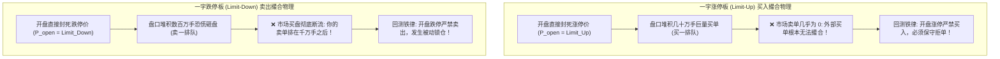
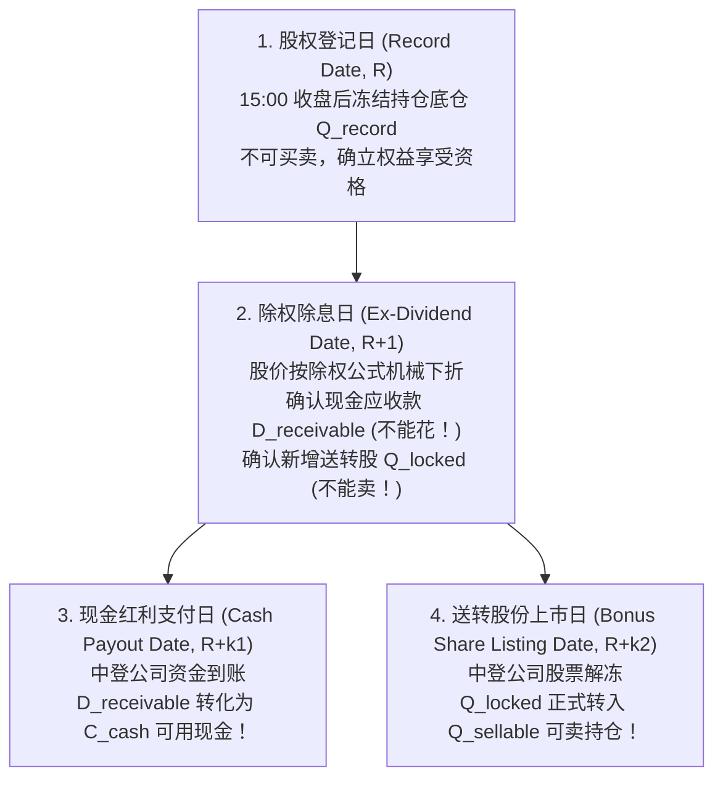

# 第 29 讲：A 股特殊撮合规则代码级实现

::: tip 本讲核心目标
许多从美股或加密货币转向 A 股的量化团队，往往会遭遇当头棒喝：A 股不是一个简单的连续撮合自由市场，而是充斥着**涨跌停板限制、一字板被动锁仓、申报价格笼子、长期无故停牌以及极其繁琐的分红除权交收日历**。

若回测系统对这些本土制度缺乏代码级保真模拟，不仅会导致回测产生“涨停板天天追进暴赚”、“跌停板瞬间清仓逃生”的虚假神话，更会导致实盘发生严重的资金交收透支违约。本讲将深入解构 A 股现行**交易所撮合机制**；手写**涨跌停保守拒单与开盘流动性截断状态机**；详解**全面注册制 2% 申报价格笼子算法**；并彻底打通**股权登记日、除权除息日、派息到账日与送转股上市日**的四阶段记账闭环！
:::

---

## 1. 监管法规与交易所微观撮合制度

构建高保真撮合系统必须严格遵循沪深北交易所的核心规章：

1. **上海/深圳证券交易所（2023）**：《上海证券交易所交易规则》《深圳证券交易所交易规则》（全面注册制修订版）。  
   > 规定了集合竞价最大成交量原则、主板/双创板涨跌停幅度、全面注册制 2% 申报价格笼子与异常波动停牌停牌机制。
2. **中国证券登记结算有限责任公司（ChinaClear, 2022）**：《证券登记结算业务指南》与《权益分派业务操作指引》。  
   > 确立了股权登记日（Record Date）、除权除息日（Ex-Date）、资金交收日（Payout Date）与红利税差额补缴的标准化清算流程。
3. **中国证券投资基金业协会（AMAC, 2017）**：《关于发布中基协（AMAC）基金行业股票估值指数的通知》。  
   > 规范了公募与私募基金在面对个股长期停牌时，必须采用“AMAC 行业指数收益法”对停牌标的进行公允盯市估值的强制性准则。

---

## 2. A 股多层次涨跌停板与板上撮合物理学

### 2.1 多层次板块涨跌幅限制矩阵

不同板块在不同生命周期与风险状态下，适用的涨跌幅限制存在严格差异：

| 证券板块 | 证券代码前缀 | 正常交易日涨跌幅 | ST / *ST 风险警示涨跌幅 | IPO 上市初期规则 |
| :--- | :--- | :--- | :--- | :--- |
| **沪深主板** | 600, 601, 603, 000, 001 | $\pm 10\%$ | $\pm 5\%$ | 前 5 个交易日不设涨跌幅限制，随后 $\pm 10\%$ |
| **创业板（ChiNext）** | 300, 301 | $\pm 20\%$ | $\pm 20\%$ | 前 5 个交易日不设涨跌幅限制，随后 $\pm 20\%$ |
| **科创板（STAR Market）** | 688 | $\pm 20\%$ | $\pm 20\%$ | 前 5 个交易日不设涨跌幅限制，随后 $\pm 20\%$ |
| **北交所（BSE）** | 8xx, 43x, 920 | $\pm 30\%$ | $\pm 30\%$ | 首日无涨跌幅，随后 $\pm 30\%$ |

### 2.2 涨跌停撮合物理机制与“被动锁仓（Passive Lock-in）”



在量化回测中，必须采取**买方保守拒单假设（Conservative Rejection Assumption）**：
1. **买单撞涨停**：当股票开盘价等于涨停价时，由于排队时间优先原则，量化策略的外部买单极大概率无法排进成交，**必须严格拒单**，持仓与现金保持不变；
2. **卖单撞跌停**：当股票开盘价等于跌停价时，由于流动性彻底枯竭，策略卖单根本无法撮合出局，**发生被动锁仓（Passive Lock-in）**！该股票持仓必须被迫继续保留，并完全承受随后的下跌浮亏！

---

## 3. 全面注册制 2% 申报价格笼子机制（Order Price Collar）

自 2023 年全面注册制落地以来，沪深交易所对连续竞价阶段的所有限价申报施加了**动态 2% 价格笼子**限制，旨在彻底消灭“秒挂涨停价抢筹”或“秒挂跌停价砸盘”的算法行为：

### 3.1 申报价格笼子数学公式
设连续竞价当前盘口基准价格为 $P_{\text{ref}}$（通常取对手方最优价格；若无对手方，取本方最优价格）：

- **买入限价申报上限**：
  $$P_{\text{buy\_order}} \le \max\left( P_{\text{ref}} \times 1.02, \; P_{\text{ref}} + 10 \text{ ticks} \right)$$
- **卖出限价申报下限**：
  $$P_{\text{sell\_order}} \ge \min\left( P_{\text{ref}} \times 0.98, \; P_{\text{ref}} - 10 \text{ ticks} \right)$$

超过上述阈值的申报将被交易所撮合主机直接判定为**废单拒单**或进入**暂存暂不受理状态**。算法执行（如 VWAP/TWAP）必须实时跟踪盘口微步微调报单价格。

---

## 4. 停牌标的盯市估值：中基协（AMAC）行业指数法

当股票因重组、暴雷或市场异常被长期停牌（如 2015 年千股停牌潮，乐视网、康得新停牌数月至数年）时，若简单按“停牌前最后收盘价”估值，会导致基金净值严重虚高；一旦遭遇大额赎回，先赎回的投资者按虚高净值套现，后留下的投资者将承担巨额穿仓损失。

### 4.1 中基协行业指数收益法（AMAC Valuation）
公募与规范私募机构在股票停牌期间，按中基协发布的对应行业分类指数的相对涨跌幅，对停牌股票价格进行动态盯市重估：

$$P_{i, t}^{\text{adjusted}} = P_{i, \text{suspend}} \times \frac{I_{\text{industry}, t}}{I_{\text{industry}, t_0}}$$

其中：
- $P_{i, \text{suspend}}$：停牌前最后一个交易日的收盘价；
- $I_{\text{industry}, t_0}$：停牌当日该股票所属申万/中基协行业指数的收盘点位；
- $I_{\text{industry}, t}$：当前估值日该行业指数的收盘点位。

若停牌期间该板块大跌 $30\%$，则该股票估值按 $70\%$ 计提公允价值，从而真实反映资产组合的实际风控净值。

---

## 5. 分红送转权益清算四阶段状态机（Corporate Actions）

分红送转绝不是简单的“在除权日改一下价格”，它横跨四个不同的法定交易日历节点，必须通过严密的对账状态机进行处理：



### 5.1 除权除息理论参考价方程
在除权除息日开盘前，交易所对前收盘价执行除权除息机械修正（去除现金红利与送转股膨胀）：

$$P_{\text{ex}} = \frac{P_{\text{before}} - d + p_{\text{allot}} \cdot r_{\text{allot}}}{1 + b + r_{\text{allot}}}$$

其中：
- $P_{\text{before}}$：股权登记日收盘价；
- $d$：每股派发税前现金红利（元）；
- $b$：每股送红股与转增股本比例（如 10 送转 5 则 $b = 0.5$）；
- $p_{\text{allot}}$：配股价格；$r_{\text{allot}}$：配股比例。

### 5.2 账户资产守恒性验证示例
假设登记日持有 100 股，登记日收盘价 10 元，总市值 1,000 元。公司公布“10 派 10 元转增 1 股”（即每股红利 $d = 1.0$ 元，转增比例 $b = 0.1$）：
1. **除权参考价**：
   $$P_{\text{ex}} = \frac{10 - 1.0}{1 + 0.1} = \frac{9.0}{1.1} \approx 8.1818 \text{ 元}$$
2. **权益确认**：
   - 确认现金红利应收：$100 \times 1.0 = 100$ 元（$D^{\text{receivable}}$，尚不可买入股票）；
   - 确认总持股数量增加：$100 \times (1 + 0.1) = 110$ 股（其中 10 股为未上市锁定股）；
3. **除权日开盘资产估值**：
   $$\text{Total Assets} = 110 \times \frac{9.0}{1.1} + 100 = 900 + 100 = \mathbf{1,000 \text{ 元}} \quad (\text{绝对守恒！})$$

若回测系统在除权日直接将 100 元红利加进可用现金去买股票，或允许当天将 110 股全部卖掉，就会产生严重的**资金透支与超额虚假卖空违规**！

---

## 6. 工业级特殊撮合与公司行为账本实战

在 `tutorial/examples/lecture_29_matching_rules_limits_suspensions.py` 中，我们实现了生产级 `AshareSpecialMatchingEngine`：
1. 实现严格的开盘涨跌停判定、停牌识别与保守拒单；
2. 实现了单笔调仓基于开盘流动性上限的等比例部分成交（Partial Fill）；
3. 实现了 `CorporateActionTracker`，完美处理股权登记日快照、应收股利冻结、派息日现金解冻与送转股上市的全流程对账。

可在终端直接运行验证：

```bash
python3 -m examples.lecture_29_matching_rules_limits_suspensions
```

<<< @/examples/lecture_29_matching_rules_limits_suspensions.py

---

## 7. 第七模块核心交付 Checklist

学完本模块，你的量化策略已经成功经受住了 A 股市场最严苛的“实盘微观物理检验”：

- [x] **回测引擎架构辨析（第 27 讲）**：
  - 厘清了向量化回测与事件驱动回测的边界与职责分工；
  - 掌握了符合 A 股制度的单日时间推进离散事件状态机（DES）与复式记账法。
- [x] **交易摩擦全真模拟（第 28 讲）**：
  - 精确核算了印花税单边 $0.05\%$、机构佣金及最低 5 元保底陷阱；
  - 推导了非线性平方根法则冲击模型，并解析求解了**策略黄金 AUM 容量峰值闭式解**。
- [x] **A 股特殊撮合规则代码级闭环（第 29 讲）**：
  - 实现了涨跌停板保守拒单、被动锁仓与 2% 申报价格笼子机制；
  - 实现了停牌标的中基协行业指数估值调整法；
  - 完整跑通了股权登记、除权除息、分红到账与送转上市的四阶段严密对账。

至此，我们的策略不仅在回测中跑出了真实可信的扣费净资产曲线，而且做好了上线实盘柜台的所有制度准备！

在接下来的 **第八模块：生产级监控系统、业绩归因与实盘上线** 中，我们将为策略装上全天候的**业绩归因显微镜（Brinson 与 Barra 归因）**与**风控熔断预警看板（跟踪误差漂移与 PSI 特征监控）**，护航策略实盘长期稳健运行！
