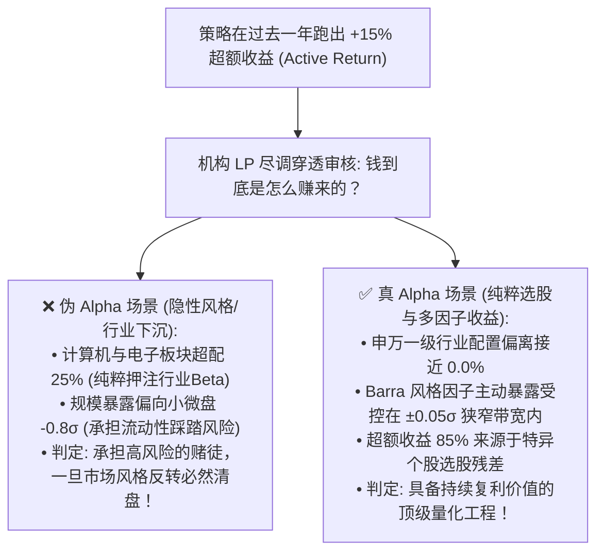
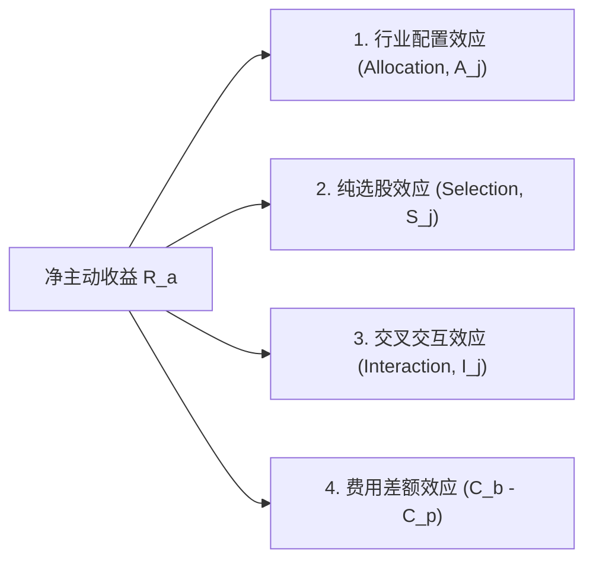
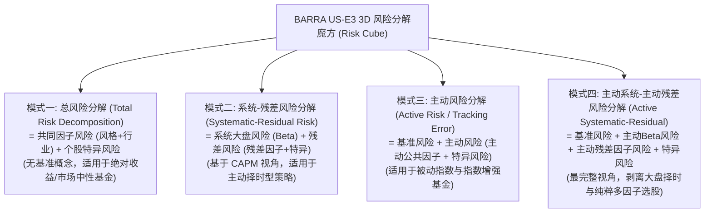
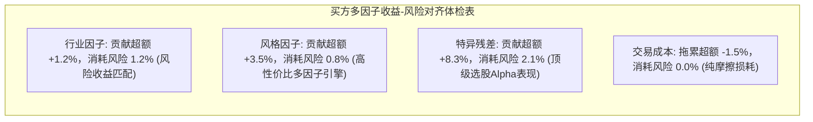

# 第 30 讲：业绩归因实战：赚的是 Beta 还是纯 Alpha？

::: tip 本讲核心目标
在机构量化投资中，每一位基金经理都必须回答主权财富基金、社保基金与大型机构 LP 的“灵魂拷问”：“**你的策略今年跑赢基准 15 个百分点，究竟是因为选股模型拥有真正的 Alpha 预测力，还是因为偷偷超配了微盘股、赌对了行业赛道，亦或仅仅是承担了未被计量的隐性 Beta 风险？**”

如果量化团队无法给出精确到基点（bps）的数学业绩归因，任何阶段性的超额都会被机构投资者视为“不可持续的侥幸赌博”。本讲融合 **MSCI Barra US-E3 经典模型手册** 与 **华泰证券多因子体系**：深入推导 **Brinson-Fachler 行业配置与选股三因素模型**；解构 Barra **事后多因子收益剥离模型**；呈现行业经典的 **US-E3 四维风险分解魔方（Risk Decomposition Cube）**；推导 **因子边际主动风险贡献（FMCAR）**；并掌握 Carino 多期复利几何链接算法！
:::

---

## 1. 经典文献与工业界理论基石

量化投资业绩归因与风险分解领域的经典文献与学术丰碑：

1. **Brinson, Gary P., & Fachler, Nimrod (1985)**. *"Measuring Non-US Equity Portfolio Performance"*, *The Journal of Portfolio Management*, 11(3): 73-78.  
   > 提出了著名的 Brinson-Fachler（BF）模型，将行业配置基准修正为行业相对大盘的超额表现，成为全球买方机构标准规范。
2. **BARRA Inc. (1998)**. *United States Equity Version 3 (US-E3) Risk Model Handbook*, Chapter 4 (Modern Portfolio Management and Risk).  
   > 确立了投资组合管理的“四大风险分解维度（Modes of Risk Decomposition）”以及著名的三维风险魔方（Risk Decomposition Cube），彻底理顺了基准、主动、系统与特异风险的关系。
3. **华泰证券研究所 (林晓明、陈烨, 2016)**. 《华泰多因子模型体系初探——华泰多因子系列之一》, 第五部分：多因子模型的绩效分析.  
   > 系统推导了主动组合收益率的 Jensen Alpha 回归、基于多因子的收益归因方程与因子对主动风险的边际贡献（FMCAR）风险归因算法。
4. **Carino, David R. (1999)**. *"Combining Attribution Effects Over Time"*, *The Journal of Performance Measurement*, 4(4): 5-14.  
   > 提出了基于对数转换因子的多期复合归因链接算法（Carino Linking），完美解决了单期可加归因在多期复利下的几何扭曲难题。
5. **Grinold, Richard C., & Kahn, Ronald N. (1999)**. *Active Portfolio Management*, Chapter 17 (Performance Attribution). McGraw-Hill.  
   > 奠定了基于因子暴露的历史主动收益分解方程，打通了事前风险预算与事后业绩归因的同构闭环。

---

## 2. 为什么买方机构必须严苛区分 Beta 与 Alpha？



在专业资管机构中，依靠行业暴露或市值下沉带来的超额，被称为**廉价的 Beta（Cheap Beta）**；只有在严格剥离了市场大盘（Market）、行业轮动（Industry）与风格漂移（Style）之后剩下的**个股特异性收益（Idiosyncratic Return）**，才是能够收取高昂业绩提成的**纯 Alpha（Pure Alpha）**！

---

## 3. Brinson-Fachler 归因模型严密数学解构

设组合与基准均覆盖 $J$ 个行业类别（涵盖申万 31 个行业，外加一个独立的**现金类别** $J_{\text{cash}}$）。

### 3.1 符号系统与加总核对
- $w_{p, j}, w_{b, j}$：组合与基准在行业 $j$ 上的配置权重，严格满足 $\sum_{j=1}^J w_{p, j} = 1, \; \sum_{j=1}^J w_{b, j} = 1$；
- $r_{p, j}, r_{b, j}$：组合与基准在行业 $j$ 内部的加权收益率；
- $R_p^{\text{gross}} = \sum_{j=1}^J w_{p, j} r_{p, j}$：组合总毛收益率；
- $R_b^{\text{gross}} = \sum_{j=1}^J w_{b, j} r_{b, j}$：基准总毛收益率；
- $C_p, C_b$：组合与基准的交易摩擦费用率。

净主动超额收益为：
$$R_a^{\text{net}} = R_p^{\text{net}} - R_b^{\text{net}} = (R_p^{\text{gross}} - C_p) - (R_b^{\text{gross}} - C_b)$$

### 3.2 Brinson-Fachler 三因素数学定义

Brinson & Fachler (1985) 将毛主动收益分解为三个具有明确管理学意义的正交项：



#### 1. 行业配置效应（Allocation Effect, $A_j$）
衡量基金经理在各行业上的超配/低配决策带来的收益贡献：

$$A_j = (w_{p, j} - w_{b, j}) (r_{b, j} - R_b^{\text{gross}})$$

- **经济学逻辑**：若行业 $j$ 跑赢基准大盘（$r_{b, j} > R_b$），且组合超配了该行业（$w_{p, j} > w_{b, j}$），则配置效应为正；反之若超配了表现落后大盘的行业，配置效应为负。

#### 2. 个股选择效应（Selection Effect, $S_j$）
衡量基金经理在行业内部挑选个股优于该行业基准表现带来的贡献：

$$S_j = w_{b, j} (r_{p, j} - r_{b, j})$$

- **经济学逻辑**：在基准权重 $w_{b, j}$ 约束下，该行业内持股的平均收益率超越行业基准的幅度。

#### 3. 交互效应（Interaction Effect, $I_j$）
行业权重主动偏离与个股选择优势的交叉乘积项：

$$I_j = (w_{p, j} - w_{b, j}) (r_{p, j} - r_{b, j})$$

#### 4. 完美加总恒等式验证
将全市场所有行业的各项效应累加，数学上严格成立：

$$\sum_{j=1}^J (A_j + S_j + I_j) = \sum_{j=1}^J \left( w_{p, j} r_{p, j} - w_{b, j} r_{b, j} \right) = R_p^{\text{gross}} - R_b^{\text{gross}}$$

$$R_a^{\text{net}} = \sum_{j=1}^J A_j + \sum_{j=1}^J S_j + \sum_{j=1}^J I_j + (C_b - C_p)$$

> [!IMPORTANT] 现金类别不可或缺
> 许多简陋的教学代码只对股票资产做归因。假设组合留存 $10\%$ 现金，股票大涨 $10\%$，现金收益为 $0\%$，组合主动收益必然落后基准 $-1\%$。若忽略现金类别，三项效应之和根本无法与真实账户净值闭合对账！必须将现金作为独立资产类别统一编入 $J$ 个分项中。

---

## 4. 多期几何复合归因链接（Carino Linking Algorithm）

在实际基金季报与年报中，投资期包含多个调仓子期（$t = 1, 2, \dots, T$）。由于复利效应：
$$1 + R = \prod_{t=1}^T (1 + R_t)$$
单期归因项直接简单累加会产生巨大的几何残差扭曲。

### 4.1 Carino 对数链接因子数学推导
Carino (1999) 证明，通过定义复合对数转换标度因子，可将多期几何收益精确转化为可加线性形式：

设第 $t$ 期的组合连续对数转换因子为：
$$k_t = \frac{\ln(1 + R_{p, t})}{R_{p, t}}$$

整个多期大区间的全局连续对数转换因子为：
$$K = \frac{\ln(1 + R_p)}{R_p} = \frac{\sum_{t=1}^T \ln(1 + R_{p, t})}{R_p}$$

定义第 $t$ 期的**时间平滑链接乘数**为：
$$c_t = \frac{k_t}{K} = \frac{\ln(1 + R_{p, t})}{R_{p, t}} \cdot \frac{R_p}{\ln(1 + R_p)}$$

利用该链接乘数对单期归因项进行时间缩放，多期累计总效应满足**严密可加性**：
$$A_{\text{total}} = \sum_{t=1}^T c_t A_t, \quad S_{\text{total}} = \sum_{t=1}^T c_t S_t, \quad I_{\text{total}} = \sum_{t=1}^T c_t I_t$$

$$R_{p, \text{total}} - R_{b, \text{total}} = A_{\text{total}} + S_{\text{total}} + I_{\text{total}} + \text{Fees}$$

---

## 5. BARRA US-E3 经典风险分解四分法与 3D 风险魔方

MSCI Barra US-E3 风险手册第 4 章指出，投资组合的风险分解存在四种经典视角，构成了对投资组合全方位的解剖：



这四种模式在几何上等价于沿着三个正交维度切分整个风险蛋糕：
1. **维度一**：系统性风险（Systematic） vs 残差风险（Residual）；
2. **维度二**：公共因子风险（Common Factor） vs 特异风险（Specific）；
3. **维度三**：基准风险（Benchmark） vs 主动偏离风险（Active）。

---

## 6. Barra 结构化因子收益归因与 FMCAR 风险归因对齐

华泰证券多因子报告提出，买方不仅要出具**收益归因表**，更要把**收益来源与风险消耗（FMCAR）并排对照**，检验单位风险收益比！

### 6.1 收益归因方程
主动超额收益分解为：
$$R_a^{\text{net}} = \underbrace{\mathbf{h}^T X_{\text{ind}} \mathbf{f}_{\text{ind}}}_{\text{行业因子贡献 } R_{\text{ind}}} + \underbrace{\mathbf{h}^T X_{\text{style}} \mathbf{f}_{\text{style}}}_{\text{风格因子贡献 } R_{\text{style}}} + \underbrace{\mathbf{h}^T \mathbf{u}}_{\text{个股特异残差 } R_{\text{spec}}} + \underbrace{(w_{p, c} - w_{b, c}) r_c}_{\text{现金拖累}} - \underbrace{C_p}_{\text{调仓成本}}$$

### 6.2 风险归因方程（基于 FMCAR）
组合总主动跟踪误差为 $\sigma_P = \sqrt{\mathbf{x}_{PA}^T F \mathbf{x}_{PA} + \mathbf{h}_{PA}^T \Delta \mathbf{h}_{PA}}$。
由欧拉齐次定理：
$$\sigma_P = \sum_{k=1}^K x_{PA}(k) \cdot \text{FMCAR}(k) + \frac{\mathbf{h}_{PA}^T \Delta \mathbf{h}_{PA}}{\sigma_P}$$

### 6.3 收益-风险对齐体检表（工业标准看板）



如果某个风格因子（例如 Size 或 Beta）贡献了 $30\%$ 的主动风险，却只带来了负向或微弱超额，说明该策略在被动承担不产生 Alpha 的“垃圾风险”，应在优化器中将其偏离限额压缩。

---

## 7. 工业级归因对账引擎实战

在 `tutorial/examples/lecture_30_performance_attribution_brinson_barra.py` 中，我们实现了生产级 `AsharePerformanceAttributionEngine`：
1. 支持完整的 Brinson-Fachler 行业配置、个股选择、交互项与现金对账拆解；
2. 原生支持 Barra 结构化因子损益剥离，精确核对行业收益、风格收益与特异残差；
3. 输出基点级（bps）精确度的加总核对报告，闭合误差严格低于 $10^{-6}$。

可在终端直接运行验证：

```bash
python3 -m examples.lecture_30_performance_attribution_brinson_barra
```

<<< @/examples/lecture_30_performance_attribution_brinson_barra.py

---

## 8. 本讲小结与核心自测

| 核心考点 | 工业标准回答要点 | 常见工程/学术陷阱 |
| :--- | :--- | :--- |
| **Brinson-Fachler 与原始 Brinson 模型的本质区别？** | BF 模型将行业收益与基准大盘总收益作差 $(r_{b, j} - R_b)$ 作为基准，超配了跑赢大盘的行业才计正贡献，符合投资常识。 | 原始模型若超配了绝对收益为正、但跑输大盘的行业，仍会错误计算出正向配置贡献。 |
| **为什么单期归因不能直接相加作为多期复合归因？** | 复合复利效应 $(1 + R) = \prod (1 + R_t)$ 具有非线性几何乘法特性，直接相加会产生巨大的复合几何残差。 | 忽视几何链接，导致年报归因各项相加与基金净值年累计超额产生数个百分点的巨大对账偏差。 |
| **US-E3 的四种风险分解模式分别适用于什么场景？** | 总风险适用于中性对冲基金；系统-残差适用于大盘择时策略；主动风险适用于指增基金；主动系统-残差适用于剥离 Beta 择时后的纯多因子选股。 | 所有策略一律只看总波动率，混淆了系统性大盘风险与主动管理能力。 |

既然我们已经掌握了在事后如何用显微镜看透组合的每一分得失，那么在**策略上线实盘之后的每一分每一秒，我们该如何防范黑天鹅穿仓、监控模型退化并自动触发熔断止损？**

在下一讲中，我们将进入全书收官之作——**第 31 讲：实盘运行监控与风控预警看板**，构建包含跟踪误差漂移告警、Barra 风格监控、三级熔断降仓与 PSI 特征漂移检测的工业级防御要塞！
