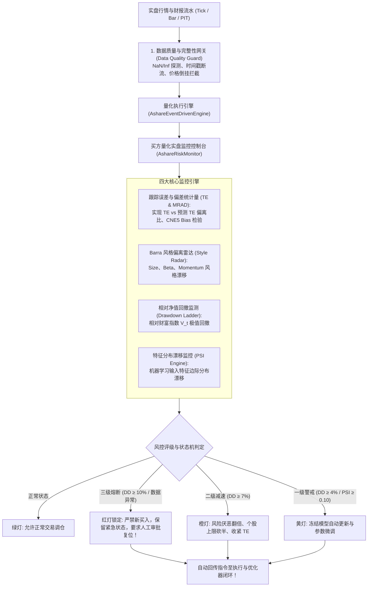
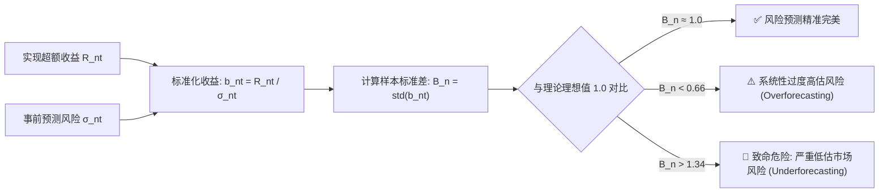
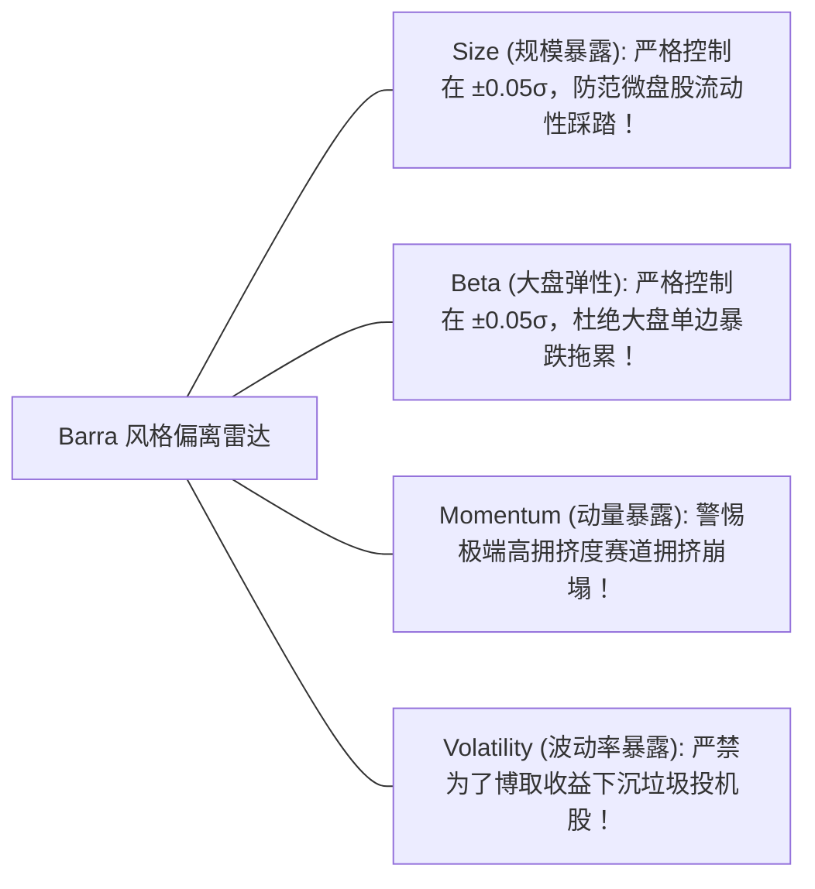
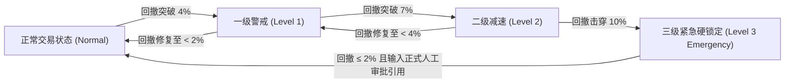
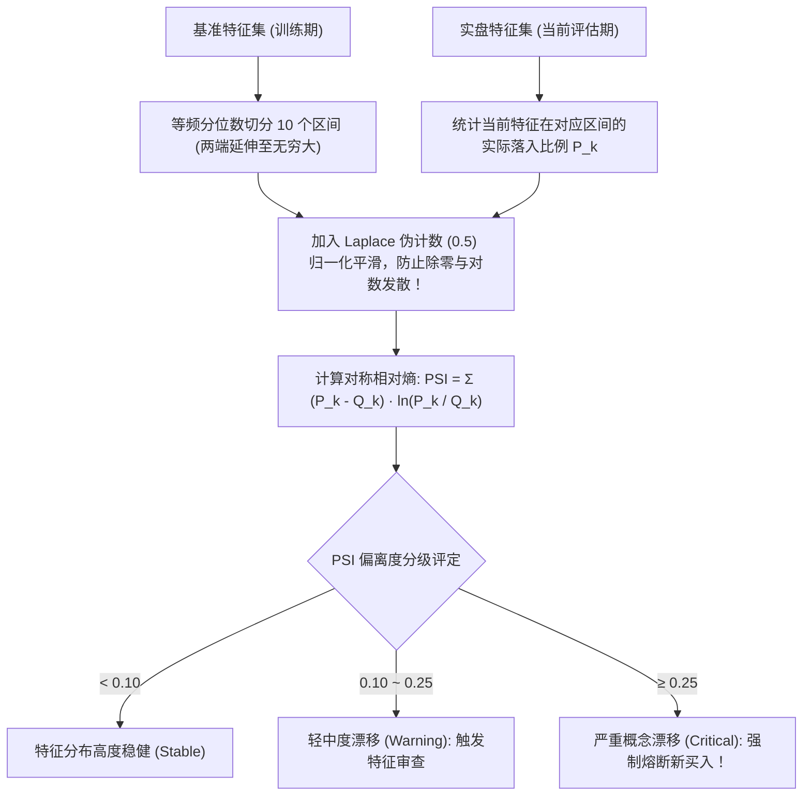
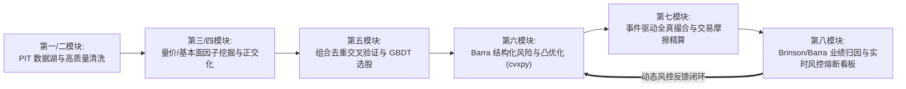

# 第 31 讲：实盘运行监控与风控预警看板

::: tip 本讲核心目标
在量化买方机构中，策略研发完成只是“行百里者半九十”。实盘是一片永不停歇的残酷战场：宏观机制突变（Regime Shift）、市场流动性骤降、因子突发踩踏、数据源字段漂移以及机器运行故障，随时都可能将一个看似完美的回测策略推向万劫不复的深渊。

本讲作为全套教程的**终章集大成之作**，将现代软件工程的**站点可靠性工程（SRE）理念**、买方**巴塞尔协议金融风控规范**与 **MSCI Barra CNE5 预测精度评估体系**深度结合：手写日频实时监控状态机；追踪**滚动实现跟踪误差（Realized TE）与事前预测 TE 的偏离比**；引入 **CNE5 偏差统计量（Bias Statistic）与平均绝对偏差（MRAD）**检验风险模型预测可信度；建立 **Barra 风格暴露漂移雷达**；推导带滞后回滞（Hysteresis）的**相对净值三级熔断降仓梯级系统**；运用**群体稳定性指标（PSI）**监测机器学习特征分布漂移；并将风控指令与第 27 讲执行引擎严密闭环，构筑实盘坚不可摧的数字防御要塞！
:::

---

## 1. 经典文献与工业界理论基石

构建生产级量化监控与风险熔断系统必须参考的经典文献与行业白皮书：

1. **Orr, D. J., Mashtaler, Igor, & Nagy, Adam (2012)**. *"The Barra China Equity Model (CNE5) Empirical Notes"*, Section 5 & Appendix C (Review of Bias Statistics). MSCI Research.  
   > 奠定了买方机构评估风险模型样本外预测精度的统计基准，系统推导了偏差统计量（Bias Statistic）、厚尾分布对置信区间的形变以及平均绝对偏差（MRAD）的度量标准。
2. **Yurdakul, Bilal (2018)**. *"Statistical properties of population stability index"*, *Risk Analysis*, 38(6): 1179-1195.  
   > 严谨推导了群体稳定性指标（Population Stability Index, PSI）在大样本下的渐近分布与假设检验置信区间，为机器学习特征监控提供理论支撑。
3. **Beyer, Betsy, Jones, Chris, Petoff, Jennifer, & Murphy, Niall Richard (2016)**. *Site Reliability Engineering: How Google Runs Production Systems*. O'Reilly Media.  
   > 奠定了服务等级指标（SLI）、服务等级目标（SLO）与错误预算（Error Budget）的工程规范，被全球头部高频做市商和量化基金奉为运维宝典。
4. **Basel Committee on Banking Supervision (BCBS, 2013)**. *"Principles for effective risk data aggregation and risk reporting (BCBS 239)"*, Bank for International Settlements.  
   > 国际清算银行巴塞尔银行监管委员会关于金融机构风险数据聚合与实时风控报告的最高准则。
5. **Lo, Andrew W. (2002)**. *"The Statistics of Sharpe Ratios"*, *Financial Analysts Journal*, 58(4): 36-52.  
   > 麻省理工学院讲席教授 Andrew Lo 揭示了收益率自相关与非正态性对事后统计指标的扭曲，奠定了动态置信区间监控的数学基础。

---

## 2. 现代买方量化监控看板架构全景图

生产级实盘监控绝不是简单的“画几张收益率折线图”，而是一个集成了**数据质量探测、统计指标监测、模型概念漂移预警与自动化熔断拦截**的高可用闭环系统：



---

## 3. 跟踪误差（Tracking Error）漂移监控

### 3.1 实现跟踪误差计算方程
设最近 $W$ 个交易日（默认 $W = 60$ 天）的日度算术主动超额收益为 $a_t = R_{p, t} - R_{b, t}$。
实现年化跟踪误差定义为主动收益样本标准差的年化值：

$$\text{TE}_{\text{realized}} = \sqrt{D} \times \sqrt{\frac{1}{W - 1} \sum_{t=1}^W (a_t - \bar{a})^2}$$

其中 $D = 250$ 为年化交易日数。

### 3.2 跟踪误差失控预警阈值
1. **事前/事后偏离比率超标**：
   $$\text{Ratio}_{\text{TE}} = \frac{\text{TE}_{\text{realized}}}{\text{TE}_{\text{ex-ante}}} > 1.5$$
   若实盘实现的跟踪误差比事前 Barra 风险模型预测的高出 $50\%$ 以上，说明市场协方差结构已发生剧烈形变（如系统性流动性挤兑），必须触发高危预警；
2. **绝对合同上限击穿**：
   $$\text{TE}_{\text{realized}} > \text{TE}_{\text{target}} \quad (\text{如合同约定的 } 4.5\%)$$
   直接触碰资管产品说明书风控红线，优化器必须强制收紧主动偏离。

---

## 4. 风险模型预测精度检验：CNE5 偏差统计量（Bias Statistic）与 MRAD

除了跟踪实际投资组合外，机构量化风控中心还必须持续检验**底层 Barra 风险模型本身是否可靠**。根据 MSCI Barra CNE5 白皮书规范，采用偏差统计量进行样本外滚动回测检验：

### 4.1 单窗口偏差统计量（Bias Statistic, $B_n$）
设组合 $n$ 在交易日 $t$ 的真实主动收益为 $R_{nt}$，期初 Barra 模型预测的主动波动率为 $\sigma_{nt}$。定义标准化收益率：
$$b_{nt} = \frac{R_{nt}}{\sigma_{nt}}$$
在长度为 $T$（如 12 个月或 252 天）的观测窗口内，偏差统计量定义为标准化收益的无偏样本标准差：

$$B_n = \sqrt{ \frac{1}{T - 1} \sum_{t=1}^T (b_{nt} - \bar{b}_n)^2 }$$



- **置信区间与厚尾修正**：
  - 在正态分布假设下，95% 置信区间为 $\left[ 1 - \sqrt{\frac{2}{T}}, \; 1 + \sqrt{\frac{2}{T}} \right]$。对于 12 个月的月度窗口（$T=12$），置信区间为 $[0.59, 1.41]$；
  - 但真实金融资产具有显著超额峰度（Fat Tails）。CNE5 模拟表明：在峰度 $k = 4$ 的 t 分布下，5% 分位数 P5 下移至 0.61，95% 分位数 P95 上移至 1.40。

### 4.2 平均绝对偏差（Mean Rolling Absolute Deviation, MRAD）
对于覆盖纯因子组合、行业组合、风格倾斜组合与最小方差组合的 $N$ 个测试标的，定义平均绝对偏差：

$$\text{MRAD}^\tau = \frac{1}{N} \sum_{n=1}^N \left| B_n^\tau - 1 \right|$$

- **理论基准底线**：在收益正态且预测完美时，$\mathbb{E}[\text{MRAD}] \approx 0.17$；在真实厚尾市场中（峰度 $3.5 \sim 4.0$），$\mathbb{E}[\text{MRAD}] \approx 0.19$；
- **模型优劣判据**：若模型 A 的 MRAD 为 0.25，模型 B 的 MRAD 为 0.22，由于下界为 0.19，模型 B 实际上将超额预测偏差降低了整整 $(0.25 - 0.22)/(0.25 - 0.19) = 50\%$！

---

## 5. Barra 风格因子主动暴露雷达

在指数增强与量化对冲产品中，风格因子的隐性漂移是引发重大亏损的头号元凶。
监控系统逐日计算组合相对基准的因子净暴露：

$$\Delta \beta_k = \sum_{i=1}^N (w_{p, i} - w_{b, i}) X_{i, k} = \mathbf{h}^T X_k$$



- **预警红线**：若任何核心风格因子的主动暴露超过 $\pm 0.10 \sigma$，看板立即亮起黄灯告警；若市值风格偏离超过 $\pm 0.20 \sigma$，判定为发生严重风格漂移（Style Drift），强制阻断当期调仓指令。

---

## 6. 相对财富指数与带回滞的三级熔断降仓梯级系统

很多量化团队在计算回撤时，直接用主动收益率累加 $\sum a_t$，这是极其业余的错误算法。正确的度量标准是**相对财富指数（Relative Wealth Index, $V_t$）**！

### 6.1 相对财富指数与真实回撤定义
将第 0 日初始相对净值设为 $V_0 = 1.0$。在每一个交易日 $t$，相对财富按组合与基准的真实总收益复利演进：

$$V_t = \prod_{s=1}^t \frac{1 + R_{p, s}}{1 + R_{b, s}}$$

截至交易日 $t$ 的**相对净值最大回撤（Drawdown）**为：

$$DD_t = 1 - \frac{V_t}{\max_{0 \le s \le t} V_s}$$

> [!WARNING] 历史最高点包含初始值 1.0
> 历史极值序列 $\max_{0 \le s \le t} V_s$ 必须显式包含起点 $V_0 = 1.0$！否则若策略从第 1 天起便发生亏损（$V_1 = 0.90$），若未包含 $V_0$，历史最大值会被错判为 $0.90$，进而得出“回撤为 0%”的荒谬结论！

### 6.2 具备回滞（Hysteresis）的三级熔断状态机

为了防止净值在临界阈值附近因单日小幅波动而产生“频繁触发、频繁解除”的系统震荡（Chattering），系统引入工业级**滞后回滞区间（Hysteresis Loop）**：

| 风控梯级 | 进入触发阈值 | 触发控制输出与动作 | 降级/解除恢复条件 |
| :--- | :--- | :--- | :--- |
| **一级警戒（Level 1）** | 相对回撤 $DD \ge 4.0\%$ | **冻结模型在线更新**：暂停特征重训与超参数自适应，防止模型将回撤噪声误学为规律。 | 相对回撤平稳修复至 $DD < 2.0\%$。 |
| **二级减速（Level 2）** | 相对回撤 $DD \ge 7.0\%$ | **执行防御性去杠杆**：<br/>• 风险厌恶系数 $\lambda \leftarrow 2\lambda$<br/>• 个股超配上限减半 $d_{\max} \leftarrow 0.5 d_{\max}$<br/>• 目标 TE 上限收缩为 $\min(\text{TE}_{\text{target}}, 3.0\%)$ | 相对回撤平稳修复至 $DD < 4.0\%$，降级至一级；待低于 $2.0\%$ 后彻底恢复正常。 |
| **三级紧急熔断（Level 3）** | 相对回撤 $DD \ge 10.0\%$ | **硬锁定紧急状态（Latched State）**：<br/>• **绝对禁止任何新买入申报（`allow_new_buys = False`）**<br/>• 冻结所有主动超额暴露，仓位向基准无风险逼近<br/>• **禁止自动解除**！ | 必须同时满足：<br/>1. 相对回撤修复至 $DD \le 2.0\%$；<br/>2. 数据质量与风格完全合格；<br/>3. **必须由风控总监输入带审计编号的人工审批指令（`reset_emergency`）显式解锁！** |



---

## 7. 特征分布漂移监控：群体稳定性指标（PSI）

在机器学习选股策略上线后，很多模型往往在运行半年后逐渐失效。这通常不是代码 Bug，而是因为金融市场的数据生成分布发生了**协变量偏移（Covariate Shift / Concept Drift）**！

### 7.1 群体稳定性指标（PSI）数学推导
群体稳定性指标（Population Stability Index, PSI）用于衡量基准样本（如训练集或历史回测期）与当前实盘样本在特征边际分布上的相对熵偏离：

$$\text{PSI} = \sum_{k=1}^K (P_k - Q_k) \ln\left(\frac{P_k}{Q_k}\right)$$

其中：
- $Q_k$：特征在**基准期（训练集）**落入第 $k$ 个分箱的样本占比；
- $P_k$：特征在**当前实盘评估期**落入第 $k$ 个分箱的样本占比；
- $K$：分箱数量（通常基于基准样本的等频十分位数划分，$K = 10$）。



### 7.2 工业级分箱与数值防暴平滑
1. **两端无穷延伸**：分箱边界左端必须设为 $-\infty$，右端设为 $+\infty$，确保任何实盘极端异常值均能被捕获；
2. **Laplace 伪计数平滑**：当实盘在某个分箱中样本数为 0 时，$P_k = 0$ 会导致 $\ln(P_k / Q_k) \to -\infty$ 计算崩溃。必须对每个分箱添加 $0.5$ 的平滑伪计数，再重新归一化计算。

---

## 8. 工业级风控监控看板与执行层联动实战

在 `tutorial/examples/lecture_31_live_monitoring_risk_dashboard.py` 中，我们构建了生产级 `AshareRiskMonitor`：
1. 完整实现滚动实现跟踪误差、Barra 风格偏离、相对净值最大回撤与 PSI 特征漂移监测；
2. 实现了带记忆保持与显式审批解锁机制的三级回撤熔断状态机；
3. 输出机器可读的 `RiskControls` 结构化对象，原生与第 27 讲 `AshareEventDrivenEngine` 联动，实现在风险超标时自动阻断新买入指令。

可在终端直接运行验证：

```bash
python3 -m examples.lecture_31_live_monitoring_risk_dashboard
```

<<< @/examples/lecture_31_live_monitoring_risk_dashboard.py

---

## 9. 全套量化工程闭环体系总览（从数据到风控）

回顾整套 8 大模块、31 讲的严谨量化研发体系，我们构建了一条严丝合缝、完全对账的买方量化工业流水线：



| 模块阶段 | 核心攻坚难点 | 落地交付的工业级组件与代码武器 |
| :--- | :--- | :--- |
| **第一/二模块** | 规避幸存者偏差、前视偏差与财报披露延时陷阱 | DuckDB/Polars 原子写入管道、`AsharePITEngine` 动态时间旅行快照、US-E3/CNE5 估计池 18 个月祖父容忍法则 |
| **第三/四模块** | 因子共线性、多重重叠虚假 Alpha 与短期衰减 | 1.4826 MAD 稳健标准化、Breusch-Pagan 异方差检验、Löwdin 对称正交化、Newey-West ICIR 检验矩阵 |
| **第五模块** | 样本时序泄漏与黑盒不可解释风险 | López de Prado CPCV 隔离交叉验证、LambdaMART 排序学习、TreeSHAP 归因 |
| **第六模块** | 协方差维度灾难、过度换手与风险偏斜 | Barra CNE5/CNE6 结构化分解、cvxpy/Clarabel 凸优化、L1/L2 成本惩罚与 HRP 资产配置 |
| **第七模块** | 资金透支、一字涨跌停被动锁仓与容量限制 | 离散事件模拟（DES）状态机、平方根冲击模型、分红送转四阶段记账对账簿 |
| **第八模块** | 赚的是 Beta 还是纯 Alpha、黑天鹅突变防范 | Brinson-Fachler 行业三因素归因、US-E3 3D 风险魔方、三级熔断预警看板、CNE5 MRAD 偏差检验与 PSI 漂移雷达 |

---

## 10. 本讲小结与全书结语

| 核心考点 | 工业标准回答要点 | 常见工程/学术陷阱 |
| :--- | :--- | :--- |
| **为什么相对回撤必须基于相对财富指数 $V_t$？** | 只有按 $V_t = \prod \frac{1+R_p}{1+R_b}$ 才能真实反映组合超越基准的复利净值财富；直接累加主动收益率会产生几何复利畸变。 | 简单用主动收益直接相加，在震荡市中得出错误的回撤数值，导致风控错判。 |
| **三级熔断状态机为什么要设计“硬锁定（Latch）”？** | 发生 $10\%$ 严重相对回撤通常意味着策略基本假设或模型已发生重大失效，必须阻止算法在次日反弹时自动盲目加仓，强制要求人工调查原因并审批复位。 | 误把三级熔断做成单日无状态判定，第二天大盘反弹 1% 便自动解锁继续亏损。 |
| **CNE5 偏差统计量（Bias Statistic）的核心用途是什么？** | 用于样本外验证风险模型的预测波动率是否无偏（理想值 $B_n \equiv 1.0$）；结合 MRAD 指标能定量测算风险模型预测误差。 | 只检验 Alpha 收益预测率，完全不检验风险模型的预测精度，导致组合在波动率骤变期破产。 |

---

### 🎉 全书结语：致未来的买方量化架构师

恭喜你！完成至此，你已经完整遍历了中国 A 股量化投资中最深邃、最硬核的数学推导、算法模型与工程架构。

量化投资绝非点铁成金的巫术，而是一门在不确定的噪声海洋中寻找统计优势、用极致严谨的工程与数学约束驾驭风险的**严肃科学**。愿你在未来的量化实战中，心怀对市场的敬畏，手握坚实的科学武器，长久立于不败之地！
