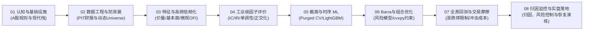
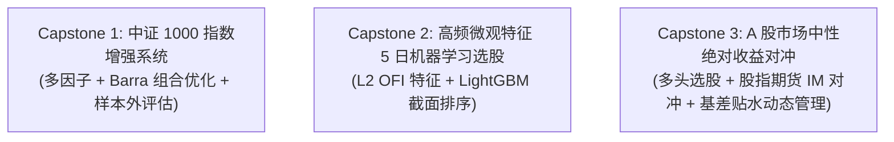

# 《现代 A 股量化投研实战：从数据、因子、AI 到指增实盘闭环》课程体系大纲

> **受众定位**：具备 Python 基础（熟悉基础语法、函数与常用数据结构），渴望掌握买方/私募级量化投研闭环的开发者、金融工程学生与量化进阶者。  
> **核心原则**：**明确示例边界，贴合 A 股研究场景，验证时点一致性，逐步贯通工程流程。**  
> **现代技术栈**：Python 3.11+、Polars（高性能时序与截面处理）、DuckDB（极速本地分析）、cvxpy（凸优化）、LightGBM/CatBoost（表格时序建模）。

> **当前进度**：第 1–31 讲已有基础正文及可运行示例，正在逐章深化。第 1 讲已恢复至本次细化前的版本；深化方案尚待调整。学习目标与前置知识见[学习路径](./learning_path.md)，阅读材料见[公开资源导读](./resources.md)，运行方法见[项目说明](./README.md)。

---

## 课程全景路线图

---

## 第一模块：认知重塑与现代化量化工程栈（4讲）

### 第 1 讲：A 股量化生态与盈利模式全景
- **量化在 A 股赚什么钱**：从早期的“小市值暴利”到当下的“中证1000/2000指增”、“量化中性”、“高频T0”与“宏观CTA”。
- **主流机构策略谱系**：
  - 指数增强（Index Enhancement）：中证500、中证1000、A500 超额 Alpha 来源。
  - 市场中性（Market Neutral）：股指期货（IF/IC/IM）对冲逻辑与基差贴水成本。
- **A 股独特交易制度与边界约束**：
  - T+1 制度对日内换手与隔夜风险的影响。
  - 涨跌停限制（主板 ±10%，双创板 ±20%，北交所 ±30%）。
  - 印花税与融券受限机制（做空工具的稀缺性）。

### 第 2 讲：量化回测的“四大死因”与防范心法
- **前瞻偏差（Lookahead / Future Bias）**：
  - 案例剖析：在 10 月 15 日用三季报财报数据做回测为什么是致命错误？
  - 日内最高价/最低价引入的未来信息泄漏。
- **幸存者偏差（Survivorship Bias）**：已退市、暂停上市股票在历史回测中的“人间蒸发”陷阱。
- **不可成交陷阱**：一字涨停买入、跌停板卖出带来的虚高胜率。
- **过拟合与数据窥探（Data Snooping / P-Hacking）**：参数过多的虚假夏普比率。

### 第 3 讲：告别缓慢的传统栈：现代量化工程环境搭建
- **包管理工具**：基于 `uv` / `pixi` 的极速现代 Python 环境管理。
- **为什么不再只用 Pandas**：
  - Polars 在截面多因子计算中的表达式与并行能力；通过结果一致性检查和实测比较性能。
  - DuckDB 嵌入式 OLAP 数据库：秒级聚合百万级股票时序与财报数据。
- **存储方案设计**：从 CSV 迁移到分区 Parquet 格式，构建轻量高效的本地数据湖。

### 第 4 讲：A 股多源数据接入与本地落库实战
- **免费与商用数据源对比**：Tushare Pro、AkShare、Baostock 与商业级 Choice/Wind/通达信数据源接入。
- **数据同步与本地管道构建**：
  - 日频 Bar、复权因子、指数成分股历史权重、交易日历的自动化抓取与校验。
  - **实操产出**：搭建一个轻量级、自动化更新的 A 股本地 Parquet 基础数据库。

---

## 第二模块：数据工程与无泄漏清洗（PIT 基石）（4讲）

### 第 5 讲：行情数据复权与动态股票池（Universe）构建
- **复权机制深潜**：前复权 vs 后复权的区别与适用场景（因子计算用后复权，回测成交与价格用真实行情）。
- **动态 Universe 过滤标准**：
  - 剔除次新股（上市前 N 天不参与交易）。
  - 剔除 ST / *ST 及退市风险整理期个股。
  - 处理盘中临时停牌与全天停牌股票。
- **代码实现**：构建随时间滚动的有效交易标的池掩码矩阵（Trading Mask）。

### 第 6 讲：Point-in-Time (PIT) 财报数据的正确处理
- **财报三大核心时间戳**：报告期（Period End Date）、实际公告披露日（Notice Date）、更正公告日（Revision Date）。
- **PIT 数据对齐算法**：
  - 确保任意历史回测时点 $t$，策略只能“看到”在 $t$ 日之前已经披露的最新财报。
  - 解决一季报、中报、三季报、年报交叉披露期的时序错位问题。
- **实操代码**：明确 `join_asof` 的适用条件，并按可用时刻、报告期和版本实现财报对齐。

### 第 7 讲：行业分类演变与概念标签维护
- **行业分类体系**：申万一级/二级行业、中信行业的分类逻辑。
- **行业分类的变更历史**：处理行业重新划分对历史因子的冲击。
- **概念板块数据治理**：概念轮动与主题暴露的定量标记。

### 第 8 讲：【动手实操】手写一个高性能 A 股 PIT 数据检索引擎
- **需求目标**：输入日期 `2024-03-01` 与股票列表，返回该交易日收盘后的量价特征、当时可用的财报指标与行业掩码，并验证数据边界。
- **单元测试**：针对未来函数注入模拟测试（Lookahead Leakage Testing），确保代码健壮性。

---

## 第三模块：特征工程与经典/微观因子挖掘（5讲）

### 第 9 讲：经典量价因子库工程化实现
- **动量与反转类**：经典时序动量、截面动量、短期反转（A 股 5 日 / 20 日反转效应分析）。
- **波动与极端收益类**：历史波动率、特异质波动率（Idiosyncratic Volatility）、最大日收益（MAX 异象）。
- **流动性与换手类**：Amihud 非流动性指标、超额换手率、量价背离系数。
- **代码规范**：用 Polars 表达式向量化计算 20+ 个经典量价因子，彻底摒弃慢速 `for` 循环。

### 第 10 讲：基本面与分析师预期因子
- **价值与盈利能力**：EP（市盈率倒数）、BP（市净率倒数）、ROE 拆解（杜邦分析体系）。
- **成长与财务质量**：SUE（标准化意外盈利）、营收同比增速、经营性现金流占净利润比重。
- **分析师预期因子**：预期评级调高、预期净利润上修动量（若使用另类数据）。

### 第 11 讲：高频数据低频化特征工程（买方核心超额来源）
- **高频微观结构视角**：从日内 Level-2 快照中提炼中低频 Alpha。
- **订单流不平衡（Order Flow Imbalance, OFI）**：
  - 买一卖一挂单量变化与价格变动关系。
  - 日内 OFI 的低频聚合（日频/周频累计）。
- **日内量价微观模式**：
  - 聪明钱因子（Smart Money Indicator）：基于日内小单与大单的成交 VWAP 差异。
  - 开盘后 30 分钟与尾盘 30 分钟量能集中度特征。

### 第 12 讲：因子预处理工业级四步法
- **Step 1: 去极值（Winsorization）**：3-Sigma 法 vs 绝对中位数偏差（MAD）法。
- **Step 2: 缺失值填充与处理**：行业中位数填补 vs 截面剔除。
- **Step 3: 标准化（Standardization）**：Z-Score 截面标准化。
- **Step 4: 行业与市值中性化（Neutralization）**：
  - 为什么必须中性化？（去除行业 Beta 与小市值非意图暴露）。
  - 基于加权最小二乘法（WLS）的截面残差提取实战。

### 第 13 讲：因子正交化与共线性消除
- **多重共线性危害**：因子间高度相关导致组合权重失真与过拟合。
- **对称正交化（Symmetric Orthogonalization）**：保持因子原始经济含义的最大化保留。
- **施密特正交化（Gram-Schmidt）**：指定基准因子优先级的逐步剥离法。
- **实战产出**：核对正交和中性化约束，并解释变换如何改变特征含义；正交性不证明预测能力。

---

## 第四模块：工业级因子评估体系（4讲）

### 第 14 讲：因子预测力核心指标（IC / Rank IC / ICIR）
- **IC（Information Coefficient）与 Rank IC 的数学原理**：皮尔逊相关系数 vs 斯皮尔曼秩相关系数。
- **ICIR 与 t 统计量**：评估因子的稳定性与置信度。
- **证据标准**：结合效应大小、样本长度、自相关、多次试验和样本外表现评价，不使用通用 IC/ICIR 优秀门槛。

### 第 15 讲：分层回测与单调性检验
- **分组收益测试法（Quantile Portfolio Analysis）**：
  - 将股票按因子值分为 5 组或 10 组，计算各组净值曲线。
  - 单调性检验：单调递增/递减评分，防止中间组非单调震荡。
- **多空对冲收益（Long-Short Spread）**：
  - Top 组减去 Bottom 组的多空年化收益与最大回撤。
  - 多头超额（Top 组跑赢基准）与空头贡献分离评估。

### 第 16 讲：因子换手率与衰减曲线（Alpha Decay）
- **因子自相关性与换手率预估**：自相关系数越高，未来调仓换手率越低。
- **因子衰减曲线绘制**：
  - 测算因子在滞后 1 天、3 天、5 天、10 天、20 天后的 IC 衰减速度。
  - 确定策略最佳调仓周期（日频、3日频还是周频？）。

### 第 17 讲：【实战避坑】假因子的“打脸”排查案例
- **案例 1**：一个看似 Rank IC 高达 0.12 的“超强因子”，为什么中性化后收益荡然无存？（暴露了微盘股市值溢价）。
- **案例 2**：高夏普策略在实盘中完全买不进（涨停打板幸存者陷阱）。

---

## 第五模块：截面排序与时序机器学习建模（5讲）

### 第 18 讲：金融时序交叉验证（CV）的正确切法
- **为什么普通 K-Fold 是灾难**：时序自相关导致的严重数据外泄。
- **Purged Group Time Series Split**：
  - 设定评估隔离期（Purging）与预测重叠缓冲区（Embargoing）。
  - 组合式清洗交叉验证（Combinatorial Purged Cross-Validation, CPCV）原理与代码。

### 第 19 讲：表格级梯度提升树（LightGBM / CatBoost）实战
- **目标函数选择**：
  - 回归目标（Regression MSE/Huber）：预测未来 N 日收益率。
  - 排序目标（LambdaMART / RankPairwise）：直接预测截面相对排名。
- **特征工程与样本构造**：
  - 样本标签去极值与截面排名归一化。
  - 滚窗训练（Walk-forward Retraining）机制设计。

### 第 20 讲：树模型抗过拟合与特征解释性
- **正则化调优实战**：学习率、叶子节点数、特征随机采样比例（`feature_fraction`）。
- **SHAP 值特征归因**：分析具体因子在不同行情环境下对模型决策的边际贡献。
- **对抗验证（Adversarial Validation）**：检测训练集与测试集是否存在显著分布漂移（Distribution Shift）。

### 第 21 讲：深度学习在 A 股选股中的适用边界
- **时序深度模型**：LSTM / GRU vs 1D-CNN vs Temporal Transformer 在截面排序中的表现评测。
- **“维度灾难”与噪声信噪比陷阱**：为什么复杂深度学习往往在实盘中跑输精细特征工程加持的 LightGBM？
- **深度模型最佳实践**：作为特征提取器生成低维嵌入（Embedding），而非端到端直接预测仓位。

### 第 22 讲：【实战】从多因子截面打分到全自动选股流水线
- **输入契约**：已完成时点对齐的特征面板、成熟标签和交易日历。
- **时间隔离**：训练、验证、收益校准与最终测试分别处理。
- **排序到收益**：用样本外成熟标签校准排序分数，输出可供组合优化的持有期预期收益。
- **执行衔接**：收盘目标权重与下一交易时段的实际成交分开，空目标也保留明确语义。
- **扩展边界**：LLM/Agent 投研作为未来可选专题，不再误列为本讲已实现功能。

---

## 第六模块：Barra 风险模型与现代组合优化（4讲）

### 第 23 讲：A 股 Barra 结构化风险模型精讲
- **多因子风险模型底层原理**：将股票总风险拆解为行业风险、风格风险与特异风险。
- **A 股 10 大核心风格因子构建**：Size（市值）、Beta、Momentum（动量）、Volatility（波动）、Non-linear Size（中盘）、Value（价值）、Liquidity（流动性）等。
- **因子暴露度矩阵 $X$ 的规范化处理**。

### 第 24 讲：cvxpy 指数增强组合优化
- **目标函数**：持有期收益、风险惩罚和组合约束的量纲对齐。
- **约束**：预算、行业、风格、个股权重和年化跟踪误差硬上限。
- **求解检查**：读取问题状态、检查残差，处理不可行和数值误差。
- **深化方向**：凸性、对偶与约束敏感性的直觉和手算案例。

### 第 25 讲：换手率约束与交易成本惩罚项引入
- **交易成本**：线性税费与基于 AUM/ADV 的非线性冲击项。
- **换手约束**：区分换手上限和惩罚，按真实交易金额解释参数。
- **风险预算**：持有期收益与年化风险的转换，成本/风险/换手之间的权衡。
- **实验**：不同换手预算下的净收益情景与可行性检查，不预设最优参数。

### 第 26 讲：风险平价（Risk Parity）与层级风险平价（HRP）
- **非基准型配置模型**：当不追求相对指数超额，而追求全天候绝对收益时的组合解法。
- **分层风险平价（Hierarchical Risk Parity）**：基于图聚类的资产权重分配，规避矩阵求逆数值不稳定问题。

---

## 第七模块：严苛全真回测与执行摩擦建模（3讲）

### 第 27 讲：A 股回测引擎架构：向量化 vs 事件驱动
- **两套回测框架的权衡**：
  - 向量化回测（Vectorized Backtest）：速度极快，用于前期数千个因子及策略的粗筛。
  - 事件驱动回测（Event-Driven Backtest）：逐日/逐笔状态机推进，用于精细仿真成交与风控。
- **架构设计**：手写一个支持持仓簿（Position Ledger）、订单簿（Order Registry）与现金流跟踪的极简事件驱动引擎。

### 第 28 讲：真实交易摩擦全真模拟
- **逐笔费用**：按可配置税费、最低佣金和冲击参数计算；历史费率与账户合同由外部按生效日期提供。
- **滑点与冲击成本（Market Impact）模型**：
  - 固定跳数滑点（Fixed Tick Slippage）。
  - 基于平方根法则（Square-root Law）的市场冲击模型：冲击成本与订单占日均成交量（ADV）比例的关系。
- **容量情景测算**：统一单边年换手、每日订单与双边成本口径，保留负利润；网格结果不等于实盘容量。

### 第 29 讲：A 股特殊撮合规则代码级实现
- **涨跌停无法成交判定**：
  - 买入开盘触及涨停价时保守拒单，不读取当日最终高低收盘价。
  - 卖出开盘触及跌停价时保守拒单，实际未成交持仓继续估值；其他订单受开盘可成交量约束。
- **停牌与分红送转处理**：
  - 停牌期间不可调仓，被动成为死仓。
  - 登记日冻结权益，除权日确认应收与送股，现金支付日和股份上市日分别结算。

---

## 第八模块：绩效归因、监控与风控看板（2讲）

### 第 30 讲：业绩归因实战：赚的是 Beta 还是纯 Alpha？
- **Brinson 绩效归因模型**：资产配置收益（Allocation）、个股选择收益（Selection）与交叉收益（Interaction）。
- **Barra 因子损益归因**：
  - 拆解行业、风格、股票未解释残差、现金和费用，并核对净主动收益；残差不等于已证明的纯 Alpha。
- **输出单期归因表与闭合误差**；期内交易及多期链接需另行处理。

### 第 31 讲：实盘运行监控与风控预警看板
- **策略健康度监测指标**：
  - 滚动年化跟踪误差（Tracking Error）与目标 TE 检查。
  - 风格漂移检验：实际持仓风格暴露是否击穿风控阈值。
  - 从初始净值 1 计算相对净值回撤，持久于进程内的分级状态、滞回与显式复位；控制输出接入执行层。
- **特征分布预警（PSI 指标）**：监测输入分布和缺失/NaN，不能单独证明概念漂移或决定重训。

---

## 贯穿全课程的毕业项目方向（待完成的综合作业）

以下是研究与工程练习目标，不是仓库已经交付的三套生产系统。阶段划分与评分标准见[学习路径](./learning_path.md#_7-三个阶段项目及评分方式)。

### 项目 1：中证 1000 指数增强端到端系统
- **目标**：以中证 1000 指数为基准，构建多因子指增策略，以年化跟踪误差 5% 作为示例风险预算，报告扣费后样本外超额、回撤和稳定性，不预设可实现的收益水平。
- **产出**：
  1. PIT 动态 Universe 与基础特征计算脚本；
  2. 行业与市值严格中性化的优化器配置；
  3. 扣除真实交易摩擦后的专业回测与 Barra 归因报告。

### 项目 2：基于高频微观结构特征的 A 股 5 日 LightGBM 选股策略
- **目标**：融合日线量价、基本面以及 Level-2 快照提取的日内微观特征（OFI、聪明钱指标），训练 LightGBM 模型预测未来 5 日收益。
- **产出**：
  1. 高频特征低频化提取模块；
  2. Purged Time-Series CV 调优模型；
  3. SHAP 因子重要性解释看板与实战分层收益图。

### 项目 3：A 股市场中性策略与对冲风险研究
- **目标**：构造股票多头与股指期货对冲情景，记录估计 Beta、剩余暴露、基差、保证金及流动性风险，不承诺完全对冲或正收益。
- **产出**：
  1. 股指期货展期与基差贴水（Basis Discount）成本测算模块；
  2. 极端下行风险监控与杠杆比例控制；
  3. QMT 仿真环境模拟下单与成交对账脚本。
